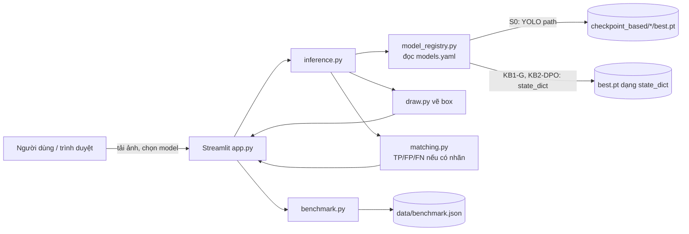
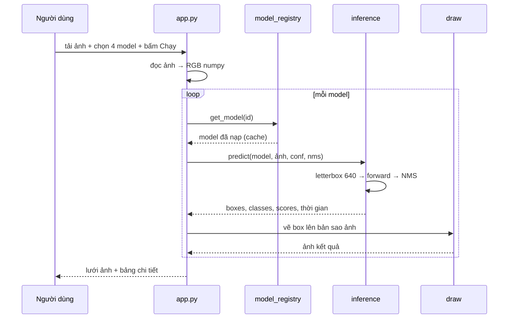

# Thiết kế web demo RL-YOLO

> Mục đích file: hình dung web trông thế nào, chạy ra sao, cần những gì, làm theo thứ tự nào.
> Chưa có code. Code sẽ đặt cùng thư mục này (`do_an/web/`).

## Mục lục

1. [Mục tiêu và người dùng](#1-mục-tiêu-và-người-dùng)
2. [Danh sách chức năng](#2-danh-sách-chức-năng)
3. [Kiến trúc và công nghệ](#3-kiến-trúc-và-công-nghệ)
4. [Giao diện từng trang (wireframe)](#4-giao-diện-từng-trang-wireframe)
5. [Web hoạt động thế nào: luồng từng bước](#5-web-hoạt-động-thế-nào-luồng-từng-bước)
6. [Kịch bản demo trước hội đồng](#6-kịch-bản-demo-trước-hội-đồng)
7. [Dữ liệu web cần](#7-dữ-liệu-web-cần)
8. [Chi tiết kỹ thuật quan trọng](#8-chi-tiết-kỹ-thuật-quan-trọng)
9. [Cấu trúc thư mục code](#9-cấu-trúc-thư-mục-code)
10. [Kế hoạch làm theo buổi](#10-kế-hoạch-làm-theo-buổi)
11. [Checklist nghiệm thu](#11-checklist-nghiệm-thu)
12. [Rủi ro và cách xử lý](#12-rủi-ro-và-cách-xử-lý)

---

## 1. Mục tiêu và người dùng

**Mục tiêu:** cho người xem *thấy tận mắt* sự khác nhau giữa model gốc (S0) và các model đã tối ưu (KB1, KB2, KB3), đồng thời xem lại toàn bộ benchmark của đồ án ở một chỗ.

| Người dùng | Họ muốn gì |
|---|---|
| Hội đồng / giảng viên | Thấy model chạy thật, hiểu nhanh kết quả, so sánh trực quan |
| Bạn (người làm) | Công cụ để kiểm tra model, lấy hình minh họa cho báo cáo |
| Người dùng cuối (giả định) | Tải ảnh lá, biết lá bị bệnh gì |

**Không làm trên web:** train model, chọn cấu hình bằng tập test, sửa số liệu benchmark. Web chỉ **suy luận** (inference) và **hiển thị** kết quả đã có.

---

## 2. Danh sách chức năng

### 2.1. Bắt buộc (MVP)

| # | Chức năng | Mô tả |
|---|---|---|
| F1 | Tải ảnh | Kéo-thả hoặc chọn file JPG/PNG; có sẵn 6–8 ảnh mẫu để bấm thử |
| F2 | Chọn model | Chọn 1–4 model, ví dụ: YOLO11n S0, YOLO11n KB1-G, YOLOv8n S0, YOLOv8n KB2-DPO |
| F3 | Chạy nhận diện | Vẽ bounding box + tên lớp + confidence lên ảnh |
| F4 | So sánh cạnh nhau | Hiển thị kết quả các model thành lưới 2×2 hoặc 1×N |
| F5 | Bảng chi tiết | Mỗi model: số box, danh sách lớp phát hiện, confidence, thời gian chạy (ms) |
| F6 | Thanh trượt ngưỡng | Ngưỡng confidence (mặc định 0,25) và NMS IoU (mặc định 0,60) |
| F7 | Dashboard benchmark | Bảng + biểu đồ mAP của KB1/KB2/KB3 đọc từ file số liệu |

### 2.2. Nên có

| # | Chức năng | Mô tả |
|---|---|---|
| F8 | Đối chiếu với nhãn thật | Tải kèm file `.txt` YOLO → tô màu TP (xanh lá), FP (đỏ), FN (vàng, nét đứt); tính P/R/F1 cho ảnh đó |
| F9 | Phân tích theo lớp | Biểu đồ thay đổi AP/recall theo 28 lớp (KB2 audit) |
| F10 | Trang phương pháp | Sơ đồ S0 → KB1/KB2/KB3, công thức chính, giải thích ngắn |
| F11 | Tải kết quả | Tải ảnh đã vẽ box và file JSON kết quả |

### 2.3. Nâng cao (nếu còn thời gian)

| # | Chức năng |
|---|---|
| F12 | Chạy nhiều ảnh một lúc (thư mục/zip) và tổng hợp |
| F13 | Thông tin bệnh: mỗi lớp có mô tả ngắn và gợi ý xử lý |
| F14 | Webcam / chụp ảnh trực tiếp |
| F15 | Triển khai online (Hugging Face Spaces hoặc máy chủ trường) |

---

## 3. Kiến trúc và công nghệ

### 3.1. Lựa chọn: Streamlit

| Tiêu chí | Streamlit (chọn) | FastAPI + React |
|---|---|---|
| Ngôn ngữ | Chỉ Python | Python + JavaScript |
| Thời gian làm MVP | ~4–6 buổi | ~10–15 buổi |
| Gọi code dự án | Trực tiếp | Qua API |
| Đẹp/chuyên nghiệp | Đủ cho demo | Tự do hơn |

Nếu hội đồng yêu cầu tách frontend/backend thì giữ nguyên `inference.py`, `benchmark.py` và bọc thêm FastAPI sau.

### 3.2. Sơ đồ khối



### 3.3. Thư viện

`streamlit`, `ultralytics==8.4.163` (đúng bản dự án), `torch`, `opencv-python`, `pillow`, `pandas`, `plotly` (biểu đồ), `pyyaml`.

---

## 4. Giao diện từng trang (wireframe)

Thanh bên trái (sidebar) cố định ở mọi trang:

```
┌──────────────────────┐
│ 🌿 RL-YOLO Demo      │
│──────────────────────│
│ ▸ Trang chủ          │
│ ▸ So sánh trên ảnh   │
│ ▸ Đối chiếu nhãn     │
│ ▸ Benchmark          │
│ ▸ Phương pháp        │
│ ▸ Dữ liệu            │
│──────────────────────│
│ Thiết bị: CUDA ✓     │
│ Model đã nạp: 3/6    │
└──────────────────────┘
```

### 4.1. Trang chủ

```
┌───────────────────────────────────────────────────────────────────────┐
│  PHÁT HIỆN BỆNH LÁ CÂY VỚI YOLO VÀ CÁC KỸ THUẬT LẤY CẢM HỨNG TỪ RL    │
│  Đồ án tốt nghiệp — <Tên bạn> — <GVHD>                                │
├───────────────────────────────────────────────────────────────────────┤
│   ┌──────────────┐  ┌──────────────┐  ┌──────────────┐  ┌───────────┐ │
│   │ 28 lớp       │  │ 3.129 ảnh    │  │ 7 model YOLO │  │ 3 kịch bản│ │
│   │ lá khỏe/bệnh │  │ 2411/479/239 │  │ v5→YOLO26    │  │ KB1/2/3   │ │
│   └──────────────┘  └──────────────┘  └──────────────┘  └───────────┘ │
│                                                                       │
│   Kết quả nổi bật                                                     │
│   ┌─────────────────────────────────────────────────────────────────┐ │
│   │ KB1  YOLO11n tốt nhất: test 37,77%  (S0 37,53%)    +0,23 điểm   │ │
│   │ KB1  Tăng lớn nhất:   YOLOv8s       +1,41 điểm                  │ │
│   │ KB2  YOLOv8n DPO: val 37,81% → 38,25%  (+0,44)  P↑  R↓          │ │
│   │ KB3  TPE: chưa vượt S0 (2/8 trial)                              │ │
│   └─────────────────────────────────────────────────────────────────┘ │
│                                                                       │
│        [ ▶ Thử nhận diện ngay ]        [ 📊 Xem benchmark ]           │
└───────────────────────────────────────────────────────────────────────┘
```

### 4.2. So sánh trên ảnh (trang chính của demo)

```
┌───────────────────────────────────────────────────────────────────────┐
│ SO SÁNH MODEL TRÊN ẢNH                                                │
├──────────────────────────────┬────────────────────────────────────────┤
│ 1. Chọn ảnh                  │ 2. Chọn model (tối đa 4)               │
│ ┌──────────────────────────┐ │ ☑ YOLO11n — S0 (supervised)            │
│ │   Kéo thả ảnh vào đây    │ │ ☑ YOLO11n — KB1 Guided                 │
│ │   hoặc [Chọn file]       │ │ ☑ YOLOv8n — S0 (supervised)            │
│ └──────────────────────────┘ │ ☑ YOLOv8n — KB2 DPO                    │
│ Ảnh mẫu:                     │ ☐ YOLO26n — S0                         │
│ [🍅][🌽][🥔][🍎][🍇][🫑]      │ ☐ YOLO26n — KB1 Guided                 │
│                              │                                        │
│ 3. Ngưỡng                    │                                        │
│ Confidence ──●────── 0,25    │                                        │
│ NMS IoU    ────●──── 0,60    │        [ 🔍 Chạy nhận diện ]           │
├──────────────────────────────┴────────────────────────────────────────┤
│ KẾT QUẢ                                                               │
│ ┌──────────────────────────────┐  ┌──────────────────────────────┐    │
│ │ YOLO11n — S0                 │  │ YOLO11n — KB1 Guided         │    │
│ │  ┌──────────┐                │  │  ┌──────────┐                │    │
│ │  │Tomato late│ 0.71          │  │  │Tomato late│ 0.78          │    │
│ │  │ blight    │               │  │  │ blight    │               │    │
│ │  └──────────┘   ┌───────┐    │  │  └──────────┘   ┌───────┐    │    │
│ │                 │Tomato │0.32│  │                 │Tomato │0.41│    │
│ │                 │ leaf  │    │  │                 │ leaf  │    │    │
│ │                 └───────┘    │  │                 └───────┘    │    │
│ │ 2 box · 14 ms                │  │ 2 box · 15 ms                │    │
│ └──────────────────────────────┘  └──────────────────────────────┘    │
│ ┌──────────────────────────────┐  ┌──────────────────────────────┐    │
│ │ YOLOv8n — S0                 │  │ YOLOv8n — KB2 DPO            │    │
│ │  ... 3 box · 12 ms           │  │  ... 2 box · 12 ms           │    │
│ └──────────────────────────────┘  └──────────────────────────────┘    │
│                                                                       │
│ BẢNG CHI TIẾT                                                         │
│ ┌──────────────────┬──────┬───────────────────────────┬───────┬─────┐ │
│ │ Model            │ Box  │ Lớp phát hiện             │ Conf TB│ ms │ │
│ ├──────────────────┼──────┼───────────────────────────┼───────┼─────┤ │
│ │ YOLO11n S0       │ 2    │ Tomato leaf late blight…  │ 0,52  │ 14  │ │
│ │ YOLO11n KB1-G    │ 2    │ Tomato leaf late blight…  │ 0,60  │ 15  │ │
│ │ YOLOv8n S0       │ 3    │ … + Tomato leaf (0,27)    │ 0,44  │ 12  │ │
│ │ YOLOv8n KB2-DPO  │ 2    │ …                         │ 0,58  │ 12  │ │
│ └──────────────────┴──────┴───────────────────────────┴───────┴─────┘ │
│ 💡 Gợi ý đọc: KB2-DPO thường báo ít box hơn S0 (precision ↑, recall ↓)│
│ [⬇ Tải ảnh kết quả] [⬇ Tải JSON]                                      │
└───────────────────────────────────────────────────────────────────────┘
```

(Số trên hình chỉ là ví dụ minh họa, không phải kết quả thật.)

### 4.3. Đối chiếu với nhãn thật

```
┌───────────────────────────────────────────────────────────────────────┐
│ ĐỐI CHIẾU VỚI NHÃN THẬT                                               │
│ Ảnh: [anh_001.jpg]   Nhãn YOLO: [anh_001.txt]   Model: [YOLOv8n S0 ▾] │
│ Hoặc: [Lấy ngẫu nhiên 1 ảnh từ tập validation]                        │
├───────────────────────────────────────────────────────────────────────┤
│   ┌───────────────────────────────────────┐   Chú thích               │
│   │   ┏━━━━━━━━┓  (xanh)  TP IoU 0.84     │   ■ xanh: TP (đúng)       │
│   │   ┃        ┃                          │   ■ đỏ:   FP (báo nhầm)   │
│   │   ┗━━━━━━━━┛        ┌ ─ ─ ─ ┐ (vàng)  │   ┅ vàng: FN (bỏ sót)     │
│   │                     │  FN   │         │                           │
│   │     ┌──────┐(đỏ)    └ ─ ─ ─ ┘         │   Ảnh này:                │
│   │     │  FP  │                          │   GT: 4  · Pred: 4        │
│   │     └──────┘                          │   TP 3 · FP 1 · FN 1      │
│   └───────────────────────────────────────┘   P 75% · R 75% · F1 75%  │
│                                                                       │
│ ┌────┬──────────────────────────┬───────────────┬──────┬──────┐       │
│ │ #  │ Lớp                      │ Kết quả       │ IoU  │ Conf │       │
│ ├────┼──────────────────────────┼───────────────┼──────┼──────┤       │
│ │ 1  │ Tomato leaf late blight  │ TP            │ 0,84 │ 0,78 │       │
│ │ 2  │ Tomato leaf              │ FP (sai lớp)  │ 0,61 │ 0,33 │       │
│ │ 3  │ Tomato leaf late blight  │ FN            │  —   │  —   │       │
│ └────┴──────────────────────────┴───────────────┴──────┴──────┘       │
│ [So sánh 2 model trên ảnh này]                                        │
└───────────────────────────────────────────────────────────────────────┘
```

Matching dùng đúng quy tắc của dự án: cùng lớp, IoU ≥ 0,5, một-một, xét theo confidence giảm dần.

### 4.4. Benchmark (3 tab)

```
┌───────────────────────────────────────────────────────────────────────┐
│ BENCHMARK        [ KB1 ] [ KB2 ] [ KB3 ] [ Tốc độ & kích thước ]      │
├───────────────────────────────────────────────────────────────────────┤
│ TAB KB1 — test mAP50–95 (%)                 Chọn: (●) Test  ( ) Val   │
│                                                                       │
│  38 ┤                         ██▓                                     │
│  36 ┤          ██▓      ██▓   ██▓  ██▓                                │
│  34 ┤    ██▓   ██▓      ██▓   ██▓  ██▓   ██▓                          │
│  32 ┤ ██▓██▓   ██▓      ██▓   ██▓  ██▓   ██▓                          │
│  30 ┤ ██▓██▓   ██▓      ██▓   ██▓  ██▓   ██▓  ██▓                     │
│     └──v5s─v8n──v8s─────11n───11s──26n───DP──                         │
│       █ S0   ▓ KB1-G                                                  │
│                                                                       │
│  Bảng: Model | S0 | S1 | G | G−S0 | G−S1          (có tô màu +/−)     │
│                                                                       │
│  Ablation (YOLO11n, YOLOv8s):                                         │
│  G−S0  ████████████████ +1,43 (v8s)                                   │
│  G−R   ███████████ +1,03                                              │
│  G−S1  ███ +0,32                                                      │
│  G−P   ▏ −0,05                                                        │
│  💬 Kết luận: lợi ích chủ yếu từ fine-tune thêm + proxy; reward riêng nhỏ│
├───────────────────────────────────────────────────────────────────────┤
│ TAB KB2 — YOLOv8n, validation, 3 seed                                 │
│  ┌──────────┬────────┬────────┬────────┐                              │
│  │ Metric   │ S0     │ DPO    │ Δ      │                              │
│  │ mAP50–95 │ 37,81  │ 38,25  │ +0,44  │                              │
│  │ Precision│ 50,90  │ 57,48  │ +6,58  │                              │
│  │ Recall   │ 54,05  │ 51,03  │ −3,02  │                              │
│  └──────────┴────────┴────────┴────────┘                              │
│  Biểu đồ: Δ tỉ lệ bỏ sót theo 28 lớp (cột ngang, sắp xếp)             │
│  ⚠ ~95% mức tăng mAP đến từ lớp "Corn Gray leaf spot" (14 GT)         │
├───────────────────────────────────────────────────────────────────────┤
│ TAB KB3 — TPE, YOLOv8n, validation                                    │
│  Biểu đồ điểm: trục x = lr0 (log), trục y = weight_decay (log),       │
│  màu = mAP; đường ngang = mốc S0 37,82%                               │
│  Bảng trial: # | mode | lr0 | wd | mAP50–95 | so S0                   │
└───────────────────────────────────────────────────────────────────────┘
```

### 4.5. Phương pháp

```
┌───────────────────────────────────────────────────────────────────────┐
│ PHƯƠNG PHÁP                                                           │
│                                                                       │
│     Pretrained COCO ─► Supervised ─► S0 ─┬─► KB1 Reward-guided ─► G   │
│                                          ├─► KB2 DPO ─────────► DPO   │
│                                          └─► (mốc) KB3 TPE ───► Trial*│
│                                                                       │
│ [▸ KB1] reward = TB_τ(0,25·P + 0,45·R + 0,30·IoU)                     │
│         L = 0,25 native + 0,10 reward + 0,25 proxy + 0,001 L2-SP      │
│ [▸ KB2] L = native + 0,01 · softplus(−0,1·Δ)                          │
│ [▸ KB3] TPE chọn (lr0, wd); PPO (thiết kế) đổi HP mỗi 5 epoch         │
│ (mỗi mục mở ra giải thích 3–5 câu + hình minh họa)                    │
└───────────────────────────────────────────────────────────────────────┘
```

### 4.6. Dữ liệu

Lưới 28 thẻ, mỗi thẻ: ảnh ví dụ, tên lớp tiếng Anh + tiếng Việt, số box train/val/test. Biểu đồ phân bố số box theo lớp.

---

## 5. Web hoạt động thế nào: luồng từng bước

### 5.1. Khi mở web

```
streamlit run do_an/web/app.py
   │
   ├─ đọc models.yaml          → danh sách model (chưa nạp trọng số)
   ├─ đọc data/benchmark.json  → số liệu cho dashboard
   ├─ kiểm tra CUDA            → hiện "CUDA ✓" hoặc "CPU"
   └─ hiển thị Trang chủ
```

Model **chỉ nạp khi lần đầu được chọn** (lazy loading), sau đó giữ trong bộ nhớ (`st.cache_resource`) để lần sau chạy ngay.

### 5.2. Khi bấm "Chạy nhận diện"



### 5.3. Khi có nhãn thật

```
ảnh + file .txt
   ├─ đổi nhãn cx,cy,w,h (chuẩn hóa) → xyxy pixel
   ├─ predict như 5.2
   ├─ matching.py: sắp prediction theo conf ↓, mỗi pred tìm GT cùng lớp chưa dùng
   │               có IoU lớn nhất; IoU ≥ 0,5 → TP, ngược lại FP; GT thừa → FN
   ├─ tính P, R, F1 của ảnh
   └─ vẽ: TP xanh, FP đỏ, FN vàng nét đứt
```

### 5.4. Trang benchmark

Không chạy model. Chỉ đọc `data/benchmark.json` → `pandas.DataFrame` → `plotly` vẽ. Vì vậy trang này **luôn chạy được kể cả khi chưa có checkpoint**.

---

## 6. Kịch bản demo trước hội đồng

Tổng thời gian ~3 phút.

| Thời điểm | Thao tác | Lời nói gợi ý |
|---|---|---|
| 0:00 | Mở Trang chủ | "Đề tài phát hiện 28 loại lá/bệnh, so sánh 7 model YOLO và 3 hướng tối ưu thêm." |
| 0:20 | Sang *So sánh trên ảnh*, bấm ảnh mẫu cà chua | "Đây là ảnh trong tập validation, model chưa từng thấy khi train." |
| 0:30 | Chọn YOLO11n S0 và YOLO11n KB1-G, bấm Chạy | "Bên trái là model gốc, bên phải là sau KB1. Confidence của box đúng tăng lên." |
| 1:00 | Thêm YOLOv8n S0 và KB2-DPO | "KB2 làm model thận trọng hơn: ít báo nhầm hơn nhưng có thể bỏ sót." |
| 1:30 | Sang *Đối chiếu nhãn*, lấy ảnh ngẫu nhiên | "Màu xanh là đúng, đỏ là báo nhầm, vàng là bỏ sót." |
| 2:00 | Sang *Benchmark*, tab KB1 | "Trên toàn tập test, KB1 cải thiện cả 7 model, nhiều nhất +1,41 điểm." |
| 2:30 | Tab KB2 | "DPO tăng mAP 0,44 nhưng giảm recall 3 điểm; phần lớn mức tăng ở một lớp." |
| 2:50 | Kết | "Web chỉ suy luận, số liệu benchmark lấy từ các lần đánh giá đã khóa." |

**Chuẩn bị trước buổi demo:** chọn sẵn 6–8 ảnh mà sự khác biệt giữa model *thấy rõ*, nhưng chọn từ validation chứ không phải test, và không nói ảnh đó "đại diện" cho toàn bộ kết quả.

---

## 7. Dữ liệu web cần

### 7.1. Checkpoint

Hiện **máy Windows này không có file `.pt` nào**. Cần chép từ máy Ubuntu về, ví dụ vào `D:\DoAn\weights\`.

| Model ID | Nguồn trong dự án | Định dạng |
|---|---|---|
| `yolo11n_s0` | `kb1_reward_guided_training/checkpoint_based/yolov11n/weights/best.pt` | Ultralytics đầy đủ |
| `yolo11n_kb1g` | `kb1_reward_guided_training/checkpoint_reward_guide_trainning/.../yolov11n/kb1b/.../best.pt` | `{'state_dict': ...}` |
| `yolov8n_s0` | `kb1_reward_guided_training/checkpoint_based/yolov8n/weights/best.pt` | Ultralytics đầy đủ |
| `yolov8n_kb2dpo` | `kb2_preference_optimization/outputs/<run seed 42>/.../best.pt` | `{'state_dict': ..., 'objective_version': ...}` |
| `yolo26n_s0`, `yolo26n_kb1g` | tương tự | như trên |

Ưu tiên MVP: **4 file** (YOLO11n S0, YOLO11n G, YOLOv8n S0, YOLOv8n DPO).

### 7.2. `models.yaml`

```yaml
weights_root: D:/DoAn/weights          # sửa theo máy
class_names: kb1_reward_guided_training/configs/pest.yaml

models:
  - id: yolo11n_s0
    label: "YOLO11n — S0 (supervised)"
    family: ultralytics
    checkpoint: yolov11n/s0_best.pt
    kind: full                          # nạp bằng YOLO(path)

  - id: yolo11n_kb1g
    label: "YOLO11n — KB1 Guided"
    family: ultralytics
    base: yolov11n/s0_best.pt           # dựng kiến trúc từ S0
    checkpoint: yolov11n/kb1g_seed43_best.pt
    kind: state_dict                    # rồi nạp state_dict vào

  - id: yolov8n_s0
    label: "YOLOv8n — S0 (supervised)"
    family: ultralytics
    checkpoint: yolov8n/s0_best.pt
    kind: full

  - id: yolov8n_kb2dpo
    label: "YOLOv8n — KB2 DPO"
    family: ultralytics
    base: yolov8n/s0_best.pt
    checkpoint: yolov8n/kb2_dpo_seed42_best.pt
    kind: state_dict
```

### 7.3. `data/benchmark.json` (rút từ báo cáo)

Số liệu trong `docs/report_final/` được chép một lần vào file này. Mỗi số ghi rõ nguồn.

```json
{
  "kb1_test_map5095": {
    "source": "docs/report_final/Report_KB1_15_10_2026.md, bảng 10 và 11",
    "split": "test",
    "rows": [
      {"model": "YOLOv5s",  "S0": 30.398, "G_mean_s43_s44": 31.261, "G_minus_S0": 0.863, "G_minus_S1": 0.235},
      {"model": "YOLOv8n",  "S0": 33.201, "G_mean_s43_s44": 33.561, "G_minus_S0": 0.359, "G_minus_S1": 0.305},
      {"model": "YOLOv8s",  "S0": 33.976, "G_mean_s43_s44": 35.387, "G_minus_S0": 1.412, "G_minus_S1": 0.377},
      {"model": "YOLO11n",  "S0": 37.534, "G_mean_s43_s44": 37.768, "G_minus_S0": 0.234, "G_minus_S1": 0.005},
      {"model": "YOLO11s",  "S0": 36.271, "G_mean_s43_s44": 36.442, "G_minus_S0": 0.172, "G_minus_S1": -0.453},
      {"model": "YOLO26n",  "S0": 33.357, "G_mean_s43_s44": 33.831, "G_minus_S0": 0.474, "G_minus_S1": 0.382},
      {"model": "DP-YOLO",  "S0": 28.913, "G_mean_s43_s44": 29.366, "G_minus_S0": 0.453, "G_minus_S1": 0.054}
    ]
  },
  "kb1_ablation_test_delta": {
    "source": "Report_KB1 bảng 14",
    "rows": [
      {"compare": "G-S0",    "YOLO11n": 0.301,  "YOLOv8s": 1.432},
      {"compare": "G-S1",    "YOLO11n": 0.210,  "YOLOv8s": 0.322},
      {"compare": "G-P",     "YOLO11n": 0.071,  "YOLOv8s": -0.050},
      {"compare": "G-R",     "YOLO11n": 0.194,  "YOLOv8s": 1.031},
      {"compare": "G-GnoSP", "YOLO11n": -0.000, "YOLOv8s": -0.000}
    ]
  },
  "kb2_yolov8n_val": {
    "source": "docs/report_final/KB2_MULTISEED_REVIEW_20261026.md",
    "split": "valid",
    "rows": [
      {"metric": "mAP50-95",  "S0": 37.8084, "DPO": 38.2523},
      {"metric": "mAP50",     "S0": 49.1157, "DPO": 49.3954},
      {"metric": "Precision", "S0": 50.8982, "DPO": 57.4824},
      {"metric": "Recall",    "S0": 54.0541, "DPO": 51.0334},
      {"metric": "F1",        "S0": 52.4287, "DPO": 54.0656},
      {"metric": "FP",        "S0": 984,     "DPO": 712.33},
      {"metric": "FN",        "S0": 867,     "DPO": 924.00}
    ],
    "per_class_csv": "docs/report_final/assets/kb2_20261028/validation_by_class.csv"
  },
  "kb3_tpe_yolov8n_val": {
    "source": "docs/report_final/Report_KB3_15_10_2026.md mục 13.2",
    "status": "2/8 trial tại 15/10/2026",
    "reference_S0": 37.8207,
    "trials": [
      {"trial": 0, "mode": "kb1_anchor",     "lr0": 0.01,         "wd": 0.0005,       "map5095": 36.0677},
      {"trial": 1, "mode": "startup_random", "lr0": 0.0056736819, "wd": 0.0005816137, "map5095": 37.7225}
    ]
  },
  "speed_size": {
    "source": "Report_KB1 bảng 19 (RTX 4060 Laptop, FP32, batch 16)",
    "rows": [
      {"model": "YOLOv5s", "params": 7085641,  "mib": 13.862, "fps": 55.89},
      {"model": "YOLOv8n", "params": 3016308,  "mib": 5.972,  "fps": 85.31},
      {"model": "YOLOv8s", "params": 11146436, "mib": 21.485, "fps": 44.17},
      {"model": "YOLO11n", "params": 2595300,  "mib": 5.230,  "fps": 80.79},
      {"model": "YOLO11s", "params": 9438628,  "mib": 18.303, "fps": 39.66},
      {"model": "YOLO26n", "params": 2514720,  "mib": 5.157,  "fps": 80.62},
      {"model": "DP-YOLO", "params": 6177161,  "mib": 12.511, "fps": 30.76}
    ]
  }
}
```

### 7.4. Ảnh mẫu

`do_an/web/samples/`: 6–8 ảnh từ **validation** kèm file `.txt`, mỗi loại cây một ảnh.

---

## 8. Chi tiết kỹ thuật quan trọng

### 8.1. Nạp checkpoint đúng định dạng

S0 nạp bình thường. KB1-G và KB2-DPO chỉ lưu `state_dict` của `DetectionModel` (xem [run_verified.py:276](../../kb1_reward_guided_training/run_verified.py#L276), [train_dpo.py:161](../../kb2_preference_optimization/train_dpo.py#L161)), nên phải dựng model từ S0 rồi nạp trọng số:

```python
import torch
from ultralytics import YOLO

def load_model(entry, root):
    if entry["kind"] == "full":
        return YOLO(f"{root}/{entry['checkpoint']}")
    yolo = YOLO(f"{root}/{entry['base']}")                    # kiến trúc + tên lớp từ S0
    saved = torch.load(f"{root}/{entry['checkpoint']}", map_location="cpu", weights_only=False)
    yolo.model.load_state_dict(saved["state_dict"], strict=True)  # strict: sai key là báo lỗi ngay
    return yolo
```

Lưu ý:
- `strict=True` để phát hiện nạp nhầm model (ví dụ trọng số v8n vào kiến trúc v8s).
- Checkpoint KB1 tạo trên Windows rồi dùng ở Ubuntu có thể cần `windows_checkpoint_paths()` trong [checkpoint_io.py](../../kb1_reward_guided_training/checkpoint_io.py); trên Windows thì không cần.
- **YOLO26:** adapter của dự án đặt `end2end = False` để dùng nhánh one-to-many + NMS (khi đánh giá). Web nên làm giống vậy cho cả S0 và G của YOLO26 để so công bằng.
- Chỉ load file `.pt` do chính dự án tạo (`weights_only=False` chạy được code pickle).

### 8.2. Thiết lập suy luận thống nhất

| Tham số | Giá trị | Lý do |
|---|---|---|
| `imgsz` | 640 | Giống train và evaluator |
| `conf` | 0,25 (chỉnh được) | Ngưỡng vận hành dùng khi báo P/R/F1 |
| `iou` (NMS) | 0,60 | Giống canonical evaluator |
| `max_det` | 300 | Giống canonical evaluator |
| `agnostic_nms` | False | NMS theo lớp |

Mọi model trong một lần so phải dùng **cùng** thiết lập.

### 8.3. Hiệu năng

- `st.cache_resource` giữ model; `st.cache_data` giữ benchmark.
- 4 model nano trên RTX 4060: mỗi ảnh vài chục ms. Trên CPU vẫn chạy được (vài trăm ms/model).
- Lần chạy đầu của mỗi model chậm hơn (khởi tạo CUDA) → hiển thị "đang nạp model…".

### 8.4. Xử lý lỗi

| Tình huống | Web hiển thị |
|---|---|
| Thiếu file checkpoint | Model bị làm mờ trong danh sách, ghi "chưa có checkpoint" |
| Sai định dạng/kích thước state_dict | Thông báo đỏ, nêu model ID; không dừng các model khác |
| Ảnh hỏng/không đọc được | "Không đọc được ảnh" |
| File nhãn sai định dạng | Chỉ ra dòng lỗi |
| Không có GPU | Tự chuyển CPU, ghi chú ở sidebar |

### 8.5. Phạm vi model

Bản đầu chỉ hỗ trợ họ Ultralytics (v8, 11, 26). YOLOv5s và DP-YOLO cần repo `yolov5` và adapter riêng → để giai đoạn nâng cao, trên trang benchmark vẫn có số liệu của chúng.

---

## 9. Cấu trúc thư mục code

```
do_an/web/
├── THIET_KE_WEB.md          ← file này
├── app.py                   ← điểm vào Streamlit, sidebar, điều hướng
├── pages/
│   ├── 1_So_sanh_anh.py
│   ├── 2_Doi_chieu_nhan.py
│   ├── 3_Benchmark.py
│   ├── 4_Phuong_phap.py
│   └── 5_Du_lieu.py
├── core/
│   ├── model_registry.py    ← đọc models.yaml, nạp + cache model
│   ├── inference.py         ← predict, đo thời gian, trả dict chuẩn
│   ├── draw.py              ← vẽ box, màu theo lớp hoặc theo TP/FP/FN
│   ├── matching.py          ← ghép pred–GT, tính P/R/F1 một ảnh
│   └── benchmark.py         ← đọc benchmark.json → DataFrame, hàm vẽ biểu đồ
├── models.yaml
├── data/
│   ├── benchmark.json
│   └── class_info.json      ← tên tiếng Việt, mô tả bệnh (F13)
├── samples/                 ← ảnh mẫu + nhãn
├── tests/
│   └── test_matching.py     ← kiểm tra matching bằng ví dụ tay
└── requirements.txt
```

Chạy: `.\.venv\Scripts\python.exe -m streamlit run do_an\web\app.py`

---

## 10. Kế hoạch làm theo buổi

Mỗi buổi 1h30. Nên làm **sau** khi học xong buổi 6 của file kiến thức (đã hiểu IoU, NMS, metric).

| Buổi | Việc | Kết quả kiểm tra được |
|---|---|---|
| W1 | Cài streamlit/plotly; tạo khung `app.py` + sidebar + 5 trang trống | `streamlit run` mở được web |
| W2 | `benchmark.json` + trang Benchmark (tab KB1, KB2) | Biểu đồ KB1 hiển thị đúng số bảng 11 |
| W3 | Tab KB3, tốc độ/kích thước; Trang chủ có thẻ số liệu | Dashboard đầy đủ, chạy không cần checkpoint |
| W4 | Chép checkpoint; `model_registry` + `inference` cho S0 | Chạy 1 model S0 trên 1 ảnh, vẽ box |
| W5 | Nạp `state_dict` cho KB1-G, KB2-DPO; trang So sánh 4 model | 4 ảnh kết quả cạnh nhau + bảng chi tiết |
| W6 | `matching.py` + test; trang Đối chiếu nhãn | Test matching qua; tô màu TP/FP/FN đúng |
| W7 | Trang Phương pháp, Dữ liệu; ảnh mẫu; nút tải kết quả | Đủ chức năng F1–F11 |
| W8 | Rà lỗi, làm đẹp, tập kịch bản demo mục 6; chụp hình cho báo cáo | Demo trơn tru 3 phút |

---

## 11. Checklist nghiệm thu

- [ ] Web mở được bằng một lệnh, không lỗi khi chưa có checkpoint (trang benchmark vẫn chạy).
- [ ] Mỗi model trong `models.yaml` nạp được với `strict=True`.
- [ ] Cùng ảnh, model S0 trên web cho box giống `YOLO(...).predict` với cùng tham số.
- [ ] Số trên Benchmark khớp 100% với bảng trong `docs/report_final/`.
- [ ] Matching trên ví dụ tay (2 GT, 3 pred) cho đúng TP=2, FP=1, FN=0.
- [ ] Đổi ngưỡng confidence → số box thay đổi đúng chiều.
- [ ] Mọi biểu đồ ghi rõ split (val/test) và nguồn số liệu.
- [ ] Không có chức năng nào dùng tập test để chọn model.

---

## 12. Rủi ro và cách xử lý

| Rủi ro | Cách xử lý |
|---|---|
| Không lấy được checkpoint từ Ubuntu | Làm Benchmark trước (không cần checkpoint); chạy web trên Ubuntu |
| Khác bản Ultralytics → nạp state_dict lỗi | Cài đúng `ultralytics==8.4.163` như dự án |
| Ảnh demo không thấy khác biệt giữa model | Gain chỉ 0,2–1,4 điểm mAP → khác biệt trên một ảnh thường nhỏ. Chuẩn bị trước ảnh minh họa; nhấn mạnh benchmark toàn tập mới là kết luận |
| Hội đồng hỏi "sao ảnh này model mới lại tệ hơn?" | Trả lời thật: mAP là trung bình toàn tập, từng ảnh có thể tốt hoặc xấu hơn; KB2 vốn giảm recall |
| Thời gian không đủ | Chỉ làm MVP (F1–F7), bỏ F12–F15 |
