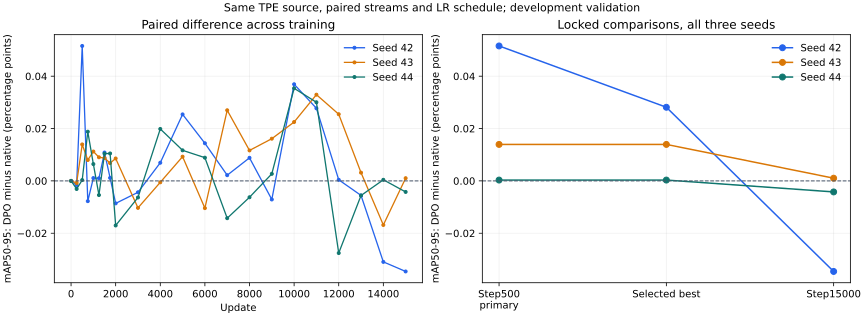

# Đối chứng đóng góp riêng của DPO trong hybrid — 16/11/2026

## Kết luận thực nghiệm

**Thêm DPO λ=0,03 tạo lợi ích mAP nhỏ tại step500 trong cả ba cặp seed đã
chạy; không phải nguyên nhân duy nhất của lợi ích hybrid so TPE. Lợi ích
không duy trì đồng đều khi huấn luyện tới15000 update.**

Đây là sáu lượt chạy mới, cùng môi trường, từ cùng TPE trial2. Trong từng
seed, hai arm khác nhau ở việc đặt trọng số DPO bằng0 hoặc0,03. Các yếu tố
được giữ cố định gồm stream ảnh/cặp, native loss, sampling, nhánh được học,
bank, optimizer, ngân sách, lịch LR, lịch đánh giá và selector. Vì vậy phép
so này cung cấp bằng chứng can thiệp trực tiếp cho **phần tăng thêm do bật
DPO trong recipe và validation đã xét**. Không quy toàn bộ hybrid−TPE cho
DPO, không coi3 seed là xác nhận tổng quát hóa độc lập.

## Protocol khóa trước

- Nguồn: KB3 trial2, SHA256
  `eb7072dd087de0154049ca8a5151c6ada6ba1fca2e2666c676a9c3d17c61a84d`.
- Seed continuation42/43/44; mỗi seed có native λ0 và DPO λ0,03; cả6 lượt
  chạy mới, không tiếp tục weights hoặc optimizer từ run hybrid cũ.
- Cùng bank773 cặp,662 cặp dùng DPO,111 probe; native batch4 gồm2 ảnh uniform
  train +2 ảnh từ cặp; cùng pair plan trong từng seed, khác stream giữa seed.
- Chỉ học classification cv3; backbone/neck/box/BN và reference giữ nguyên.
- Native foreground1/background0,5; β0,1; AdamW LR1e−6, WD5e−4, clip1.
  LR giảm xuống1e−7 từ update1001;15.000 update mỗi arm.
- Full validation479 ảnh/1887GT. Eval mỗi250 tới2000, sau đó mỗi1000.
  Best theo mAP50–95, min_delta1e−4 fraction; step0 được phép thắng.
- **Tiêu chí chính:** chênh lệch DPO−native tại cùng step500. Tiêu chí bổ sung:
  best theo cùng selector/grid và cùng step15000. Chạy đủ6 arm bất kể dấu kết quả.

Native vẫn thực hiện sampling/reference/auxiliary diagnostics như DPO nhưng
nhân auxiliary bằng0. Điều này giữ quy trình và stream tương ứng để tách tác
dụng của gradient DPO khỏi thay đổi ảnh huấn luyện. Một native trainer có
sampling khác không phải đối chứng đang xét.

[Kế hoạch máy đọc được](assets/hybrid_paired_control_20261116/plan.json),
[runner](../../scripts/run_kb2_paired_control.py),
[script xác minh](../../scripts/review_kb2_paired_control.py).

## Kết quả chính: cùng update500

| Seed | Native mAP (%) | DPO mAP (%) | Δ DPO−native, điểm % | Δ TP | Δ FP | Δ FN |
|---|---:|---:|---:|---:|---:|---:|
| 42 | 38,661698 | 38,713256 | +0,051558 | 0 | 0 | 0 |
| 43 | 38,671300 | 38,685235 | +0,013936 | 0 | −1 | 0 |
| 44 | 38,672855 | 38,673171 | +0,000316 | 0 | 0 | 0 |

Trung bình chênh lệch ghép cặp: **+0,021936 ±0,026541 điểm phần trăm**
(mean ± SD mẫu, n=3). Dấu dương ở3/3 seed, nhưng mức tăng rất nhỏ và khác
nhau đáng kể về độ lớn; seed44 gần như ngang nhau. SD không phải khoảng tin
cậy hoặc sai số evaluator;3/3 dấu dương không tự chứng minh ý nghĩa thống kê.

**Không thấy lợi ích giảm bỏ sót tại step500:** TP/FN bằng nhau trong cả ba
cặp. FP chỉ giảm1 ở seed43, bằng nhau ở hai seed còn lại. Precision/F1 cũng
bằng nhau ở seed42/44; seed43 tăng lần lượt0,026805 và0,013884 điểm phần trăm.
AP50/AP75 tăng ở seed42/43 nhưng giảm nhẹ ở seed44, nên không phải mọi metric
đều tăng khi bật DPO.

## Best theo cùng quy tắc và cùng step15000

| Phép so | Seed | Step native / DPO | Δ mAP, điểm % | Δ FP | Δ FN |
|---|---:|---|---:|---:|---:|
| Selected best | 42 | 250 /500 | +0,028133 | −20 | +8 |
| Selected best | 43 | 500 /500 | +0,013936 | −1 | 0 |
| Selected best | 44 | 500 /500 | +0,000316 | 0 | 0 |
| Cùng15000 | 42 | 15000 /15000 | −0,034603 | +2 | 0 |
| Cùng15000 | 43 | 15000 /15000 | +0,001031 | 0 | +1 |
| Cùng15000 | 44 | 15000 /15000 | −0,004217 | +1 | +1 |

- Selected best: **+0,014128 ±0,013910 điểm mAP**, dương3/3 seed. Trong
  seed42, DPO best có recall thấp hơn native best0,423953 điểm và F1 thấp hơn
  0,026920 điểm, dù mAP cao hơn. Selector chọn AP nên phải báo cả đánh đổi.
- Cùng15000: **−0,012596 ±0,019238 điểm mAP**, DPO thấp hơn2/3 seed; F1 thấp
  hơn native ở cả3 seed. Không thể nói bật DPO luôn giúp, hoặc càng train
  nhiều DPO càng tốt.

## Bao nhiêu lợi ích là do DPO?

TPE đầu vào chấm lại ở cả6 run đều đạt38,509670%. Phân rã số học cùng
step500, trung bình ba seed:

| Mốc | mAP (%) | Chênh lệch, điểm % |
|---|---:|---:|
| TPE đầu vào | 38,509670 | — |
| Native-only500 | 38,668618 | Native−TPE: +0,158948 |
| Native+DPO500 | 38,690554 | DPO−native: +0,021936 |
| Tổng DPO500−TPE | — | +0,180884 |

**Native continuation trong recipe này đã tạo ra phần lớn mức cải thiện.**
DPO tạo thêm phần nhỏ trong phép so trực tiếp. Đây là phân rã theo đối chứng
đã định, không phải tỷ lệ đóng góp phổ quát của các thành phần tương tác.

Riêng seed42 tương ứng model chốt:

- TPE38,509670 → native50038,661698: +0,152028 điểm.
- Native50038,661698 → DPO50038,713256: **+0,051558 điểm**.
- Nếu so cả quy trình chọn best công bằng: native chọn250 đạt38,685122;
  DPO chọn500 đạt38,713256; **lợi ích thêm của arm DPO là+0,028133 điểm**.

Vì vậy mức hybrid−TPE **+0,203586 điểm** trước đây không được gọi là gain
riêng của DPO. Khoảng cách0,0829 điểm giữa hybrid best500 và native best1000
cũ cũng không phải ước lượng đúng: khi native được đánh giá dày, best250 của
nó tốt hơn native1000.

## Cơ chế nào được hỗ trợ?

Loss DPO tạo gradient có hướng keep/drop tại logit. Đối chứng mới xác nhận
rằng bật hạng loss đó, giữ các yếu tố khác cố định, làm quỹ đạo và AP thay
đổi. Vì chỉ classification được học và geometry được kiểm giữ nguyên trong
ngưỡng số học của trainer, cơ chế phù hợp là thay đổi score/class, thứ hạng
và tập detection sau hậu xử lý.

AP dùng cả thứ hạng/tập detection với confidence thu candidate0,001, khác
với số TP/FP tại confidence0,25. Bởi vậy TP/FP/FN bằng nhau không đòi hỏi AP
bằng nhau. Tuy nhiên, chưa phân rã counterfactual riêng ranking, class và
NMS, nên không khẳng định một cơ chế cụ thể đóng góp bao nhiêu. AP75 tăng
không chứng minh DPO học sửa tọa độ box.

Cũng không suy từ loss giảm ra AP tăng, hoặc từ gradient cục bộ ra mọi
candidate đều tốt hơn. Kết quả cuối quỹ đạo cho thấy tác động có thể đảo dấu.

## Mức khẳng định phù hợp

> Trong đối chứng ghép cặp từ cùng TPE trial2, cùng stream, lịch LR và lịch
> đánh giá, thêm DPO λ=0,03 làm mAP50–95 tại step500 cao hơn native-only ở cả
> ba continuation seed, trung bình0,021936 điểm phần trăm. Khi áp dụng cùng
> quy tắc chọn checkpoint, chênh lệch trung bình là0,014128 điểm. Đây là bằng
> chứng DPO tạo một phần lợi ích AP nhỏ trong recipe/validation đã xét;
> native continuation đã tạo ra phần lớn mức tăng hybrid so TPE. Chưa thấy
> giảm FN tại step500, và DPO thấp hơn về mAP ở hai seed khi train tới15000.

Bằng chứng này mạnh hơn so hybrid với checkpoint TPE đứng yên vì đã có đối
chứng chỉ khác trọng số DPO. Tuy nhiên, chỉ có3 seed continuation từ một
TPE, trên validation đã được dùng phát triển recipe và chọn step500 trước
campaign này. Khóa protocol trước campaign mới không biến validation thành
holdout mới; kết quả chưa loại trừ ảnh hưởng chọn recipe/validation, chưa
xác nhận tính ổn định qua các TPE initialization/dataset khác, và chưa đủ
cho phát biểu “DPO là nguyên nhân chủ yếu/tất yếu của lợi ích hybrid”.

## Artifact và kiểm chứng

[Kết quả đầy đủ và số chưa làm tròn](assets/hybrid_paired_control_20261116/paired_results.json),
[CSV](assets/hybrid_paired_control_20261116/paired_results.csv),
[báo cáo tự sinh](assets/hybrid_paired_control_20261116/REPORT.md),
[hash/manifest và xác minh chấm lại](assets/hybrid_paired_control_20261116/verification.json),
[quỹ đạo validation](assets/hybrid_paired_control_20261116/validation.csv).

Các checkpoint/log gốc nằm tại
`kb2_preference_optimization/outputs/paired_control_20261116/seed{42,43,44}/{native,dpo}/`.
Native control có gradient DPO bằng0; stream trong từng cặp giống từng byte;
config chỉ khác arm/dpo_weight/effective_dpo_weight. Tất cả source/bank và
code được bảo vệ bằng SHA trong plan. Đã hoàn tất kiểm tra LR/selector, hash132 checkpoint eval và chấm lại18
checkpoint (gồm các lần chấm cùng step khi best trùng500). Mọi metric và
per-class khớp log; frozen-state không đổi. Đối chiếu danh tính GT tại500:
cả3 seed có0 GT mất/0 GT cứu so với native, tức cùng tập GT được phát hiện.
[Chi tiết GT và class](assets/hybrid_paired_control_20261116/step500_identity_summary.json).
