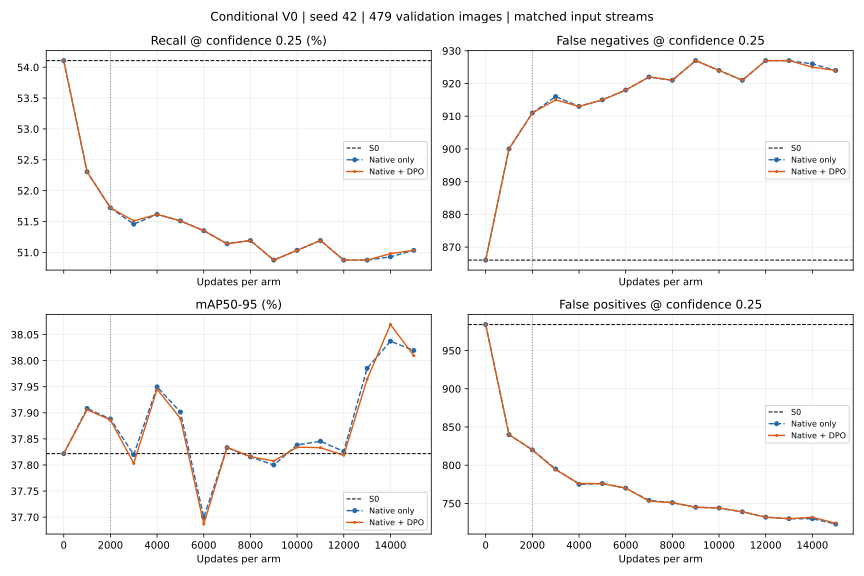

# KB2 Conditional V0 — review chạy dài 15.000 update, 31/10/2026

**Đã hoàn tất cả native-only và native+DPO, mỗi arm15.000 update.** Nguyên recipe
V0 chưa giảm FN tại confidence0,25 và chưa cho thấy lợi ích thêm rõ của DPO so
native-only. Tuy nhiên, quét threshold chính xác ở cùng FP budget cho thấy một
cải thiện nhỏ của cảhai model so S0; không bỏ qua kết quả phụ này.

## 1. Run và kiểm chứng

Run: `kb2_preference_optimization/outputs/yolov8n_conditional_long_s42_20261030_200209_427399/`.

- YOLOv8n/S0, seed42, conditional V0,15k mỗi arm, tổng30k update; DPO trước rồi
  native-only. Full bank/validation; không test và không sửa recipe sau pilot.
- Giữ LR1e-6, beta0,1, lambda0,01, native coefficient1, clip1; input640/native
  batch4, DPO2 quyết định. Chỉ train classification cv3; regression/BN/backbone
  giữ nguyên. Metadata `pilot=True` kế thừa không đổi ngân sách15.000 thực tế.
- Có `completed.json` cho cảhai và toàn run;16 validation checkpoints/arm tại
  0/1k/.../15k, đều đủ479 ảnh/1.887 GT. Thời gian trainer ghi khoảng38phút cảhai.
- Tái dựng đủ15.000 batch từ seed, cả2 uniform images và2 sampled pairs mỗi bước;
  native/DPO stream byte-identical, exposure và checksum khớp. Stream SHA:
  `0604b960337555fe83d6dd1b649b514fbfbb2b420f4a83ef2316062837d063e8`.
- 2k batch đầu và metrics/probes0/1k/2k khớp nguyên pilot, nên đây là kiểm việc kéo
  dài quỹ đạo, không đổi thiết kế đồng thời. Không resume weights/optimizer pilot.
- Đã kiểm hash best/last, reload checkpoint, kiểm frozen state và best bằng S0.
  **Đã đo GPU lại S0, native-last, DPO-last trên đủ validation; toàn bộ metrics
  số học khớp logs**, bỏ riêng thời gian evaluator khi so. Không train thêm.
- Source/data/bank/code provenance khớp, reference không đổi theo trainer checks,
  checkpoint gốc giữ nguyên trước/sau review. Không dùng GT test.

[Review/provenance đầy đủ](assets/kb2_conditional_long_20261031/review.json).

## 2. Kết quả chính: ordinary confidence0,25

| Model | Step | mAP50–95 (%) | Micro recall (%) | Macro recall (%) | FN | FP |
|---|---:|---:|---:|---:|---:|---:|
| S0 | 0 | 37,8218 | 54,1070 | 54,5463 | 866 | 984 |
| Native-only | 15.000 | 38,0195 | 51,0334 | 52,6276 | 924 | 723 |
| Native+DPO | 15.000 | 38,0096 | 51,0334 | 52,6276 | 924 | 724 |

DPO last so S0: AP+0,1878 điểm phần trăm, precision50,9227%→57,0836%, FP giảm260;
nhưng FN tăng58, micro recall giảm3,0737 điểm và macro recall giảm1,9186 điểm.
Model có học theo hướng giảm dự đoán thừa, nhưng chưa đạt mục tiêu giảm bỏ sót
ở điểm vận hành đã khóa.

So native-only tại15k: DPO cùng TP963/FN924 và cùng FN của cả28class; FP nhiều hơn1,
AP thấp hơn0,00990 điểm. Ledger fresh validation xác nhận GT detected IDs của
native và DPO **giống nhau hoàn toàn** ở threshold0,25, không chỉ trùng TP tổng.

Cảhai `best.pt` vẫn có **đúng trọng số S0 step0**: không có checkpoint train nào
qua gate micro recall>=S0. File `last.pt` lưu weights train15k. Không đổi selector
sang AP hoặc threshold sau khi đã xem kết quả.

## 3. Kéo dài có tạo cải thiện muộn không?

| DPO step | mAP50–95 (%) | FN | FP | GT cứu /mất so S0 |
|---|---:|---:|---:|---:|
| 0 | 37,8218 | 866 | 984 | 0 /0 |
| 2.000 | 37,8863 | 911 | 820 | 4 /49 |
| 5.000 | 37,8892 | 915 | 776 | 11 /60 |
| 10.000 | 37,8342 | 924 | 744 | 14 /72 |
| 14.000 | 38,0692 | 925 | 732 | 18 /77 |
| 15.000 | 38,0096 | 924 | 724 | 18 /76 |



Đường dọc2k là ngân sách pilot; hai đường native/DPO gần trùng nhau về recall/FN.
AP tăng muộn, đỉnh DPO38,0692% tại14k, nhưng điểm đó FN925/FP732, vẫn không đủ gate.
Đây là metric được log tại14k; weights14k không được lưu riêng khi selector từ chối.

Trong15 điểm validation sau update, không điểm nào đưa recall về mức S0. Checkpoint
train có recall cao nhất là1k:52,3052%, FN900. Từ2k đến15k, recovered tăng4→18 nhưng
lost tăng49→76; net FN xấu thêm13. DPO chỉ hơn native1FN tại3k và14k, không có lợi
thế FN tại last hoặc một sự tách đường học rõ.

Kết luận giới hạn: **recipe/seed này chưa có cải thiện muộn về ordinary recall đến
15k**. Không chứng minh15k là hội tụ toán học hoặc mọi ngân sách lớn hơn đều vô ích;
nhưng hiện không có cơ sở thực nghiệm chỉ tăng step tiếp sẽ giải quyết mục tiêu.

[Toàn bộ16 điểm/arm](assets/kb2_conditional_long_20261031/validation.csv),
[SVG để xuất](assets/kb2_conditional_long_20261031/learning_curves.svg).

## 4. GT nào được cứu/mất?

DPO last: giữ945 GT S0 từng đúng, cứu18 GT S0 bỏ sót, mất76 GT S0 từng đúng,
848GT còn bị cảhai bỏ sót. Net recovery=18−76=−58, đúng với FN866→924.

| Mật độ ảnh | GT cứu | GT mất | Net |
|---|---:|---:|---:|
| 1–2 object | 6 | 11 | -5 |
| 3–5 object | 4 | 12 | -8 |
| >=6 object | 8 | 53 | -45 |

Medium mất39/cứu1; small mất6/cứu0; large mất31/cứu17. 53/76 GT mất thuộc ảnh>=6
object. 18class tăng FN,7class giữ nguyên,3class giảm FN. Ví dụ Tomato leaf57→72,
Tomato leaf yellow virus105→113, Peach leaf24→31; Corn Gray leaf spot6→3 và
Tomato leaf bacterial spot52→49. Class ít support vẫn cần diễn giải thận trọng.

AP gain tập trung: Corn Gray leaf spot có14GT valid, AP tăng13,9918 điểm, đóng góp
khoảng+0,4997 điểm vào macro mAP.27class còn lại cộng đóng góp−0,3119 điểm, tạo net
+0,1878 điểm. Không gọi đây là cải thiện AP đồng đều giữa các class.

[Class table](assets/kb2_conditional_long_20261031/classes.csv),
[GT identity ledger](assets/kb2_conditional_long_20261031/gt_transitions.csv).

## 5. Điểm bổ sung quan trọng: so chính xác tại cùng FP budget

Grid thưa trong trainer có0,15 và0,20: DPO tại0,15 FP997 hơi vượt budget984,
còn0,20 FP839 nên bỏ lỡ điểm vận hành gần budget. Không dùng kết quả grid đó để
kết luận mọi threshold đều kém S0.

Review này cache predictions ordinary từ fresh GPU evaluation, rồi quét **mọi
score cutoff phân biệt được**, giữ nguyên NMS/cap/IoU0,5, bao gồm toàn bộ ties.
Chọn max recall với FP<=984 và kiểm lại bằng canonical greedy matching tại cutoff.
S0 cũng được quét với cùng quyền chọn threshold và cùng budget.

| Model | Confidence được chọn trên validation | TP | FP | FN | Recall (%) |
|---|---:|---:|---:|---:|---:|
| S0 | 0,250284 | 1021 | 984 | 866 | 54,1070 |
| Native-only last | 0,153232 | 1027 | 984 | 860 | 54,4250 |
| Native+DPO last | 0,153341 | 1027 | 984 | 860 | 54,4250 |

S0 cutoff0,250284 cho cùng output counts như0,25. Ở budget984, cả native và DPO
cứu ròng thêm6GT so S0, recall+0,3180 điểm. **Đây là tín hiệu cải thiện nhỏ của
fine-tuning ở điểm vận hành khác, không phải lợi ích thêm được đo của DPO**:
hai đối chứng có cùng TP/FP/FN tại budget này.

Các cutoff được chọn bằng GT validation trong lượt review, nên là kết quả phát
triển hậu nghiệm; không thay protocol chính hoặc dùng để sửa `best.pt` đã chọn.
Chưa có CI/multiple seeds/test xác nhận6GT gain; chưa đo calibration nên không
đồng nhất thay đổi confidence với cải thiện calibration. Không tự kết luận triển
khai threshold này sẽ tốt hơn trên nguồn ảnh mới.

[Exact FP-budget sweep result](assets/kb2_conditional_long_20261031/exact_FP_budget.json).

## 6. Train-target probes và exposure

Fixed32 probes/cohort gồm8 mỗi nhóm, chỉ là chẩn đoán train:

- Recovery DPO train: mean score S0=0,128454;2k=0,071540;15k=0,071384;
  ordinary targets vẫn0/8. Native15k=0,070566 và0/8; DPO đỡ giảm nhưng không cứu thêm.
- Preservation DPO train có học lại muộn:2k score0,259319/3target còn đúng;
  15k score0,370948/6target, so S0 là0,296807/8target. Native cũng6/8 tại15k.
  Mean score tăng không có nghĩa giữ đủ GT.
- Preservation không vào DPO: mean score0,295055→0,208751, còn4/8 target;
  native cũng4/8. Recovery không vào DPO vẫn0/8. Đây vẫn là train images, native
  có thể dùng và S0 đã học; không gọi là holdout độc lập.
- Raw-box delta probes=0; không có bằng chứng regression drift trong V0.

Đã lấy30.000 lượt preference/arm: recovery7.496, preservation7.411, background7.658,
duplicate7.435. Toàn bộ663 cặp và378 ảnh DPO train đều xuất hiện; không phải model
chưa gặp phần lớn bank. Ảnh lặp tối đa405, target375; sampler cap xác suất kỳ vọng,
không giới hạn cứng số draw. Chỉ phủ bank hiện có, không tạo target mới theo thời gian.

151 batch có diagnostics: weighted DPO/native gradient norm ratio trung bình1,3990%,
khoảng0,2317%–3,6135%. Norm không bằng phần trăm tác động AdamW; dùng cùng
[audit actual AdamW](KB2_CONDITIONAL_GRADIENT_AUDIT_20261031.md) để diễn giải cơ chế.

[Probe curves](assets/kb2_conditional_long_20261031/probes.csv).

## 7. Kết luận sử dụng

1. Không thể quy kết kết quả pilot chỉ do chưa train đủ2k: đã kéo nguyên recipe
   tới15k và so đối chứng, ordinary recall vẫn dưới S0. AP và preservation train
   có chuyển biến muộn, nhưng chưa chuyển thành lợi ích FN tại threshold chính.
2. Có tín hiệu nhỏ ở matched-FP sau tune threshold, nhưng native-only đạt cùng
   mức; chưa chứng minh đóng góp riêng của DPO. Không gọi toàn bộ fine-tuning
   là vô ích hoặc nói mọi điểm vận hành đều xấu hơn.
3. Nếu nghiên cứu tiếp DPO, ưu tiên ablation tín hiệu native background/DPO
   strength/bảo vệ GT đã đúng, từng biến với đối chứng. Tăng ngân sách tiếp cho
   nguyên recipe chưa có căn cứ rõ từ đường học hiện có.
4. Nếu đánh giá điểm vận hành triển khai, cần khóa threshold từ validation rồi
   kiểm độc lập sau khi khóa phương pháp. Chưa dùng test để phát triển recipe.

Kết quả chỉ1seed/model/dataset và validation đã được dùng nhiều lần trong phát
triển. Không khẳng định DPO nói chung thất bại, recipe đã hội tụ hoàn toàn hoặc
gain6GT có ý nghĩa thống kê/tổng quát hóa. Trong lượt này không đổi trainer,
threshold triển khai, annotation hay checkpoint; chỉ tạo báo cáo và artifacts mới.

Tái kiểm (output phải mới):

```bash
.venv-ubuntu/bin/python -m scripts.review_kb2_conditional_long --run kb2_preference_optimization/outputs/yolov8n_conditional_long_s42_20261030_200209_427399 --output /tmp/NEW_kb2_conditional_long_review --device cuda
```
