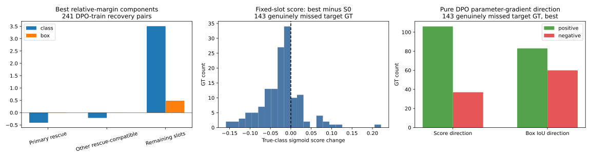

# KB2 — DPO đang nâng score/box của GT hay chỉ nâng margin?, 30/10/2026

**Đã kiểm tra trên GPU. DPO có tín hiệu nâng score tại GT cần cứu, nhưng tín hiệu đó chưa nhất quán và phần tăng margin sau run dài chủ yếu đến từ những quyết định khác trong action.** Box decode thông thường cải thiện nhẹ về trung bình; score tại các vị trí cần cứu lại giảm. Có bước AdamW mà thêm DPO làm margin tăng nhưng score đúng class tại GT mục tiêu giảm.

Kết luận này dựa trên ba phép kiểm riêng: bóc tách chính xác margin, đo đạo hàm tại S0/best/last, và so sánh một bước AdamW có/không có DPO từ cùng trạng thái optimizer. Không chạy thêm một đợt train; các checkpoint trên đĩa giữ nguyên.

## 1. Phạm vi và cách đo

Run: `kb2_preference_optimization/outputs/yolov8n_recovery_long_20261029_023113_387762/`. Best ở14k, last15k; cùng S0 supervised đã dùng trong [đánh giá run dài](KB2_RECOVERY_LONG_REVIEW_20261030.md).

- Kiểm toàn bộ **267 ảnh có cặp khôi phục / 328 GT mục tiêu** trong selected pool; không chọn ảnh theo kết quả validation.
- Trong đó241 ảnh /295GT thuộc DPO train;26 ảnh /33GT không dùng cho DPO. Toàn bộ vẫn là ảnh train được native loss sử dụng, nên đây là audit cơ chế, không phải phép đo tổng quát hóa độc lập.
- Với mỗi GT được chosen cứu so rejected, truy ngược chính xác detection đã qua renderer/NMS về **slot nguồn của chosen**. Giữ slot này cố định giữa S0/best/last, đo sigmoid score đúng class và IoU của box decode thông thường với cùng GT.
- Đo phát hiện GT bằng ordinary inference và canonical matching tại confidence0,25, IoU0,5. GT được chọn cho preference dùng max-cardinality/IoU matching; hai phép gán ID có thể khác khi object chồng lấn.
- Đạo hàm tham số dùng loss của từng ảnh, qua cùng Detect head đang train. Hướng `-grad(DPO)` được chuẩn hóa L2 để kiểm tra dấu thay đổi score/IoU. Đây là đạo hàm bậc nhất, không tự đồng nhất với bước AdamW thực tế.
- Phần AdamW riêng tái dựng đúng native/DPO minibatch độc lập, batch4, clip1, LR1e-6, weight decay5e-4, native+0,01DPO, beta0,1; dùng optimizer state đã lưu ở best/last.

## 2. “GT được cứu giữa hai output” chưa chắc là GT S0 bỏ sót

Trong328GT mục tiêu, **170GT đã được ordinary S0 phát hiện**, chỉ158GT thực sự bị ordinary S0 bỏ sót tại0,25.

| Nhóm | GT mục tiêu | S0 đã phát hiện | S0 thực sự bỏ sót |
|---|---:|---:|---:|
| DPO train | 295 | 152 | **143** |
| Ảnh không dùng DPO | 33 | 18 | 15 |
| Tổng | 328 | 170 | 158 |

Trong241 cặp khôi phục thuộc DPO train,126 cặp chứa ít nhất một GT thực sự bị ordinary S0 bỏ sót;115 cặp còn lại chỉ khôi phục các GT đã được ordinary S0 phát hiện. Vì vậy, tăng tần suất mọi cặp khôi phục chưa tập trung hoàn toàn vào FN thực tế của detector.

Scorer chấm các output lấy mẫu bằng GT và không yêu cầu confidence vượt0,25. Một output lấy mẫu có thể phát hiện GT nhờ quyết định emit/class/bin khác, trong khi predict thông thường vẫn thiếu confidence hoặc dùng box kỳ vọng DFL khác.

## 3. Sau run dài, score và box thực tế thay đổi ra sao?

Tập chính dưới đây là **143 GT mục tiêu thực sự bị S0 bỏ sót trên ảnh DPO train**, cùng slot nguồn cố định:

| Chỉ số | S0 | Best14k | Last15k |
|---|---:|---:|---:|
| Score đúng class trung bình tại slot | 0,149083 | **0,125160** | 0,125128 |
| IoU box decode thông thường trung bình | 0,793352 | **0,798702** | 0,799017 |
| GT được ordinary predict phát hiện | 0/143 | 10/143 | 11/143 |
| Slot có score dưới0,25 | 128/143 | 126/143 | 126/143 |
| Slot có box IoU dưới0,5 | 9/143 | 9/143 | 9/143 |

Best so S0: score tăng ở30GT nhưng giảm ở113GT; IoU tăng ở82GT, giảm ở61GT. Score trung bình giảm0,023923, trong khi IoU tăng0,005350. Tại best, slot có argmax class sai ở29/143GT. Các lỗi score/geometry/class có thể chồng lấn, không cộng chúng thành số FN.

Trên toàn bộ295GT mục tiêu thuộc DPO train, số phát hiện giảm **152→124**: cứu thêm10GT nhưng mất38GT từng phát hiện. Last phát hiện126GT: cứu11, mất37. Đây là GT train trong audit, tách biệt với số GT validation cứu/mất trong báo cáo run dài.

**Vấn đề nổi bật trên tập này là confidence tại các vị trí mục tiêu, dù box có IoU trung bình khá cao.** Không suy rằng mọi GT đều chỉ cần hạ ngưỡng: còn class argmax, geometry, NMS và gán một-một.

## 4. Margin tăng từ đâu?

Với từng slot, tách gap chosen−rejected thành phần class và DFL; rồi trừ gap của reference. Tổng các thành phần khớp margin đầy đủ cho mọi cặp/checkpoint.

Ba nhóm slot rời nhau:

1. **Primary rescue:** slot chosen sau NMS được matcher gán cho GT mục tiêu.
2. **Other rescue-compatible:** slot khác mà box lấy mẫu chosen hoặc rejected có đúng class và IoU≥0,5 với ít nhất một GT mục tiêu, kể cả slot bị NMS loại.
3. **Remaining:** các slot còn lại. Nhóm này có thể chứa GT khác hoặc quyết định bị NMS loại; không mặc định tất cả đều vô ích hay là FP.

Trung bình trên241 cặp khôi phục thuộc DPO train, best so reference:

| Nhóm | Đóng góp class | Đóng góp DFL box | Tổng |
|---|---:|---:|---:|
| Primary rescue | **−0,409312** | −0,008963 | −0,418274 |
| Other rescue-compatible | −0,214067 | +0,002725 | −0,211341 |
| Remaining | **+3,506785** | +0,483650 | **+3,990435** |
| Tổng margin | | | **+3,360819** |

Tính theo số lượt xuất hiện DPO thực tế của từng ảnh cũng cho cùng xu hướng: margin+3,511763, các nhóm liên quan trực tiếp tới GT mục tiêu có đóng góp âm, remaining dương. Trên riêng126 cặp có FN thực sự của S0, margin+3,514846; primary class−0,517359, remaining class+3,582520.

Log-prob toàn action chosen trung bình thay đổi **−7,811647**, rejected **−11,172466**. Margin tăng vì rejected giảm nhiều hơn chosen. Đây là log-prob action đầy đủ, không phải confidence của một bounding box.

Như vậy **margin tốt hơn không chứng minh score tại GT cần cứu được nâng lên**. Trong run này có bằng chứng trực tiếp rằng tăng margin chủ yếu đi qua các thành phần khác.



## 5. Riêng gradient DPO có đẩy đúng GT không?

Trên cùng143GT thực sự bị S0 bỏ sót:

| Checkpoint | Qua tham số: score tăng / giảm | Qua tham số: IoU tăng / giảm |
|---|---:|---:|
| S0 | 107 / 36 | 79 / 64 |
| Best | **106 / 37** | **83 / 60** |
| Last | 107 / 36 | 84 / 59 |

Các cột là dấu đạo hàm theo hướng giảm DPO loss tại checkpoint, giữ GT/slot cố định; không phải số GT vượt được ngưỡng sau update. Ở best chỉ63/143GT có cả hai hướng score và IoU cùng tăng.

Đo trực tiếp ở output logits, trước sự lan truyền qua các tham số chung của head:

- Cả ba checkpoint, true-class score có hướng tăng ở135/143GT, không đổi ở8GT, không có hướng giảm trực tiếp.
- Ở best, IoU box decode có hướng tăng ở86GT, giảm55GT, không đổi2GT. Ưu tiên DFL bins của chosen không bảo đảm kỳ vọng DFL dịch box về phía IoU tốt hơn.
- Với143GT này, box chosen lấy mẫu có IoU trung bình0,695359; box kỳ vọng S0 tại cùng slot có IoU0,793352. Chosen tốt hơn rejected theo output-set score không có nghĩa box chosen tốt hơn box ordinary S0.

Phần class của pair gap có dạng tổng raw class logits chosen trừ tổng raw class logits rejected, chia temperature: normalizer softmax tại từng slot triệt tiêu. Nếu hai action dùng cùng class tại một slot thì phần class ở đó triệt tiêu hoàn toàn; background chung cũng triệt tiêu. Khác biệt emit/background vẫn tạo class term.

Triệt tiêu cùng class xảy ra ở8/143GT trong tập chính, nên **đây chưa phải nguyên nhân chiếm đa số**. Tín hiệu nâng score trực tiếp tồn tại ở135GT, nhưng khi đi qua tham số head dùng chung,36–37GT có hướng score giảm. Native và DPO còn dùng hai minibatch khác nhau trong trainer thực tế.

## 6. Kiểm tra sát optimizer: cùng một bước AdamW, chỉ thêm/bỏ DPO

Đã tái dựng native/DPO streams từ đúng RNG và sampler. Hash toàn bộ15.000 bước native khớp; số lượt từng ảnh DPO khớp exposure. Bước đầu tiên tái hiện đúng native loss2,2206056, DPO loss0,6931472, grad norm4,0123272 như log gốc.

Tại mỗi điểm, tạo hai phép cập nhật tạm trong RAM:

- A: native loss.
- B: native+0,01DPO.

Cùng trọng số xuất phát, optimizer moments, native batch, DPO batch và gradient clipping. Tại best/last, lịch sử moments vẫn chứa toàn bộ huấn luyện trước đó; chỉ bỏ/thêm DPO ở bước hiện tại. Sau đo khôi phục trọng số. Inference đối chiếu một bước dùng TF32 off để đọc các khác biệt nhỏ.

| Điểm xuất phát | Bước kiểm tra | Margin trung bình trên4 cặp: B−A | Score trung bình143GT: B−A |
|---|---:|---:|---:|
| S0 | 1 | +0,05420846 | +0,000002781 |
| Best14k | 14.001 | +0,00171743 | +0,000000410 |
| Last15k | 15.001, giả lập | +0,00032626 | −0,000000078 |

Ở cả ba bước, margin tăng ở đủ4 cặp khi thêm DPO. Thay đổi score trên tập143GT nhỏ và thay đổi theo batch; giá trị sát1e-7 cần đọc cùng giới hạn float32. Không coi ba bước này là bằng chứng cho tác động nhân quả tích lũy15.000 bước.

**Ví dụ ngay trong minibatch bước1, ảnh109 / GT17:** thêm DPO làm margin của cặp tăng **0,180908**, nhưng true-class score tại slot cứu GT **giảm0,000134811** so A; IoU tăng rất nhỏ0,000003457. Ảnh116 / GT2 cùng batch có score tăng0,000007108 nhưng IoU giảm0,000018090. Đây là ví dụ trực tiếp cho việc margin tăng vẫn có thể đi cùng score hoặc box của GT mục tiêu xấu đi.

Tại bước14.001, ảnh1043 / GT14 lại có score tăng0,000008523 nhờ thêm DPO, IoU không đổi trong độ phân giải đo. Do đó không kết luận DPO luôn đẩy sai: tác động phụ thuộc ảnh, các action còn lại trong batch, tham số chung và optimizer history.

Norm chênh lệch update B−A chia norm update A lần lượt69,95% ở bước1,5,77% ở14.001,1,86% ở15.001. Đây là khoảng cách hai vector update, không phải tỷ lệ hiệu quả. Nó cũng cho thấy không thể lấy tỷ lệ norm gradient khoảng3–4% rồi suy DPO chỉ tác động3–4% lên bước AdamW.

## 7. Hướng sửa đáng ưu tiên

1. **Chọn GT mục tiêu bằng FN của ordinary S0 trước.** Tách cặp cứu FN thật khỏi cặp chỉ cứu GT bị một lần sampling bỏ sót. Sau đó mới cân bằng cơ hội học giữa các class. Hiện hơn một nửa328GT mục tiêu đã được S0 phát hiện.
2. **Sinh cặp có khác biệt tập trung vào GT mục tiêu.** Giữ action ở các vùng khác giống nhau khi có thể, để các thành phần đó triệt tiêu và margin khó tăng nhờ những quyết định khác. Cần kiểm tra renderer/NMS sau can thiệp; chưa thay generator trong lần audit này.
3. **Kiểm tra score và box theo hai tiêu chí riêng.** Tập143GT có box trung bình đã khá khít nhưng score thấp; tín hiệu sửa class/emission cần rõ hơn. Với DFL, không coi việc nâng xác suất bins của chosen đồng nghĩa nâng IoU box kỳ vọng.
4. **Dùng metric tại GT mục tiêu làm gate pilot:** score đúng class, IoU box ordinary, GT cứu và GT mất; đồng thời đọc margin đến từ nhóm slot nào. Margin tăng đơn độc chưa đủ để quyết định chạy dài.
5. **Chưa tăng lambda DPO ngay.** Tăng một hướng update còn gây giảm score/IoU ở một phần GT có thể khuếch đại tác động không mong muốn. Nên thử cặp tập trung vào FN thật trước, trong pilot có native stream/seed/budget cố định.

Kết luận giới hạn: **DPO hiện tại có tín hiệu nâng score/box, nhưng việc cải thiện preference toàn action đang thiếu sự tập trung vào FN thực tế và chưa chuyển thành khôi phục GT ổn định.** Audit chưa cô lập toàn bộ nguyên nhân score giảm trong lịch sử15k; cần ablation có cùng native stream để kết luận tác động tích lũy của DPO.

## 8. Kiểm chứng và artifact

- Các slot nguồn replay đúng renderer tham chiếu, khớp detection lưu và GT matching cho toàn bộ267 ảnh.
- Mọi box decode trong audit khớp decoder YOLO thực tế. Mọi margin khớp tổng class/box theo slot.
- Synthetic check xác nhận phân rã log-prob và triệt tiêu class/background chung. Đạo hàm tham số được kiểm bằng central finite difference tại một ảnh mỗi checkpoint, hai epsilon; TF32 tắt cho cả hai vế kiểm tra này để giảm nhiễu làm tròn.
- Hash dữ liệu/code/manifest/checkpoint đạt; reference và policy state hashes sau audit không đổi. Phần AdamW chỉ cập nhật tạm trong RAM rồi khôi phục, không ghi weights; không đánh giá valid/test ở audit mới.

- [Audit gradient và margin](assets/kb2_dpo_gt_alignment_20261030/audit.json)
- [Paired analysis: S0→best/last, class và trọng số exposure](assets/kb2_dpo_gt_alignment_20261030/paired_analysis.json)
- [Đủ từng GT và đạo hàm](assets/kb2_dpo_gt_alignment_20261030/targets.csv)
- [Margin từng cặp](assets/kb2_dpo_gt_alignment_20261030/pairs.csv)
- [Đạo hàm theo class](assets/kb2_dpo_gt_alignment_20261030/classes.csv)
- [AdamW counterfactual và replay checks](assets/kb2_dpo_gt_alignment_20261030/adam_step/counterfactual.json)
- [Tác động từng GT trong bước AdamW](assets/kb2_dpo_gt_alignment_20261030/adam_step/targets.csv)
- [Code audit gradient](../../scripts/audit_kb2_dpo_gt_alignment.py)
- [Code audit bước AdamW](../../scripts/audit_kb2_dpo_adam_step.py)

Lệnh tái kiểm, dùng output mới cho mỗi lượt:

```bash
YOLO_CONFIG_DIR=/tmp MPLCONFIGDIR=/tmp/kb2-matplotlib NO_ALBUMENTATIONS_UPDATE=1 .venv-ubuntu/bin/python scripts/audit_kb2_dpo_gt_alignment.py --root kb2_preference_optimization/outputs/yolov8n_recovery_long_20261029_023113_387762 --output docs/report_final/assets/kb2_alignment_REVIEW_NEW --device cuda
YOLO_CONFIG_DIR=/tmp MPLCONFIGDIR=/tmp/kb2-matplotlib NO_ALBUMENTATIONS_UPDATE=1 .venv-ubuntu/bin/python scripts/audit_kb2_dpo_adam_step.py --root kb2_preference_optimization/outputs/yolov8n_recovery_long_20261029_023113_387762 --alignment docs/report_final/assets/kb2_alignment_REVIEW_NEW --output docs/report_final/assets/kb2_alignment_REVIEW_NEW/adam_step --device cuda
```
