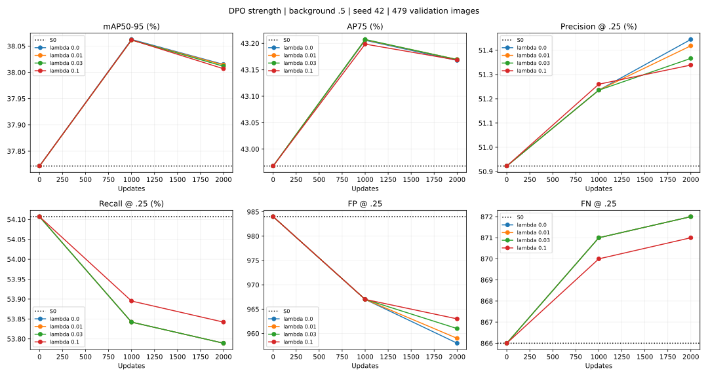

# KB2 — pilot tăng sức mạnh DPO và đánh giá nhiều metric, 01/11/2026

**Đã hoàn tất audit32 batch và bốn pilot GPU, mỗi pilot2.000 update.** Tăng λ lên0,1 làm DPO có gradient lớn hơn và tạo khác biệt nhỏ, nhưng chưa có ưu thế rõ trên nhiều mặt so native-only. Selector mới lưu được các checkpoint train có AP tốt hơn S0; không còn dùng recall gate để ép best về S0.

## Thiết kế khóa trước khi chạy

- S0 YOLOv8n, seed42, background BCE0,5; mọi term foreground1, assignment/box/DFL/normalization giữ nguyên.
- Chỉ train classification cv3; regression/backbone/neck/BN state cố định.
- Bốn nhánh λ=0 (native-only),0,01,0,03,0,1; beta0,1, LR1e-6, AdamW WD5e-4, clip1.
- Native batch4=2 uniform train+2 preference; DPO2 quyết định; cùng full bank784/663 train pairs, cùng input stream byte-identical.
- Validation đủ479 ảnh/1.887GT tại0/1k/2k. Native-only và λ0,01 tái hiện chính xác số học metrics/probes/train logs của pilot background0,5 cũ, trừ metadata selector và thời gian eval.
- Không đổi λ sau khi xem kết quả. Không dùng test, sửa data/annotation hoặc checkpoint cũ.
- Best theo mAP50–95 với min_delta1e-4, S0 eligible; không có recall gate. Mọi step0/1k/2k được lưu riêng để đối chiếu nhiều metric. Ghi thêm tập Pareto theo mAP/P/R; đây là diagnostic, không phải phép đếm số metric hay tổng điểm tự đặt.

Implementation mới tách ở `conditional_strength/`; code loss/background V0 và các fingerprint cũ giữ nguyên. Metrics checkpoint_selection được đổi để phản ánh selector mới; numeric comparisons bỏ riêng metadata này và thời gian evaluator.

## Kết quả ở1.000 bước — cũng là best_AP của cả bốn nhánh

| Cấu hình | Step | mAP50–95 (%) | AP75 (%) | Precision (%) | Recall (%) | FP | FN |
|---|---:|---:|---:|---:|---:|---:|---:|
| S0 | 0 | 37,8218 | 42,9680 | 50,9227 | 54,1070 | 984 | 866 |
| Native-only | 1000 | 38,0625 | 43,2058 | 51,2355 | 53,8421 | 967 | 871 |
| DPO λ=0.01 | 1000 | 38,0613 | 43,2067 | 51,2355 | 53,8421 | 967 | 871 |
| DPO λ=0.03 | 1000 | 38,0615 | 43,2074 | 51,2355 | 53,8421 | 967 | 871 |
| DPO λ=0.1 | 1000 | 38,0617 | 43,1986 | 51,2601 | 53,8951 | 967 | 870 |

Native-only có mAP cao nhất38,0625%. λ0,1 có recall cao nhất trong các model đã train53,8951%, FN870 so native871, cùng FP967. AP thấp hơn native khoảng0,00083 điểm phần trăm — khác biệt rất nhỏ. λ0,01/0,03 cùng TP/FN/FP như native ở mốc này.

## Kết quả ở2.000 bước

| Cấu hình | Step | mAP50–95 (%) | AP75 (%) | Precision (%) | Recall (%) | FP | FN |
|---|---:|---:|---:|---:|---:|---:|---:|
| S0 | 0 | 37,8218 | 42,9680 | 50,9227 | 54,1070 | 984 | 866 |
| Native-only | 2000 | 38,0150 | 43,1677 | 51,4445 | 53,7891 | 958 | 872 |
| DPO λ=0.01 | 2000 | 38,0141 | 43,1695 | 51,4184 | 53,7891 | 959 | 872 |
| DPO λ=0.03 | 2000 | 38,0115 | 43,1694 | 51,3664 | 53,7891 | 961 | 872 |
| DPO λ=0.1 | 2000 | 38,0068 | 43,1684 | 51,3391 | 53,8421 | 963 | 871 |

So native-only tại2k, λ0,1 giảm1 FN nhưng tăng5 FP; mAP thấp hơn0,00822 điểm phần trăm. λ0,03 cùng FN nhưng tăng3 FP, mAP thấp hơn. Tăng λ không tạo cải thiện lớn như chỉ nhìn tỷ lệ gradient có thể kỳ vọng.

## Theo mục tiêu cải thiện nhiều chỉ số: λ0,1 / best1k so S0

| Metric | S0 | λ0,1 /1k | Delta |
|---|---:|---:|---:|
| mAP50–95 (%) | 37,8218 | 38,0617 | 0,2399 điểm % |
| AP50 (%) | 49,1225 | 49,4282 | 0,3057 điểm % |
| AP75 (%) | 42,9680 | 43,1986 | 0,2306 điểm % |
| AR300 (%) | 56,2044 | 56,9128 | 0,7084 điểm % |
| Precision (%) | 50,9227 | 51,2601 | 0,3374 điểm % |
| Recall (%) | 54,1070 | 53,8951 | -0,2120 điểm % |
| Macro recall (%) | 54,5463 | 54,4958 | -0,0504 điểm % |
| F1 (%) | 52,4666 | 52,5446 | 0,0780 điểm % |
| Matched mean IoU (%) | 86,9785 | 87,0135 | 0,0350 điểm % |
| AP small (%) | 4,3965 | 4,3051 | -0,0914 điểm % |
| AP medium (%) | 17,9704 | 17,8559 | -0,1144 điểm % |
| AP large (%) | 42,5676 | 42,8888 | 0,3212 điểm % |
| FP | 984 | 967 | -17 |
| FN | 866 | 870 | 4 |

Các cải thiện so S0 cần được ghi nhận; đồng thời không cộng precision/FP hoặc recall/FN như các bằng chứng độc lập. Đây vẫn là một seed trên validation dùng phát triển. Box regression đóng băng nên matched IoU thay đổi là do candidate/matching được chọn khác, không chứng minh đã học chỉnh tọa độ.

Tập Pareto toàn thí nghiệm theo mAP/P/R gồm S0, native1k/native2k, λ0,1 tại1k/2k. Không có một model trội đồng thời ở cảba metric. Các metric khác như AP50/AP75/size vẫn được công bố, không bị kết luận thay bởi Pareto3 metric này.

## So chính xác cùng FP984 — kết quả phụ

| λ | FN tại1k | FN tại2k |
|---|---:|---:|
| 0 | 864 | 864 |
| 0,01 | 864 | 862 |
| 0,03 | 864 | 863 |
| 0,1 | 865 | 864 |

S0 FN866 ở FP984. Lợi thế λ0,1 tại FP967 không còn khi so tại FP984: tại1k native FN864, λ0,1 FN865; tại2k cùngFN864. Các đường precision–recall có thể đổi chỗ tùy điểm vận hành; chưa có ưu thế DPO trên toàn đường. Cutoff được quét hậu nghiệm trên validation, không đổi threshold chính hoặc tune test.

## Audit actual AdamW trước pilot

32 batch lấy đúng stream cũ,64 quyết định; mỗi λ là một bước độc lập từ cùng S0 với optimizer mới.15 recovery/17 preservation/24 background/8 duplicate; không coi64 lượt là64 mẫu độc lập hoặc validation.

- Native-only và λ0,01 cùng13/15 recovery score tăng,15/17 preservation tăng; λ0,03/0,1 không đổi các số đếm này.
- Mean score delta recovery tăng0,00040084→0,00047315 khi λ0→0,1; preservation0,00056680→0,00072108. DPO có tác động đúng hướng trung bình tại decision, nhưng tác động nhỏ và chưa đủ đưa thêm GT qua ordinary threshold trong một bước.
- Số background score tăng ngoài mong muốn giảm9/24→4/24; duplicate1/8→0/8.
- Không thay đổi FP/GT detected trên các batch sau đúng một update nhỏ. Không suy từ việc này rằng FP sẽ an toàn khi train dài.
- Mean norm(weighted DPO)/norm(native) trên21 điểm trong pilot: λ0,01=1,337%; λ0,03=4,012%; λ0,1=13,378%. Đây không phải phần trăm ảnh hưởng chính xác lên AdamW update.

## Audit hướng chọn box tốt hơn

Đã kiểm đủ2.411 ảnh train/10.333GT bằng complete pre-NMS contexts S0 đã được audit trước, không cần sinh prediction mới. Chỉ xét hai candidate đúng class, cùng GT, score>=0,25; ưu tiên box tăng IoU>=0,1, bảo vệ GT toàn ảnh sauNMS tại IoU0,5:0,95.

Chỉ có20 cặp hợp lệ/20 ảnh,15 cặp train và5 probe.237 lần thử bị loại vì box tốt vẫn bị NMS chặn sau khi bỏ candidate xấu đang xét. Đã kiểm thêm mọi proposal đủ điều kiện, giữ nguyên gate chất lượng: chỉ28 cặp hợp lệ/22 train trên20 ảnh train. **Không train pilot candidate-swap với lượng cặp này**:4.000 preference draws trong2k bước sẽ lặp trung bình khoảng182 lần/cặp, độ phủ quá ít để đánh giá đáng tin cậy. Không hạ gate sau khi xem số lượng để ép đủ cặp.

Chi tiết và giới hạn của kết luận ở [candidate audit](KB2_CANDIDATE_RANK_AUDIT_20261101.md). Đây là hạn chế của thiết kế hai-candidate hiện tại trên S0/train với các ngưỡng đã khóa, không chứng minh mọi kiểu quality preference đều không có ích.

## Checkpoint và kiểm chứng

Run: `kb2_preference_optimization/outputs/yolov8n_strength_s42_20261101_094532_307953/`.
Mỗi thư mục `native`, `lambda001`, `lambda003`, `lambda010` có `best.pt`, `last.pt` và `step_000000.pt`/`step_001000.pt`/`step_002000.pt`.

- Best_AP của cảbốn nhánh ở1k, thực sự chứa weights đã train. Trọng số best và step1k đã so bằng nhau.
- Đã nạp lại đủ8 checkpoint train1k/2k trên GPU và S0; mọi numeric metrics khớp log, gồm từng class.
- Reference/frozen state bất biến; stream các nhánh byte-identical; native/λ0,01 tái hiện pilot trước.
- Source và8 checkpoint pilot cũ giữ nguyên SHA. Đủ8.000 update, trainer ghi khoảng560 giây, chưa tính audit/setup/initial validation.
- 54 tests gồm GPU smoke trainer/checkpoint/selection đạt;5 tests candidate probability/NMS/context đạt.

[Review JSON](assets/kb2_strength_20261101/review.json), [summary đầy đủ](assets/kb2_strength_20261101/summary.csv), [class table](assets/kb2_strength_20261101/classes.csv), [probes](assets/kb2_strength_20261101/probes.csv), [exact FP](assets/kb2_strength_20261101/exact_fp_budget.csv).

[Kiểm state checkpoint](assets/kb2_strength_20261101/checkpoint_verification.json),
[hash checkpoint cũ](assets/kb2_strength_20261101/old_checkpoints_unchanged.json),
[54 tests CPU/GPU](assets/kb2_strength_20261101/tests_strength.txt).



Lệnh tái hiện pilot, tự tạo output mới:

```bash
YOLO_CONFIG_DIR=/tmp MPLCONFIGDIR=/tmp/kb2-matplotlib NO_ALBUMENTATIONS_UPDATE=1 .venv-ubuntu/bin/python -m scripts.run_kb2_strength_pilot --device cuda
```

## Đánh giá và bước sau

Có model với nhiều metric tốt hơn S0, và λ0,1 đáng giữ như một điểm đánh đổi để kiểm thêm; nhưng ưu thế riêng so native-only chỉ rất nhỏ. Không tự chạy dài chỉ vì norm DPO đã tăng.

Audit candidate chỉ ra bước thiết kế tiếp nên xét nhóm các candidate cạnh tranh qua NMS, kiểm likelihood/gradient sao cho ordinary inference thực sự chọn box tốt; hoặc đo nhu cầu học tọa độ nếu không có đủ box tốt sẵn. Chưa mở regression/backbone, thay threshold, sửa data, hoặc train một nhánh mới thiếu độ phủ.
