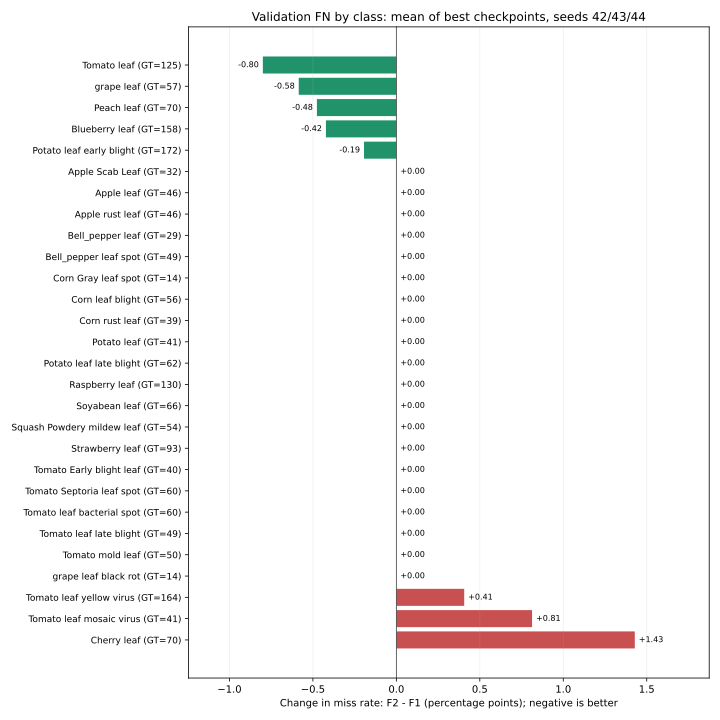
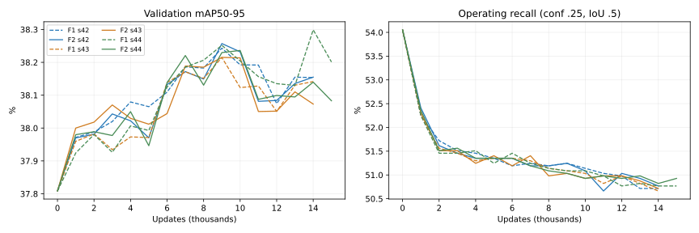

# KB2 — Thử scorer F2 so với F1, 28/10/2026

**Kết luận: F2 gần như ngang F1 trong recipe hiện tại, chưa giải quyết vấn đề bỏ sót GT.** Chạy đủ ba seed 42/43/44 trên GPU và đánh giá lại các best checkpoint. Recall tổng tăng **0,0353 điểm phần trăm**, tương đương giảm trung bình **0,67 FN/run**; mAP50–95 giảm **0,0162 điểm**. Macro recall giảm **0,0061 điểm**. Những thay đổi này nhỏ và không đồng đều giữa seed/class; chưa có bằng chứng F2 tốt hơn rõ ràng.

Ảnh, annotation, S0, kiến trúc, sampler, optimizer, native/DPO coefficients, inference và selection protocol được giữ nguyên. Không dùng test.

## 1. Thiết kế thí nghiệm

- S0: best supervised YOLOv8n, SHA256 `9a7ce8d2710b94453da2add079d3b3635fb2a9f9ae1078fbe260428a67c969f9`. Policy/reference đều bắt đầu từ S0; reference đóng băng.
- Đổi scorer: `0.8 * mean(F1@IoU=.50:.05:.95) + 0.2 * Igt` thành `0.8 * mean(F2@IoU=.50:.05:.95) + 0.2 * Igt`. `F2=5TP/(5TP+4FN+FP)`; `Igt=sum(matched IoU@.5)/Ngt`. Matching đúng class, một-một như cũ.
- Generation seed 42, 4 draw/ảnh, cùng policy nhiệt độ 1/1, background logit 0, NMS .60/cap300, gap .02; sinh lại trên toàn bộ train và chọn lại best/worst.
- Ba continuation seed 42/43/44 dùng chung fixed preferences F2 mới. Head-only, native coefficient 1, λDPO=.01, βDPO=.1, AdamW LR=1e-6/WD=5e-4, batch4/input640, clip1.
- Ngân sách 15.000 update, full validation mỗi 1.000 update, patience5, min-delta mAP=1e-4 (0,01 điểm phần trăm). Step0 tham gia chọn best. Giữ nguyên tiêu chí chọn bằng mAP50–95.
- Full validation: 479 ảnh / 1.887 GT / 28 class. Operating P/R/F1/F2 và FN: confidence .25, IoU .5; inference confidence .001, NMS .60, max_det300.

## 2. Best checkpoint: từng seed

| Seed | Best step F1 → F2 | mAP F1 (%) | mAP F2 (%) | Recall F1 (%) | Recall F2 (%) | FN F1 → F2 | FP F1 → F2 |
|---:|---|---:|---:|---:|---:|---|---|
| 42 | 9000 → 9000 | 38.2432 | 38.2570 | 51.2454 | 51.2454 | 920 → 920 | 719 → 718 |
| 43 | 9000 → 9000 | 38.2147 | 38.2150 | 51.0864 | 51.0334 | 923 → 924 | 717 → 715 |
| 44 | 14000 → 10000 | 38.2989 | 38.2361 | 50.7684 | 50.9274 | 929 → 926 | 701 → 714 |

F2 seed42/43 dừng sớm ở 14k, best9k. Seed44 kết thúc ở ngân sách15k, best10k. Seed44 có bad evaluation thứ5 tại đúng15k; completed.json ghi `budget` theo quy tắc trainer, không suy đây là bằng chứng hội tụ.

## 3. Tổng hợp ba seed

Mean ± sample SD, n=3 continuation seed. Δ là paired mean F2−F1; metric phần trăm dùng điểm phần trăm. SD qua ba seed không thay thế bất định do tập validation.

| Metric | S0 | F1 mean ± SD | F2 mean ± SD | Δ F2−F1 |
|---|---:|---:|---:|---:|
| mAP50–95 (%) | 37.8084 | 38.2523 ± 0.0429 | 38.2361 ± 0.0210 | -0.0162 |
| mAP50 (%) | 49.1157 | 49.3954 ± 0.0123 | 49.3956 ± 0.0401 | +0.0003 |
| mAP75 (%) | 42.9601 | 43.0427 ± 0.0916 | 43.0334 ± 0.1075 | -0.0093 |
| AR300 (%) | 56.1876 | 55.0395 ± 0.0109 | 55.0517 ± 0.0413 | +0.0122 |
| Precision (%) | 50.8982 | 57.4824 ± 0.2280 | 57.3839 ± 0.0093 | -0.0985 |
| Recall (%) | 54.0541 | 51.0334 ± 0.2428 | 51.0687 ± 0.1619 | +0.0353 |
| F1 metric (%) | 52.4287 | 54.0656 ± 0.0542 | 54.0423 ± 0.0936 | -0.0232 |
| F2 metric (%) | 53.3920 | 52.2044 ± 0.1687 | 52.2180 ± 0.1365 | +0.0136 |
| FP | 984.0000 | 712.3333 ± 9.8658 | 715.6667 ± 2.0817 | +3.3333 |
| FN | 867.0000 | 924.0000 ± 4.5826 | 923.3333 ± 3.0551 | -0.6667 |
| Matched IoU (%) | 86.9800 | 87.4973 ± 0.0595 | 87.4616 ± 0.0420 | -0.0357 |

Macro recall: S0 **54.4734%**, F1 **52.1560%**, F2 **52.1499%**. F2 vẫn bỏ sót thêm **56.33 GT/run** và recall thấp hơn S0 **2.9853 điểm**.

## 4. Tỷ lệ bỏ sót theo class

FN/Gt ×100, mean của ba best checkpoint. Δ âm là giảm bỏ sót. So F1, F2 cải thiện ở **5 class**, xấu hơn ở **3 class**, không đổi ở **20 class**. Hai class yếu nhất Potato leaf và Tomato leaf bacterial spot không đổi so F1.

| Class | GT | Bỏ sót S0 (%) | Bỏ sót F1 (%) | Bỏ sót F2 (%) | Δ F2−F1 (điểm) |
|---|---:|---:|---:|---:|---:|
| Potato leaf | 41 | 92.68 | 92.68 | 92.68 | +0.00 |
| Tomato leaf bacterial spot | 60 | 86.67 | 83.33 | 83.33 | +0.00 |
| Tomato Early blight leaf | 40 | 70.00 | 72.50 | 72.50 | +0.00 |
| Potato leaf early blight | 172 | 69.77 | 72.29 | 72.09 | -0.19 |
| Tomato leaf yellow virus | 164 | 64.02 | 65.24 | 65.65 | +0.41 |
| Potato leaf late blight | 62 | 58.06 | 65.05 | 65.05 | +0.00 |
| Tomato mold leaf | 50 | 64.00 | 64.00 | 64.00 | +0.00 |
| Bell_pepper leaf spot | 49 | 61.22 | 61.22 | 61.22 | +0.00 |
| Tomato leaf mosaic virus | 41 | 58.54 | 60.16 | 60.98 | +0.81 |
| Cherry leaf | 70 | 51.43 | 58.10 | 59.52 | +1.43 |
| Apple Scab Leaf | 32 | 50.00 | 53.12 | 53.12 | +0.00 |
| Tomato leaf | 125 | 45.60 | 53.60 | 52.80 | -0.80 |
| Tomato Septoria leaf spot | 60 | 50.00 | 51.67 | 51.67 | +0.00 |
| Soyabean leaf | 66 | 45.45 | 48.48 | 48.48 | +0.00 |
| Tomato leaf late blight | 49 | 40.82 | 46.94 | 46.94 | +0.00 |
| Peach leaf | 70 | 34.29 | 42.86 | 42.38 | -0.48 |
| Squash Powdery mildew leaf | 54 | 37.04 | 38.89 | 38.89 | +0.00 |
| Bell_pepper leaf | 29 | 34.48 | 37.93 | 37.93 | +0.00 |
| grape leaf black rot | 14 | 35.71 | 35.71 | 35.71 | +0.00 |
| Apple rust leaf | 46 | 30.43 | 34.78 | 34.78 | +0.00 |
| Blueberry leaf | 158 | 32.91 | 34.60 | 34.18 | -0.42 |
| Corn Gray leaf spot | 14 | 42.86 | 28.57 | 28.57 | +0.00 |
| Corn rust leaf | 39 | 25.64 | 28.21 | 28.21 | +0.00 |
| Strawberry leaf | 93 | 21.51 | 26.88 | 26.88 | +0.00 |
| Corn leaf blight | 56 | 21.43 | 26.79 | 26.79 | +0.00 |
| grape leaf | 57 | 24.56 | 25.15 | 24.56 | -0.58 |
| Raspberry leaf | 130 | 16.92 | 20.00 | 20.00 | +0.00 |
| Apple leaf | 46 | 8.70 | 10.87 | 10.87 | +0.00 |



## 5. Preference thay đổi thế nào?

| Đặc điểm cặp train | F1 | F2 |
|---|---:|---:|
| Số cặp | 2357 | 2358 |
| Chosen tăng số TP | 266 | 285 |
| Chosen giảm số TP | 20 | 15 |
| Chosen cùng số TP, giảm FP | 1735 | 1512 |
| Cặp cứu ít nhất một GT | 281 | 303 |
| Cặp mất ít nhất một GT | 47 | 48 |

- GT cứu được trong chosen so với rejected: **368 → 403**; GT bị mất: **53 → 52**. Cặp cứu/mất có thể chồng nhau nếu cứu object này nhưng mất object khác.
- Ảnh có cặp chung: **2339**; thêm19/bỏ18 ảnh, tổng2358. Trên phần chung, **1849 cặp** có cả chosen/rejected không đổi; chosen không đổi ở **2109 ảnh**.
- GT trong ảnh được giữ: **9641 → 9805**. Vì native loss dùng ảnh có cặp, thay scorer cũng thay nhẹ tập ảnh cho native loss. Đây là so hiệu quả toàn quy trình đổi scorer; chưa tách riêng tác động đổi thứ tự preference khỏi tác động thay tập ảnh.
- F2 tăng tỷ lệ cặp tăng TP từ **11,29% lên 12,09%**; phần lớn cặp vẫn không tăng TP. Không thể suy tăng điểm quality hoặc tăng số cặp cứu GT trên train sẽ tự tăng recall inference.
- Không so trực tiếp raw sampled-Q F1 với raw sampled-Q F2 vì hai công thức khác nhau.

## 6. Cùng update budget và ảnh hưởng class ít GT

| Update chung | mAP F1 (%) | mAP F2 (%) | Recall F1 (%) | Recall F2 (%) | FN F1 | FN F2 |
|---:|---:|---:|---:|---:|---:|---:|
| 9000 | 38.2365 | 38.2339 | 51.1394 | 51.1040 | 922.00 | 922.67 |
| 14000 | 38.1980 | 38.1225 | 50.7154 | 50.7684 | 930.00 | 929.00 |

Corn Gray leaf spot chỉ có14 GT: mean AP giảm **1.3474 điểm**, đóng góp **-0.0481 điểm** vào chênh mAP toàn bộ **-0.0162 điểm**. Mean AP delta của27 class còn lại là **+0.0331 điểm**. Đây là phân rã đại số, không phải thí nghiệm bỏ class; không kết luận F2 làm suy giảm rộng theo class chỉ từ mAP tổng.



## 7. Quyết định và giới hạn

- **Chưa coi F2 là cải tiến đã đạt mục tiêu giảm FN.** Số FN giảm chưa tới một object/run so F1, macro recall không tăng và class yếu nhất không cải thiện. Đây là kết quả âm/không rõ lợi ích của giả thuyết đổi scorer trong recipe này.
- Chưa có lý do chạy dài thêm chỉ với F2. Bước nghiên cứu tiếp theo nên thử chọn/cân bằng các cặp có tín hiệu khôi phục GT theo class, đồng thời kiểm soát FP; scorer F2 có thể giữ như một yếu tố thử nghiệm. Chưa triển khai thêm biến thể này.
- Không kết luận F2 luôn kém, không xác nhận lợi ích riêng của DPO so với continued native training. Các seed cùng S0, cùng fixed preferences và cùng split; validation đã dùng chọn best/tuning, chưa có test độc lập.

## 8. Kiểm chứng và artifact

- 24 kiểm thử đạt qua hai lượt: 23 CPU và 1 integration GPU riêng. Kiểm tra F2 đổi đúng thứ tự ưu tiên ở ví dụ cứu GT/FP vừa phải, vẫn phạt FP, native/DPO gradients và reference immutable.
- Quality cũ F1 và mới F2 đều replay khớp trên train GT; SHA256 pairs được kiểm tra.
- Cả ba best F2 được đánh giá GPU lại; mọi metric khớp log tại step được chọn. S0 khớp chính xác báo cáo F1. Đã kiểm hash checkpoint và config/protocol giữa các seed/variant.
- Sau cả ba lượt, fingerprint ảnh/annotation/source checkpoint/code/runtime vẫn khớp. Chỉ ba file Python trong package thay đổi: quality.py, generate_preferences.py, run.py; trainer/policy/adapter/data/metrics/evaluator không đổi.

- [Snapshot đầy đủ](assets/kb2_f2_20261028/comparison.json)
- [Bảng summary CSV](assets/kb2_f2_20261028/summary.csv)
- [Bảng từng seed CSV](assets/kb2_f2_20261028/per_seed.csv)
- [Bảng từng class CSV](assets/kb2_f2_20261028/classes.csv)
- [Bảng từng class/seed CSV](assets/kb2_f2_20261028/classes_by_seed.csv)
- [Bảng cùng update CSV](assets/kb2_f2_20261028/fixed_steps.csv)
- [Script chạy thí nghiệm](../../scripts/run_kb2_f2_experiment.py)
- [Script tổng hợp](../../scripts/compare_kb2_f2_results.py)

Run artifacts: `kb2_preference_optimization/outputs/yolov8n_f2_20261028/` chứa preferences, experiment/verification, log, best/last/completed và validation_comparison từng seed. Các artifact F1 gốc được giữ nguyên.

Tái lập vào thư mục mới:

```bash
YOLO_CONFIG_DIR=/tmp MPLCONFIGDIR=/tmp/kb2-matplotlib NO_ALBUMENTATIONS_UPDATE=1 .venv-ubuntu/bin/python scripts/run_kb2_f2_experiment.py kb2_preference_optimization/outputs/yolov8n_f2_NEW
```
