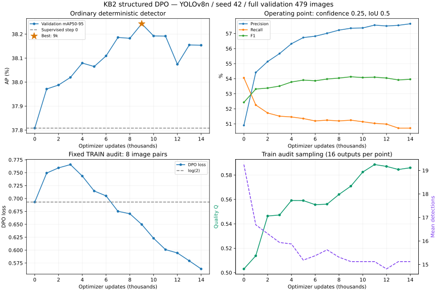

# KB2 — Review run dài YOLOv8n seed 42, 26/10/2026

> Đã bổ sung [review ba seed 42/43/44](KB2_MULTISEED_REVIEW_20261026.md).
> Báo cáo này giữ kết quả chi tiết của riêng seed 42.

## Kết luận

**Đã hoàn tất:** run dừng sớm đúng protocol ở update 14.000; best tại 9.000. Đánh giá GPU lại S0/best trên đủ 479 ảnh validation khớp AP đã log. Model sau native+DPO tăng mAP50–95 nhẹ, giảm FP nhưng tăng FN; chưa đủ bằng chứng về hiệu quả ổn định hoặc đóng góp riêng của DPO.

## Run và kiểm tra artifact

- Run: `kb2_preference_optimization/outputs/yolov8n_dpo_s42_20261026_135931`.
- Objective: `structured_detection_dpo_v1`, reference scoring `same_batch_reference_v1`.
- S0 là checkpoint supervised YOLOv8n chung; head-only, native coefficient 1, λ_DPO = 0.01, β = 0.1, AdamW LR 1e-6, batch 4, input 640, seed 42.
- Sinh preference trên 2.411 ảnh train: 9.644 outputs, giữ 2.357 cặp (97,76%), bỏ 54 ảnh gần hòa/trùng. Có GT của đủ28 lớp trong các cặp giữ. Native loss trong v1 replay các ảnh có cặp được giữ.
- Có 15 validation passes: step 0 và mỗi 1k đến14k; mỗi pass479 ảnh/1.887 GT. Không dùng test.
- Best 9k;10k/11k/12k/13k/14k không vượt best+1e-4 nên patience 5 dừng14k. Trần15k là giới hạn tối đa, không phải số update bắt buộc.
- Training+validation/audit khoảng 940,22 giây (15 phút40 giây), chưa cộng thời gian sinh preference. Peak PyTorch CUDA allocated451.916.800 byte; không phải tổng VRAM của máy.
- Đã đối chiếu SHA256 manifests, pairs.jsonl, best.pt/last.pt; checkpoint best step9000, last step14000; source-code fingerprints khớp. Reference immutable theo kiểm tra cuối run.
- Đã chạy lại evaluator trên GPU cho cả S0/best; mAP khớp tuyệt đối với step 0/best trong log.

## So S0 với best checkpoint

P/R/F1, FP/FN dùng confidence 0.25/IoU 0.5. AR300 là COCO average recall, không phải operating recall. Các metric phần trăm dùng điểm phần trăm cho delta.

| Metric | S0 | Best 9k | Delta |
|---|---:|---:|---:|
| mAP50–95 | 37.8084% | 38.2432% | +0.4347 điểm |
| mAP50 | 49.1157% | 49.4007% | +0.2850 điểm |
| mAP75 | 42.9601% | 42.9530% | -0.0071 điểm |
| AR300 | 56.1876% | 55.0318% | -1.1558 điểm |
| Precision | 50.8982% | 57.3547% | +6.4565 điểm |
| Recall@0.25/0.5 | 54.0541% | 51.2454% | -2.8087 điểm |
| F1 | 52.4287% | 54.1282% | +1.6995 điểm |
| AP-small | 4.3786% | 5.1143% | +0.7357 điểm |
| AP-medium | 17.9482% | 17.6595% | -0.2887 điểm |
| AP-large | 42.5581% | 43.3946% | +0.8365 điểm |
| TP | 1020 | 967 | -53 |
| FP | 984 | 719 | -265 |
| FN | 867 | 920 | +53 |

**Diễn giải:** số FP giảm 984→719 (−265) nhưng TP giảm 1.020→967, FN tăng 867→920 (+53). Detector phát ít hơn tại operating threshold này; tăng precision/F1 đi cùng giảm recall. Matched IoU tăng nhưng coverage giảm nên không thể kết luận mọi GT được định vị tốt hơn.
AP-small dùng94 GT nhỏ trong không gian ảnh đã resize/pad; AP-medium577 GT và AP-large1.216 GT. Không so AP-small trực tiếp với evaluator dùng area ảnh gốc.
Checkpoint last 14k có mAP50–95=38,1537%, thấp hơn best 38,2432%; nên dùng best.pt cho đánh giá tiếp.

## Theo lớp và độ vững của gain

18/28 lớp tăng AP,10/28 lớp giảm. Corn Gray leaf spot tăng 23,3718%→33,8712% (+10,4994 điểm), nhưng valid chỉ 14 GT. Vì mAP là trung bình 28 lớp, riêng lớp này đóng góp+0,3750 điểm, khoảng 86,26% net gain+0,4347 điểm của toàn model. Đây là cảnh báo về độ vững theo class support, không phải chứng minh gain sai hoặc không có ý nghĩa.

| Lớp | GT valid | AP S0 | AP best | Delta điểm |
|---|---:|---:|---:|---:|
| Corn Gray leaf spot | 14 | 23.3718% | 33.8712% | +10.4994 |
| Bell_pepper leaf spot | 49 | 25.7687% | 28.8799% | +3.1112 |
| Tomato leaf | 125 | 19.2561% | 21.4640% | +2.2079 |
| Blueberry leaf | 158 | 42.7885% | 44.9090% | +2.1205 |
| Soyabean leaf | 66 | 46.7882% | 48.7703% | +1.9821 |
| Cherry leaf | 70 | 31.2240% | 32.8331% | +1.6091 |
| grape leaf | 57 | 66.5522% | 68.0172% | +1.4650 |
| Bell_pepper leaf | 29 | 38.6076% | 39.8283% | +1.2206 |
| Tomato leaf bacterial spot | 60 | 3.8494% | 4.6260% | +0.7766 |
| Tomato leaf late blight | 49 | 43.6159% | 44.1789% | +0.5630 |
| Tomato leaf mosaic virus | 41 | 31.3108% | 31.8524% | +0.5415 |
| Corn leaf blight | 56 | 50.8962% | 51.3013% | +0.4051 |
| Squash Powdery mildew leaf | 54 | 46.4469% | 46.7251% | +0.2782 |
| Strawberry leaf | 93 | 66.9204% | 67.1483% | +0.2279 |
| Peach leaf | 70 | 45.0692% | 45.2215% | +0.1524 |
| Raspberry leaf | 130 | 64.3969% | 64.5441% | +0.1472 |
| Apple rust leaf | 46 | 43.9563% | 44.0381% | +0.0818 |
| Apple leaf | 46 | 66.1785% | 66.2407% | +0.0622 |
| Tomato mold leaf | 50 | 13.4911% | 13.4128% | -0.0784 |
| Potato leaf early blight | 172 | 19.6551% | 19.5367% | -0.1185 |
| Tomato leaf yellow virus | 164 | 18.0331% | 17.6846% | -0.3485 |
| Tomato Early blight leaf | 40 | 17.9010% | 17.4635% | -0.4374 |
| Tomato Septoria leaf spot | 60 | 30.1855% | 29.2728% | -0.9126 |
| grape leaf black rot | 14 | 60.9131% | 58.8383% | -2.0748 |
| Potato leaf | 41 | 6.1109% | 3.8034% | -2.3075 |
| Corn rust leaf | 39 | 68.8887% | 65.9846% | -2.9041 |
| Potato leaf late blight | 62 | 22.8256% | 19.8865% | -2.9391 |
| Apple Scab Leaf | 32 | 43.6348% | 40.4761% | -3.1587 |

## Preference có học được không?

- Fixed train audit8 cặp: DPO loss0,693147 ở step 0 tăng tới0,765747 tại 3k rồi giảm còn0,649761 ở best9k và0,563603 lúc 14k. Relative margin0→3,1648 ở 9k→4,7298 ở14k. Có tín hiệu tối ưu preference trên audit train sau giai đoạn đầu.
- Sampled Q trên audit tăng 0,503059→0,570897 ở 9k→0,585951 ở14k; số detection trung bình giảm 19,25→15,125. Chỉ 16 sampled outputs/mốc từ 8 ảnh train, chưa phải bằng chứng holdout/generalization.
- Absolute chosen win rate trên audit ở step 0 và14k đều0,875: không dùng chỉ số này để tuyên bố accuracy tăng. Chất lượng chosen/rejected được xác định bằng GT trước train.
- DPO audit tiếp tục tốt lên sau9k nhưng validation AP không vượt best: cải thiện preference không tự chuyển thành cải thiện AP ở deterministic inference.

## Gradient và tối ưu

- Có 141 batch được đo gradient riêng. Mean norm(λDPO)/norm(native)=3.021%; min/max=0.914%/12.231%. Không diễn giải λ0.01 thành gradient đúng1%.
- Gradient cosine mean=0.02564; 54/141 batch (38.30%) có cosine âm. Có xung đột cục bộ, chưa chứng minh đây là nguyên nhân chính của gain nhỏ hoặc recall giảm.
- Global clipping hoạt động trên 100% update (norm trước clip thường lớn hơn 1). Đây là trạng thái optimizer được cấu hình, không tự chứng minh gradient exploding hoặc training lỗi. Cần giữ thông tin này khi so recipe.
- Mean trên các record được log của 1k đầu/cuối: native 2,25408→2,09723; DPO 0,65374→0,56299. Các batch khác nhau nên dùng như diagnostic, không coi là fixed-set evaluation.

## Diễn biến đầy đủ

| Step | mAP50–95 (%) | Precision (%) | Recall (%) | F1 (%) | Audit DPO | Audit Q | Best |
|---:|---:|---:|---:|---:|---:|---:|---|
| 0 | 37.8084 | 50.8982 | 54.0541 | 52.4287 | 0.693147 | 0.503059 |  |
| 1000 | 37.9714 | 54.4150 | 52.2523 | 53.3117 | 0.749318 | 0.513833 |  |
| 2000 | 37.9880 | 55.1412 | 51.7223 | 53.3771 | 0.759368 | 0.546404 |  |
| 3000 | 38.0198 | 55.6701 | 51.5103 | 53.5095 | 0.765747 | 0.547270 |  |
| 4000 | 38.0794 | 56.3225 | 51.4573 | 53.7801 | 0.743443 | 0.559136 |  |
| 5000 | 38.0650 | 56.7330 | 51.3514 | 53.9082 | 0.714551 | 0.559067 |  |
| 6000 | 38.1093 | 56.8235 | 51.1924 | 53.8612 | 0.705070 | 0.555697 |  |
| 7000 | 38.1862 | 57.0165 | 51.2454 | 53.9771 | 0.675163 | 0.556131 |  |
| 8000 | 38.1826 | 57.2275 | 51.1924 | 54.0420 | 0.670480 | 0.564092 |  |
| 9000 | 38.2432 | 57.3547 | 51.2454 | 54.1282 | 0.649761 | 0.570897 | ★ |
| 10000 | 38.1923 | 57.3722 | 51.1394 | 54.0768 | 0.622911 | 0.582429 |  |
| 11000 | 38.1917 | 57.5613 | 51.0334 | 54.1011 | 0.601020 | 0.588570 |  |
| 12000 | 38.0744 | 57.5015 | 50.9804 | 54.0449 | 0.594502 | 0.587064 |  |
| 13000 | 38.1548 | 57.5466 | 50.7154 | 53.9155 | 0.579245 | 0.584535 |  |
| 14000 | 38.1537 | 57.6506 | 50.7154 | 53.9611 | 0.563603 | 0.585951 |  |

## Bước tiếp theo

1. Không kéo dài run này chỉ bằng tăng steps: đã có 5k update sau best không cải thiện theo protocol.
2. Audit các A/B và lỗi ở lớp 7 support 14, các lớp AP giảm và các GT bị bỏ sót thêm. Nếu recall là yêu cầu ứng dụng, kiểm tra đường P/R và threshold trên validation; giữ riêng kết quả threshold 0.25 để so sánh công bằng.
3. Chạy cùng cấu hình ở continuation seed 43/44 trước khi kết luận ổn định. Một S0/seed/split không cung cấp độ bất định cho gain hiện tại.
4. So S0 hiện chứng minh gain của quy trình native+DPO tổng thể. Nếu cần quy gain riêng cho DPO, bổ sung native-only ablation cùng điều kiện; không biến ablation thành hướng nghiên cứu KB2 riêng.
5. Chưa đánh giá test trong review này; chỉ đánh giá sau khi khóa phương pháp và checkpoint policy.

Bằng chứng: [snapshot JSON](assets/kb2_20261026/full_run_yolov8n_s42.json), [evaluation chạy lại](../../kb2_preference_optimization/outputs/yolov8n_dpo_s42_20261026_135931/validation_comparison.json), [best.pt](../../kb2_preference_optimization/outputs/yolov8n_dpo_s42_20261026_135931/training/best.pt).
