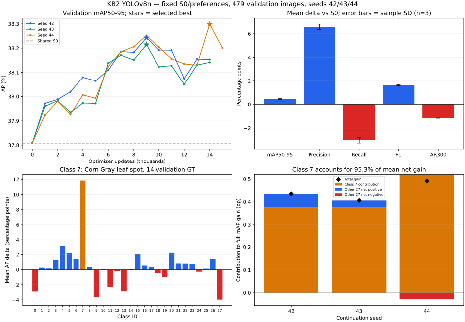

# KB2 — Review ba continuation seed YOLOv8n, 26/10/2026

## Kết luận

**Ba run seed 42/43/44 đều hoàn tất và có best validation AP cao hơn S0.** Gain mAP50–95 trung bình **+0,4438 ± 0,0429 điểm phần trăm** (sample SD, n=3). Precision/F1 tăng, nhưng operating recall và AR300 giảm ở cả ba seed. Gain lặp lại theo thứ tự batch, song chưa chứng minh cải thiện rộng theo lớp hoặc tổng quát ngoài split hiện tại.

Điểm quyết định: lớp Corn Gray leaf spot (ID 7, chỉ 14 GT validation) đóng góp khoảng **95,33% net gain trung bình**. Trung bình AP delta của 27 lớp còn lại chỉ khoảng **+0,0215 điểm**. Không thể lấy SD nhỏ qua continuation seeds để thay cho bất định do dữ liệu/GT ít.

## Phạm vi kiểm tra

- Cùng S0 YOLOv8n, dataset, 2.357 cặp preference, sampler/policy/quality, optimizer/LR/λ/β và evaluator. Khác seed shuffle/continuation; không sinh lại preference cho seed 43/44.
- Cả ba chạy GPU, full validation 479 ảnh / 1.887 GT / 28 lớp; không đánh giá test.
- Đã kiểm manifests, SHA256 best/last/pairs, checkpoint step và source-code fingerprints.
- Đã đánh giá GPU lại S0 và best của seed 43/44; seed 42 được đánh giá GPU lại ở review trước. AP tái tính khớp log ở cả ba seed.
- Reference immutable theo digest cuối run. Mỗi run chọn best bằng validation mAP50–95, kể cả step 0; đây là so cùng selection/stopping protocol, không phải mọi checkpoint có cùng số update.
- Audit sampling dùng seed phụ khác nhau theo continuation seed; không so trực tiếp raw sampled-Q giữa các seed như cùng bộ output. Fixed preference actions/GT vẫn giống nhau.

## Kết quả từng seed

| Seed | Best step | Kết thúc | Lý do | mAP50–95 (%) | Delta so S0 (điểm) | Precision (%) | Recall (%) | F1 (%) |
|---:|---:|---:|---|---:|---:|---:|---:|---:|
| 42 | 9000 | 14000 | Early stop | 38.2432 | +0.4347 | 57.3547 | 51.2454 | 54.1282 |
| 43 | 9000 | 14000 | Early stop | 38.2147 | +0.4063 | 57.3468 | 51.0864 | 54.0359 |
| 44 | 14000 | 15000 | Chạm trần | 38.2989 | +0.4905 | 57.7456 | 50.7684 | 54.0327 |

Seed 42/43 dừng ở 14k sau 5 lần không cải thiện kể từ best 9k. Seed 44 best ở 14k rồi chạm trần 15k, mới một bad evaluation; không gọi seed 44 là đã early-stop hoặc chứng minh hội tụ.

## Tổng hợp mean ± sample SD

P/R/F1 tại confidence 0.25, matching IoU 0.5. Delta của metric phần trăm dùng **điểm phần trăm**. AR300 là average recall, khác operating recall. Một S0 chung được trừ khỏi mỗi continuation để tính paired delta.

| Metric | S0 | Mean best ± SD | Mean delta ± SD |
|---|---:|---:|---:|
| mAP50–95 | 37.8084% | 38.2523% ± 0.0429 điểm | +0.4438 ± 0.0429 điểm |
| mAP50 | 49.1157% | 49.3954% ± 0.0123 điểm | +0.2796 ± 0.0123 điểm |
| mAP75 | 42.9601% | 43.0427% ± 0.0916 điểm | +0.0827 ± 0.0916 điểm |
| AR300 | 56.1876% | 55.0395% ± 0.0109 điểm | -1.1481 ± 0.0109 điểm |
| Precision | 50.8982% | 57.4824% ± 0.2280 điểm | +6.5842 ± 0.2280 điểm |
| Recall | 54.0541% | 51.0334% ± 0.2428 điểm | -3.0207 ± 0.2428 điểm |
| F1 | 52.4287% | 54.0656% ± 0.0542 điểm | +1.6369 ± 0.0542 điểm |
| AP-small | 4.3786% | 5.0334% ± 0.0912 điểm | +0.6548 ± 0.0912 điểm |
| AP-medium | 17.9482% | 17.5946% ± 0.1061 điểm | -0.3536 ± 0.1061 điểm |
| AP-large | 42.5581% | 43.4276% ± 0.0859 điểm | +0.8695 ± 0.0859 điểm |
| FP | 984 | 712.33 ± 9.87 | -271.67 ± 9.87 |
| FN | 867 | 924.00 ± 4.58 | +57.00 ± 4.58 |

Trung bình giảm khoảng 272 FP nhưng tăng 57 FN; TP giảm tương ứng 57. Đây là đánh đổi lặp lại ở cả ba seed. AR300 giảm cả khi đánh giá từ confidence 0.001, nên chưa thể giải thích mọi mất recall chỉ bằng threshold operating 0.25.
Matched mean IoU tăng khoảng 0,5172 điểm phần trăm nhưng coverage GT giảm 3,0207 điểm; không kết luận mọi object được định vị tốt hơn.
MAP75 mean tăng 0,0827 điểm với SD 0,0916 điểm; chưa có cải thiện định vị ở IoU cao mạnh và đồng đều.

## Kiểm tra cùng update budget

- Tại 9.000 update ở cả ba seed: mean AP=38.2365%, gain=+0.4281 điểm.
- Tại 14.000 update ở cả ba seed: mean AP=38.1980%, gain=+0.3896 điểm.
Gain không chỉ xuất hiện do các seed được chọn best ở mốc khác nhau. Tuy nhiên đây vẫn là kết quả trên cùng validation dùng selection/tuning.

## Gain tập trung vào lớp nào?

| Seed | Gain toàn mAP (điểm) | Đóng góp lớp 7 | Tỷ lệ net gain | Macro AP delta của 27 lớp còn lại |
|---:|---:|---:|---:|---:|
| 42 | +0.4347 | +0.3750 | 86.26% | +0.0620 |
| 43 | +0.4063 | +0.3750 | 92.30% | +0.0324 |
| 44 | +0.4905 | +0.5193 | 105.88% | -0.0299 |

Tỷ lệ vượt 100% ở seed 44 có nghĩa gain lớp 7 bù cả net loss của các lớp khác; không phải lỗi công thức. Đây là phân rã đại số của macro AP, không phải thí nghiệm train bỏ lớp 7.
Không phủ nhận gain thật trên split này, nhưng kết luận phù hợp là cải thiện tập trung ở một lớp ít support. Cần audit prediction/annotation của lớp đó và xác nhận độ bất định bằng dữ liệu phù hợp.

| Lớp | GT valid | AP S0 (%) | Mean AP best (%) | Mean delta ± SD (điểm) | Seed tăng |
|---|---:|---:|---:|---:|---:|
| Corn Gray leaf spot | 14 | 23.3718 | 35.2187 | +11.8468 ± 2.3338 | 3/3 |
| Bell_pepper leaf spot | 49 | 25.7687 | 28.9056 | +3.1370 ± 0.0578 | 3/3 |
| Tomato leaf | 125 | 19.2561 | 21.4936 | +2.2375 ± 0.0602 | 3/3 |
| Blueberry leaf | 158 | 42.7885 | 45.0215 | +2.2330 ± 0.2789 | 3/3 |
| Soyabean leaf | 66 | 46.7882 | 48.8357 | +2.0475 ± 0.0585 | 3/3 |
| Cherry leaf | 70 | 31.2240 | 32.6433 | +1.4193 ± 0.1644 | 3/3 |
| grape leaf | 57 | 66.5522 | 67.9643 | +1.4121 ± 0.2385 | 3/3 |
| Bell_pepper leaf | 29 | 38.6076 | 39.9128 | +1.3051 ± 0.1349 | 3/3 |
| Tomato leaf bacterial spot | 60 | 3.8494 | 4.6562 | +0.8068 ± 0.0519 | 3/3 |
| Tomato leaf late blight | 49 | 43.6159 | 44.4086 | +0.7928 ± 0.2742 | 3/3 |
| Tomato leaf mosaic virus | 41 | 31.3108 | 32.0309 | +0.7201 ± 0.5797 | 3/3 |
| Squash Powdery mildew leaf | 54 | 46.4469 | 46.9874 | +0.5404 ± 0.4170 | 3/3 |
| Strawberry leaf | 93 | 66.9204 | 67.2667 | +0.3463 ± 0.1308 | 3/3 |
| Corn leaf blight | 56 | 50.8962 | 51.2175 | +0.3213 ± 0.1154 | 3/3 |
| Apple leaf | 46 | 66.1785 | 66.4444 | +0.2659 ± 0.2719 | 3/3 |
| Apple rust leaf | 46 | 43.9563 | 44.1202 | +0.1639 ± 0.2855 | 2/3 |
| Tomato mold leaf | 50 | 13.4911 | 13.6280 | +0.1369 ± 0.6482 | 1/3 |
| Peach leaf | 70 | 45.0692 | 45.1611 | +0.0920 ± 0.1805 | 2/3 |
| Raspberry leaf | 130 | 64.3969 | 64.4614 | +0.0644 ± 0.1923 | 2/3 |
| Potato leaf early blight | 172 | 19.6551 | 19.5036 | -0.1515 ± 0.0333 | 0/3 |
| Tomato leaf yellow virus | 164 | 18.0331 | 17.7693 | -0.2639 ± 0.1007 | 0/3 |
| Tomato Early blight leaf | 40 | 17.9010 | 17.4301 | -0.4709 ± 0.0714 | 0/3 |
| Tomato Septoria leaf spot | 60 | 30.1855 | 29.2209 | -0.9646 ± 0.1041 | 0/3 |
| Potato leaf | 41 | 6.1109 | 3.8326 | -2.2783 ± 0.0259 | 0/3 |
| Potato leaf late blight | 62 | 22.8256 | 19.9510 | -2.8746 ± 0.1277 | 0/3 |
| Apple Scab Leaf | 32 | 43.6348 | 40.7449 | -2.8899 ± 0.2636 | 0/3 |
| Corn rust leaf | 39 | 68.8887 | 65.2885 | -3.6002 ± 0.7373 | 0/3 |
| grape leaf black rot | 14 | 60.9131 | 56.9448 | -3.9683 ± 3.1844 | 0/3 |

## Preference và gradient

| Seed | Audit DPO step 0 | Audit DPO tại best | Audit DPO cuối | Mean norm(λDPO)/norm(native) | Batch gradient xung đột |
|---:|---:|---:|---:|---:|---:|
| 42 | 0.693147 | 0.649761 | 0.563603 | 3.021% | 38.30% |
| 43 | 0.693147 | 0.650638 | 0.573579 | 3.145% | 34.04% |
| 44 | 0.693147 | 0.574019 | 0.558800 | 3.029% | 39.07% |

DPO loss trên 8 cặp train audit đều thấp hơn log(2) tại best/cuối run. Có tín hiệu tối ưu preference; audit nhỏ trên train không thay thế holdout. Global clipping xảy ra ở 100% update trong cả ba run; không tự chứng minh exploding gradient.
Native loss vẫn có trong objective; so với S0 chỉ xác nhận hiệu quả quy trình native+DPO. Chưa tách lợi ích DPO khỏi continued native training.

## Đồ thị

## Đề xuất tiếp theo

1. Giữ ba run này làm kết quả phiên bản hiện tại; không chọn seed thắng để thay thế mean/SD.
2. Audit các GT bị bỏ sót thêm và lớp 7: so prediction S0/best trên cùng ảnh, tách hạ confidence, class sai và hộp lệch. Giữ threshold hiện tại trong bảng chính.
3. Nếu ưu tiên giảm bỏ sót, thiết kế một phiên bản preference scorer ưu tiên recall hơn (ví dụ F2) và so với phiên bản hiện tại trên cùng source/recipe. Đây là giả thuyết cần kiểm chứng, chưa khẳng định sẽ tốt hơn.
4. Sau khi khóa phương pháp, xác nhận trên model/holdout phù hợp. Ba seed này dùng cùng S0, fixed pairs và split, nên không đo bất định của S0, preference generation hoặc dữ liệu.
5. Native-only ablation là đối chứng bổ sung nếu cần quy gain riêng cho DPO. Chưa dùng test để điều chỉnh công thức hoặc chọn seed.

Bằng chứng: [snapshot JSON](assets/kb2_20261026/multiseed_yolov8n_s42_s43_s44.json). [Review seed 42](KB2_FULL_RUN_REVIEW_20261026.md).
