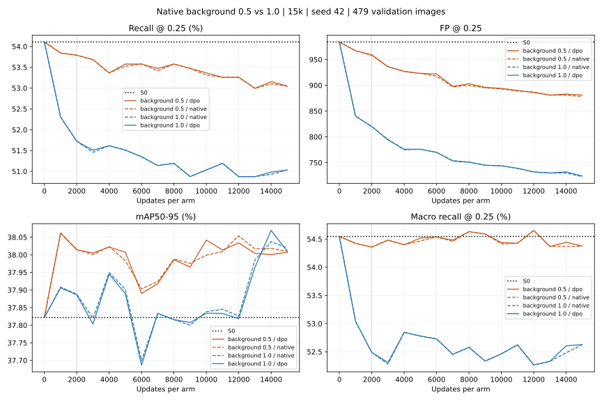

# KB2 — review chạy dài native background0,5, 31/10/2026

**Đã hoàn tất DPO và native-only, mỗi lượt15.000 update.** Giảm background giúp
recall tại confidence0,25 ít suy giảm hơn recipe gốc, nhưng kéo dài từ2k lên15k
không đưa recall vượt S0. DPO vẫn gần trùng native-only. Tại cùng FP budget có
cải thiện nhỏ của cảhai model, trong đó lợi thế riêng DPO chỉ1 GT.

## 1. Kết quả chính trên full validation

479 ảnh/1.887 GT, confidence0,25, IoU0,5, ordinary YOLO inference input640,
NMS0,6/cap300; mAP từ predictions confidence0,001.

| Model | Background weight | Step | mAP50–95 (%) | Micro recall (%) | Macro recall (%) | FN | FP |
|---|---:|---:|---:|---:|---:|---:|---:|
| S0 supervised | — | 0 | 37,8218 | 54,1070 | 54,5463 | 866 | 984 |
| DPO pilot mới | 0,5 | 2.000 | 38,0141 | 53,7891 | 54,3571 | 872 | 959 |
| DPO dài mới | 0,5 | 15.000 | 38,0072 | 53,0472 | 54,3743 | 886 | 881 |
| Native-only dài mới | 0,5 | 15.000 | 38,0099 | 53,0472 | 54,3743 | 886 | 878 |
| DPO dài recipe gốc | 1 | 15.000 | 38,0096 | 51,0334 | 52,6276 | 924 | 724 |

DPO dài mới so S0: AP+0,1854 điểm phần trăm, FP giảm103, nhưng FN tăng20,
micro recall−1,0599 điểm. Precision50,9227%→53,1881%: model tiếp tục đánh đổi
recall để giảm dự đoán thừa tại threshold chính.

So pilot2k: FN872→886, FP959→881, AP38,0141%→38,0072%. Không có lợi ích muộn
về micro recall từ việc tăng ngân sách này. So recipe gốc15k, FN giảm38 nhưng
FP tăng157, trong khi AP gần bằng. Giảm background có tác động, chưa đạt mục tiêu
vượt S0 tại confidence0,25.

So native-only mới, DPO cùng TP1001/FN886, cùng FN từng class và **cùng mọi GT
detected ID**. FP hơn3, AP thấp hơn0,00274 điểm phần trăm. Chưa có lợi ích thêm
rõ của DPO tại primary threshold.

Hai best.pt đều là **đúng trọng số S0 step0**; last.pt chứa trọng số15k.
Không điểm train nào qua gate micro recall>=S0 trong15 điểm validation sau update.
Không đổi selector/threshold sau khi xem kết quả để chọn lại best.

[Summary](assets/kb2_native_background_long_20261031/summary.csv),
[fresh metrics DPO](assets/kb2_native_background_long_20261031/dpo_validation.json),
[fresh metrics native-only](assets/kb2_native_background_long_20261031/native_validation.json).

## 2. Quỹ đạo học

| DPO step | mAP50–95 (%) | FN | FP | GT cứu/mất so S0 |
|---|---:|---:|---:|---:|
| 0 | 37,8218 | 866 | 984 | 0/0 |
| 1.000 | 38,0613 | 871 | 967 | 7/12 |
| 2.000 | 38,0141 | 872 | 959 | 9/15 |
| 5.000 | 38,0072 | 876 | 923 | 21/31 |
| 10.000 | 38,0419 | 880 | 894 | 27/41 |
| 12.000 | 38,0336 | 882 | 886 | 30/46 |
| 15.000 | 38,0072 | 886 | 881 | 31/51 |

Điểm train có micro recall và AP cao nhất đều tại1k, vẫn kém S0 về micro recall.
Macro recall cao nhất tại12k:54,6524%, hơn S0 nhưng FN882 khiến gate từ chối.
Không đồng nhất việc macro recall tăng ở một số điểm với việc cả detector đã tốt hơn.



Cam: background0,5; xanh: background1. Nét liền DPO, nét đứt native-only, đường
dọc2k là ngân sách pilot. DPO/native-only gần trùng trong cảhai recipe.

Kết luận giới hạn: nguyên recipe/seed này chưa cải thiện muộn về ordinary recall
đến15k. Không chứng minh hội tụ toán học hay mọi ngân sách lớn hơn đều vô ích,
nhưng không có cơ sở thực nghiệm chỉ tăng step tiếp sẽ xử lý vấn đề.

[Đủ16 điểm/lượt, cả background0,5 và1](assets/kb2_native_background_long_20261031/validation.csv).

## 3. GT được cứu và GT bị mất

DPO15k giữ970 GT S0 từng đúng, cứu31 GT S0 bỏ sót, mất51 GT S0 từng đúng,
cảhai vẫn bỏ sót835 GT. Net31−51=−20, khớp FN866→886.

Từ2k đến15k, recovered9→31 nhưng lost15→51: cứu thêm22, mất thêm36, net−14.
Đây là nguyên nhân trực tiếp FN xấu hơn pilot dù số GT được cứu vẫn tăng.

| Mật độ ảnh | GT cứu | GT mất | Net |
|---|---:|---:|---:|
| 1–2 object | 7 | 11 | -4 |
| 3–5 object | 5 | 8 | -3 |
| >=6 object | 19 | 32 | -13 |

Small0 cứu/4 mất, medium6/23, large25/24. Vấn đề còn tập trung ở ảnh đông lá
và object medium. Bảng theo overlap GT không cho phép quy mọi lỗi này cho NMS:
nhóm GT overlap IoU>=0,3 giữ27/miss17, không có recovery/lost trong run này.

Theo28 class,8 class giảm FN,6 giữ nguyên,14 tăng so S0. Ví dụ Tomato leaf
57→67 FN; Potato leaf late blight36→41; Strawberry leaf20→24. Chiều ngược lại,
Blueberry leaf52→49, Corn Gray leaf spot6→3, Tomato leaf bacterial spot52→49.

AP gain không đồng đều: riêng Corn Gray leaf spot có14 GT đóng góp khoảng
+0,5138 điểm phần trăm vào macro mAP; tổng27 class còn lại đóng góp khoảng
−0,3283 điểm, tạo net+0,1854 điểm. Không gọi đây là AP cải thiện đồng đều.

[GT identity ledger](assets/kb2_native_background_long_20261031/gt_ledger.csv),
[class breakdown](assets/kb2_native_background_long_20261031/classes.csv).

## 4. FP: tổng trong budget, một số class vẫn tăng

DPO881 FP, native878 FP, đều dưới S0 là984 và dưới gate nguyên tối đa1.033 FP.
FP không phải gate thất bại của run này; micro recall mới là gate thất bại.

So S0, DPO có48 ảnh tăng FP,101 giảm,330 giữ nguyên. Các ảnh tăng cộng61 FP;
các ảnh giảm cộng−164 FP, net−103. FP/image2,0543→1,8392.

| Mật độ ảnh | FP S0 | FP DPO mới |
|---|---:|---:|
| 1–2 object | 213 | 214 |
| 3–5 object | 303 | 275 |
| >=6 object | 468 | 392 |

Bốn class tăng FP: Tomato leaf bacterial spot42→65; Corn Gray leaf spot11→18;
Potato leaf17→20; Tomato mold leaf41→42. Class bacterial spot chỉ giảm3 FN
nhưng tăng23 FP, nên cải thiện recall ở class này đi kèm chi phí đáng kể.
Không suy từ tổng FP giảm rằng mọi class hoặc ảnh đều tốt hơn.

[FP/TP/FN từng ảnh](assets/kb2_native_background_long_20261031/images.csv).

## 5. Tại cùng FP984: có tín hiệu nhỏ, phần riêng DPO rất ít

Quét cutoff global trên các score thực tế, giữ score ties theo nhóm, giữ nguyên
NMS/cap và xác nhận matching lại tại cutoff chọn được. Đây là phép so exploratory
trên validation, không dùng để đổi threshold chính, chọn lại checkpoint hoặc tune test.

| Model | Cutoff validation | TP | FP | FN |
|---|---:|---:|---:|---:|
| S0 | 0,250284 | 1.021 | 984 | 866 |
| DPO background0,5 pilot2k | 0,236803 | 1.025 | 984 | 862 |
| DPO background0,5 dài15k | 0,211847 | 1.028 | 984 | 859 |
| Native-only background0,5 dài15k | 0,212765 | 1.027 | 984 | 860 |
| DPO/native-only background1 dài15k | khoảng0,153 | 1.027 | 984 | 860 |

DPO mới hơn S0 là7 GT ở cùng FP; native-only hơn6 GT. Vì thế không kết luận
model kém S0 ở mọi threshold. Nhưng phần lợi ích thêm của DPO chỉ1 GT; so
recipe background1 dài trước đây cũng chỉ hơn1 TP ở budget này.

Matching theo GT identity cho thấy DPO và native cùng cứu **44 GT S0 bỏ sót**;
DPO mất37 GT S0 từng đúng, native mất38. Một GT khác biệt là ảnh valid ID396,
GT25, class12 Potato leaf early blight, vốn đã được S0 phát hiện. Lợi thế1 GT
của DPO ở budget này là giữ lại GT, không phải cứu thêm một GT S0 bỏ sót so native.

Giảm background chủ yếu giúp điểm vận hành confidence0,25 gần S0 hơn; sau khi
so cùng FP, các recipe gần nhau. AP có thay đổi, nên cũng chưa thể quy toàn bộ
tác động cho score scaling thuần túy. Chỉ một seed/validation, chưa có CI hoặc
test độc lập; chênh1–7 GT chưa đủ để khẳng định lợi ích ổn định hay tổng quát hóa.

[Exact FP sweep](assets/kb2_native_background_long_20261031/exact_fp_budget.csv),
[GT ledger tại matched FP](assets/kb2_native_background_long_20261031/matched_fp_gt_ledger.csv).

## 6. DPO đang đóng góp đến đâu?

Ở151 điểm gradient được log, weighted DPO/native gradient norm trung bình
khoảng1,659%. Đây là tỷ lệ norm trên các batch được đo, không phải phần trăm
chính xác ảnh hưởng lên AdamW update. DPO làm đổi weights/scores nhưng chưa
tạo đường học recall tách rõ khỏi native-only.

Fixed DPO-train probes tại15k: recovery mean score0,128454 ở S0→0,114723 DPO,
native-only0,113537; cảhai chỉ phát hiện1/8 recovery targets. Preservation
DPO8/8, native8/8. Các probe bị loại khỏi DPO nhưng vẫn là ảnh train: recovery
DPO0/8, preservation6/8, gần native-only. Không dùng các probe này như holdout
độc lập hay thay cho kết quả validation.

Full train-bank exposure đã chạm đủ663 cặp và378 ảnh preference,30.000 draws:
background7.658, recovery7.496, preservation7.411, duplicate7.435. Do đó chưa
có bằng chứng thiếu cơ hội nhìn thấy các cặp trong bank là nguyên nhân chính.
Điều này không bảo đảm bank đủ đa dạng hoặc gradient đang tối ưu đúng mục tiêu.

## 7. Kiểm chứng và artifact

Run: `kb2_preference_optimization/outputs/yolov8n_native_background_long_s42_20261031_020350_005551/`.

- completed.json toàn run và từng lượt có đủ, không có failed.json. Tổng30.000
  update, trainer ghi khoảng2.068 giây, tương đương34,5 phút chưa tính setup.
- Recipe giữ background0,5/positive1, LR1e-6, beta0,1, lambda0,01, batch4/DPO2,
  classification cv3, S0/reference cố định; không train thêm trong lần review.
- Bốn checkpoint best/last đã kiểm SHA. Đã nạp lại S0 và hai last.pt, đo GPU
  lại toàn validation: toàn bộ metrics khớp log, bỏ riêng thời gian evaluator.
- Best state cảhai bằng S0; frozen state khớp. Reference bất biến theo trainer.
- Hai stream15k byte-identical và bằng nguyên stream15k đã được tái dựng độc
  lập ở review background1 trước. Digest tính lại khớp:
  `0604b960337555fe83d6dd1b649b514fbfbb2b420f4a83ef2316062837d063e8`.
- Stream và toàn bộ metrics/probes0/1k/2k khớp pilot background0,5. Exposure
  native/DPO bằng nhau. Source/bank/runtime/code provenance khớp.
- S0 và8 checkpoint pilot giữ nguyên checksum trong plan. Không đổi data,
  loss implementation, sampler, checkpoint cũ hoặc threshold chính; không dùng test.

[Review/provenance/diagnostics đầy đủ](assets/kb2_native_background_long_20261031/review.json).

Lệnh tái kiểm tra, output phải chưa tồn tại:

```bash
YOLO_CONFIG_DIR=/tmp MPLCONFIGDIR=/tmp/kb2-matplotlib NO_ALBUMENTATIONS_UPDATE=1 .venv-ubuntu/bin/python -m scripts.review_kb2_native_background_long --root kb2_preference_optimization/outputs/yolov8n_native_background_long_s42_20261031_020350_005551 --output /tmp/kb2_bg_long_fresh_review --device cuda
```

## 8. Đánh giá và hướng tiếp theo

Lượt dài có ý nghĩa vì xác nhận lợi ích giảm background tồn tại so recipe cũ,
đồng thời cho thấy tăng ngân sách15k chưa khắc phục được mất GT và chưa làm DPO
vượt native-only rõ ràng. Giữ S0 làm checkpoint được chọn theo protocol đã khóa.

Không nên chỉ tăng step tiếp với nguyên recipe. Nếu tiếp tục nghiên cứu, ưu tiên
kiểm cơ chế DPO tại recovery GT và ảnh hưởng lên các GT khác, sau đó thử thay đổi
một yếu tố có đối chứng. Tín hiệu nhỏ ở matched FP cần seed bổ sung/đánh giá độc
lập trước khi dùng làm bằng chứng DPO tốt hơn. Chưa tự thay loss hoặc mở run mới.
