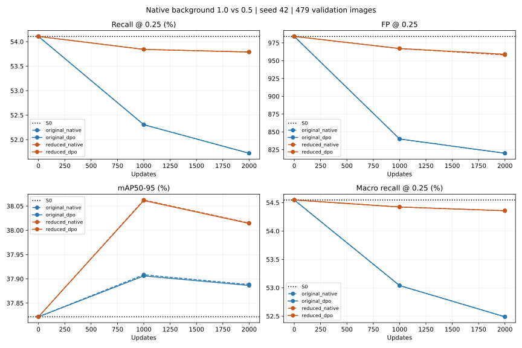

# KB2 — pilot giảm riêng native background, 31/10/2026

## Thiết kế đã khóa trước khi chạy

Thử một hệ số duy nhất `alpha_bg = 0,5`, đối chiếu với bản gốc `alpha_bg = 1`.
Chạy đủ bốn cấu hình: background gốc/giảm một nửa × native-only/native+DPO.
Mỗi cấu hình bắt đầu lại từ S0, 2.000 update, seed42, validation tại 0/1.000/2.000.
Không dùng checkpoint chạy dài làm điểm khởi đầu. Không sửa ảnh/annotation, bank,
checkpoint cũ hoặc implementation conditional V0 đã dùng trong các thí nghiệm trước.

Mục tiêu: kiểm tra giảm sức ép từ các slot background có hạn chế việc mất GT hay
không, đồng thời kiểm tra FP và phần đóng góp thêm của DPO so với native-only.

## Loss thay đổi chính xác ở đâu?

Với `fg_mask` do native Task-Aligned Assigner trả về:

```
L_cls = cls_gain / max(sum(target_scores), 1)
        * [sum(BCE tại foreground) + alpha_bg * sum(BCE tại background)]
L_total = L_box + L_dfl + L_cls + lambda * L_DPO
```

Ở nhánh native-only, hệ số DPO bằng 0; native+DPO giữ lambda0,01, beta0,1.
Foreground là toàn bộ slot được assigner gán cho object: cả target class đúng
lẫn target bằng 0 ở các class khác đều giữ trọng số1. Không nhân0,5 vào tất cả
phần tử có target bằng0. Background là các slot **không** được assigner gán cho
object, được giảm trọng số ở toàn bộ class.

Mẫu số, soft target, quy tắc assignment, class weighting nếu có, box/DFL và
native coefficient1 giữ nguyên. Giữ công thức native positive không có nghĩa
assignment/positive score sẽ đứng yên sau nhiều bước: chúng vẫn được tính lại
từ model hiện tại theo native loss.

Implementation ở `kb2_preference_optimization/conditional_bg/`, dùng lại loss
Ultralytics và thay riêng BCE elementwise bằng mask của assigner. Trainer fork
tách riêng để giữ nguyên fingerprint của V0/bank cũ. Mỗi run ghi fingerprint
của cả V0 lẫn implementation mới, kèm native foreground/background loss components.

## Các yếu tố đối chứng

- Native batch4 = 2 ảnh uniform + 2 ảnh preference; DPO2 quyết định mỗi bước.
- Cùng bank784 cặp,663 cặp train, cùng thứ tự ảnh và pair qua cả bốn cấu hình.
- Chỉ train classification cv3; backbone/regression/BN buffers giữ nguyên.
- AdamW LR1e-6, weight decay5e-4, gradient clip1; float32, TF32 tắt.
- Full validation479 ảnh/1.887GT, ordinary inference input640, NMS0,6, cap300.
- Primary confidence0,25, matching IoU0,5; AP tính từ predictions confidence0,001.
- Selector giữ nguyên: micro recall>=S0, FP<=1,05*S0, AP>=S0−0,001;
  trong các điểm đạt gate chọn macro recall cao nhất, S0 vẫn eligible.
- Không chọn lại alpha, confidence hoặc selector sau khi xem kết quả. Không test.

Kiểm thử trước pilot: **51/51 đạt**, gồm GPU với S0 trên batch4 thật.
Alpha1 cho loss và toàn bộ trainable parameter gradients trùng hoàn toàn với
native gốc; alpha0,5 giữ nguyên assignment/soft target và gradient tại mọi class
foreground, giảm đúng một nửa gradient tại background. Có kiểm tra empty GT,
class weighting, mask phải được cung cấp mới cho từng batch và tham số không hợp lệ.

Batch đầu thực tế có170 foreground slot và33.430 background slot. Foreground
classification component là0,3263017; background trước weighting0,1077774,
sau weighting0,0538887. Native total1,7617470→1,7078583, chênh đúng một nửa
background component. Gradient clip vẫn áp dụng như cũ cho tổng parameter gradient;
giữ foreground loss không có nghĩa mọi parameter update tại foreground sẽ giống cũ.

Lệnh tái hiện (tạo thư mục output mới):

```bash
YOLO_CONFIG_DIR=/tmp MPLCONFIGDIR=/tmp/kb2-matplotlib NO_ALBUMENTATIONS_UPDATE=1 .venv-ubuntu/bin/python -m kb2_preference_optimization.conditional_bg.run --preferences kb2_preference_optimization/outputs/yolov8n_conditional_bank_20261031_v1/preferences --device cuda --steps 2000 --eval-interval 1000 --background-weight 0.5
```

## Kết quả chính: confidence0,25

**Đã hoàn tất đủ bốn pilot trên GPU, mỗi cấu hình2.000 update.** Giảm riêng
background giúp hạn chế mất GT rõ so với recipe cũ; chưa vượt S0 về recall tại
điểm vận hành đã khóa. FP tổng không vượt ngân sách S0. DPO chưa tạo khác biệt
GT được phát hiện so với native-only ở confidence0,25.

| Model | Background weight | mAP50–95 (%) | Micro recall (%) | Macro recall (%) | FN | FP |
|---|---:|---:|---:|---:|---:|---:|
| S0 | — | 37,8218 | 54,1070 | 54,5463 | 866 | 984 |
| Native-only gốc | 1 | 37,8882 | 51,7223 | 52,4885 | 911 | 820 |
| Native+DPO gốc | 1 | 37,8863 | 51,7223 | 52,4885 | 911 | 820 |
| Native-only mới | 0,5 | 38,0150 | 53,7891 | 54,3571 | 872 | 958 |
| Native+DPO mới | 0,5 | 38,0141 | 53,7891 | 54,3571 | 872 | 959 |

DPO mới so DPO gốc: FN giảm39, FP tăng139, AP tăng0,1278 điểm phần trăm.
So S0: FN vẫn tăng6, FP giảm25, AP tăng0,1924 điểm. Vì thế không kết luận
“FP không tăng” nếu đang so với recipe cũ: FP tăng so recipe cũ nhưng còn dưới S0.

So native-only mới, DPO cùng TP/FN, cùng mọi GT detected ID trên479 ảnh, FP hơn1,
AP thấp hơn0,00091 điểm phần trăm. Chưa có lợi ích thêm rõ tại primary threshold.

Ở1.000 bước, hai cấu hình background0,5 cùng FN871/FP967; đến2.000 bước
FN872/FP958–959. Cảhai điểm vẫn không qua gate micro recall>=S0. **Bốn best.pt
đều giữ đúng trọng số S0 step0; last.pt mới chứa trọng số đã học2.000 update.**
Không đổi selector để chọn checkpoint sau khi xem kết quả.



[Tất cả validation points](assets/kb2_native_background_20261031/validation.csv),
[bảng tổng hợp](assets/kb2_native_background_20261031/summary.csv).

## GT được cứu/mất: tác động chính là giữ các GT đã đúng

| So với S0 | DPO gốc | DPO background0,5 |
|---|---:|---:|
| Giữ GT S0 đã đúng | 972 | 1.006 |
| Cứu GT S0 bỏ sót | 4 | 9 |
| Mất GT S0 từng đúng | 49 | 15 |
| Cảhai vẫn bỏ sót | 862 | 857 |
| Net recovered−lost | -45 | -6 |

So trực tiếp DPO mới/gốc theo GT identity: mới phát hiện thêm41 GT và mất2 GT
mà bản gốc phát hiện, net+39. Không chỉ so tổng TP.

Trong ảnh>=6 object: bản gốc mất40/cứu1; bản mới mất11/cứu6. Giảm mất GT ở
ảnh đông lá là phần lớn thay đổi. Bản mới vẫn mất11 GT ở nhóm này, nên chưa
giải quyết hoàn toàn ảnh hưởng giữa các lá.

Theo28 class, DPO mới có3 class giảm FN so S0,18 giữ nguyên,7 tăng FN;
recipe gốc tương ứng1/9/18. Không có cải thiện đồng đều ở mọi class.

Fixed train probes cho thêm dấu hiệu phù hợp:8 preservation GT từ8/8 ở S0
còn3/8 với DPO gốc, nhưng7/8 với DPO mới. Mean recovery score8 probe:
0,128454 ở S0→0,071540 bản gốc→0,107817 bản mới; vẫn0/8 recovery target được
ordinary inference phát hiện. Đây là nhóm probe nhỏ trên train, không thay cho
validation hoặc bằng chứng tổng quát hóa.

[GT identity ledger](assets/kb2_native_background_20261031/gt_ledger.csv),
[class breakdown](assets/kb2_native_background_20261031/classes.csv).

## Kiểm FP

Gate FP cho phép tối đa1.033 FP nguyên, tương ứng1,05×984. Bản DPO mới959 FP
qua gate FP; gate thất bại là recall. FP/image2,0021 so S0 là2,0543 và bản cũ1,7119.

Tổng FP giảm25 so S0 nhưng25 ảnh tăng FP,41 ảnh giảm,413 ảnh giữ nguyên.
Các ảnh tăng cộng30 FP, các ảnh giảm cộng−55 FP. Theo mật độ:

| GT trong ảnh | FP S0 | FP DPO mới |
|---|---:|---:|
| 1–2 | 213 | 211 |
| 3–5 | 303 | 295 |
| >=6 | 468 | 453 |

Có8 class tăng FP so S0: Tomato leaf bacterial spot42→49; Blueberry leaf66→69;
Potato leaf early blight56→58; Tomato leaf yellow virus60→62; Corn Gray leaf
spot11→12; Potato leaf17→18; Squash Powdery mildew leaf33→34; Tomato leaf mosaic
virus19→20. Tăng cuối cùng này là1 FP khác biệt giữa DPO/native-only mới.
FP toàn bộ vẫn trong budget nhưng cần theo dõi class bacterial spot khi thử tiếp.

[FP/TP/FN từng ảnh](assets/kb2_native_background_20261031/images.csv).

## So tại cùng FP budget: kết quả phụ, không đổi threshold chính

Quét đúng các score thực tế, giữ nguyên NMS/cap và xử lý score ties theo nhóm;
mỗi model chọn cutoff global để đạt tối đa984 FP. Đây là phân tích exploratory
trên validation, không dùng để chọn lại best hoặc đưa ra kết luận trên test.

| Model | Cutoff tìm trên validation | TP | FP | FN |
|---|---:|---:|---:|---:|
| S0 | 0,250284 | 1.021 | 984 | 866 |
| Native-only gốc | 0,187743 | 1.023 | 984 | 864 |
| Native+DPO gốc | 0,187623 | 1.023 | 984 | 864 |
| Native-only mới | 0,236953 | 1.023 | 984 | 864 |
| Native+DPO mới | 0,236803 | 1.025 | 984 | 862 |

Ở budget này, giảm background ở native-only không tăng TP so bản gốc sau khi
điều chỉnh cutoff. Phần lớn cải thiện tại confidence0,25 phù hợp với việc bớt
đè confidence; chưa phải bằng chứng mạnh về phân biệt object/background tốt hơn.
AP có tăng nhẹ, nên cũng không kết luận mọi thay đổi chỉ là score scaling.

DPO mới hơn native-only2 GT và S0 là4 GT tại FP984: ghi nhận tín hiệu nhỏ này,
không bỏ qua nhưng cũng không coi là lợi ích ổn định. Chỉ một seed và một tập
validation, chưa có CI hoặc test độc lập; thay đổi2–4 GT có thể nhạy với cutoff.

[Sweep chính xác](assets/kb2_native_background_20261031/exact_fp_budget.csv).

## Kiểm chứng và artifact

Run mới:
`kb2_preference_optimization/outputs/yolov8n_native_background_s42_20261031_001256_145730/`.
Bốn thư mục `original_native`, `original_dpo`, `reduced_native`, `reduced_dpo`
mỗi thư mục có manifest, metrics, stream, completed, best.pt/last.pt riêng.

- Đủ8.000 update, tổng thời gian trainer khoảng558 giây, không tính setup/initial eval.
- Full source/bank/runtime provenance được kiểm bởi trainer; code cũ không đổi.
- Bốn stream byte-identical, SHA
  `377802ba46eaa91b79aae70ff0881ffed8e72b97c1435084ae819b78269edbe0`.
- Hai original controls tái hiện chính xác cả metrics/probes0/1k/2k và stream
  của pilot V0 trước, bỏ riêng thời gian evaluator khi so metrics.
- Đã reload S0 và bốn last.pt, đo GPU lại đủ validation: toàn bộ metrics khớp log.
  Đã kiểm best state=S0, reference/frozen state invariants và checkpoint hashes.
- Source S0 và8 file best/last của pilot/long cũ giữ nguyên checksum trước/sau.
- [Review JSON](assets/kb2_native_background_20261031/review.json),
  [51 tests](assets/kb2_native_background_20261031/tests.txt),
  [hash checkpoint cũ](assets/kb2_native_background_20261031/old_checkpoints_unchanged.json).

Lệnh fresh review, dùng output path chưa tồn tại:

```bash
YOLO_CONFIG_DIR=/tmp MPLCONFIGDIR=/tmp/kb2-matplotlib NO_ALBUMENTATIONS_UPDATE=1 .venv-ubuntu/bin/python -m scripts.review_kb2_native_background --root kb2_preference_optimization/outputs/yolov8n_native_background_s42_20261031_001256_145730 --output /tmp/kb2_bg_fresh_review --device cuda
```

## Đánh giá

Giảm riêng native background0,5 là thay đổi có tác dụng trong pilot này: giữ
native foreground formula/gradient trực tiếp, hạn chế mất GT và không làm FP
tổng vượt S0. Nó chưa khôi phục recall S0 tại threshold đã khóa, chưa tạo
lợi ích DPO rõ so native-only, và chưa đủ để thay S0 hoặc xác nhận tổng quát hóa.

Giữ đây là cấu hình thử nghiệm có đối chứng; không tự đổi default V0 hoặc chạy
dài tiếp. Nếu tiếp tục, cần xác nhận chênh lệch nhỏ tại matched FP qua seed bổ
sung và kiểm recovery gradient/score còn bị kéo xuống, trước khi tăng ngân sách.
