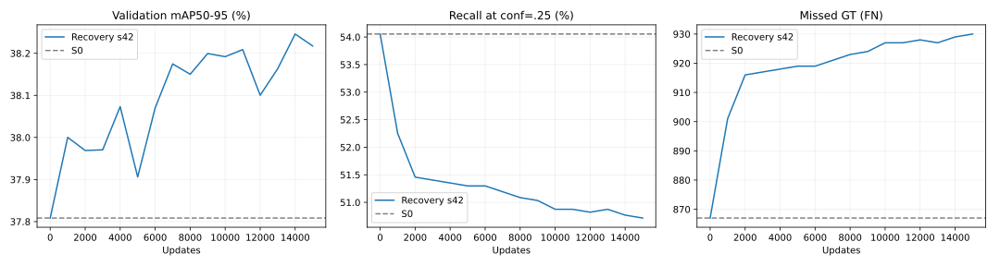

# KB2 — Đánh giá run dài khôi phục GT, 30/10/2026

> Kết quả mới nhất31/10: [review pilot Conditional DPO V0](KB2_CONDITIONAL_PILOT_REVIEW_20261031.md), native/DPO cùng FN911 so S0 FN866; chưa chuyển run dài.

> Cập nhật31/10: đã triển khai V0 theo brainstorm sau audit; xem [KB2_CONDITIONAL_V0_IMPLEMENTATION_20261031.md](KB2_CONDITIONAL_V0_IMPLEMENTATION_20261031.md). Kết quả recovery-long bên dưới được giữ nguyên.

**Run đã hoàn tất 15.000 update CUDA. Ở protocol cố định conf=0,25, cách chọn/cân bằng cặp khôi phục chưa đạt mục tiêu giảm GT bị bỏ sót.** Best mAP50–95 tăng 0,4374 điểm phần trăm so S0, nhưng recall giảm 3,2856 điểm phần trăm và FN tăng 62. So best F2 seed42 trước đó, best mới có mAP thấp hơn 0,0112 điểm phần trăm và thêm 9 FN. Đây là một seed, chưa phải kết luận phủ định DPO nói chung.

Có một điểm cần phân biệt: hạ confidence của best mới xuống 0,15 trên validation giúp khôi phục mức recall của S0 tại 0,25, đồng thời FP thấp hơn một chút. Vì vậy có dấu hiệu dịch chuyển confidence/điểm vận hành; chưa nên diễn giải mọi FN tăng tại ngưỡng cố định thành mất hoàn toàn khả năng phát hiện.

Đã kiểm tra sâu hơn score/box, phân rã margin và bước AdamW trong [audit DPO tại GT mục tiêu](KB2_DPO_GT_ALIGNMENT_AUDIT_20261030.md): DPO có tín hiệu nâng score nhưng chưa nhất quán; phần tăng margin trên các cặp khôi phục chủ yếu đến từ những slot khác. Trong328GT được chosen cứu so rejected,170GT đã được ordinary S0 phát hiện; cần phân biệt khôi phục giữa hai lần sampling với khôi phục FN thực tế của S0.

Brainstorm sau audit được tổng hợp và review ngày31/10 trong [thiết kế KB2 đề xuất](../KB2_DPO_DESIGN_BRAINSTORM_20261031.md). Đây là kế hoạch nghiên cứu, chưa phải cấu hình hoặc kết quả mới.

## Run và kiểm chứng

- Run: `kb2_preference_optimization/outputs/yolov8n_recovery_long_20261029_023113_387762/`.
- `completed.json`: status complete, 15.000 update, reference immutable; thời gian train/validation nội bộ khoảng 21,50 phút, chưa tính sinh pool.
- Best ở **14.000**, last ở **15.000**; nằm trong `pilot_balanced/`. Tên folder và `pilot=true` được giữ từ trainer thử nghiệm; ngân sách thực tế là 15.000, không phải pilot 2.000 bước.
- Khởi tạo lại từ S0, không resume pilot. Chỉ train Detect head; backbone/neck và BN running statistics cố định. Reference S0 đóng băng.
- Input640, batch4; AdamW LR1e-6, weight decay5e-4, clip norm1; loss=native+0,01×DPO, beta0,1. Native stream độc lập trên toàn bộ 2.411 ảnh train.
- Kiểm hash S0, dữ liệu, code gốc/recovery, full pool, cặp, manifest và best/last đều đạt. Hash best/last F2 seed42 cũ vẫn khớp bản ghi hoàn tất.
- Đã đánh giá mới cả best/last trên GPU, đầy đủ **479 ảnh validation / 1.887 GT**: tất cả metric, gồm từng class, khớp log train; chỉ thời gian chạy được loại khỏi phép so sánh.
- Pool/cặp và metric/probe tại 0/1k/2k khớp chính xác balanced pilot trước đó. Không đánh giá test; không sửa ảnh, annotation, code huấn luyện hoặc checkpoint.

## Kết quả chính

Inference chung: ordinary deterministic YOLO, conf đầu vào0,001, NMS IoU0,60, max_det300. TP/FP/FN/recall/precision tại conf0,25, matching đúng class, một-một, IoU≥0,5 theo canonical confidence-ordered greedy. mAP tích hợp nhiều mức confidence và IoU0,50:0,05:0,95.

| Model | Bước checkpoint | mAP50–95 (%) | Precision (%) | Recall (%) | Macro recall (%) | FP | FN |
|---|---:|---:|---:|---:|---:|---:|---:|
| S0 supervised KB1 | 0 | 37,8084 | 50,8982 | 54,0541 | 54,4734 | 984 | 867 |
| F2 cũ, seed42, best | 9.000 | 38,2570 | 57,3887 | 51,2454 | 52,2743 | 718 | 920 |
| Recovery, best | 14.000 | 38,2458 | 57,5721 | 50,7684 | 52,0098 | 706 | 929 |
| Recovery, last | 15.000 | 38,2174 | 57,7550 | 50,7154 | 51,9891 | 700 | 930 |

Best mới so S0: FP giảm278, precision tăng6,6739 điểm phần trăm; TP giảm62, recall giảm3,2856 điểm phần trăm. F1 tăng52,4287%→53,9566%, nhưng điều này không đáp ứng riêng mục tiêu khôi phục GT. AR300 cũng giảm56,1876%→55,0765%.

Best chọn theo mAP nên không có nghĩa best theo recall. Trong mọi checkpoint đã đo sau update, recall tại0,25 đều thấp hơn S0. Last không cải thiện mục tiêu so best.

So F2 lịch sử chỉ là đối chiếu mô tả: recovery đổi cả native stream/toàn bộ ảnh, quy tắc loại probe khỏi DPO, selector và sampler. Chưa có control cùng protocol chạy15k để tách riêng tác động chọn/cân bằng. Tại cùng14k: F2 cũ mAP38,1550%, FP708/FN929; recovery mAP38,2458%, FP706/FN929. Không dùng so best9k với best14k để suy tác động nhân quả.



## GT được cứu và mất theo từng class

Đã đối chiếu ID từng GT trên cùng ảnh, thay vì lấy hiệu FN rồi coi đó là số GT được cứu:

| Chuyển trạng thái từ S0 | Recovery best | Recovery last |
|---|---:|---:|
| Vẫn phát hiện được | 945 | 944 |
| Phát hiện thêm GT S0 từng bỏ sót | 13 | 13 |
| Mất GT S0 từng phát hiện | 75 | 76 |
| Cả S0 và checkpoint mới cùng bỏ sót | 854 | 854 |

Best: **75 mất − 13 cứu = 62 FN tăng**. Đây là chuyển trạng thái dưới matcher/ngưỡng canonical; với GT chồng lấn, thay đổi gán box vào GT cũng có thể góp phần vào số đổi ID.

So S0, **2 class FN giảm, 21 tăng, 5 giữ nguyên**. So best F2 seed42:1 giảm,6 tăng,21 giữ nguyên.

| Class | GT valid | FN S0 | FN F2 cũ | FN best mới | Lượt học cặp khôi phục của class |
|---|---:|---:|---:|---:|---:|
| Corn Gray leaf spot | 14 | 6 | 4 | 4 | 1.062 |
| Tomato leaf bacterial spot | 60 | 52 | 50 | 50 | 2.088 |
| Potato leaf | 41 | 38 | 38 | 38 | 1.324 |
| Tomato leaf | 125 | 57 | 66 | 70 | 584 |
| Peach leaf | 70 | 24 | 29 | 30 | 891 |
| Cherry leaf | 70 | 36 | 41 | 41 | 1.145 |
| Potato leaf early blight | 172 | 120 | 124 | 125 | 1.094 |
| Potato leaf late blight | 62 | 36 | 40 | 41 | 1.514 |

Potato leaf vẫn bỏ sót38/41GT=92,68%; bacterial spot còn50/60=83,33%. Dù có hàng nghìn lượt học cặp khôi phục, chưa thấy cải thiện thêm hai class này so F2 cũ. Lượt theo class có thể chồng lấn khi một cặp cứu nhiều class; không cộng chúng thành số lượt DPO độc lập.

AP class Corn Gray leaf spot tăng12,9267 điểm phần trăm, chỉ có14GT. Do mAP lấy trung bình28 class, đóng góp của class này bằng khoảng105,55% mức tăng mAP ròng; các class khác bù trừ nhau thành phần âm nhỏ. Trung bình AP của27 class còn lại giảm0,0252 điểm phần trăm. Có19 class AP tăng và9 giảm, nên không diễn giải thành chỉ một class cải thiện; vấn đề là độ lớn mức tăng mAP chung phụ thuộc mạnh vào class có ít GT.

## Cặp khôi phục có được học và chuyển thành predict tốt hơn không?

- DPO đã lấy **59.972 lượt cặp**, gồm28.655 khôi phục và31.317 duy trì: **47,7806% khôi phục**, gần kỳ vọng47,5734% sau cap xác suất.
- Đã gặp đủ2.079 ảnh DPO train. Có tín hiệu khôi phục cho26 class trong DPO train; Apple leaf không có cặp khôi phục trong phần train DPO, Corn rust leaf không có cặp đủ gate trong pool.
- Trên151 update được ghi diagnostic, trung bình norm(0,01×grad_DPO)/norm(grad_native)=3,5394%; cosine âm46,36%. Đây là đo cục bộ tại các update được log, không phải tỷ lệ đóng góp nhân quả vào kết quả.

Probe cố định dùng predict thông thường tại0,25 để kiểm tra GT mục tiêu đã chọn từ cặp:

| Probe | S0: GT mục tiêu phát hiện | Best14k | Last15k | Margin DPO: S0→best | DPO loss: S0→best |
|---|---:|---:|---:|---:|---:|
| 64 ảnh thuộc DPO train,80GT mục tiêu | 38/80 | 26/80 | 26/80 | 0→3,0465 | 0,6931→0,6054 |
| 64 ảnh không dùng cho DPO,33GT mục tiêu | 18/33 | 14/33 | 14/33 | 0→3,5126 | 0,6931→0,5627 |

**Ranking likelihood của cặp tốt hơn nhưng predict thông thường chưa phát hiện thêm GT mục tiêu so S0.** Nhóm không dùng DPO phục hồi11→14GT từ2k đến14k, vẫn dưới18GT ban đầu. Cả hai nhóm ảnh đều được native loss dùng; không phải holdout độc lập của detector.

## Kiểm tra confidence: một phần là dịch chuyển điểm vận hành

Đây là khảo sát bổ sung trên validation, không thay protocol chính và chưa chốt ngưỡng triển khai:

| Model | Confidence | Precision (%) | Recall (%) | FP | FN |
|---|---:|---:|---:|---:|---:|
| S0 | 0,25 | 50,8982 | 54,0541 | 984 | 867 |
| Recovery best | 0,25 | 57,5721 | 50,7684 | 706 | 929 |
| Recovery best | 0,15 | 51,7975 | 54,2130 | 952 | 864 |
| S0 | 0,15 | 44,4848 | 58,3466 | 1.374 | 786 |

Tại0,15, best mới có recall gần S0 tại0,25, thêm3TP và giảm32FP. Vì vậy, nhận định phù hợp là **chưa giảm FN tại ngưỡng chuẩn; confidence/đường precision–recall đã thay đổi**, không phải mọi detection bị mất đều không thể lấy lại.

Tuy nhiên, nếu cả hai cùng dùng0,15 thì S0 vẫn recall cao hơn. Ở tất cả7 ngưỡng chung đã khảo sát0,05/0,10/0,15/0,20/0,25/0,30/0,50, recovery best có precision cao hơn và recall thấp hơn S0. AR300 giảm cho thấy không nên quy toàn bộ vấn đề cho riêng ngưỡng0,25. Khảo sát này chưa phải kiểm định calibration hay chứng minh một model trội trên toàn đường PR; cũng chưa so F2 cũ sau điều chỉnh ngưỡng.

## Đề xuất tiếp theo

1. Giữ run này như kết quả âm có thông tin: selector/sampler hoạt động, nhưng mục tiêu giảm FN chưa đạt ở protocol chính. Chưa tiếp tục tăng số bước với cấu hình hiện tại chỉ vì margin/loss DPO cải thiện.
2. Ưu tiên audit hướng gradient trên GT bị bỏ sót: tách thay đổi log-prob chosen/rejected theo class, background và DFL ở những slot khác nhau; đo xem update nâng score đúng class và box decoded tại GT cần cứu hay chỉ cải thiện ranking qua các quyết định khác. Các thành phần chung giữa hai action triệt tiêu trong hiệu log-prob, nên không mặc định mọi background slot đều áp đảo DPO.
3. Kiểm tra sự tương thích giữa action được lấy mẫu (categorical background/class và DFL bins) với inference thường (sigmoid score và box từ kỳ vọng DFL). Đây là giả thuyết cần đo, chưa phải nguyên nhân đã được chứng minh. DPO tối ưu ưu tiên tương đối, tự nó không bảo đảm chosen có confidence tuyệt đối vượt ngưỡng predict.
4. Trước run dài tiếp, dùng thí nghiệm ngắn có cùng native stream/probe split và cùng ngân sách để tách tác động DPO; giữ mọi phần khác cố định khi đổi một yếu tố. Nếu khảo sát trọng số native–DPO, theo dõi đồng thời recall từng class, GT cứu/mất và score trên GT mục tiêu; không chọn cấu hình chỉ bằng margin.
5. Tách hai mục tiêu nghiên cứu: cải thiện detector bằng huấn luyện và chọn ngưỡng vận hành. Có thể đánh giá ngưỡng0,15 bằng validation theo quy tắc định trước, nhưng cần đối chiếu F2/S0 tương ứng và đánh giá độc lập sau khi chốt. Không lấy tối ưu ngưỡng hậu nghiệm làm bằng chứng cách cân bằng mới hiệu quả.

Chưa thay code/loss/sampler hay chạy thêm training trong lần đánh giá này.

## Artifact

- [Snapshot và checks](assets/kb2_recovery_long_20261030/review.json)
- [Bảng tổng hợp](assets/kb2_recovery_long_20261030/summary.csv)
- [Đủ28 class](assets/kb2_recovery_long_20261030/classes.csv)
- [GT transitions theo từng ảnh/GT](assets/kb2_recovery_long_20261030/gt_transitions.jsonl)
- [Probe theo bước](assets/kb2_recovery_long_20261030/probes.csv)
- [Validation trajectory](assets/kb2_recovery_long_20261030/trajectory.csv)
- [So F2 tại cùng ngân sách](assets/kb2_recovery_long_20261030/fixed_steps.csv)
- [Khảo sát ngưỡng](assets/kb2_recovery_long_20261030/thresholds.csv)
- [Best đánh giá mới trên GPU](assets/kb2_recovery_long_20261030/best_evaluation.json)
- [Last đánh giá mới trên GPU](assets/kb2_recovery_long_20261030/last_evaluation.json)
- [Reviewer](../../scripts/review_kb2_recovery_long.py)

Lệnh tái kiểm vào output mới, một dòng:

```bash
YOLO_CONFIG_DIR=/tmp MPLCONFIGDIR=/tmp/kb2-matplotlib NO_ALBUMENTATIONS_UPDATE=1 .venv-ubuntu/bin/python scripts/review_kb2_recovery_long.py --root kb2_preference_optimization/outputs/yolov8n_recovery_long_20261029_023113_387762 --output docs/report_final/assets/kb2_recovery_long_REVIEW_NEW --device cuda
```
