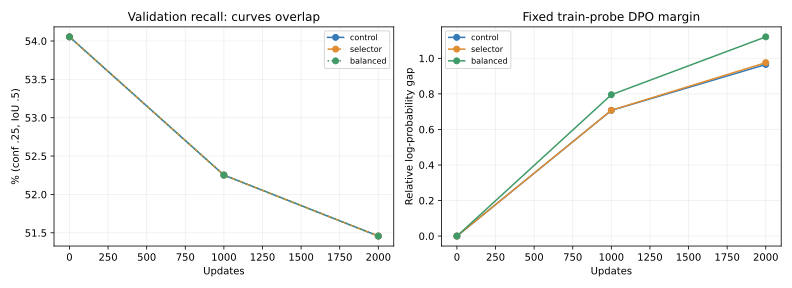

# KB2 — Audit và pilot khôi phục GT theo class, 29/10/2026

**Kết luận: đã chọn được cặp đúng tiêu chí và tăng rõ tần suất học cặp khôi phục, nhưng chưa cải thiện recall trong pilot 2.000 update.** Ba cách đều đạt FN=916, FP=785 và recall=51,4573% tại cùng mốc2k; số FN theo class cũng giống nhau. Cân bằng tăng margin trên train-probe, nhưng không tăng số GT mục tiêu được predict thông thường. Chưa có tín hiệu đủ thuyết phục để chạy dài với riêng thay đổi này.

Phạm vi: audit full train; ba pilot GPU seed42, mỗi pilot2.000 update; full validation479 ảnh/1.887 GT. Không thay ảnh/annotation, không dùng test, chưa chạy dài/nhiều seed.

## 1. Thiết kế và kiểm soát

- Từ cùng S0 YOLOv8n, seed42 và policy F2 hiện hành, sinh4 action/ảnh và xét đủ6 cặp. Lưu toàn bộ pool để tái xét mà không sinh lại.
- Nhóm khôi phục: chosen cứu ít nhất1 GT, không mất bất kỳ GT đã được rejected phát hiện, FP không tăng, Q_F2-gap≥.02. GT matching đúng class/một-một/IoU≥.5.
- Nếu nhiều cặp đủ điều kiện: ưu tiên nhiều GT cứu hơn, sau đó ít khác biệt action trace hơn, rồi Q-gap lớn hơn. Khoảng cách trace đếm quyết định class và DFL; không giả định cùng GT matched là cùng action.
- Nhóm duy trì: chosen/rejected matched đúng cùng tập ID GT và có Q-gap≥.02. Giữ tối đa1 cặp/ảnh, ưu tiên khôi phục nếu có.
- Cân bằng: mục tiêu50% khôi phục/50% duy trì; trong khôi phục trộn50% lấy đều cặp và50% lấy đều class được cứu. Cặp cứu nhiều class dùng xác suất biên, không nhân bản record.
- Xác suất mỗi ảnh không quá5 lần lấy đều. Sau giới hạn, kỳ vọng nhóm khôi phục còn47,5734%; đây là giới hạn xác suất, không phải giới hạn cứng số lần xuất hiện ngẫu nhiên.
- Cùng chuỗi native trên toàn bộ2.411 ảnh train, seed riêng20042; DPO có loader/RNG riêng. Native coefficient1, λDPO=.01, βDPO=.1, LR1e-6, WD5e-4, head-only, batch4, input640.
- Khoảng10% ảnh train được chọn bằng hash ảnh, không dựa validation, để loại khỏi DPO. Những ảnh này vẫn được native loss sử dụng. Fixed probe64 ảnh ở mỗi nhóm dùng chung giữa ba pilot; không gọi đây là holdout độc lập của detector.
- Chạy đủ2.000 update, validation tại0/1k/2k. Best chọn bằng mAP50–95 với min-delta1e-4, kể cả S0. Cả3 best ở1k.

**Đối chiếu mới có cùng native stream và quy tắc loại ảnh probe như hai phương án mới.** Không dùng kết quả F2 dài ngày28/10 làm đối chiếu nhân quả trực tiếp vì protocol native/DPO-image split đã khác. Source Python gốc của F2 giữ nguyên; code thử nghiệm nằm trong subpackage recovery và có fingerprint riêng.

## 2. Audit toàn bộ pool

| Chỉ số | Số lượng |
|---|---:|
| Ảnh train / GT | 2411 / 10333 |
| Cặp đã xét | 14466 |
| Cặp khôi phục đủ điều kiện | 573 |
| Ảnh có ít nhất một cặp khôi phục | 267 |
| Ảnh có cặp duy trì | 2238 |
| GT cả4 output cùng bỏ sót | 158 |

Sau giữ tối đa1 cặp/ảnh: selected có2.321 cặp, gồm267 khôi phục và2.054 duy trì. Trong DPO train có2.079 cặp;242 ảnh có cặp được dành cho probe. Nhóm đối chiếu có2.358 cặp, trong đó2.113 dùng cho DPO train. Toàn bộ2.358 action/output/quality của đối chiếu đã so khớp chính xác với artifact F2 ngày28/10.

Có cặp khôi phục ở27/28 class. Corn rust leaf không có cặp hợp lệ. Apple leaf chỉ có1 ảnh khôi phục và ảnh này thuộc probe; phần DPO train do đó có26 class với tín hiệu khôi phục. Cân bằng không tạo được tín hiệu còn thiếu của hai class này.

## 3. Kết quả tại cùng2.000 update

| Phương án | mAP50–95 (%) | Recall (%) | Macro recall (%) | FP | FN | Lượt DPO khôi phục / tổng |
|---|---:|---:|---:|---:|---:|---|
| F2 đối chiếu | 37.9698 | 51.4573 | 52.2379 | 785 | 916 | 642/7991 (8.03%) |
| Chọn cặp khôi phục | 37.9583 | 51.4573 | 52.2379 | 785 | 916 | 933/7997 (11.67%) |
| Chọn + cân bằng class | 37.9690 | 51.4573 | 52.2379 | 785 | 916 | 3708/7997 (46.37%) |

Mẫu số lượt DPO hơi khác nhau vì loader không drop batch cuối; cả ba có đúng2.000 optimizer update và native stream giống hệt nhau. Cân bằng dùng sampling có hoàn lại, các nhánh còn lại shuffle không hoàn lại. Số ảnh DPO khác nhau đã gặp: control2.113, selector2.079, balanced1.904.

Best1k: control mAP38,0020%, selector37,9999%, balanced38,0002%; cả ba FP822/FN901/recall52,2523%. Tại2k, so S0: recall giảm từ54,0541% xuống51,4573%, FN tăng867→916, FP giảm984→785. Các metric operating dùng conf.25/IoU.5, inference conf.001/NMS.60/cap300.



## 4. Có học đúng các GT mục tiêu không?

Probe train có64 ảnh và80 GT mục tiêu được xác định từ cặp selected. Probe ảnh không dùng cho DPO có64 ảnh và33 GT mục tiêu. Các GT mục tiêu được cố định từ S0; không đổi danh sách sau train.

| Nhóm / phương án | Margin DPO cuối | DPO loss cuối | GT mục tiêu được predict: S0 → cuối | Recall mục tiêu cuối | Score đúng class trung bình cuối |
|---|---:|---:|---|---:|---:|
| Ảnh nhóm DPO train — F2 đối chiếu | 0.9654 | 0.6671 | 38 → 26/80 | 32.50% | 0.221595 |
| Ảnh nhóm DPO train — Chọn cặp khôi phục | 0.9757 | 0.6666 | 38 → 26/80 | 32.50% | 0.221413 |
| Ảnh nhóm DPO train — Chọn + cân bằng class | 1.1209 | 0.6596 | 38 → 26/80 | 32.50% | 0.221798 |
| Ảnh không dùng cho DPO — F2 đối chiếu | 1.9401 | 0.6180 | 18 → 11/33 | 33.33% | 0.283430 |
| Ảnh không dùng cho DPO — Chọn cặp khôi phục | 1.9457 | 0.6179 | 18 → 11/33 | 33.33% | 0.283187 |
| Ảnh không dùng cho DPO — Chọn + cân bằng class | 1.9352 | 0.6181 | 18 → 11/33 | 33.33% | 0.283412 |

Trước train, margin=0 và DPO loss=log(2) ở cả ba. Recall mục tiêu S0 là47,50% trên probe train và54,55% trên probe ảnh không dùng DPO. Cân bằng tăng margin train-probe từ0,9654 của control lên1,1209, nhưng cùng chỉ phát hiện26/80 GT. Trên nhóm không dùng DPO, cùng phát hiện11/33 GT; margin và score cũng gần như control.

Score diagnostic là score đúng class cao nhất trong các raw decoded box có IoU≥.5 với GT, bằng0 nếu không có box đủ IoU. Đây là diagnostic kết hợp geometry/class, không phải đo thuần calibration. Matching GT mục tiêu để chọn cặp là max-cardinality/IoU; matching predict trong probe dùng canonical confidence-ordered greedy. Với object chồng lấn, hai matcher có thể gán ID GT khác nhau.

### Gradient diagnostic

| Phương án | Mean norm(λDPO)/norm(native) | Tỷ lệ cosine âm |
|---|---:|---:|
| F2 đối chiếu | 3.53% | 38.10% |
| Chọn cặp khôi phục | 3.37% | 38.10% |
| Chọn + cân bằng class | 3.92% | 61.90% |

Đo ở21 update diagnostic mỗi phương án. Weighted DPO gradient vẫn nhỏ so native và cosine âm thường xuyên hơn ở nhóm cân bằng. Đây là dấu hiệu cần kiểm tra thêm; không suy gradient-norm % thành % tác động lên model, không đủ để kết luận nguyên nhân.

## 5. Bảng theo class

Cột cặp là số ảnh có cặp khôi phục sau chọn1 cặp/ảnh. Cột train đã loại ảnh probe. Tỷ lệ bỏ sót là FN/GT validation tại2k; ba phương án có cùng FN từng class.

| Class | Ảnh khôi phục | Trong DPO train | Lượt khôi phục: đối chiếu / chọn / cân bằng | Bỏ sót validation (%) |
|---|---:|---:|---|---:|
| Apple Scab Leaf | 4 | 4 | 13 / 15 / 72 | 50.00 |
| Apple leaf | 1 | 0 | 0 / 0 / 0 | 10.87 |
| Apple rust leaf | 4 | 3 | 11 / 12 / 52 | 32.61 |
| Bell_pepper leaf | 6 | 5 | 22 / 19 / 97 | 37.93 |
| Bell_pepper leaf spot | 12 | 10 | 45 / 39 / 152 | 63.27 |
| Blueberry leaf | 12 | 11 | 33 / 44 / 175 | 36.71 |
| Cherry leaf | 8 | 8 | 39 / 32 / 166 | 57.14 |
| Corn Gray leaf spot | 9 | 7 | 26 / 28 / 128 | 42.86 |
| Corn leaf blight | 19 | 18 | 68 / 70 / 217 | 23.21 |
| Corn rust leaf | 0 | 0 | 0 / 0 / 0 | 25.64 |
| Peach leaf | 7 | 6 | 23 / 23 / 110 | 41.43 |
| Potato leaf | 10 | 10 | 42 / 37 / 170 | 92.68 |
| Potato leaf early blight | 11 | 8 | 38 / 31 / 143 | 70.93 |
| Potato leaf late blight | 16 | 14 | 59 / 54 / 232 | 64.52 |
| Raspberry leaf | 5 | 5 | 15 / 20 / 77 | 19.23 |
| Soyabean leaf | 8 | 8 | 34 / 29 / 171 | 48.48 |
| Squash Powdery mildew leaf | 8 | 7 | 30 / 28 / 135 | 38.89 |
| Strawberry leaf | 2 | 2 | 4 / 7 / 38 | 25.81 |
| Tomato Early blight leaf | 16 | 15 | 66 / 58 / 224 | 72.50 |
| Tomato Septoria leaf spot | 22 | 21 | 83 / 80 / 248 | 50.00 |
| Tomato leaf | 5 | 4 | 25 / 16 / 68 | 50.40 |
| Tomato leaf bacterial spot | 23 | 23 | 97 / 88 / 262 | 86.67 |
| Tomato leaf late blight | 4 | 4 | 19 / 16 / 86 | 44.90 |
| Tomato leaf mosaic virus | 11 | 11 | 41 / 42 / 171 | 58.54 |
| Tomato leaf yellow virus | 22 | 18 | 101 / 70 / 204 | 65.85 |
| Tomato mold leaf | 12 | 11 | 65 / 43 / 162 | 66.00 |
| grape leaf | 5 | 3 | 19 / 12 / 60 | 24.56 |
| grape leaf black rot | 5 | 5 | 14 / 20 / 88 | 35.71 |

Một cặp cứu nhiều class đóng góp một lượt vào từng class tương ứng; không cộng các cột exposure theo class để suy số lượt DPO unique.

## 6. Đánh giá và bước tiếp theo

- Đã thực hiện đúng việc chọn/cân bằng: cặp hợp lệ có thật, selected tăng số ảnh cung cấp tín hiệu khôi phục, và tần suất khôi phục thực tế tăng8,03%→46,37%. Không phải sampler không được áp dụng.
- **Chưa có cải thiện detection ở pilot.** Ranking preference cải thiện nhỉnh hơn trên ảnh train, nhưng chưa chuyển thành thêm GT được predict. Cả FN tổng, FN theo class và recall trên probe mục tiêu không thay đổi so đối chiếu.
- Chưa nên chạy dài chỉ vì margin DPO tăng. Nên kiểm tra hướng gradient tại GT bị bỏ sót và sự tương thích giữa policy lấy mẫu với inference YOLO trước; sau đó mới quyết định thử thay sức mạnh/tỷ lệ native–DPO hoặc cách sinh cặp có ít quyết định khác nhau hơn. Chưa tự thực hiện các thay đổi đó.
- Pilot2k/seed42 chưa đủ để kết luận phương pháp chắc chắn thất bại ở run dài. Kết luận giới hạn là chưa có tín hiệu rõ ở ngân sách hiện tại. Probe vẫn là ảnh train được native loss dùng; không phải đánh giá tổng quát hóa độc lập.

## 7. Kiểm chứng và artifact

- 31 CPU tests đạt;1 test GPU opt-in bỏ qua ở lượt CPU. Ba pilot GPU đều có initial margin0, reference immutable và native image sequence hash giống hệt nhau.
- Kiểm lại2.321 cặp selected với full pool; toàn bộ đạt các gate. Control replay khớp2.358 cặp F2 lịch sử.
- Đã kiểm hash pool, manifests, best/last; source/data/base F2 và code thử nghiệm giữ nguyên. Best/last của cả3 pilot được đánh giá GPU lại và mọi metric AP/P/R/FP/FN/per-class khớp log.

- [Snapshot JSON đầy đủ](assets/kb2_recovery_20261029/review.json)
- [Summary CSV](assets/kb2_recovery_20261029/summary.csv)
- [Bảng theo class CSV](assets/kb2_recovery_20261029/classes.csv)
- [Bảng probe CSV](assets/kb2_recovery_20261029/probes.csv)
- [Bảng validation CSV](assets/kb2_recovery_20261029/validation.csv)
- [GPU checkpoint verification](assets/kb2_recovery_20261029/checkpoint_verification.json)
- [Kiểm chứng cặp và test](assets/kb2_recovery_20261029/verification.json)
- [Code thử nghiệm](../../kb2_preference_optimization/recovery/selection.py)
- [Runner](../../scripts/run_kb2_recovery_pilot.py)
- [Reviewer](../../scripts/review_kb2_recovery_pilot.py)

Run artifacts: `kb2_preference_optimization/outputs/yolov8n_recovery_pilot_20261029/`. Full pool là `all_candidates.jsonl`; checkpoint nằm trong `pilot_control`, `pilot_selector`, `pilot_balanced`.

Chạy lại vào thư mục mới:

```bash
YOLO_CONFIG_DIR=/tmp MPLCONFIGDIR=/tmp/kb2-matplotlib NO_ALBUMENTATIONS_UPDATE=1 .venv-ubuntu/bin/python scripts/run_kb2_recovery_pilot.py --root kb2_preference_optimization/outputs/yolov8n_recovery_NEW
```
