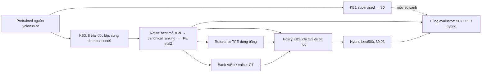
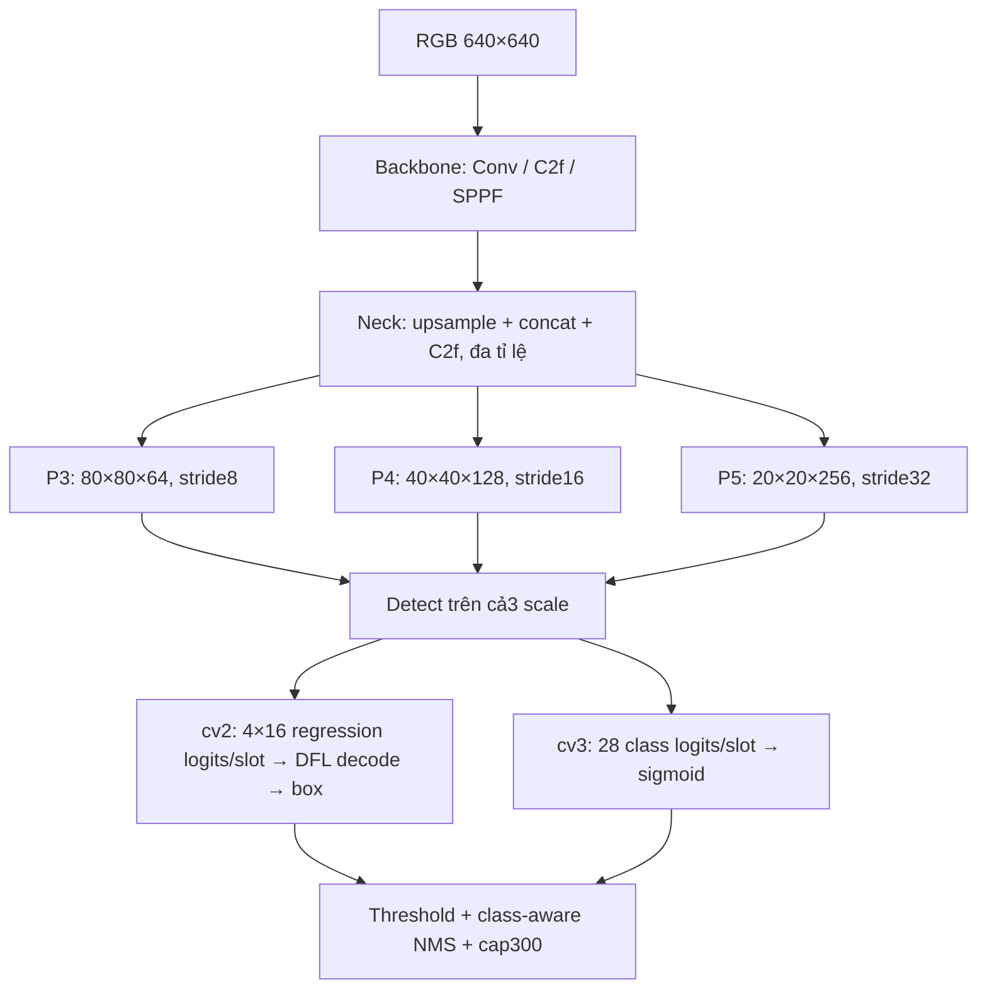

# BÁO CÁO HYBRID KB3–KB2: TPE VÀ DIRECT PREFERENCE OPTIMIZATION CHO YOLOv8n

**Ngày báo cáo:** 09/11/2026 — Asia/Bangkok.  
**Mô hình:** YOLOv8n, 28 class, input640×640.  
**Kết quả được chốt:** best TPE trial2 → KB2 DPO λ=0,03, native background0,5;
best tại update500 trong lượt có ngân sách15.000 update, continuation seed42.  
**Phạm vi:** tổng hợp phương pháp, code và artifact đã có; không train hoặc
đánh giá lại model để viết báo cáo. Chưa có kết quả xác nhận trên dữ liệu mới.

## Tóm tắt

Hybrid kết hợp hai giai đoạn tối ưu khác nhau trên cùng kiến trúc detector.
KB3-A dùng Tree-structured Parzen Estimator (TPE) chọn learning rate và weight
decay cho quá trình huấn luyện YOLO. Sau khi hoàn tất tám trial, checkpoint
TPE tốt nhất được dùng làm khởi tạo và reference đóng băng cho KB2. KB2 tạo
cặp quyết định giữ/bỏ candidate trên ảnh train, dùng GT chấm preference rồi
fine-tune nhánh classification với native detection loss cộng DPO loss.

Trong bảng so sánh được chấm lại cùng evaluator, S0 supervised đạt mAP50–95
37,8218%, TPE đạt38,5097%, hybrid cuối đạt**38,7133%**. Giai đoạn KB2 tăng thêm
**0,2036 điểm phần trăm** so TPE; toàn hybrid hơn S0 **0,8915 điểm**. So TPE,
precision tăng1,7444 điểm và F1 tăng0,3985 điểm, nhưng recall giảm1,1129 điểm:
FP giảm87, TP giảm21. Cần trình bày đồng thời lợi ích và đánh đổi này.

Hai lưu ý quyết định cách đọc báo cáo: **TPE không phải RL**, và **trial TPE
không khởi tạo từ best S0** trong implementation đã tạo kết quả. Chúng khởi
tạo độc lập từ `yolov8n.pt` pretrained nguồn của recipe KB1; best S0 là mốc
so sánh. Hybrid hiện tại là pretrained → KB3/TPE → KB2/DPO, đối chiếu với S0.

## Mục lục

1. Ý tưởng hybrid, vai trò các checkpoint và ký hiệu.
2. Dữ liệu, evaluator và các phép so sánh.
3. Kiến trúc YOLOv8n dùng chung.
4. KB3-A: bài toán HPO và lý thuyết TPE.
5. KB3-A: không gian tìm kiếm, seed và thuật toán thực thi.
6. KB3-A: detector học và cập nhật trọng số như thế nào.
7. KB3-A: chọn checkpoint, kết quả tám trial và giới hạn.
8. Phân biệt KB3-B/PPO với KB3-A trong hybrid.
9. Chuyển checkpoint TPE sang KB2.
10. KB2: ánh xạ DPO vào detection.
11. KB2: tạo A/B và chấm bằng GT.
12. KB2: bank, sampling và batch học.
13. KB2: tổng loss, optimizer và lịch cập nhật.
14. Luồng hybrid hoàn chỉnh và tái hiện.
15. Kết quả cuối, các lần hiệu chỉnh và đánh giá.
16. Artifact, tính toàn vẹn và phạm vi xác nhận.
17. Cơ sở lý thuyết giải thích sự cải thiện và bằng chứng đối chứng của KB2.

Các mục1–16 mô tả phương pháp/kết quả. Mục17 kết nối công thức, ví dụ, số đo
và các đối chứng lịch sử trong báo cáo KB2 ngày03/11, đồng thời chỉ rõ phần
nào chưa được chứng minh. Tài liệu tham khảo được dẫn ngay tại nơi sử dụng.

## 1. Ý tưởng hybrid, vai trò checkpoint và ký hiệu

### 1.1. Vì sao ghép hai giai đoạn?

KB3 trả lời câu hỏi **recipe huấn luyện nào tạo detector tốt hơn?** Biến được
tìm là hyperparameter h; detector vẫn học bằng native detection loss. KB2
trả lời câu hỏi **từ detector đã có, có thể dùng preference ở những quyết định
detection cụ thể để cải thiện output không?** Biến được học là tham số model θ.

Không ghép hai mạng để ensemble, không cộng prediction của hai detector và
không đồng thời cho TPE chọn λ DPO. TPE hoàn tất trước; sau đó KB2 tối ưu
một bản sao của checkpoint thắng. Model inference cuối vẫn là một YOLOv8n.



### 1.2. Ba checkpoint phải phân biệt

| Artifact | Vai trò thực tế |
|---|---|
| `yolov8n.pt` nguồn pretrained | Mỗi trial KB3 nạp lại từ nguồn này; không tiếp tục weights của trial trước |
| Best supervised KB1, gọi S0 | Mốc so sánh cố định; recipe/nguồn pretrained của KB1 được KB3 kế thừa |
| Best KB3 TPE, trial2 | Khởi tạo policy, reference và nguồn sinh bank của giai đoạn KB2 |
| Hybrid best500 | Model cuối được chọn để báo cáo |

Điểm khởi tạo được xác nhận từ
[pretrained_reference.py](../../kb3_hyperparameter_optimization/quality/pretrained_reference.py),
[pretrained_detector.py](../../kb3_hyperparameter_optimization/quality/pretrained_detector.py)
và manifest/result của tám trial. Code còn chặn việc lấy best S0 làm nguồn
trial. Vì vậy “S0 → TPE → DPO” chỉ được dùng như cách viết tắt các *mốc chất
lượng*, không được diễn giải là đường truyền weights trong run đã thực hiện.

### 1.3. Ký hiệu

| Ký hiệu | Ý nghĩa |
|---|---|
| x, G(x) | Ảnh và tập GT gồm box/class của ảnh |
| h=(η₀,ω) | Hyperparameter TPE: base LR và weight decay |
| w, w̄ | Trọng số detector live và EMA trong KB3 |
| θ, θref | Policy KB2 và reference TPE đóng băng |
| j,c,z | Raw slot, class và class logit tại slot/class đó |
| C, A, B | Context candidate chung và hai phương án giữ/bỏ |
| λDPO | Hệ số DPO trong tổng loss, chọn0,03 |
| βDPO | Thang contrast của DPO, chọn0,1 |
| αbg | Hệ số native BCE ở background slot, chọn0,5 |
| Jcan, fnat | Canonical mAP50–95 và native validation fitness |

ω weight decay, λDPO và βDPO là ba đại lượng khác nhau. β trong assigner TAL
cũng khác βDPO. Các công thức dưới đây ghi rõ ngữ cảnh để tránh nhập nhằng.

## 2. Dữ liệu, evaluator và phép so sánh

### 2.1. Dữ liệu và preprocessing

Dataset: `pre-data/data/v2i_cleanned`, cấu hình28 class tại
[pest.yaml](../../kb1_reward_guided_training/configs/pest.yaml).

| Split | Số ảnh | GT dùng trong phân tích | Vai trò |
|---|---:|---:|---|
| Train | 2.411 | 10.333 | Train detector KB3, sinh preference và học KB2 |
| Validation | 479 | 1.887 | Chọn cấu hình/checkpoint và đánh giá trong báo cáo |
| Test | 239 | Không chấm ở đây | Không dùng để chọn trial/best của hybrid |

Hash dataset ghi trong provenance:
`cbd68ffc1da935ac300fba953ea5f9c97c831f53887e1b9391d500f9e40c0c95`.
Manifest nhận diện667 ảnh train có hậu tố augmentation đã biết. Điều này
khác augmentation online trong trainer KB3. GT “bị bỏ sót” trong KB2 là GT
đã annotation nhưng detector không phát hiện, không phải sửa nhãn thiếu.

KB3 train dùng augmentation native kế thừa recipe KB1. KB2 dùng resize giữ
tỉ lệ, center-pad114, RGB/255 xác định ở640×640, không thêm augmentation ngẫu
nhiên để giữ đúng slot/context khi replay bank. Validation dùng hợp đồng
canonical cố định; kích thước object được tính sau transform ảnh.

### 2.2. Protocol đánh giá

| Thành phần | Canonical contract của bảng hybrid |
|---|---|
| Prediction | Ordinary deterministic YOLO inference |
| Confidence tối thiểu khi thu detection cho AP | 0,001 |
| NMS | Class-aware, IoU0,60 |
| Giới hạn detection | 300/ảnh |
| AP50–95 | Trung bình IoU0,50:0,05:0,95 và các class có GT |
| AP50, AP75 | AP ở IoU0,50 và0,75 |
| P/R/F1, TP/FP/FN | Confidence0,25; đúng class; greedy matching một-một IoU0,5 |
| AR300 | Average recall theo protocol COCO với cap300; không phải micro recall0,25 |
| Small/medium/large | Area <32² / [32²,96²) / ≥96² trên ảnh đã transform |
| Chọn model KB2 | Validation mAP50–95, min_delta=1e-4 fraction |

AP dùng COCO-style evaluator qua TorchMetrics/faster-coco-eval, với maxDets
[1,10,300], khác mặc định COCO cap100. Định nghĩa AP/AR theo
[COCOeval chính thức](https://github.com/cocodataset/cocoapi/blob/master/PythonAPI/pycocotools/cocoeval.py);
implementation thực tại [metrics.py](../../kb2_preference_optimization/metrics.py).

$$
IoU(b,g)=\frac{|b\cap g|}{|b\cup g|},\quad
P=\frac{TP}{TP+FP},\quad R=\frac{TP}{TP+FN},\quad
F1=\frac{2TP}{2TP+FP+FN}.
$$

Với C class có support, viết khái niệm:

$$mAP_{50:95}=\frac1{10C}\sum_{c=1}^{C}\sum_{\tau\in\{.50,.55,\ldots,.95\}}AP_{c,\tau}.$$

AP nội suy precision trên101 mức recall theo COCO, không chỉ là precision
tại0,25. Macro recall/F1 trung bình theo class; micro P/R/F1 lấy từ số đếm
gộp. Trong artifact KB3, field `recall` có thể là AR300; bảng operating phải
đọc `canonical_best_scores.operating_recall`.

### 2.3. So sánh theo giai đoạn và giữ hai lớp số liệu

$$\Delta_{KB3}=100[J_{can}(w_{TPE})-J_{can}(S0)],$$
$$\Delta_{KB2|TPE}=100[J_{can}(\theta^*)-J_{can}(w_{TPE})],$$
$$\Delta_{hybrid}=\Delta_{KB3}+\Delta_{KB2|TPE}.$$

100 chuyển fraction sang **điểm phần trăm**, không phải relative-percent gain.
Trong bảng hybrid, cả S0/TPE/hybrid dùng số đã nạp lại checkpoint cùng đường
đánh giá. Bảng tám trial KB3 giữ số canonical lịch sử để trung thành với
observations mà TPE thực sự dùng.

TPE trial2 lịch sử38,5071%, khi nạp lại cho hybrid38,5097%; S0 lịch sử37,8207%,
nạp lại37,8218%. SHA weights không đổi. Không coi chênh rất nhỏ này là gain
training, không thay score trial2 trong study lịch sử và chưa quy được riêng
nguyên nhân số học/runtime/evaluator của sai khác. Bảng so cuối sử dụng nhất
quán số cùng lượt kiểm chứng, không ghép hai loại endpoint.

## 3. Kiến trúc YOLOv8n dùng chung

### 3.1. Backbone, neck và head

Kiến trúc lấy trực tiếp từ checkpoint TPE: depth multiplier0,33, width0,25;
backbone Conv/C2f/SPPF; neck upsample–concat–C2f theo luồng đa tỉ lệ top-down
và bottom-up; Detect head phân nhánh regression/classification. Nền kiến trúc
được mô tả trong [tài liệu YOLOv8 chính thức](https://docs.ultralytics.com/models/yolov8/);
các số bên dưới là audit checkpoint28 class của dự án, không lấy param count
của bản COCO80 class để thay thế.



| Đại lượng audit | Giá trị |
|---|---:|
| Tổng tham số checkpoint28 class | 3.016.308 |
| Tham số `cv3` được mở học ở KB2 | 374.868, khoảng12,43% tổng số |
| Số tensor trainable KB2 | 24 |
| Số raw slot ở input640 | 80²+40²+20²=8.400 |
| Class logits | 28/slot |
| Regression logits | 4×16=64/slot, `reg_max=16` |

KB3 fine-tune các phần detector theo trainer native; KB2 chỉ mở `cv3`.
BN affine thuộc `cv3` có thể học nhưng BN running statistics giữ nguyên.
Không thêm actor, critic hoặc reward head vào detector cuối.

### 3.2. Raw prediction và giải mã box

Tại scale stride s, anchor point (aₓ,aᵧ), một cạnh có16 logits rₖ:

$$p_k=\frac{e^{r_k}}{\sum_{q=0}^{15}e^{r_q}},\qquad d=\sum_{k=0}^{15}k p_k.$$

Với bốn khoảng cách l,t,r,b theo đơn vị grid:

$$b=[s(a_x-l),\ s(a_y-t),\ s(a_x+r),\ s(a_y+b)].$$

Ở biểu thức trên b cuối trong ngoặc là khoảng cách cạnh dưới; toàn vector
là box xyxy. Tại classification: pⱼc=σ(zⱼc), class dự đoán là argmax c và
score là max c. YOLOv8 này không có objectness logit riêng như YOLOv5.
Sigmoid class riêng lẻ không phải softmax tổng28 class bằng1.

DFL integral cho tọa độ là kỳ vọng phân phối, không phải lấy mẫu tọa độ.
KB2 hiện giữ nhánh này cố định. Việc sinh A/B trong mục11 cũng không lấy mẫu
DFL bins như thiết kế whole-action lịch sử đã bỏ.

## 4. KB3-A: bài toán HPO và lý thuyết TPE

### 4.1. Hai vòng tối ưu và objective thật

Trong trial i, hᵢ=(η₀ᵢ,ωᵢ) được chọn trước. Từ nguồn pretrained cố định,
detector train thành quỹ đạo wₑ(hᵢ). Native chọn epoch e*; TPE nhận một score:

$$e^*(h)=NativeSelect\{f_{nat}(\bar w_e(h)):1\le e\le E_{actual}(h)\},$$
$$F(h)=J_{can}(\bar w_{e^*(h)}(h)),\qquad
\hat h=\arg\max_{h_i\in H_{tested}}F(h_i).$$

Vòng trong cập nhật w bằng SGD/native loss. Vòng ngoài cập nhật history của
cấu hình/score và mô hình mật độ để đề xuất h mới. TPE không backprop qua AP,
không trực tiếp chỉnh tensor YOLO và không đổi HP sau từng epoch trong một
trial. Cấu hình h cố định nhưng actual LR vẫn chạy warmup/decay đã định.

### 4.2. Density ratio và Expected Improvement

Dùng dạng minimization y=−F(h). Chia observations tốt và còn lại theo y*:

$$\ell(h)=p(h\mid y<y^*),\quad g(h)=p(h\mid y\ge y^*),\quad
p(h)=\gamma\ell(h)+(1-\gamma)g(h).$$

Expected Improvement:

$$EI(h)=\int_{-\infty}^{y^*}(y^*-y)p(y\mid h)\,dy
\ \propto\ \left[\gamma+(1-\gamma)\frac{g(h)}{\ell(h)}\right]^{-1}.$$

Dưới mô hình TPE, ưu tiên EI tương ứng ưu tiên ℓ(h)/g(h). Nền tảng là
[Bergstra et al., Algorithms for Hyper-Parameter Optimization, 2011](https://papers.nips.cc/paper/4443-algorithms-for-hyper-parameter-optimization);
implementation được đối chiếu với [Optuna4.5.0 TPESampler](https://optuna.readthedocs.io/en/v4.5.0/reference/samplers/generated/optuna.samplers.TPESampler.html).
Đây là mô hình xác suất để đề xuất cấu hình, không bảo đảm trial sau tốt hơn.

Trong code này `multivariate=False`: Optuna mô hình hóa từng chiều bằng
Parzen/Gaussian-mixture estimator, chưa là surrogate joint LR–WD đầy đủ.
Với n history hoàn tất, default gamma của4.5.0 lấy
`min(ceil(0.1*n),25)` observations tốt. Ở các proposal sau startup của search
tám trial, n=2..7 nên nhóm tốt chỉ có một observation. Không mô tả đã học
được density chắc chắn hoặc dùng một split20% tự đặt.
Xem [source Optuna4.5.0](https://optuna.readthedocs.io/en/v4.5.0/_modules/optuna/samplers/_tpe/sampler.html).

## 5. KB3-A: search space, seed và thực thi

### 5.1. Local search hai chiều

| Tham số | Anchor recipe KB1 | Miền TPE thực tế | Trạng thái |
|---|---:|---|---|
| `lr0` | 0,01 | [0,005;0,015], log scale | Tìm |
| `weight_decay` | 0,0005 | [0,00025;0,001], log scale | Tìm |
| Momentum | 0,937 | Giữ nguyên | Không tìm |
| `augmentation_strength` | 0,5 | Giữ recipe augmentation gốc | Không tìm |

Miền là giao của global bounds và local factors: LR×[0,5;1,5], WD×[0,5;2].
Với x∈[L,U], startup log-uniform có mật độ1/[x ln(U/L)], tương đương lấy
uniform trong ln(x). “Augmentation strength0,5” là abstraction ghi nhận
recipe, không phải nhân0,5 vào mọi xác suất augment trong A.

### 5.2. Startup, candidates và seed

Config [kb3_tpe.yaml](../../kb3_hyperparameter_optimization/configs/kb3_tpe.yaml)
mặc định4 trial, nhưng run báo cáo đã được mở rộng thành **8 trial tổng**.

| Trial | Cách chọn | Detector seed | Sampler seed |
|---:|---|---:|---:|
| 0 | Enqueue anchor KB1 | 0 | 42 |
| 1 | Startup random | 0 | 43 |
| 2–7 | TPE từ completed history | 0 | 44–49 |

`n_startup_trials=2` gồm anchor0 và random1; `n_ei_candidates=24` là24 ứng viên
nội bộ của sampler, **không phải24 lượt train YOLO**. Mặc định Optuna startup10
sẽ khiến pilot4/8 trial chưa ra TPE; repo giảm xuống2 là lựa chọn ngân sách.

Mỗi proposal i dựng lại study trong bộ nhớ với seed42+i, nhập observations
hoàn tất theo thứ tự rồi ask/suggest. Đây là quy tắc triển khai để tái dựng
proposal khi resume; không giả định giống một study dài không reset RNG.
Tám initial weights hash giống nhau; detector seed0 được giữ để giảm nhiễu
khởi tạo khi so HP. Tám trial không phải tám independent detector seeds.

### 5.3. Thuật toán thực thi

```text
Khóa pretrained source, recipe, data split và evaluator
history = []
for i = 0..7:
    dựng TPE study từ history, sampler_seed = 42+i
    enqueue anchor nếu i=0; chọn lr0/WD theo startup hoặc TPE
    nạp lại pretrained nguồn, tạo/thích ứng head28 class, seed detector0
    train native liên tục tới early stop hoặc200 epoch
    lấy native-best EMA checkpoint của trial
    chấm canonical selected-best và last; F_i = AP của selected-best
    commit result + hashes; thêm (h_i,F_i) vào history
winner = trial có F_i lớn nhất; tie ưu tiên trial number nhỏ
```

TPE nhận completed result, không nhận score của trial dở như một observation
thành công. Trial sau không dùng weights của trial trước. Resume tái sử dụng
trial hoàn tất đã kiểm; trial dở được archive rồi chạy lại cùng proposal,
không có exact resume giữa trial trong protocol này.

## 6. KB3-A: detector học và cập nhật weights

### 6.1. Recipe cố định và augmentation

| Tham số native | Giá trị |
|---|---:|
| Maximum epochs / patience | 200 /30 |
| Batch / nominal batch `nbs` | 16 /64 |
| Optimizer / momentum | SGD Nesterov /0,937 |
| Input / workers / detector seed | 640 /0 /0 |
| AMP / deterministic | True /True |
| Warmup | 3 epoch; momentum0,8→0,937; bias LR bắt đầu0,1 |
| Scheduler | Linear, `cos_lr=False`, `lrf=0.01` |
| Native val NMS IoU / max_det | 0,7 /300; khác canonical IoU0,6 |
| Loss gains box/cls/DFL | 7,5 /0,5 /1,5 |
| HSV h/s/v | 0,015 /0,7 /0,4 |
| Degrees / translate / scale | 10° /0,1 /0,5 |
| Flip up-down / left-right | 0,3 /0,5 |
| Mosaic / mixup | 1,0 /0,1 |
| Shear / perspective / cutmix / copy_paste | 0 /0 /0 /0 |
| Close mosaic | 10 epoch cuối của maximum horizon |

KB3 nạp pretrained nguồn mà `args.yaml` KB1 chỉ định; head được chuyển về28
class, tensor phù hợp layout được tải theo framework. Callback kiểm trực
tiếp non-head/backbone tensors trước học và initial hash chung. Runtime
guard kiểm integrity/layout/transfer; riêng nc80 không đủ chứng thực lịch sử
COCO của một file bất kỳ. Audit nguồn official trong báo cáo KB3 là bằng
chứng riêng, không thay bằng kiểm nc80 đơn thuần.

### 6.2. Assignment và native detection loss

TAL native dùng score class và độ khớp hình học để chọn foreground candidate.
Alignment score có dạng aⱼg=pⱼ,cg^0,5 · uⱼg^6 với các điều kiện vùng/top-k và
xử lý xung đột; assigner tạo soft class targets tⱼc và target box. Đây không
phải matching một-một sau NMS của metric. Code dùng `TaskAlignedAssigner`
trong Ultralytics, liên quan TAL của [TOOD, Feng et al.](https://arxiv.org/abs/2108.07755);
không triển khai toàn bộ TOOD/T-Head.

Đặt S=max(Σⱼc tⱼc,1), qⱼ=Σc tⱼc, F là foreground slot:

$$L_{cls}=\frac1S\sum_{j,c}BCEWithLogits(z_{jc},t_{jc}),$$
$$L_{box}=\frac1S\sum_{j\in F}q_j\,[1-CIoU(b_j,g_j)].$$

CIoU có ba thành phần overlap, khoảng cách tâm chuẩn hóa và aspect ratio:

$$CIoU=IoU-\frac{\rho^2(center_b,center_g)}{c_{enclose}^2}-\alpha_v v,$$
$$v=\frac4{\pi^2}\left(\arctan\frac{w_g}{h_g}-\arctan\frac{w_b}{h_b}\right)^2,
\qquad \alpha_v=\frac{v}{1-IoU+v+\epsilon}.$$

Nguồn hình học: [DIoU/CIoU, Zheng et al.](https://arxiv.org/abs/1911.08287).
Ký hiệu αv không liên quan αbg của KB2. Chi tiết clamp/epsilon theo library.

Với target khoảng cách liên tục d*, dL=floor(d*), dR=dL+1, DFL một cạnh:

$$L_{DFL,side}=-(d_R-d^*)\log p_{d_L}-(d^*-d_L)\log p_{d_R}.$$

Native clamp target trong miền bin hợp lệ, trung bình bốn cạnh và weighted
sum qⱼ/S. Đây là thành phần kế thừa từ
[Generalized Focal Loss, Li et al.](https://arxiv.org/abs/2006.04388), không
đồng nghĩa KB3/KB2 dùng toàn bộ Quality Focal Loss của GFL.

$$L_{native}=7.5L_{box}+0.5L_{cls}+1.5L_{DFL}.$$

Biểu thức ghi các gain, còn batch/reduction native được giữ đúng framework.
Trong KB3, các loss này có thể cập nhật backbone/neck và cả hai nhánh head.
KB2 đổi mask tham số và background BCE ở giai đoạn sau, không đổi kiến trúc.

### 6.3. SGD momentum/Nesterov và weight decay

Ở parameter group có decay, gradient loss g và buffer v:

$$\tilde g_t=\nabla_w L_t+\omega_{eff}w_t,\qquad
v_t=\mu v_{t-1}+\tilde g_t,$$
$$w_{t+1}=w_t-\eta_t(\tilde g_t+\mu v_t).$$

Đây là dạng PyTorch SGD Nesterov, không phải AdamW; buffer đầu có quy tắc
khởi tạo native. Bias/normalization groups không chịu WD như weight group.
Native còn AMP/scaler, gradient accumulation và gradient clipping max_norm10.

$$A=\max(round(nbs/B),1),\qquad
\omega_{eff}=\omega_{input}\frac{BA}{nbs}.$$

B16/nbs64 cho A4 và hệ số scaleWD=1. Warmup có thể nội suy accumulation từ1
lên4, nên không khẳng định mọi optimizer step đều tương ứng đúng64 ảnh.
WD thắng0,0009130 là input của SGD group, khác WD5e-4 của AdamW KB2.

### 6.4. Warmup, decay và EMA

Với zero-based epoch e và horizon E200:

$$q(e)=\max(1-e/200,0)(1-0.01)+0.01,\qquad \eta_e=\eta_0q(e).$$

Warmup nội suy theo batch iteration n tới nᵥ=round(min(3,E−1)×batches/epoch):

$$\eta_{n,g}=interp(n;[0,n_w],[\eta_{start,g},\eta_{0,g}q(e)]),$$
$$\mu_n=interp(n;[0,n_w],[0.8,0.937]).$$

Bias group bắt đầu0,1; các group còn lại bắt đầu0. Trial early stop ở169
epoch vẫn dùng schedule theo maximum200, không nén lại169. Base LR do TPE
chọn và actual LR theo schedule là hai đại lượng khác nhau.

EMA cập nhật sau optimizer step u:

$$\bar w_u=d(u)\bar w_{u-1}+[1-d(u)]w_u,\quad
d(u)=0.9999[1-e^{-u/2000}].$$

Native validation/checkpoint dùng EMA, serialization lưu half; chuyển model
đã nạp về FP32 không khôi phục bit đã mất khi serialize. KB2 nạp checkpoint
TPE này thành FP32 rồi học classification, không tiếp tục SGD/EMA buffers
của KB3. Các công thức/giá trị được đối chiếu trainer Ultralytics8.4.163 và
[pretrained_detector.py](../../kb3_hyperparameter_optimization/quality/pretrained_detector.py).

## 7. KB3-A: chọn checkpoint và kết quả tám trial

### 7.1. Hai tầng selection

Trong mỗi trial, native fitness của Ultralytics8.4.163 dùng weights
[0,0,0,1] cho [P,R,AP50,AP50–95], tức native AP50–95. Native best/EMA và
patience30 quyết định selected epoch; không dùng công thức fitness cũ
0,1×AP50+0,9×AP50–95. Dừng theo native staleness hoặc maximum200.

Sau trial, canonical chấm **native-selected best** và last. TPE xếp trial
bằng canonical AP của selected-best, không quét canonical mọi epoch. Vì
native/canonical khác preprocessing/postprocessing/metric settings, native
best không được bảo đảm là canonical best trong toàn trajectory.

### 7.2. Tám trial đã hoàn tất

Số bảng này là canonical lịch sử dùng trong observations TPE; AP tính theo%.
Momentum0,937 và augmentation abstraction0,5 giữ nguyên cả tám trial.

| Trial | Mode | lr0 | Weight decay | Native best epoch | Epoch thực | mAP50–95 best | mAP50–95 last | Giờ result |
|---:|---|---:|---:|---:|---:|---:|---:|---:|
| 0 | Anchor | 0,010000000 | 0,000500000 | 91 | 121 | 36,0677 | 34,2572 | 1,9258 |
| 1 | Startup random | 0,005673682 | 0,000581614 | 149 | 179 | 37,7225 | 37,1416 | 2,7537 |
| **2** | **TPE** | **0,005354944** | **0,000913034** | **139** | **169** | **38,5071** | 36,8442 | 2,6116 |
| 3 | TPE | 0,005249991 | 0,000990020 | 187 | 200 | 37,0877 | 37,6367 | 2,9103 |
| 4 | TPE | 0,014831581 | 0,000269726 | 146 | 176 | 38,3459 | 37,3276 | 2,5355 |
| 5 | TPE | 0,007483110 | 0,000981896 | 115 | 145 | 36,2870 | 35,1079 | 3,0796 |
| 6 | TPE | 0,007700056 | 0,000564495 | 186 | 200 | 37,2655 | 37,0066 | 3,3894 |
| 7 | TPE | 0,010322016 | 0,000754066 | 167 | 197 | 38,2293 | 36,2571 | 3,4980 |

Ranking2→4→7→1→6→3→5→0. Tổng1.387 epoch và22,7038 giờ theo tổng
`result.elapsed_seconds`; không xem đây là thời gian kernel GPU thuần.
Không có detector train thêm để xuất báo cáo, không có RL/PPO trong search.
Tám selected checkpoint được kiểm SHA khi tổng hợp báo cáo này.

Thông số winner đầy đủ: lr0=0,005354944281299181;
WD=0,0009130337123429847; detector seed0; native-best epoch139, actual169.


Nguồn: [tpe_trials.csv](assets/hybrid_tpe_dpo_20261109/tpe_trials.csv),
[evaluation gốc](../../kb3_hyperparameter_optimization/checkpoint_hyperparameter_optimization/quality/tpe_kb1_pretrained_v2/yolov8n/evaluation.json).

### 7.3. Đánh giá và các giới hạn quan trọng

Winner hơn anchor train mới **2,4394 điểm** và hơn historical S0 **0,6864
điểm** theo score lịch sử. Anchor36,0677% thấp hơn historical S0 37,8207%
1,7530 điểm dù cùng recipe/source/seed được khai báo. Cùng recipe không tái
tạo chắc chắn checkpoint cũ; chưa quy được toàn bộ chênh cho từng yếu tố
runtime/RNG. Vì vậy không gán2,4394 điểm hoàn toàn cho lợi thế TPE so S0.

Trial3 last37,6367% cao hơn native-selected best37,0877% khoảng0,5490 điểm
canonical. Không đổi selected checkpoint sau khi thấy last: đây là ví dụ
selector mismatch đã khai báo, không phải TPE tìm maximum canonical mọi epoch.

Một startup-random trial không thay thế random-search đối chứng cùng budget;
một detector seed chưa đo robustness. TPE proposal có thể giảm score rõ như
trial3/5; thuật toán không bảo đảm cải thiện đơn điệu. Tám trial là local
search nhỏ, chưa chứng minh tìm được HP tối ưu hoặc thắng mọi HPO khác.

## 8. KB3-B/PPO: vị trí trong toàn bộ KB3

Để trình bày đầy đủ KB3, cần phân biệt A–TPE đang dùng và B–adaptive-RL được
lưu trong repo. **B không tạo checkpoint TPE trial2 và không tham gia kết
quả hybrid chốt.** Không gộp số trial A thành bằng chứng PPO học thành công.

| Thành phần | KB3-A dùng trong hybrid | KB3-B quality implementation lưu để nghiên cứu |
|---|---|---|
| Thời điểm đổi HP | Giữa các trial độc lập | Sau mỗi segment5 epoch trong một detector episode |
| Tác nhân | TPE density estimator | Actor–critic MLP20→128→128 |
| Output | Hai biến liên tục LR/WD | Bốn categorical heads5/3/3/3; critic1 scalar |
| Biến điều khiển | LR0, WD | LR0, WD, momentum, augmentation_strength |
| Init detector | Pretrained nguồn recipe KB1 | Quality B lịch sử còn scratch, protocol khác |
| Trạng thái trong run | Trial train native, không controller | Weights/optimizer/scheduler/EMA liên tục giữa segment |
| Trạng thái bằng chứng | Tám pretrained trial đã hoàn tất | Không phải kết quả xác nhận hybrid |

Observation B có16 features train/val/progress/metric/trend/best/stale/
schedule, cộng4 HP normalized. Loss scale `log1p(loss)/4`; HP normalized tuyến
tính về[-1,1]. Agent chỉ thấy summary, không thấy đầy đủ weights/momentum/RNG,
nên chưa bảo đảm Markov. B4heads factorized; mask loại action ra ngoài bounds.
LR multipliers[0,5;0,8;1;1,2;1,5], WD[0,8;1;1,2], momentum offsets[-0,02;0;0,02],
augmentation offsets[-0,1;0;0,1]; tối đa135 tổ hợp trước mask.

Quality reward best-gain, với bₜ là running-best AP đã train:

$$r_t=100(b_{t+1}-b_t),\quad \gamma=1,\quad \lambda_{GAE}=0.95,$$
$$\delta_t=r_t+\gamma m_tV(o_{t+1})-V(o_t),\quad
\hat A_t=\delta_t+\gamma\lambda_{GAE}m_t\hat A_{t+1}.$$

PPO dùng ρₜ=exp(logπnew−logπold), clipped surrogate:

$$L_{PPO}=-\mathbb E\min(\rho_t\hat A_t,clip(\rho_t,.8,1.2)\hat A_t)
+0.5\mathbb E(\hat R_t-V(o_t))^2-0.01\mathbb E H(\pi).$$

Controller Adam3e-4/eps1e-5, clip norm0,5, tối đa10 update epochs, targetKL0,02.
Quality config dùng rollout64/minibatch32, khác class defaults256/64. Đọc
[quality/ppo.py](../../kb3_hyperparameter_optimization/quality/ppo.py),
[state.py](../../kb3_hyperparameter_optimization/quality/state.py),
[PPO gốc](https://arxiv.org/abs/1707.06347) và [GAE](https://arxiv.org/abs/1506.02438).
Đây là mô tả nhánh được lưu, không yêu cầu chạy lại B và không áp reward/PPO
loss này vào TPE hay DPO của hybrid. Chi tiết lịch sử riêng trong
[Report_KB3_15_10_2026.md](Report_KB3_15_10_2026.md), mục16–20.

## 9. Chuyển checkpoint TPE sang KB2

### 9.1. Hợp đồng chuyển giao

Artifact nguồn:
`kb3_hyperparameter_optimization/checkpoint_hyperparameter_optimization/quality/tpe_kb1_pretrained_v2/yolov8n/tpe/trial_0002/selected_best.pt`.

SHA256:
`eb7072dd087de0154049ca8a5151c6ada6ba1fca2e2666c676a9c3d17c61a84d`.

[hybrid/source.py](../../kb2_preference_optimization/hybrid/source.py) đọc
evaluation/manifest/result/trial_spec, kiểm đủ8/8 trial, winner đúng maximum
score, parameters/seed nhất quán, dataset identity khớp và SHA checkpoint
đúng. Path Windows lịch sử được giữ nguyên trong metadata; resolver tìm file
cục bộ theo trial ID và kiểm SHA, không sửa manifest để vượt guard.

Từ nguồn này tạo hai bản model bằng nhau ban đầu:

$$\theta_0=w_{TPE},\qquad \theta_{ref}=w_{TPE},\qquad
\nabla_{\theta_{ref}}L=0.$$

Policy mở `cv3`; reference đóng băng toàn bộ. Bank hybrid sinh lại từ TPE,
không đổi nhãn bank S0 cũ thành bank TPE. Optimizer mới là AdamW; không nạp
momentum/optimizer/EMA state của SGD KB3. Dữ liệu train/GT giữ nguyên.

### 9.2. Vì sao cần giữ reference và batch giống nhau?

Reference chấm logit gốc của đúng slot/class, dùng cùng ảnh và cùng batch4
với policy. Ở khởi tạo phải có zθ=zref, margin0, DPO loss≈log2=0,69314718.
Thiết kế cache-reference batch1 rồi so policy batch4 trước đây tạo sai lệch
số học; bản hiện tại forward lại reference no-grad cùng batch và kiểm điều
kiện này. Đây là sửa đúng phép tính, không tự tạo bằng chứng tăng AP.

Checkpoint/frozen-state digest bảo vệ regression/backbone/BN. Reference là
mốc logit TPE; nó không có nghĩa mọi output của policy được ràng buộc giữ
gần TPE bằng một KL hard constraint.

## 10. KB2: lý thuyết DPO và ánh xạ sang detection

### 10.1. DPO gốc

Khung DPO xuất phát từ preference learning và reward optimization có điều
chuẩn so reference. Với input x, chosen yᵥ, rejected yₗ:

$$L_{DPO}=-\mathbb E\log\sigma\!\left[\beta\left(
\log\frac{\pi_\theta(y_w|x)}{\pi_{ref}(y_w|x)}-
\log\frac{\pi_\theta(y_l|x)}{\pi_{ref}(y_l|x)}\right)\right].$$

Theo [DPO, Rafailov et al.](https://arxiv.org/html/2305.18290v3#S4), preference
có thể được tối ưu bằng classification objective này, không cần huấn luyện
reward model riêng rồi chạy PPO. Liên hệ với RLHF không biến mỗi update
KB2 thành một bước policy-gradient. KB2 dùng preference tự động từ GT,
không dùng human preference annotations.

YOLO không cung cấp sẵn likelihood của cả set detection sau threshold/NMS.
KB2 do đó định nghĩa một action phụ nhị phân tại candidate có ngữ cảnh;
không lấy negative detection loss, mAP hoặc confidence trung bình làm
`log pi` của cả set. Những bảo đảm của lý thuyết gốc không tự chuyển thành
định lý tăng mAP cho ánh xạ này.

### 10.2. Bảng ánh xạ

| DPO | Ánh xạ trong hybrid KB2 |
|---|---|
| Input x | Ảnh train resize/pad xác định |
| Policy πθ | YOLOv8n initialized từ best TPE, chỉ classification học |
| Reference πref | YOLOv8n best TPE đóng băng, cùng batch |
| Action/response | Keep hoặc drop tại slot j, class c |
| A/B | Hai set detection cùng context, khác một active-bit trước NMS |
| Chosen/rejected | GT judge toàn ảnh chọn phương án có ích và không làm hại GT khác |
| Policy probability | Bernoulli sigmoid từ đúng raw class logit zⱼc |
| Preference data | Offline train bank từ TPE, không sinh từ validation/test |
| Tham số học | 24 tensor `cv3`; không học reference/backbone/regression |
| Output để đánh giá | Ordinary YOLO prediction; không đưa GT vào model |

Context C dùng cho renderer/judge/replay; nó không phải input phụ của mạng.
Mạng chỉ forward ảnh; bank cung cấp slot/class để lấy logit đúng vị trí.

### 10.3. Bernoulli policy, loss và gradient

$$q_\theta(keep|x,j,c)=\sigma(z_\theta),\quad
q_\theta(drop|x,j,c)=1-\sigma(z_\theta).$$

Hai xác suất tổng bằng1 cho action phụ đã định nghĩa. Với s=+1 khi chosen
keep, s=−1 khi chosen drop, dùng đẳng thức logσ(z)−logσ(−z)=z:

$$m=s(z_\theta-z_{ref}),\qquad
L_{DPO}=\frac1{B_p}\sum_{r=1}^{B_p}softplus(-\beta m_r),\quad B_p=2.$$

Đây cũng là:

$$L_{DPO}=BCEWithLogits[\beta(z_\theta-z_{ref}),\ a_w],\quad a_w\in\{0,1\}.$$

Đạo hàm của một cặp trước mean batch:

$$\frac{\partial L}{\partial z_\theta}=-\beta s\,\sigma[-\beta s(z_\theta-z_{ref})].$$

Keep có đạo hàm âm, drop có đạo hàm dương. Gradient descent trực tiếp trên z
vì vậy có hướng tăng/giảm logit tương ứng. Khi policy=reference, độ lớn bằng
β/2; thêmλ và mean2 cặp cho λβ/4=0,00075 ở khởi tạo λ0,03/β0,1, trên từng
output logit được lấy riêng. Đây không phải độ lớn update tensor model.

Tham số classification dùng chung, native gradient và AdamW/clipping có
tương tác. Vì vậy tăng relative margin không bảo đảm score tuyệt đối của GT
mục tiêu tăng hoặc candidate sống sót qua argmax/threshold/NMS. Objective
nhị phân tương đương BCE có tâm theo reference, chưa có bằng chứng ở đây
rằng nó vượt mọi hard-example BCE khác.

## 11. KB2: tạo hai bộ prediction A/B và chấm preference

### 11.1. Không gọi predict hai lần để tạo ngẫu nhiên A/B

YOLO inference ở cùng weights/ảnh/settings là xác định trong protocol này.
A/B được tạo bằng **can thiệp một candidate từ cùng raw prediction TPE**:

```text
TPE forward ảnh → raw box/class/score ở từng slot
Context C = candidate + active-bit theo confidence0,25
A = C với candidate j được keep
B = C với candidate j bị drop
Mỗi phương án → class-aware NMS0,6 → cap300 → GT matching
GT judge → chosen/rejected; lưu slot/class/box/source logit/evidence
```

Đây là hai output dựng phục vụ học preference, không phải hai ảnh đầu vào
mới, không sửa annotation và không ghép box GT vào prediction. Box/class/
score nguồn của các candidate đều giữ nguyên khi chấm A/B.

Phần chung không có nghĩa đã đúng hoặc từng lá đã được khóa vĩnh viễn. Sau
NMS, thay một active-bit có thể làm đổi box khác, nên judge kiểm toàn ảnh.
Trong ảnh nhiều lá, có thể sinh nhiều cặp, mỗi cặp xét một candidate/GT cụ
thể; không coi cả ảnh là duy nhất một action bất kể số lá.

### 11.2. Bốn nhóm candidate

| Nhóm | Đề xuất từ TPE | Chosen |
|---|---|---|
| Recovery | GT TPE bỏ sót; raw candidate đúng class, score[0,05;0,25), IoU≥0,60 | Keep nếu thực sự cứu GT sau NMS |
| Preservation | Candidate đang match một GT TPE đã phát hiện | Keep nếu bỏ nó làm mất GT mục tiêu |
| Background | FP có max IoU mọi GT≤0,10 và tâm không nằm trong GT | Drop nếu giảm FP và không mất GT |
| Duplicate | Detection dư cho một GT đã được match | Drop nếu giảm FP và không mất GT |

Đối với recovery, lấy tối đa3 candidate score cao cho mỗi GT; gate giữ tối
đa một recovery pair/GT. Cap4 accepted pairs mỗi group/ảnh. Các giới hạn là
heuristic versioned, không phải kết quả paper khẳng định tối ưu. Cap này có
thể hạn chế độ phủ trong ảnh rất đông lá, nhất là khi thứ tự GT cố định.

Không coi mọi FP là background đơn giản: sai class, localization chưa đủ
hoặc box ở trong lá được loại khỏi nhóm background bảo thủ này. Nhánh hiện
tại không có action sửa class/di chuyển cạnh box độc lập.

### 11.3. Gate toàn ảnh và GT identity

Gọi Mᵥ/Mₗ là tập ID GT được chosen/rejected phát hiện sau NMS; FPᵥ/FPₗ là số
FP tương ứng. Điều kiện chung:

$$M_l\subseteq M_w,\qquad FP_w\le FP_l.$$

Với keep còn cần gtarget∈Mᵥ\Mₗ; với drop còn cần FPᵥ<FPₗ. Matching đúng class,
một-một theo score tại IoU0,5. So ID GT thay vì chỉ tổng TP để tránh “cứu lá6
nhưng làm mất lá3” vẫn được nhận vì tổng số bằng nhau.

**Minh họa:** ảnh8GT, drop cho5TP/2FP; keep cho6TP/2FP, chứa cả5GT cũ và đúng
GT cần cứu thì có thể nhận keep. Nếu keep đồng thời làm mất một GT cũ qua
NMS, cặp bị loại. Ví dụ không phải số đo dataset.

Trong phương án keep của recovery, renderer cho candidate score thấp tham
gia như một emission được cưỡng bức bật; score gốc không tăng lên0,25. GT
judge chấm set đã render, không áp lại ngưỡng vận hành để loại candidate
đang thử. Ordinary validation sau train vẫn áp threshold thật. Vì vậy một
cặp “cứu GT” hợp lệ offline chưa chứng minh model đã học đưa score qua0,25.

GT chỉ chọn/gate proposal có từ model; không tạo tọa độ mới. Nếu không có
candidate đủ class/IoU, current recovery không tạo pair cứu GT đó. Đây là
giới hạn trực tiếp của việc giữ geometry/source bank cố định.

Nguồn chính xác:
[pairs.py](../../kb2_preference_optimization/conditional/pairs.py) và
[hybrid/bank.py](../../kb2_preference_optimization/hybrid/bank.py).

## 12. KB2: bank, sampling và batch học

### 12.1. Bank hybrid từ TPE, không phải bank S0 lịch sử

Trên2.411 ảnh/10.333GT train, ordinary TPE ở operating point này bỏ sót331GT
và có3.976FP. Bank ghi773 cặp trên448 ảnh;1.963 ảnh không có cặp qua gate.
Có167 GT recovery trong toàn bank, nên phạm vi này chỉ bao phủ một phần các
FN của TPE, không giải quyết toàn bộ331GT bỏ sót.

| Group | Tổng | DPO train | Probe thuộc train |
|---|---:|---:|---:|
| Recovery | 167 | 149 | 18 |
| Preservation | 80 | 68 | 12 |
| Background | 468 | 391 | 77 |
| Duplicate | 58 | 54 | 4 |
| **Tổng** | **773** | **662** | **111** |

392 ảnh có cặp DPO train; các cặp train phủ28 class. Probe chọn theo hash
image path khoảng10% ảnh train, loại toàn bộ pair của ảnh đó khỏi DPO. Native
uniform vẫn có thể dùng các ảnh này, và detector nguồn đã học train, nên
probe không phải holdout xác nhận độc lập.

Source/reference/box/logit/judge được replay trên fixed probes; manifest
hash cặp và context chống tái sử dụng nhầm bank. Bank mới không được suy từ
số784 cặp của S0 trong báo cáo03/11; hai source model khác nhau.

### 12.2. Công thức sampling thực tế

Sampler trước cap chia mass keep/drop cân bằng, chia group trong mỗi sign.
Với đủ bốn group, mỗi group xấp xỉ25%. Trong group k, đặt nₖ là số cặp, Cₖ
là số class có cặp, Uₖc là số target unit của class c, mᵤ là số pair cùng unit.
Unit là(image,GT ID), hoặc(image,slot) nếu không có target GT. Trọng số ban đầu:

$$p_r^{raw}=\frac1{|S|\,|G_s|}\left[(1-\alpha_c)\frac1{n_k}
+\alpha_c\frac1{C_kU_{kc}m_u}\right],\qquad \alpha_c=0.5.$$

Sau đó water-fill tổng mass theo ảnh, giới hạn:

$$\sum_{r:image(r)=i}p_r\le\min(1,5/392)\approx0.0127551.$$

Trong một ảnh giữ tỉ lệ pair tương đối. Cap ảnh có thể làm mass group lệch
khỏi25%; manifest ghi mass thực kỳ vọng: recovery24,9155%, preservation
24,9402%, background25,1397%, duplicate25,0046%. Không dùng tỷ lệ raw bank
391/662 để kết luận background chiếm59% tín hiệu lấy mẫu thực tế.

Đây là bound *xác suất kỳ vọng*, không phải cap cứng số lần lặp một run;
cân bằng exposure không bảo đảm gradient/class AP bằng nhau. Related work
về object/image resampling là [Chang et al., ICML2021](https://proceedings.mlr.press/v139/chang21c.html);
mixture0,5/cap5 và sampler ở đây là thiết kế riêng, không phải triển khai
memory-bank resampling của paper. Source:
[conditional/bank.py](../../kb2_preference_optimization/conditional/bank.py).

### 12.3. Một update dùng bao nhiêu ảnh/cặp?

Mỗi update lấy2 pair bằng weighted sampling có hoàn lại, thêm2 ảnh uniform
từ full train. Native loss dùng cả4 ảnh và toàn bộ GT trong ảnh; DPO chỉ dùng
hai quyết định ở vị trí batch2/3. Nếu hai pair chung ảnh thì có thể lặp ảnh
trong batch, không bảo đảm bốn ảnh unique.

Hai RNG stream được khóa: pair generator seed+10.000; uniform loader
seed+20.000. Kế hoạch pair được tạo trước run, không phụ thuộc validation.
Tại500 update:1.000 pair presentations và2.000 native image presentations;
ở15k:30.000 và60.000 tương ứng. Đây là số lần xuất hiện, không phải số mẫu
unique hoặc số epoch YOLO tương đương. Uniform2 ảnh/update giúp những ảnh
không có pair vẫn có cơ hội học qua native.

## 13. KB2: tổng loss, optimizer và lịch cập nhật

### 13.1. Native loss giảm background, giữ foreground

Với F là foreground mask native TAL, B là slot còn lại, S=max(Σtⱼc,1):

$$L_{cls}^{(\alpha_{bg})}=\frac1S\left[
\sum_{j\in F,c}BCE(z_{jc},t_{jc})+
\alpha_{bg}\sum_{j\in B,c}BCE(z_{jc},t_{jc})\right].$$

$$L_{native,\alpha}=7.5L_{box}+0.5L_{cls}^{(\alpha_{bg})}+1.5L_{DFL},$$
$$L_{total}=L_{native,0.5}+0.03L_{DPO},\qquad\beta_{DPO}=0.1.$$

αbg chỉ nhân toàn bộ BCE tại *slot unassigned background*. Tại foreground,
cả target class đúng lẫn class target0 đều giữ trọng số1. Không nhân0,5 vào
mọi phần tử target0. Assignment, soft targets, denominator, gains và box/DFL
vẫn của native criterion. Adapter chia batch scale trả về từ criterion để
giữ loss convention của KB2, không tự thay target-score normalization.

Regression/backbone giữ cố định và assignment dùng prediction.detach nên
box/DFL không tạo gradient chỉnh tọa độ qua trainable `cv3`. Giá trị box/DFL
vẫn có thể đổi do native assignment chọn GT/foreground khác khi score đổi;
giá trị loss đổi không chứng minh đã học regression.

Native foreground theo TAL khác TP sau greedy/NMS. Một GT có thể gán nhiều
foreground slot; GT judge lại so matching một-một. Không dùng GT judge để
thay native foreground mask. Code:
[conditional_bg/loss.py](../../kb2_preference_optimization/conditional_bg/loss.py).

### 13.2. AdamW và clipping

Đặt gₜ=∇θLtotal; clipping max_norm1:

$$g'_t=g_t\min\left(1,\frac1{\|g_t\|_2+\epsilon_c}\right).$$

AdamW với defaults β₁=0,9, β₂=0,999, eps1e-8:

$$m_t=\beta_1m_{t-1}+(1-\beta_1)g'_t,\quad
v_t=\beta_2v_{t-1}+(1-\beta_2)(g'_t)^2,$$
$$\hat m_t=m_t/(1-\beta_1^t),\quad \hat v_t=v_t/(1-\beta_2^t),$$
$$\theta_{t+1}=(1-\eta_t\omega)\theta_t-
\eta_t\frac{\hat m_t}{\sqrt{\hat v_t}+10^{-8}},\qquad \omega=5\times10^{-4}.$$

Đây là decoupled weight decay theo [AdamW, Loshchilov–Hutter](https://arxiv.org/abs/1711.05101).
Trong trainer KB2, toàn bộ trainable cv3 params nằm chung optimizer group,
kể cả bias/BN affine; khác cách KB3 native chia decay/nondecay groups.
Không dùng momentum0,937 của SGD TPE làm β₁ AdamW. Không có EMA học thêm ở
KB2; checkpoint lưu state_dict policy live sau update.

### 13.3. Cấu hình cuối và lý do chọn

| Tham số | Giá trị | Cơ sở lựa chọn |
|---|---:|---|
| Initialization/reference | Best TPE trial2 | Ghép hai giai đoạn, đo gain KB2 so chính nguồn |
| λDPO | 0,03 | Thử giảm0,1 và quan sát AP; không phải giá trị tối ưu từ paper |
| βDPO | 0,1 | Thang contrast kế thừa recipe, chưa sweep đầy đủ |
| αbg / foreground | 0,5 /1 | Audit/đối chứng lịch sử giảm sức ép nền, giữ native foreground |
| LR ban đầu | 1e-6 | Continuation nhỏ, thử nghiệm đã ghi manifest |
| LR update1–1.000 | 1e-6 | Best500 còn trong pha này |
| LR update1.001–15.000 | 1e-7 | Thử cập nhật nhẹ hơn về sau |
| AdamW WD / clip norm | 5e-4 /1 | Recipe kỹ thuật giữ qua các run so sánh |
| Batch native / DPO | 4 /2 | Replay same-batch và ngân sách GPU |
| Seed | 42 | Continuation seed, khác detector seed0 của KB3 |
| Trainable | Classification cv3 | Cô lập câu hỏi score/selection, giữ raw geometry |
| Precision | FP32, AMP/TF32 tắt | Khớp generation/replay và kiểm reference |
| Eval | Mỗi250 tới2k, mỗi1k về sau | Tìm checkpoint tốt sớm |
| Best | AP50–95, min_delta1e-4 | Mục tiêu đã khóa; TPE step0 hợp lệ |
| Budget | 15.000 update | Ngân sách thử nghiệm; không là định lý hội tụ |

Lịch LR theo update1-based:

$$\eta_t=\begin{cases}10^{-6},&1\le t\le1000,\\10^{-7},&1001\le t\le15000.\end{cases}$$

22 mốc eval:0,250,500,750,1k,1.250,1.500,1.750,2k,3k,...,15k.
Chỉ thay best nếu APnew>APbest+0,0001 fraction, tức tăng hơn0,01 điểm phần
trăm. Không chọn lại theo F1 sau khi đã xem bảng metric; raw max của run chốt
cũng ở500, không có mốc tốt hơn bị bỏ do min_delta.

### 13.4. Một update KB2 thực thi theo thứ tự nào?

```text
Lấy2 pair theo bank plan; lấy2 ảnh uniform train
Ghép batch4 = uniform2 + preference2
Policy native forward: model train, nhưng BN stats eval → native loss
Policy raw forward: eval mode có autograd → lấy logits/boxes
Reference raw forward trên cùng batch4, no_grad
Kiểm raw box/state; lấy z_policy/z_ref đúng slot/class của2 pair
Tính DPO mean2; total = native + 0.03*DPO
Backward chỉ cv3 → clip1 → AdamW.step()+Nếu tới mốc eval: ordinary prediction full valid → lưu step checkpoint
Nếu AP tăng đủ min_delta: thay best.pt trong output run mới
```

Hai policy forwards phục vụ hai loss, không phải hai prediction ngẫu nhiên
để chọn chosen. Reference và bank được giữ cố định, không refresh online
trong các15k update của run chốt. Gradient/clip/native partitions, probes,
actual exposure và hashes đều có log.

## 14. Luồng hybrid hoàn chỉnh và tái hiện

### 14.1. Luồng end-to-end

1. Khóa dataset, kiến trúc và recipe/nguồn pretrained KB1; giữ S0 làm reference
   đánh giá. Kiểm input source khác SHA best S0.
2. KB3 chạy8 detector trial từ cùng pretrained nguồn, detector seed0; TPE chọn
   LR/WD và giữ những setting còn lại; native chọn best mỗi trial.
3. Canonical ranking chọn trial2; bảo toàn checkpoint/result/spec và SHA.
4. Nạp TPE thành policy/reference KB2, sinh full train bank A/B; GT gate toàn
   ảnh, tách probe ở mức ảnh; kiểm replay.
5. Fine-tune classification theo nativeαbg0,5 + λ0,03DPO, seed42, budget15k.
6. Chọn best500 theo validation AP50–95; nạp lại checkpoint để kiểm metric.
7. So hybrid với TPE cho gain giai đoạn KB2; so hybrid với S0 cho gain cuối.

### 14.2. Tái hiện trong workspace hiện tại

Các lệnh là tài liệu, không được thực thi khi viết báo cáo. Run mới phải
dùng output mới và source/recipe phù hợp; KB3 artifacts gốc từ Windows có
guard/path không tự tương thích mọi môi trường Linux. Đọc giới hạn ở mục16
trước khi dùng resume; không sửa manifest cũ để ép chạy.

Lệnh KB3 đã dùng cho tổng8 trial (cần source snapshot/environment gốc tương ứng):

```bash
bash kb3_hyperparameter_optimization/run_all_kb3.sh --model yolov8n --trials 8 --output-dir kb3_hyperparameter_optimization/checkpoint_hyperparameter_optimization/quality/NEW_tpe_run/yolov8n
```

Lệnh public launcher tương ứng recipe KB2 chốt, tái sử dụng đúng bank TPE:

```bash
bash kb2_preference_optimization/run_hybrid_kb3_kb2.sh --device cuda --steps 15000 --eval-interval 1000 --seed 42 --dpo-weight 0.03 --background-weight 0.5 --beta 0.1 --lr 0.000001 --lr-drop-step 1000 --lr-drop-factor 0.1 --early-eval-interval 250 --early-eval-until 2000 --preferences kb2_preference_optimization/outputs/yolov8n_hybrid_tpe2_s42_20261105_180813_658387/preferences
```

Default CLI cũ có thể cònλ0,1; phải truyền rõλ0,03/eval dày để không chạy
nhầm recipe. `.sh` hiện chỉ chạy một pipeline DPO; native-only không còn là
nhánh hiện tại. Các kết quả native-only đã có được giữ làm chứng cứ lịch sử.

Lượt chốt thành công dùng host runtime threads1, affinity CPU16–23,
`CUDA_LAUNCH_BLOCKING=1`, `PYTHONFAULTHANDLER=1`, `YOLO_CONFIG_DIR=/tmp`,
`MPLCONFIGDIR=/tmp/kb2-matplotlib`, `NO_ALBUMENTATIONS_UPDATE=1`. Đây là biện
pháp runtime trên máy thực nghiệm sau các crash native trước đó, không
phải thay GPU bằng CPU hoặc một thành phần của DPO. Chưa xác định căn nguyên
segmentation fault, không gán chắc cho một phần cứng/library cụ thể.

## 15. Kết quả cuối và đánh giá

### 15.1. S0, TPE và hybrid được chấm cùng evaluator

Tỷ lệ%; P/R/F1 và count tại0,25/IoU0,5. Đây là bảng kết quả chính của hybrid,
khác bảng score lịch sử tám trial tại mục7.

| Metric | S0 | TPE | Hybrid best500 | Δ hybrid−TPE, điểm%/count |
|---|---:|---:|---:|---:|
| **mAP50–95** | 37,8218 | 38,5097 | **38,7133** | **+0,2036** |
| AP50 | 49,1225 | 50,4306 | **50,6287** | +0,1981 |
| AP75 | 42,9680 | 43,4945 | **43,7080** | +0,2135 |
| Precision | 50,9227 | 50,8763 | **52,6208** | +1,7444 |
| Recall | 54,1070 | **55,3789** | 54,2660 | −1,1129 |
| F1 | 52,4666 | 53,0322 | **53,4307** | +0,3985 |
| Macro F1 | 51,3707 | 51,2818 | **51,6693** | +0,3875 |
| Macro recall | 54,5463 | **55,9285** | 55,0529 | −0,8756 |
| AR300 | 56,2044 | **58,2612** | 58,0731 | −0,1881 |
| APsmall | **4,3965** | 4,0997 | 4,1209 | +0,0212 |
| APmedium | 17,9704 | **18,4362** | 18,3008 | −0,1354 |
| APlarge | 42,5676 | 43,8593 | **44,0333** | +0,1741 |
| TP | 1.021 | **1.045** | 1.024 | −21 |
| FP ↓ | 984 | 1.009 | **922** | −87 |
| FN ↓ | 866 | **842** | 863 | +21 |

Hybrid so S0 tăng AP/P/R/F1, TP+3/FP−62/FN−3. So TPE, AP/P/F1 tăng nhưng
recall giảm: đây là cải thiện có đánh đổi, không phải trội trên mọi metric.
Mức tăng tổngmAP0,8915 điểm gồmKB3 +0,6879 vàKB2 +0,2036, không gán hết cho
một hạng loss. Số tăng lớn nhất theo điểm trong các AP/P/R/F1 chính so TPE
là precision; metric quyết định best vẫn mAP50–95.

### 15.2. Các lần hiệu chỉnh dẫn đến kết quả chốt

| Recipe từ TPE, seed42 | Best mAP50–95 | Step best | Diễn giải |
|---|---:|---:|---|
| λ0,1, LR1e-6 cố định, eval1k | 38,5962% | 1.000 | Mốc hybrid DPO ban đầu |
| λ0,03, LR cố định, eval1k | 38,6314% | 1.000 | +0,0352 điểm trên lịch1k cùng điều kiện |
| **λ0,03, LR drop1k/eval dày** | **38,7133%** | **500** | **Recipe/checkpoint chốt** |
| λ0,03, LR drop500/eval dày | 38,7133% | 500 | Best state dict giống hệt lượt chốt |
| λ0,03, sampler preservation35%, pilot2k | 38,7046% | 1.000 | P/F1/AP50 tốt hơn ở selected-best nhưng mAP chưa vượt |

Hai run constantλ0,1/0,03 có cùng15k stream, mask, source, optimizer/loss
ngoàiλ đã kiểm. Run scheduledλ0,03 tới1k khớp weights/optimizer constantλ0,03.
Vì vậy +0,0818 điểm khi tìm được best500 thay vìbest1k đến từ **quan sát thêm
checkpoint sớm**, không phải tác động giảm LR vốn chỉ bắt đầu sau1k.

Trên lịch1k chung, LR giảm chọn5k38,6609%, hơn constantλ0,03best1k38,6314%
0,0295 điểm. Đó là phép so riêng; không dùng nó để giải thích best500.
Không có step500 củaλ0,1 trên cùng lịch dày, nên chưa kết luậnλ0,03 luôn
tốt hơnλ0,1 ở500 hoặc phần gain doλ bằng toàn bộ0,1171 điểm.

### 15.3. Diễn biến best và last

| Step run chốt | mAP50–95 | Precision | Recall | F1 | FP | FN |
|---:|---:|---:|---:|---:|---:|---:|
| 0 — TPE | 38,5097% | 50,8763% | 55,3789% | 53,0322% | 1.009 | 842 |
| **500** | **38,7133%** | 52,6208% | 54,2660% | 53,4307% | 922 | 863 |
| 1.000 | 38,6314% | 52,9657% | 53,9481% | 53,4523% | 904 | 869 |
| 15.000 | 38,5167% | 53,8916% | 53,2061% | 53,5467% | 859 | 883 |

Train tiếp tăng precision/F1 nhưng chưa nâng AP, recall giảm. Đó là lý do
không chọn last hoặc checkpoint F1 cao hơn để thay best mAP. Không đủ bằng
chứng chỉ từ bảng này để chẩn đoán chính xác overfit; objective và metric
selection cũng có thể tạo đánh đổi.15k là budget; model cuối chỉ tích lũy500
update KB2, bắt đầu từ detector TPE đã huấn luyện169 epoch/chọn epoch139.


### 15.4. Class, kích thước và GT identity

So TPE, AP tăng20/28 class, giảm8; so S0, hybrid có15 class tăng/13 giảm.
Với28 class, đóng góp vào macro mAP là delta APclass/28, không nhân GT support.

| Class | GT valid | Δ AP so TPE, điểm% | Δ TP0,25 |
|---|---:|---:|---:|
| Tomato Septoria leaf spot | 60 | +0,9838 | +1 |
| Tomato mold leaf | 50 | +0,9230 | −5 |
| Corn leaf blight | 56 | +0,7785 | +1 |
| grape leaf black rot | 14 | +0,7654 | 0 |
| Squash Powdery mildew leaf | 54 | +0,6510 | 0 |
| Tomato leaf yellow virus | 164 | −0,3281 | −4 |
| Tomato leaf mosaic virus | 41 | −1,0552 | 0 |

Validation có94GT small,577 medium,1.216 large trên ảnh transform. Small AP
chỉ cải thiện rất nhỏ so TPE và vẫn thấp hơn S0; medium AP còn giảm. Không
coi đây là giải quyết object nhỏ hoặc ảnh đông lá toàn diện.

GT identity so TPE: cứu3, mất24, ròng−21 TP. Ở ảnh có6+GT, hybrid mất19 GT
TPE từng phát hiện và cứu1; các group còn lại đóng góp phần còn lại. Điều này
chỉ mô tả nơi mất GT trong validation, không dùng để tạo cặp train nhắm vào
validation. Chuyển sang sampler preservation35% chưa vượt best và tại2k
vẫn mất33GT như sampler cũ, nên không thay recipe chốt.

### 15.5. Chi phí và khả năng dùng model cuối

TPE search:22,7038 giờ result,1.387 epoch; riêng trial2 khoảng2,6116 giờ/
169 epoch. Run KB2 chốt:32,84 phút train wall gồm periodic eval/probes; chưa
gồm đầy đủ setup, generation bank và hậu kiểm. Các lượtλ/background/LR/
sampling thử khác có chi phí bổ sung; không báo một run thắng như toàn chi
phí nghiên cứu. Không so trực tiếp Windows training giờ với GPU kernel time.

Model cuối giữ kiến trúc/parameter count như TPE, inference không cần hai
model hoặc reference. Chưa có đo latency/FPS/VRAM inference độc lập trong
phép tổng hợp này; không dùng `evaluation_wall_seconds` hoặc fieldFPS0 của
artifact KB3 để kết luận tốc độ thật.

## 16. Artifact, toàn vẹn và phạm vi xác nhận

### 16.1. Artifact chính

| Nội dung | Đường dẫn/nguồn |
|---|---|
| S0 | `kb1_reward_guided_training/checkpoint_based/yolov8n/weights/best.pt` |
| KB3 source pretrained | `yolov8n.pt`, SHA f59b3d83…fc83b36 theo manifest |
| KB3 search | `kb3_hyperparameter_optimization/checkpoint_hyperparameter_optimization/quality/tpe_kb1_pretrained_v2/yolov8n/` |
| Best TPE | `tpe/trial_0002/selected_best.pt` trong search trên |
| Hybrid bank | `kb2_preference_optimization/outputs/yolov8n_hybrid_tpe2_s42_20261105_180813_658387/preferences/` |
| **Hybrid chốt** | `kb2_preference_optimization/outputs/yolov8n_hybrid_schedule_s42_20261106_trial3/run/dpo/best.pt` |
| Kết quả/manifest/stream hybrid | Cùng thư mục `run/dpo/` của checkpoint chốt |

SHA hybrid:
`7b371f3313f1fe8fd5de157d16c961f076874c7659a6060e6947b4b8f31a80a4`.
SHA S0:
`9a7ce8d2710b94453da2add079d3b3635fb2a9f9ae1078fbe260428a67c969f9`.

Môi trường versions được ghi: Torch2.5.1+cu121, TorchVision0.20.1+cu121,
Ultralytics8.4.163, TorchMetrics1.9.0, faster-coco-eval1.7.2, NumPy2.2.6,
Albumentations2.0.8; KB3 Optuna4.5.0. Cùng version không bảo đảm toàn bộ OS/
driver/library bytes và phép tính giống nhau.

### 16.2. Kiểm chứng số liệu và tái lập có giới hạn

Review hybrid trước đây đã nạp lại checkpoint, chấm đủ validation, kiểm
source/frozen-state, hash các mốc eval và stream/optimizer parity. Báo cáo
này đọc lại metric đã kiểm, xác minh SHA8 selected TPE và hybrid, initial hash
chung tám trial, đối chiếu epoch/config và tái tính các bảng/biểu đồ. Không
phát sinh lượt train, test hoặc checkpoint evaluation mới.

KB3 manifest dùng đường dẫn Windows và hash source snapshot lịch sử. Một số
source KB1 đã đổi bytes; CLI resume/evaluate gốc có thể không chạy nguyên
trạngi trên Linux dù checkpoint đã được copy đúng. Guard giảm target dưới
completed work có ở stage search; không coi nó tự bảo vệ mọi đường evaluate
lịch sử. Resolver hybrid chỉ chứng thực checkpoint/winner hiện lưu, không
tái chứng minh mọi bước training KB3. Xem
[review KB3](KB3_REPORT_CODE_REVIEW_20261103.md).

### 16.3. Phạm vi kết luận

Hybrid hiện có **một continuation seed42 từ một winner TPE detector seed0**,
validation đã dùng search/chọn recipe/checkpoint nhiều lần. Ba seed S0-DPO
lịch sử tại mục17 không thay thế xác nhận hybrid nhiều seed. Tám trial TPE
không phải tám independent confirmations. Chưa có CI/significance test hoặc
kết quả trên kiến trúc khác cho hybrid này.

Test chung đã được KB1 xem nhiều lần theo lịch sử đề tài. Việc KB2/KB3 chưa
chấm test không làm tập đó thành holdout độc lập cho toàn bộ quá trình. Hướng
xác nhận tiếp là khóa recipe rồi kiểm continuation seed/initialization độc
lập và dữ liệu xác nhận mới phù hợp, báo cùng protocol và cả trade-off; đây
là định hướng, không phải các thí nghiệm đã chạy.

### 16.4. Nguồn để tái kiểm báo cáo

- [evidence.json](assets/hybrid_tpe_dpo_20261109/evidence.json): manifest settings,
  model audit, trial rows, selection, bank audit và hashes nguồn được bảo vệ.
- [tpe_trials.csv](assets/hybrid_tpe_dpo_20261109/tpe_trials.csv),
  [current_metrics.csv](assets/hybrid_tpe_dpo_20261109/current_metrics.csv),
  [dpo_validation.csv](assets/hybrid_tpe_dpo_20261109/dpo_validation.csv).
- [Historical S0 controls](assets/hybrid_tpe_dpo_20261109/historical_S0_controls.csv),
  [paired deltas](assets/hybrid_tpe_dpo_20261109/historical_paired_deltas.csv).
- [Script tổng hợp](../../scripts/build_hybrid_report_evidence_20261109.py),
  [selection khóa ngày08/11](assets/kb2_hybrid_selected_20261108/selection.json).
- [Báo cáo KB3 gốc](Report_KB3_15_10_2026.md),
  [báo cáo KB2 gốc và các bổ sung](Report_KB2_DPO_20261103.md),
  [giải thích checkpoint chốt](KB2_HYBRID_SELECTED_EXPLANATION_20261108.md).

## 17. Cơ sở giải thích sự cải thiện và đối chứng thực nghiệm của KB2

Phần này nối cơ chế của KB2 với số đo của hybrid đang báo cáo và với đối chứng
ba seed trong báo cáo KB2 ngày03/11. Cần phân biệt hai câu hỏi:

1. **KB2 tiếp tục cải thiện checkpoint TPE trong lượt hybrid này không?** So
   trực tiếp checkpoint hybrid với chính checkpoint TPE đã khởi tạo nó.
2. **DPO có đóng góp thêm so với chỉ dùng native detection loss không?** Báo
   cáo ngày03/11 có phép so native-only/DPO ghép cặp từ S0; phép so đó giúp
   kiểm tra tác dụng của DPO trong recipe cũ, nhưng không thay thế đối chứng
   native-only khởi tạo từ TPE.

Mỗi công thức dưới đây giải thích cơ chế hoặc quan hệ giữa metric. Bằng chứng
model tốt hơn vẫn là các phép chấm thực tế; paper DPO gốc không khẳng định
DPO sẽ cải thiện AP của detector.

### 17.1. Từ preference của GT đến thay đổi tham số YOLO

DPO gốc được xây dựng cho policy sinh câu trả lời, với preference giữa hai
đầu ra và một policy reference. KB2 mượn cấu trúc so sánh policy/reference,
nhưng định nghĩa policy nhị phân keep/drop tại một raw slot và class. Đây là
phép ánh xạ do dự án thiết kế, không phải một công thức detector đã được
chứng minh trong paper gốc. Xem [paper DPO](https://arxiv.org/abs/2305.18290)
và phần ánh xạ ở mục10.

Với logit hiện tại z, logit reference z₀, nhãn preference s∈{+1,−1} và
β=0,1, loss của một quyết định là:

$$m=s(z-z_0),\qquad \ell_{DPO}=\log(1+e^{-\beta m}).$$

Đạo hàm theo z:

$$\frac{\partial\ell_{DPO}}{\partial z}=-\beta s\,\sigma(-\beta m).$$

Vì vậy, tại một quyết định keep (s=+1), gradient descent có xu hướng tăng
logit slot/class đã chọn; tại drop (s=−1), có xu hướng giảm logit ấy. Ban đầu
z=z₀, margin bằng0 và loss là log2≈0,6931. Reference tạo mốc đo thay đổi;
trong implementation này không có KL penalty tường minh hay ràng buộc cứng
giữ policy gần reference.

GT chỉ dùng để chọn candidate và quyết định keep/drop thông qua so sánh hai
render toàn ảnh. Nó không sinh box mới và không chép tọa độ GT vào output.
Vì nhiều slot cùng chia sẻ trọng số cv3, native loss còn cập nhật đồng thời,
và optimizer có clipping, đạo hàm cục bộ không bảo đảm mọi logit mục tiêu
thực sự tăng sau mỗi update. Nó càng không bảo đảm metric trên ảnh mới tăng.

Trong hybrid đang chốt, bank gồm773 cặp; preference được tạo từ TPE trial2.
Một cặp giữ context chung và chỉ bật/tắt một candidate. Bốn nhóm là recovery,
preservation, duplicate và background. Gate kiểm GT được giữ/phục hồi, GT
khác không bị mất và FP không tăng theo điều kiện nhóm. Đây là nguồn supervision
của DPO; bank không dùng validation để sinh cặp.

### 17.2. Vì sao AP có thể tăng dù box không được cập nhật?

KB2 chỉ mở các tensor classification `cv3`; regression `cv2`, backbone, neck,
DFL và BN running statistics đóng băng. Vì thế KB2 không học tọa độ box mới.
Tuy nhiên, class score thay đổi có thể làm đổi confidence, class argmax, thứ
tự candidate, candidate vượt ngưỡng và kết quả NMS/cap300. AP được tính bằng
cách xếp detection theo confidence rồi tích lũy TP/FP trên nhiều ngưỡng IoU;
nó không chỉ đếm TP tại confidence0,25. Đây là cách evaluator COCO-style
xây precision-recall curve ([COCOeval](https://github.com/cocodataset/cocoapi/blob/master/PythonAPI/pycocotools/cocoeval.py)).

Vì vậy box có sẵn nhưng đúng class/khớp GT tốt có thể được xếp cao hơn một
false positive, hoặc candidate score thấp có thể bị loại trước NMS. Những
thay đổi đó có thể làm AP50/AP75 tăng dù tọa độ không đổi. Đây là cơ chế khả
thi, không phải bằng chứng đã xác định chính xác detection nào tạo ra phần
tăng AP của run này. Hơn nữa, AP75 tăng không chứng minh box khít hơn: matched
mean IoU hybrid/TPE lần lượt0,869820/0,870426 trên các tập match khác nhau,
nên phép so này không cô lập chất lượng box trên cùng GT.

Bằng chứng output của hybrid: so TPE, mAP50–95 tăng0,2036 điểm phần trăm,
AP50 tăng0,1981 và AP75 tăng0,2135. Kiểm tra frozen-state xác nhận nhánh box
không đổi. Kết hợp hai điều này phù hợp với cơ chế score/selection, nhưng chưa
phân rã đóng góp giữa xếp hạng confidence, đổi class, NMS, ngưỡng thu candidate
và max_det. Các bài về chất lượng phân loại/định vị như
[Generalized Focal Loss](https://arxiv.org/abs/2006.04388) và
[TOOD](https://arxiv.org/abs/2108.07755) là bối cảnh liên quan, không phải
bằng chứng rằng KB2 đã học localization-aware scoring như các phương pháp đó.

Một phép kiểm định hướng hữu ích: nếu chỉ nhân mọi score với cùng một hàm
tăng nghiêm ngặt, đồng thời giữ nguyên class, tập detection, NMS/cap và xử lý
ties, thứ hạng TP/FP không đổi và AP cũng không đổi. Do đó không nên giải
thích AP tăng bằng câu “confidence nhìn chung tăng”; phải có thay đổi thực tế
ở thứ hạng hoặc tập đầu ra.

### 17.3. Precision và F1 tăng trong khi recall giảm

Ở ngưỡng vận hành0,25, đặt T=TP, F=FP, N=tổng GT. Nếu model mới mất r TP
nhưng loại được q FP thì:

$$P_0=\frac{T}{T+F},\quad P_1=\frac{T-r}{T-r+F-q},$$
$$P_1>P_0\ \Longleftrightarrow\ Tq>rF.$$

Và do FN=N−TP:

$$F_{1,0}=\frac{2T}{N+T+F},\quad
F_{1,1}=\frac{2(T-r)}{N+T-r+F-q},$$
$$F_{1,1}>F_{1,0}\ \Longleftrightarrow\ Tq>r(N+F).$$

Đây là điều kiện đại số; số đếm validation xác nhận điều kiện nào xảy ra.
Hybrid so TPE có T=1.045, F=1.009, N=1.887; TP giảm r=21 và FP giảm
q=87. Ta có Tq=90.915 > rF=21.189 và cũng lớn hơn
r(N+F)=60.816. Vì vậy precision tăng50,8763→52,6208%, F1 tăng
53,0322→53,4307%, dù recall giảm55,3789→54,2660%. GT identity audit ghi
hybrid cứu3 GT mà TPE bỏ sót và làm mất24 GT TPE từng phát hiện; TP ròng giảm21.

So S0 lại là phép so khác: hybrid có TP tăng3, FP giảm62, FN giảm3; do đó
precision, recall và F1 đều tăng so S0 trong lượt này. Không mâu thuẫn với
việc recall giảm khi so TPE.

### 17.4. Đối chứng ba seed trong báo cáo KB2 ngày03/11 nói được gì?

Báo cáo [KB2 DPO ngày03/11](Report_KB2_DPO_20261103.md), mục10 và13, có ba
cặp native-only/DPO ở seed42/43/44. Cả hai arm khởi tạo từ S0, dùng chung
bank, stream ảnh/cặp trong từng seed, trainable mask, native loss, optimizer
và ngân sách15.000 update. Khác biệt chủ đích chính là thêm DPO với λ=0,1.
Đây là đối chứng phù hợp để kiểm tra DPO trong recipe S0-start đó.

| Phép so lịch sử S0-start | Native-only | DPO | Chênh lệch ghép cặp DPO−native |
|---|---:|---:|---:|
| Best mAP50–95 trung bình qua3 seed | 38,1196±0,0608% | 38,1707±0,0429% | +0,0511±0,0202 điểm; cao hơn3/3 seed |
| Cùng update15.000, mAP50–95 | 38,0595±0,0430% | 38,1670±0,0475% | +0,1075±0,0337 điểm; cao hơn3/3 seed |
| Cùng15.000 update, AP50 | — | — | +0,1381 điểm trung bình; cao hơn3/3 seed |
| Cùng15.000 update, AP75 | — | — | +0,1805 điểm trung bình; cao hơn3/3 seed |
| Cùng15.000 update, precision/F1 | 53,2564% /53,1339% | 53,2093% /53,1104% | DPO thấp hơn nhẹ ở trung bình; không có lợi thế đồng đều |

Đối chứng này hỗ trợ kết luận hẹp: trong recipe S0-start đã thử, thêm DPO
tạo lợi thế AP lặp lại trên validation ở cả ba seed, cả khi so best và cùng
15k update. Nó không cho thấy mọi metric tăng, không chứng minh ý nghĩa thống
kê với n=3, và không kiểm tra dữ liệu chưa dùng phát triển. Ba seed fine-tune
từ cùng S0 cũng không phải ba supervised initialization độc lập.

### 17.5. Đối chứng trực tiếp cho hybrid hiện tại

Hybrid hiện tại bắt đầu từ TPE trial2, dùng λ=0,03 và đã bỏ nhánh native-only
khỏi protocol chạy hiện tại. Vì vậy so sánh trực tiếp hiện có là:

| Model | mAP50–95 | AP50 | AP75 | Precision | Recall | F1 | TP/FP/FN |
|---|---:|---:|---:|---:|---:|---:|---:|
| S0 supervised | 37,8218 | 49,1225 | 42,9680 | 50,9227 | 54,1070 | 52,4666 | 1.021/984/866 |
| KB3 TPE trial2 | 38,5097 | 50,4306 | 43,4945 | 50,8763 | 55,3789 | 53,0322 | 1.045/1.009/842 |
| **KB3→KB2 DPO best500** | **38,7133** | **50,6287** | **43,7080** | **52,6208** | **54,2660** | **53,4307** | **1.024/922/863** |

TPE→DPO tăng mAP thêm0,2036 điểm; toàn hybrid so S0 tăng0,8915 điểm.
Precision/F1 của DPO tăng so TPE trong khi recall giảm và FP giảm87. Đây là
bằng chứng thực nghiệm rằng checkpoint hybrid đã có metric validation tốt
hơn TPE theo selector mAP50–95, không phải bằng chứng DPO có tác dụng nhân
quả riêng biệt so với native continuation từ cùng TPE.

**Giới hạn quan trọng:** chưa có đối chứng native-only bắt đầu từ chính TPE
trial2, cùng batch/bank, 15k update, lịch LR, mốc đánh giá và selector. Bởi
vậy không thể dùng bảng ba seed S0-start để khẳng định rằng phần tăng
0,2036 điểm là do DPO thay vì tổ hợp DPO, native loss, mask classification,
sampling, lịch cập nhật và khác biệt của initialization TPE. Dữ liệu ba seed
cũ là bằng chứng bổ trợ cho hợp lý của DPO, không phải đối chứng trực tiếp
của hybrid.

### 17.6. Native background, λ và lịch chọn checkpoint

Native loss trong hybrid vẫn giữ class BCE tại foreground với trọng số1;
chỉ BCE trên unassigned background slots được nhân0,5. Batch đầu được audit
thực tế có100 foreground slots,33.500 background slots; thành phần background
classification loss giảm0,231566→0,115783, trong khi foreground là0,600880.
Đây là bằng chứng phép nhân0,5 được áp dụng; số slot nhiều hơn không chứng minh
background chiếm ưu thế về gradient. Paper [Focal Loss](https://arxiv.org/abs/1708.02002)
đưa ra bối cảnh về mất cân bằng foreground/background trong dense detection,
nhưng KB2 không dùng Focal Loss và paper không xác lập trọng số0,5.

Với cùng batch đầu/khởi tạo, gradient DPO có trọng số λ=0,03 có norm0,082913
so với0,276375 khi λ=0,1; tỷ số0,30 đúng với tỷ lệ λ. So sánh λ trên cùng
lịch đánh giá1k cho mAP best38,5962% (λ0,1) và38,6314% (λ0,03), chênh
0,0352 điểm. Chưa có λ0,1 eval dày ở step500 để quy toàn bộ mức38,7133%
cho thay đổi λ. Vì vậy λ0,03 là hiệu chỉnh thực nghiệm có bằng chứng cùng
chiều nhỏ, không phải trị số tối ưu đã được lý thuyết xác lập.

Best500 được tìm khi lịch đánh giá dày thêm các mốc250/500/750. Nó xuất hiện
trước khi LR giảm sau1000; việc đánh giá dày giúp phát hiện checkpoint tốt
trên cùng quỹ đạo, không tự huấn luyện model. Model được chọn theo validation
mAP50–95 nên giá trị38,7133% là cực đại trong các mốc đã đánh giá của run,
không phải bằng chứng step500 là tối ưu phổ quát. Chọn checkpoint trên cùng
validation nhiều lần cũng làm tăng nguy cơ thích nghi với tập phát triển.

### 17.7. Mức kết luận được phép

| Mệnh đề | Bằng chứng | Cách phát biểu chính xác |
|---|---|---|
| Objective tạo preference keep/drop có hướng | Công thức và code loss; z−zref là logit ratio của policy Bernoulli | Đúng ở logit/candidate cục bộ; không bảo đảm toàn model tăng metric |
| AP có thể đổi khi geometry đóng băng | Classification cv3 đổi score/class và hậu xử lý; AP50/AP75 thực tế tăng | Cơ chế phù hợp với quan sát; chưa phân rã nhân quả từng bước hậu xử lý |
| Precision/F1 tăng dù recall giảm | Số TP/FP/FN và bất đẳng thức trên | Được giải thích chính xác bởi giảm FP đủ bù giảm TP |
| DPO thêm lợi thế AP so native trong recipe cũ | Ghép cặp native/DPO S0-start,3 seed, cùng15k: mAP/AP50/AP75 tăng3/3 | Bằng chứng thực nghiệm trong protocol/validation đó; không ngoại suy thành mọi init/model/data |
| Hybrid tiếp tục tăng mAP so TPE | Cùng evaluator: +0,2036 điểm trên validation; frozen geometry | Kết quả của pipeline hybrid chốt; chưa tách được phần riêng của DPO khỏi native continuation |
| λ0,03 và background0,5 là tối ưu | Không có sweep đủ rộng/đối chứng trực tiếp đầy đủ | Chưa được chứng minh; đây là lựa chọn thực nghiệm có kiểm tra cục bộ |

Kết luận phù hợp để trích dẫn:

> Trên validation YOLOv8n, pipeline hybrid KB3-TPE→KB2-DPO đạt mAP50–95 38,7133%, cao hơn checkpoint TPE 0,2036 điểm phần trăm và S0 0,8915 điểm. AP50, AP75, precision và F1 cũng cao hơn S0; so với TPE, precision/F1 tăng nhưng recall giảm, nên kết quả có đánh đổi. Cơ chế DPO keep/drop và sự phụ thuộc của AP vào score/ranking giải thích khả năng cải thiện khi nhánh box đóng băng; các công thức này không bảo đảm mức tăng. Đối chứng ba seed trong báo cáo KB2 ngày03/11 cho thấy DPO S0-start tăng AP so native-only ở cả ba seed, nhưng chưa có native-only continuation từ chính checkpoint TPE để quy nhân quả riêng phần tăng 0,2036 điểm của hybrid. Kết quả hiện là bằng chứng validation cho một continuation seed, chưa phải xác nhận tổng quát hóa độc lập.

Nguồn số liệu đối chứng lịch sử: [báo cáo KB2 03/11, mục10 và13](Report_KB2_DPO_20261103.md),
[paired deltas](assets/hybrid_tpe_dpo_20261109/historical_paired_deltas.csv) và
[summary](assets/hybrid_tpe_dpo_20261109/historical_S0_controls.csv).
