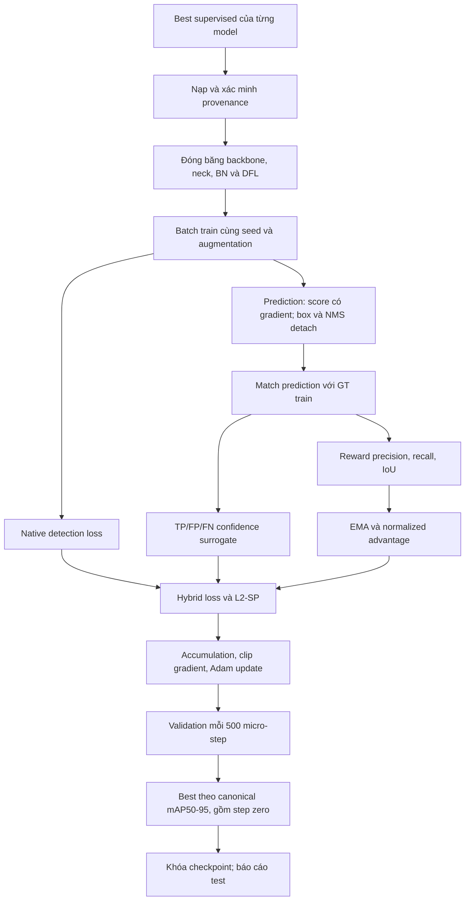

# BÁO CÁO KB1 — HUẤN LUYỆN YOLO HAI GIAI ĐOẠN: SUPERVISED VÀ REWARD-GUIDED FINE-TUNING

**Ngày lập báo cáo:** 15/10/2026, theo múi giờ Asia/Bangkok.  
**Phạm vi:** tổng hợp quá trình phát triển, phương pháp, công thức, kiểm chứng, kết quả thực nghiệm và hướng nghiên cứu tiếp theo của KB1.  
**Tên phương pháp phù hợp với mã:** *Reward-guided fine-tuning of YOLO detection heads with native detection loss, match-aware confidence surrogate and starting-point regularization*.  
**Dữ liệu thực nghiệm:** `pre-data/data/v2i_cleanned`, 28 class.  
**Metric chính:** canonical mAP50–95. Các bảng AP/P/R/F1 dưới đây dùng %, delta dùng **điểm phần trăm** trừ khi ghi khác.

> Báo cáo phân biệt bốn loại thông tin: kết quả có artifact; phương pháp được xác nhận từ code; kết quả của paper bên ngoài; và đề xuất chưa chạy. Đọc một tài liệu hướng dẫn hoặc thấy model được đăng ký trong code không đồng nghĩa thí nghiệm đó đã hoàn tất. Báo cáo này kiểm tra artifact và chạy kiểm thử mã; không huấn luyện lại detector hoặc chạy một lượt test inference mới.

## Mục lục

1. [Kết quả chính và mức độ hoàn thành](#1-kết-quả-chính-và-mức-độ-hoàn-thành)
2. [Câu hỏi nghiên cứu và thiết kế đối chứng](#2-câu-hỏi-nghiên-cứu-và-thiết-kế-đối-chứng)
3. [Nguồn bằng chứng và tài liệu đã đối chiếu](#3-nguồn-bằng-chứng-và-tài-liệu-đã-đối-chiếu)
4. [Lịch sử và các mốc triển khai](#4-lịch-sử-và-các-mốc-triển-khai)
5. [Dữ liệu, annotation và kiểm soát leakage](#5-dữ-liệu-annotation-và-kiểm-soát-leakage)
6. [Giai đoạn supervised](#6-giai-đoạn-supervised)
7. [Reward-guided: công thức và gradient](#7-reward-guided-công-thức-và-gradient)
8. [Huấn luyện, checkpoint và resume](#8-huấn-luyện-checkpoint-và-resume)
9. [Metric và protocol đánh giá](#9-metric-và-protocol-đánh-giá)
10. [Validation và các mốc đánh giá đã chạy](#10-validation-và-các-mốc-đánh-giá-đã-chạy)
11. [Kết quả test và hai câu hỏi nghiên cứu](#11-kết-quả-test-và-hai-câu-hỏi-nghiên-cứu)
12. [YOLO26n](#12-yolo26n)
13. [Phân tích class yếu và vật thể nhỏ](#13-phân-tích-class-yếu-và-vật-thể-nhỏ)
14. [Chi phí và benchmark](#14-chi-phí-và-benchmark)
15. [Đối chiếu paper và phạm vi bằng chứng](#15-đối-chiếu-paper-và-phạm-vi-bằng-chứng)
16. [Hạn chế, lỗi logic và việc cần sửa](#16-hạn-chế-lỗi-logic-và-việc-cần-sửa)
17. [Kế hoạch nghiên cứu tiếp theo](#17-kế-hoạch-nghiên-cứu-tiếp-theo)
18. [Cách diễn đạt kết luận trong luận văn](#18-cách-diễn-đạt-kết-luận-trong-luận-văn)
19. [Lệnh và cấu trúc artifact](#19-lệnh-và-cấu-trúc-artifact)
20. [Tài liệu tham khảo](#20-tài-liệu-tham-khảo)
21. [Phụ lục: lịch validation, hash và tài liệu lịch sử](#21-phụ-lục-lịch-validation-hash-và-tài-liệu-lịch-sử)

## 1. Kết quả chính và mức độ hoàn thành

KB1 đã xây dựng được quy trình hai giai đoạn: train supervised riêng từng model, lấy checkpoint tốt nhất tương ứng, rồi fine-tune Detect head bằng objective kết hợp native loss, reward, confidence proxy và regularization về trọng số khởi đầu. Có nhánh native-only để kiểm tra phần tăng thêm so với tiếp tục học bằng native loss.

Trên dữ liệu sạch, **sáu model ban đầu đều cải thiện mAP50–95 test khi so guided với supervised**, từ **+0,196 đến +1,264 điểm phần trăm**. Trung bình mô tả qua sáu kiến trúc là **+0,608 điểm phần trăm**; đây không phải trung bình qua seed và không phải kiểm định thống kê. YOLOv11n là model guided đứng đầu validation và cũng đạt điểm test guided cao nhất: **37,727%**.

Kết luận bổ sung cần giữ: guided thắng native-only trên test ở **4/6 model**, nhưng thấp hơn native-only ở YOLOv11n và YOLOv11s. Do đó, bằng chứng hiện tại ủng hộ lợi ích nhỏ của **quy trình guided tổng thể**, chưa chứng minh reward luôn tốt hơn continued supervised training hoặc là nguyên nhân duy nhất của cải thiện.

YOLO26n đã được bổ sung sau đợt sáu model. Nó có supervised checkpoint hợp lệ và **đã hoàn tất guided validation**: 39,232% → 39,568%, tăng **+0,336 điểm phần trăm**. Chưa có artifact native-only hoặc test guided cho YOLO26n trong output chính. Không được đưa baseline test YOLO26n vào bảng như thể đó là kết quả sau hai giai đoạn.

| Hạng mục | Trạng thái xác nhận ngày 15/10/2026 |
|---|---|
| Supervised sạch | 7/7 model có manifest và checkpoint được kiểm tra hash/dataset |
| Preflight sạch riêng | 12/14 tổ hợp model–mode có `completed.json`; thiếu hai nhánh YOLO26n |
| Screening dài | 13/14 tổ hợp hoàn tất: sáu cặp ban đầu và guided YOLO26n |
| Native-only YOLO26n | Chưa tìm thấy artifact trong output screening chính |
| Test supervised/native-only/guided | 18 dòng cho sáu model trong CSV clean ngày 28/09 |
| Benchmark supervised bổ sung | 14 dòng: 7 model × validation/test, ngày 07/10 |
| Test guided YOLO26n | Chưa tìm thấy trong bảng test clean |
| Nhiều seed sạch | Chưa có bằng chứng đủ trong output chính; stage hai hiện là seed 42 |
| Proxy-only/reward-only ablation | Chưa có bộ kết quả sạch đầy đủ |
| Kiểm thử ngày lập báo cáo | 10 unittest; kết quả bộ 19 kiểm tra legacy ghi ở mục 8 |
| Tình trạng paper-ready | Có pipeline và kết quả pilot; còn thiếu độ ổn định, ablation và đối chứng compute chặt |

Nguồn kết quả: [CSV test clean](../../kb1_reward_guided_training/results/canonical_clean/screening/test/results_full.csv), [screening checkpoints](../../kb1_reward_guided_training/checkpoint_reward_guide_trainning/screening_seed42_v1), [benchmark supervised 07/10](../../kb1_reward_guided_training/results/baseline_comparison_yolo26n_20261007/results.csv).

## 2. Câu hỏi nghiên cứu và thiết kế đối chứng

### 2.1. Hai câu hỏi gốc

**RQ1:** Với từng kiến trúc, reward-guided fine-tuning cải thiện bao nhiêu so với supervised checkpoint tương ứng?

\[
\Delta_M^{G-S}=100\left(\mathrm{mAP}_{M,G}-\mathrm{mAP}_{M,S}\right).
\]

**RQ2:** Model nào có kết quả cuối tốt nhất sau cả hai giai đoạn?

Validation dùng để chọn checkpoint và model dẫn đầu:

\[
M_{\mathrm{selected}}=\arg\max_M \mathrm{mAP}_{val}(M,G_M^*).
\]

Sau khi khóa lựa chọn, test đo chất lượng cuối. Thứ hạng test được báo cáo mô tả; không dùng để chọn lại hyperparameter/checkpoint. Tập ứng viên ban đầu đã khóa gồm guided best của sáu model. YOLO26n là phần mở rộng sau đợt đó, chưa hoàn tất cùng bảng test.

### 2.2. Ba nhánh thực tế

- **S0 — supervised:** best checkpoint sau stage một; không train thêm trong phép so sánh.
- **S1 — native-only:** tiếp tục tối ưu cùng Detect head bằng native loss và L2-SP.
- **G — guided / `kb1b`:** thêm reward term và TP/FP/FN confidence proxy vào S1.

\[
\Delta_M^{G-S1}=100\left(\mathrm{mAP}_{M,G}-\mathrm{mAP}_{M,S1}\right).
\]

G−S0 đo hiệu quả toàn bộ stage hai. G−S1 đo tác dụng **kết hợp reward và proxy trong protocol có early stopping**. Chưa có nhánh proxy-only nên không thể tách riêng hiệu ứng reward.

Các nhánh được ghép cặp theo model, checkpoint, dataset, seed, sampler, augmentation và evaluator. Ngân sách tối đa giống nhau; số update thực tế và thời gian khác nhau do early stopping và chi phí reward. Cụm từ “matched compute” chỉ nên dùng khi đã bổ sung đối chứng cùng số update/thời gian, không mặc định cho kết quả hiện tại.

### 2.3. Ranh giới với KB2 và KB3

KB1 dùng reward online từ prediction–GT để hướng cập nhật **trọng số detector**. KB2 nghiên cứu feedback/preference optimization. KB3 nghiên cứu lựa chọn hoặc điều khiển hyperparameter. EMA trong KB1 là EMA **reward baseline**, khác model-weight EMA của native trainer và khác trạng thái liên tục của agent KB3. Các kết quả KB2/KB3 không được cộng vào mức cải thiện KB1.

## 3. Nguồn bằng chứng và tài liệu đã đối chiếu

Báo cáo ưu tiên bằng chứng theo câu hỏi:

1. **Đã chạy gì và cấu hình nào:** `manifest.json`, `completed.json`, `validation.jsonl`, `args.yaml`/`opt.yaml`.
2. **Đã đạt metric nào:** CSV/JSON sinh bởi evaluator và metric lưu trong completed.
3. **Công thức/luồng hiện tại:** code của runner, reward, adapter, dataloader và evaluator.
4. **Lịch sử sửa lỗi:** các báo cáo review/screening cũ.
5. **Cơ sở phương pháp:** paper gốc đã kiểm tra qua nguồn xuất bản/tác giả.

Code hiện tại không tự chứng minh chính xác code của run lịch sử; cần đối chiếu SHA trong manifest. Tại ngày lập báo cáo, SHA của `run_verified.py`, `reward.py`, `canonical_eval.py`, `dataloader.py` và các thành phần khác vẫn khớp những run clean trước đó, nhưng `train_rl.py` và `adapters/ultralytics_adapter.py` đã đổi sau tích hợp YOLO26. Manifest YOLO26n guided khớp toàn bộ các file code mà nó ghi.

Tài liệu KB1 đã đối chiếu gồm các báo cáo KB1B, báo cáo rewritten, screening cũ/clean, final clean, review cv-rl, review tuning_rl, project analysis, guide RL legacy, guide DP và DPO. Tài liệu chung gồm review final, checkpoint/pretrained audit, ba tài liệu YOLO26 và README. Các docs KB2/KB3 được đối chiếu ở nội dung giao với KB1: nguồn checkpoint, recipe, evaluator và ranh giới phương pháp. Phụ lục lập danh mục tài liệu KB1 và các mô tả lỗi thời.

**Các mâu thuẫn tài liệu được xử lý trong báo cáo này:**

| Nội dung cũ | Bằng chứng hiện tại được dùng |
|---|---|
| 10 class UAV/lúa, chưa có data | Dataset sạch 28 class lá/cây; đã train |
| Train 2.072 / val 592 / test 296 | Dữ liệu cũ bị leak; dữ liệu sạch 2.411 / 479 / 239 |
| Chọn best bằng 0,4 mAP50 + 0,4 mAP50–95 + 0,2 recall | Runner verified clean chọn canonical mAP50–95 |
| Reward precision/recall 0,35/0,35 | Run clean dùng 0,25/0,45, IoU 0,30 |
| Chỉ YOLOv8/v11 có native loss | Luồng verified có native loss YOLOv5 và DP |
| DP chỉ P2/P3/P4 | YAML hiện tại giữ P2/P3/P4/P5 |
| W3F/PSA OFF | Manifest DP clean ghi cả hai ON |
| Chưa có kết quả sau làm sạch | Đã có sáu cặp và test; YOLO26 có guided validation |
| “18 dòng” cho toàn pipeline hiện tại | 7 model đầy đủ cần 21 dòng; artifact hiện mới 18 |
| Ba seed validation cũ chứng minh ổn định | Thuộc dữ liệu/protocol lịch sử; không dùng làm nhiều seed sạch |

## 4. Lịch sử và các mốc triển khai

Ngày của tài liệu là ngày ghi trong tài liệu. Ngày hoàn tất artifact là bằng chứng lưu trên filesystem, không thay thế nhật ký có timestamp được ký hoặc provenance thời gian.

| Mốc | Việc đã làm | Giá trị và giới hạn |
|---|---|---|
| 24/06, tài liệu prototype | Dựng adapter YOLO, reward recall/small, EMA, DP modules, test kỹ thuật | Ý tưởng ban đầu; nhiều mô tả 10 class/UAV và kỳ vọng hiệu năng chưa thành dữ liệu thực nghiệm |
| 19/08, KB1B status | Thử YOLOv11n v3.1 với seeds 42/43/44 và native-only | Validation lịch sử; chưa dùng làm kết luận sạch |
| 15/09, rewritten report | Chuẩn hóa KB1 thành hai giai đoạn và hai câu hỏi nghiên cứu | Phân biệt reward-guided surrogate với REINFORCE |
| 16/09, screening review | Phát hiện source leakage; dừng screening dài | 149/592 val, 67/296 test chung nguồn với train; kiểm chứng pixel hai cặp |
| 26/09, clean-path/audit docs | Làm lại data, loại checkpoint cũ, đổi tên output, thêm provenance | Tài liệu ghi xóa 217 checkpoint thí nghiệm và 8 pretrained theo yêu cầu; đây là lịch sử, không phải thao tác của lần viết báo cáo |
| Trước/đến 28/09 | Train lại sáu supervised, preflight 12 nhánh, screening 12 nhánh | Dataset sạch, source/checkpoint hash, native loss và DP flags được kiểm tra |
| 28/09, bảng final clean | Đánh giá test cho 18 model–stage | Trả lời RQ1/RQ2 cho sáu model |
| 07/10, YOLO26 | Supervised YOLO26n hoàn tất; benchmark lại 7 baseline × 2 split | Cùng canonical inference, benchmark FP32 batch 16 |
| 08/10, artifact YOLO26 guided | Hoàn tất 5.000 micro-step, best tại 3.000 | Có guided validation; thiếu native-only và test guided |
| 15/10, báo cáo này | Đối chiếu docs/code/artifact; kiểm tra hash/dataset và test mã | Tổng hợp có nguồn, không sinh kết quả inference mới |

### 4.1. Những cải tiến kỹ thuật đã đạt

Đã chuyển từ checkpoint chỉ mang tên model sang checkpoint gắn fingerprint dataset, hash file và metadata. Đã loại bỏ silent fallback tiền xử lý; cố định input RGB [0,1]; giữ gradient score sau NMS; đóng băng feature extractor/BatchNorm/DFL; dùng step zero làm candidate; nạp state dict strict và kiểm tra metric sau reload; thêm native-only thực; kiểm tra DP flags; lưu optimizer/RNG/EMA để resume; tách dữ liệu leak khỏi kết quả clean.

Đây là thành tựu về tính đúng và khả năng truy vết. Chúng không tự chứng minh AP tăng, nhưng làm phép đo cải thiện có ý nghĩa hơn.

## 5. Dữ liệu, annotation và kiểm soát leakage

### 5.1. Bài toán thực tế

Input là ảnh có thể có nhiều lá. Output gồm box, class và confidence. Class kết hợp loại cây và tình trạng lá/bệnh. Box bao lá; vết bệnh có thể nhỏ trong box lá lớn. Dataset hiện không chứng minh được nguồn ảnh UAV, cũng không phải benchmark phát hiện từng trứng/sâu/vết tổn thương.

Nguồn PlantDoc là tham khảo bối cảnh, không đủ để đồng nhất split Roboflow/dataset sạch của dự án với benchmark gốc. [PlantDoc, paper gốc](https://arxiv.org/abs/1911.10317).

### 5.2. Quy mô đã đếm lại

| Split | Ảnh | File nhãn | Box theo TXT | Ảnh augment nhận diện theo hậu tố |
|---|---:|---:|---:|---:|
| Train | 2.411 | 2.411 | 10.333 | 667 |
| Validation | 479 | 479 | 1.887 | 0 |
| Test | 239 | 239 | 1.063 | 0 |
| Tổng | 3.129 | 3.129 | 13.283 | 667 |

Train có **1.744 file ảnh không mang hậu tố augment đã biết**, với **7.036 box**. Các file train augment bổ sung 3.297 box. 1.744 không phải bằng chứng tuyệt đối có 1.744 cảnh/nguồn độc lập về nội dung: có thể có ảnh cùng cảnh khác ID.

Fingerprint toàn bộ ảnh, nhãn và cấu hình đã tính lại:

```text
cbd68ffc1da935ac300fba953ea5f9c97c831f53887e1b9391d500f9e40c0c95
```

Mọi class đều có box train/val/test. Phân bố theo class và số ảnh nguồn ở mục 13. Các box cùng ảnh và các biến thể augment là quan sát tương quan; không được coi số box như số mẫu độc lập.

### 5.3. Audit leakage

Audit clean không thấy source group trùng train–valid, train–test, valid–test theo policy bỏ hậu tố flip/rotation rồi so đầy đủ Roboflow ID. Audit còn kiểm tra pairing ảnh–nhãn và cấm các hậu tố augment đã biết ở val/test.

Audit lịch sử ghi 149 ảnh val và 67 ảnh test chung nguồn với train. Kết quả lịch sử không được dùng làm benchmark tổng quát hóa hoặc tính mức tăng phương pháp sạch.

**Giới hạn:** source audit không phát hiện đầy đủ ảnh gần trùng mang ID khác, burst video, cùng cây hoặc cùng nền. Đề xuất bổ sung perceptual hash/embedding similarity, review thủ công và chia theo cây/nguồn/cảnh khi có metadata.

### 5.4. Tiền xử lý và augmentation

Stage hai/evaluator dùng resize cạnh dài về 640, pad giữa 114 về 640×640, RGB float32/255. Validation/test không dùng random augment. Albumentations biến đổi box cùng ảnh, clipping box; lỗi decode/nhãn/transform phải báo lỗi.

Train stage hai dùng brightness/contrast, HSV, Gaussian noise, motion blur, horizontal/vertical flip, rotate ±15°, CLAHE. Sampler gắn RNG augmentation với seed, epoch và chỉ số ảnh để các nhánh ghép cặp nhận cùng batch/transform. Đây là augmentation online bổ sung trên tập đã augment offline; chưa có ablation chứng minh mức blur/noise hiện tại tốt cho dấu bệnh nhỏ.

Nguồn: [dataloader.py](../../kb1_reward_guided_training/dataloader.py), [audit_splits.py](../../kb1_reward_guided_training/audit_splits.py), [run_provenance.py](../../kb1_reward_guided_training/run_provenance.py).

## 6. Giai đoạn supervised

### 6.1. Khởi tạo và recipe

Mỗi kiến trúc được khởi tạo riêng từ pretrained được mapping trong `train_supervised.py`. YOLOv11 có CLI alias `yolov11n/s` nhưng tên asset là `yolo11n/s.pt`. DP dùng YOLOv5s pretrained và YAML tùy chỉnh; các module mới không có toàn bộ trọng số pretrained tương ứng.

Recipe chung: 640, SGD, tối đa 200 epoch, patience 30, detector seed 0; batch khác nhau để phù hợp VRAM. Ultralytics: lr0 0,01, lrf 0,01, momentum 0,937, weight decay 0,0005, warmup 3 epoch; degrees 10, translate 0,1, scale 0,5, fliplr 0,5, flipud 0,3, mosaic 1, mixup 0,1, HSV 0,015/0,7/0,4, AMP. YOLOv5/DP đọc `hyp.pest.yaml`. Cấu hình chạy thực lưu trong args/opt đáng tin hơn mô tả “mọi họ model có recipe hoàn toàn giống”.

Trainer native chọn best bằng fitness của framework. Hàng native mAP cao nhất trong CSV có thể khác checkpoint best nếu fitness khác; không đồng nhất hai khái niệm này. Native trainer thường dùng model-weight EMA cho validation/checkpoint. Stage hai bắt đầu từ model lưu trong best, không tiếp tục optimizer/scheduler stage một.

### 6.2. Log supervised sạch

Bảng trích trực tiếp `checkpoint_based/<model>/results.csv`. Epoch giữ cách đánh số của log từng framework; YOLOv5/DP và Ultralytics có thể khác quy ước bắt đầu.

| Model | Epoch đã chạy | Native peak epoch | Batch | Seed | Native peak mAP50–95 | Log time (giây) |
|---|---|---|---|---|---|---|
| YOLOv5s | 151 | 144 | 16 | 0 | 39.384 | — |
| YOLOv8n | 166 | 136 | 16 | 0 | 41.432 | 8369.91 |
| YOLOv8s | 126 | 96 | 8 | 0 | 42.159 | 8439.6 |
| YOLOv11n | 161 | 131 | 16 | 0 | 43.792 | 8266.29 |
| YOLOv11s | 167 | 137 | 8 | 0 | 44.718 | 11075.4 |
| DP-YOLO | 200 | 194 | 4 | 0 | 37.322 | — |
| YOLO26n | 142 | 112 | 16 | 0 | 42.984 | 8151.78 |

Native peak chỉ phục vụ mô tả quá trình supervised. Bảng canonical ở mục 10 mới dùng cho so sánh cùng evaluator. Stage một seed 0, stage hai seed 42: đây là một supervised initialization với một seed continuation, không phải hai seed nghiên cứu độc lập.

### 6.3. Native loss theo họ model

Ở mức cấu trúc:

\[
L_{\mathrm{v5}}=\lambda_b L_{\mathrm{box}}+\lambda_o L_{\mathrm{obj}}+\lambda_c L_{\mathrm{cls}}.
\]

YOLOv5 dùng native `ComputeLoss`; DP dùng ComputeLoss đã patch W3F/PSA.

\[
L_{\mathrm{v8/v11}}=\lambda_b L_{\mathrm{box}}+\lambda_c L_{\mathrm{cls}}+\lambda_d L_{\mathrm{DFL}}.
\]

Các hệ số native được lấy từ model/config. Không thay chúng bằng hệ số 0,25 của objective KB1: 0,25 là hệ số nhân toàn bộ native loss ở stage hai.

YOLO26 giữ native criterion riêng với cấu trúc dual-head và regression không dùng DFL; test local xác nhận thành phần `l1_loss`. Không mô tả mọi YOLO Ultralytics đều dùng DFL. [Tài liệu YOLO26](https://docs.ultralytics.com/models/yolo26/).

Adapter chia native loss theo batch để quy về scale mỗi ảnh theo implementation. Thang gradient vẫn khác giữa họ model, nên so sánh quan trọng là trong từng model.

### 6.4. DP-YOLO thực tế và công thức custom

DP hiện có P2/4, P3/8, P4/16, P5/32; backbone D2C3 và D3C3, neck PTCSP/C3Ghost. DCNv3 là bản giản lược/shared offset bằng torchvision, không tái lập đầy đủ operator của paper DCNv3. DP là tổ hợp thiết kế dự án, không phải bản tái lập nguyên vẹn của một paper mang tên DP-YOLO.

Manifest DP clean xác nhận `w3f=true`, `psa=true` ở supervised và continuation. PSA xét lân cận 3×3, radius 1 grid unit, kết hợp anchor-ratio/bounds. Tăng 5% positives trong tài liệu nguồn không phải số đã đo trên dataset này.

Đặt \(u=IoU\), \(d_1^2,d_2^2\) là khoảng cách bình phương hai góc tương ứng, \(c_{\mathrm{enc}}^2\) là đường chéo bình phương của enclosing box. Code dùng:

\[
L_{\mathrm{MPD,code}}=1-u+\frac{d_1^2+d_2^2}{c_{\mathrm{enc}}^2+\epsilon},
\quad
L_{\mathrm{F,code}}=L_{\mathrm{MPD,code}}+u-\max(u,\epsilon)^{0.5}.
\]

\[
R_{\mathrm{W,code}}=
\mathrm{stopgrad}\left[
\exp\left(\mathrm{clip}\left(
\frac{\|c_p-c_g\|^2}{w_g^2+h_g^2+\epsilon},0,\log10
\right)\right)\right].
\]

\[
r_{\mathrm{code}}=\mathrm{clip}\left(
\frac{0.6}{0.5\cdot1.9^{0.6}-0.5+10^{-9}},0,10
\right),\quad
L_{\mathrm{W3F,code}}=r_{\mathrm{code}}R_{\mathrm{W,code}}L_{\mathrm{F,code}}.
\]

Đây là **công thức code**, có constant focusing factor và power-IoU. Không được mô tả như tái lập nguyên bản dynamic WIoU v3 hoặc piecewise Focaler-IoU. Nguồn nghiên cứu: [MPDIoU](https://arxiv.org/abs/2307.07662), [Wise-IoU](https://arxiv.org/abs/2301.10051), [Focaler-IoU đúng](https://arxiv.org/abs/2401.10525).

Patch trả score:

\[
q=\mathrm{stopgrad}(q_{\mathrm{CIoU}})
+q_{\mathrm{W3F}}-\mathrm{stopgrad}(q_{\mathrm{W3F}}).
\]

Forward có giá trị CIoU để native objectness quality target phù hợp; gradient regression đi qua W3F surrogate. Log scalar native box loss vì thế không trực tiếp là giá trị W3F thuần. Các guide gọi công thức khác phải được xem là lịch sử.

Nguồn implementation: [DP YAML](../../kb1_reward_guided_training/models/dp_yolo/dp_yolo.yaml), [loss.py](../../kb1_reward_guided_training/models/dp_yolo/loss.py), [psa.py](../../kb1_reward_guided_training/models/dp_yolo/psa.py).

## 7. Reward-guided: công thức và gradient

### 7.1. Thuật toán triển khai



Chỉ Detect head được cập nhật, gồm các tham số classification/objectness/regression nằm trong module Detect; DFL fixed projection được giữ cố định. `eval()` giữ BN statistics, không tắt autograd. Forward native vẫn cung cấp gradient định vị; reward/confidence surrogate không trực tiếp backprop qua tọa độ box.

### 7.2. Matching một-một

Với ảnh \(i\), đặt GT \(G_i\), predictions sau confidence/NMS là \(P_i\). Sắp prediction theo score giảm dần. Với mỗi prediction, tìm GT **cùng class và chưa được dùng** có IoU lớn nhất. Match nếu IoU đạt ngưỡng. GT chỉ được match một lần.

Nhầm class tạo FP của class dự đoán và FN của class thật. Duplicate không được tính thêm TP. NMS IoU khác matching IoU: một ngưỡng lọc prediction trùng, ngưỡng kia quyết định khớp GT.

### 7.3. Reward đang dùng

Tại ngưỡng \(\tau\in T=\{0.50,0.60,0.70,0.80\}\):

\[
P_{i,\tau}=\frac{TP_{i,\tau}}{\max(|P_i|,1)},\quad
R_{i,\tau}=\frac{TP_{i,\tau}}{|G_i|},
\quad
U_{i,\tau}=
\begin{cases}
\frac{1}{TP_{i,\tau}}\sum_{(p,g)\in Match_\tau}IoU(p,g),&TP>0\\
0,&TP=0.
\end{cases}
\]

\[
r_i=\frac{1}{4}\sum_{\tau\in T}
\left(0.25P_{i,\tau}+0.45R_{i,\tau}+0.30U_{i,\tau}\right).
\]

Nếu ảnh không có GT: reward bằng 1 khi không có prediction, bằng 0 khi có prediction. Nếu có GT nhưng không có prediction: reward 0. Reward detach và tính matching CPU.

Reward khác mAP: theo ảnh, không tích phân đường PR toàn tập; không class-macro cùng cách mAP; chỉ bốn IoU tới 0,8; prediction reward được lọc conf 0,20 và NMS 0,45, khác evaluator conf 0,001/NMS 0,60. Do đó reward tăng chưa bảo đảm mAP50–95 tăng. Native loss và validation best giúp kiểm soát điều này.

Small-object reward còn trong `reward.py` cho lịch sử/dispatcher nhưng **không được dùng trong run verified clean**. Hệ số `reward_alpha`, `small_thresh`, duplicate penalty của legacy composite không phải hệ số của reward hiện tại.

### 7.4. EMA và normalized advantage đúng theo code

Với batch reward trung bình \(\bar r_t\), mean squared \(\overline{r^2}_t\), decay \(\alpha=0.99\):

\[
b_t=\alpha b_{t-1}+(1-\alpha)\bar r_t,\quad
v_t=\alpha v_{t-1}+(1-\alpha)\overline{r^2}_t.
\]

Ở batch đầu, \(b_t=\bar r_t\), \(v_t=\overline{r^2}_t\).

\[
\sigma_t=\sqrt{\max(v_t-b_t^2,10^{-4})},
\quad
A_{i,t}=\mathrm{clip}\left(\frac{r_i-b_t}{\sigma_t},-3,3\right).
\]

EMA được cập nhật bằng **batch hiện tại trước khi tính advantage**. Đây là standardization heuristic; không được viện dẫn tính unbiased của REINFORCE để chứng minh estimator KB1 unbiased. Một baseline độc lập với action là điều kiện khác với chỉ nói baseline có kỳ vọng bằng reward.

Nguồn: [EMABaseline và match_aware_objective](../../kb1_reward_guided_training/train_rl.py).

### 7.5. Confidence surrogate theo TP/FP/FN

Sau matching IoU 0,5, đặt tập prediction TP là \(\mathcal T_i\), FP là \(\mathcal F_i\), số GT chưa match \(m_i\), số GT \(n_i\), score candidate lớn nhất \(s_i^{max}\). Score clamp về \([10^{-6},1-10^{-6}]\).

\[
g_i=
\mathbf1_{|\mathcal T_i|>0}
\frac{1}{|\mathcal T_i|}\sum_{j\in\mathcal T_i}\log s_{ij}
+
0.5\mathbf1_{|\mathcal F_i|>0}
\frac{1}{|\mathcal F_i|}\sum_{j\in\mathcal F_i}\log(1-s_{ij})
+
1.5\mathbf1_{m_i>0}
\frac{m_i}{\max(n_i,1)}\log s_i^{max}.
\]

Chỉ cộng thành phần nếu điều kiện áp dụng; nếu không có thành phần, code giữ loss 0 nối với graph.

\[
L_{\mathrm{proxy}}=-\frac1B\sum_i g_i,\qquad
L_{\mathrm{reward}}=-\frac1B\sum_i
\mathrm{stopgrad}(A_{i,t})g_i.
\]

Khác prototype \(\log(\mathrm{mean\ confidence})\), verified runner dùng \(g_i\) match-aware. Tên biến `log_prob` không làm nó trở thành log-likelihood hợp lệ của một detection policy.

TP term tăng score TP; FP term giảm score FP. FN term có giới hạn nghiêm trọng: \(s_i^{max}\) là score mạnh nhất của **bất cứ candidate nào trong ảnh**, không phải candidate gắn với từng GT bị bỏ sót. Nó có thể tăng score của một TP đã tốt hoặc candidate sai class. Native loss đang chịu trách nhiệm lớn cho tín hiệu GT cụ thể.

### 7.6. L2-SP và objective tổng

Với tập tensor trainable \(\mathcal H\), reference là giá trị supervised đầu stage hai:

\[
L_{\mathrm{SP}}=\frac1{|\mathcal H|}
\sum_{h\in\mathcal H}\frac1{N_h}
\|\theta_h-\theta_h^0\|_2^2.
\]

Đây là trung bình từng tensor rồi trung bình các tensor, không phải tổng bình phương toàn bộ parameter. Tensor nhỏ và tensor lớn có trọng số tương đương ở cấp mean tensor.

\[
\boxed{
L_G=0.25L_{\mathrm{native}}
+0.10L_{\mathrm{reward}}
+0.25L_{\mathrm{proxy}}
+0.001L_{\mathrm{SP}}
}
\]

\[
\boxed{
L_{S1}=0.25L_{\mathrm{native}}+0.001L_{\mathrm{SP}}
}
\]

Regularization về điểm khởi đầu được lấy cảm hứng từ [Li, Grandvalet và Davoine, ICML 2018](https://proceedings.mlr.press/v80/li18a.html). Trong KB1, reference là supervised checkpoint đích, khác reference pretrained source trong transfer learning gốc.

Một hệ quả cần kiểm tra bằng ablation:

\[
0.10L_{\mathrm{reward}}+0.25L_{\mathrm{proxy}}
=-\frac1B\sum_i(0.25+0.10A_i)g_i.
\]

Vì \(A_i\in[-3,3]\), hệ số confidence nằm trong \([-0.05,0.55]\). Khi \(A_i<-2.5\), dấu contribution của proxy có thể đảo: hướng TP/FP mong muốn ở proxy-only không còn bảo đảm. Đây là hệ quả toán học của code, **chưa có log đo tần suất hoặc bằng chứng nó gây giảm AP**. Cần đo distribution/gradient và so với thiết kế trọng số không âm.

### 7.7. Vì sao tên gọi RL-inspired là chính xác

REINFORCE cho policy stochastic \(\pi_\theta(a|x)\), action sample \(a\sim\pi_\theta\), có log-likelihood thực:

\[
\nabla_\theta J=
\mathbb E\left[(r-b)\nabla_\theta\log\pi_\theta(a|x)\right].
\]

Cơ sở: [Williams, 1992](https://doi.org/10.1007/BF00992696). KB1 không sample tập boxes/class từ policy probability model; inference xác định; label/matching/NMS/box detach; \(g_i\) là score surrogate. Vì vậy không có chứng minh gradient KB1 là estimator unbiased của expected task reward. Không có PPO ratio/clipped policy objective, critic, learned reward model hay preference pair loss trong KB1.

Đóng góp khả dụng là một **hybrid reward-guided loss cho YOLO**, có thể kiểm chứng bằng đối chứng thực nghiệm; không cần gọi sai thuật toán để biện minh nghiên cứu.

## 8. Huấn luyện, checkpoint và resume

### 8.1. Thông số thực chạy stage hai

| Thành phần | Giá trị |
|---|---|
| Optimizer | Adam, không phải SGD của supervised |
| LR max/min | \(5\times10^{-7}\) / \(10^{-7}\) |
| Warmup | 500 micro-step |
| Scheduler | Cosine theo budget tối đa 10.000 micro-step |
| Batch | 8 |
| Accumulation | 2; 16 ảnh/update |
| Gradient norm clip | 0,5 |
| Budget | 10.000 micro-step = tối đa 5.000 optimizer update |
| Validation interval | 500 micro-step = 250 optimizer update |
| Patience | 4 validation không tăng quá min-delta |
| Min-delta | 0,0005 mAP = 0,05 điểm phần trăm |
| Seed continuation | 42 |
| Workers | Sáu cặp trước: 2; YOLO26 guided: 0 |
| Model mode | Eval/frozen BN, autograd cho Detect head |
| Reward prediction | Conf 0,20; NMS 0,45 |
| Validation prediction | Conf 0,001; NMS 0,60; max 300 |

Learning rate tại micro-step \(s\), warmup \(W=500\), budget \(S=10000\):

\[
\eta_s=
\begin{cases}
\eta_{min}+(\eta_{max}-\eta_{min})s/W,&s\le W\\
\eta_{min}+\frac12(\eta_{max}-\eta_{min})
[1+\cos(\pi(s-W)/(S-W))],&s>W.
\end{cases}
\]

Nếu early stop ở step 3.000, cosine chưa về LR min. Không mô tả “mọi run hoàn tất toàn bộ cosine schedule”.

Với train 2.411 ảnh và batch 8, sampler dùng \(\lfloor2411/8\rfloor=301\) micro-batch trên một sampler epoch; bỏ 3 ảnh theo permutation mỗi epoch. Budget 10.000 micro-step tương đương khoảng 33,2 lượt đi qua sampler, không phải 10.000 epoch.

### 8.2. Chọn best và early stopping

Step zero supervised được lưu vào `best.pt`. Mỗi lần validation, **bất cứ tăng mAP50–95 nào** đều có thể cập nhật best. Min-delta chỉ áp dụng cho mốc patience. Vì thế run có thể lưu best tại step cuối nhưng vẫn early stop: những tăng nhỏ chưa vượt mốc patience.

\[
s^*=\arg\max_{s\in\{0,500,1000,\ldots\}}
\mathrm{mAP}_{val}(s).
\]

Không chọn best bằng training reward hoặc weighted validation score lịch sử. Bảo vệ step zero giữ best validation không thấp hơn baseline trong các mốc được đo, nhưng không bảo đảm test tăng.

### 8.3. Guard và state lưu

Manifest supervised ghi model, source pretrained nếu có, checkpoint SHA, dataset/config SHA và DP flags. Verified runner từ chối nguồn khác hoặc data thay đổi.

Manifest stage hai ghi config, source checkpoint/hash, protocol và hash các file code trọng yếu. Resume khác metadata phải dùng output mới. `last.pt` lưu state_dict, optimizer, micro-step, best/patience state, EMA reward, RNG CPU/CUDA và training time. `best.pt` lưu state_dict, step, metrics và metadata; phải dựng architecture từ supervised source rồi load strict, không mặc định dùng trực tiếp `YOLO(guided_best.pt)`.

Run kiểm tra step-zero reload parity trên một batch, native/reward loss hữu hạn, nonzero gradients ở mỗi optimizer update, head đổi và frozen parameters không đổi sau update đầu, BN buffers không đổi ở các validation, best reload khớp metric. Frozen parameter equality không phải kiểm tra lại mọi tensor ở mọi update.

Các file được ghi qua temporary file rồi replace. Chưa có lock độc quyền output cho hai tiến trình KB1 cùng thư mục, và code hash chưa bao phủ mọi dependency hoặc tất cả DP modules. Đây là các giới hạn provenance cần nêu.

### 8.4. Kiểm thử tại ngày lập báo cáo

Chạy `python -m unittest discover -s kb1_reward_guided_training/tests -p test_*.py`: **10/10 PASS**. Gồm provenance, matching/NMS/score gradient, nhãn sát biên/letterbox, sampler/augmentation resume, evaluator perfect prediction, và YOLO26 dual-head/native-loss gradient.

Chạy riêng `python kb1_reward_guided_training/tests/test_fixes.py`: **19/19 PASS**. Bộ này kiểm tra custom loss, PSA, DCNv3 và một số contract legacy; không phải 19 benchmark accuracy.

Các test tổng hợp/ảnh nhỏ kiểm tra logic và gradient. Chúng không thay thế benchmark dataset, không chứng minh cải thiện có ý nghĩa thống kê hoặc khả năng tổng quát hóa UAV.

## 9. Metric và protocol đánh giá

### 9.1. Định nghĩa

\[
IoU(B_p,B_g)=\frac{|B_p\cap B_g|}{|B_p\cup B_g|}.
\]

Tại operating confidence 0,25 và matching IoU 0,50:

\[
P=\frac{TP}{TP+FP},\quad
R_{op}=\frac{TP}{TP+FN},\quad
F1=\frac{2PR_{op}}{P+R_{op}}
=\frac{2TP}{2TP+FP+FN}.
\]

P/R/F1 của evaluator là **micro** qua counts toàn tập. Macro-F1 là mean F1 theo class có counts trong evaluator; không bằng F1 tính từ macro P/R. Với dataset hiện tại đủ 28 class GT, số class thực đo được ghi trong CSV arrays.

AP class \(c\), IoU \(\tau\), dùng precision envelope nội suy trên 101 recall points:

\[
AP_{c,\tau}=\frac1{101}\sum_{r\in\{0,.01,\ldots,1\}}p^{interp}_{c,\tau}(r).
\]

\[
mAP50=\frac1C\sum_c AP_{c,0.50},\quad
mAP50\text{–}95=\frac1{10C}\sum_c
\sum_{\tau\in\{.50,.55,\ldots,.95\}}AP_{c,\tau}.
\]

mAP là chất lượng phát hiện và xếp hạng confidence, không phải tỷ lệ ảnh đúng, mean confidence hay accuracy. AP theo class trong CSV là AP50–95, không phải AP50.

\[
AR300=\frac1{10C}\sum_c\sum_\tau
Recall_{c,\tau,\mathrm{cap}=300}.
\]

AR300 dùng confidence thấp và trung bình qua class/IoU, khác micro operating recall ở 0,25/0,50. Cột `recall` legacy của canonical evaluator là alias **AR300**; trong report dùng tên riêng để tránh nhầm.

### 9.2. Contract canonical đã triển khai

| Thành phần | Contract |
|---|---|
| Backend | TorchMetrics MeanAveragePrecision + faster-coco-eval |
| Input | RGB float32 [0,1], longest-side resize 640, centered pad114 |
| Box | xyxy tuyệt đối trong ảnh resize/pad |
| Conf để tính AP | 0,001 |
| NMS | Class-aware, IoU 0,60 |
| Candidate class | Một class có probability cao nhất mỗi candidate |
| Cap prediction | Tối đa 300 box sau NMS mỗi ảnh |
| Metric max detections | [1,10,300] |
| AP IoU | 0,50:0,05:0,95 |
| P/R/F1 point | Conf 0,25, matching IoU 0,50 |
| APs/APm/APl | Area box trong tọa độ resize/pad 640 |
| FP32 benchmark | Forward + NMS, synchronized CUDA, batch 16, loại batch đầu |

Tên `kb1_canonical_v3_map5095` trong **training protocol manifest** ghi thêm lựa chọn checkpoint bằng mAP50–95; tên `kb1_canonical_v2_ar300` trong **metric output** ghi evaluator. Hai lớp tên tồn tại đồng thời; không suy ra có hai evaluator số học khác nhau chỉ từ version string.

COCO-style evaluator dùng cap 300 và diện tích sau resize của dự án; không hoàn toàn đồng nhất benchmark COCO chuẩn cap 100/area gốc. Tài liệu API xác nhận max detection/IoU/recall thresholds có thể tùy chỉnh. [TorchMetrics mAP](https://lightning.ai/docs/torchmetrics/stable/detection/mean_average_precision).

### 9.3. Kích thước và tốc độ

APs ứng với box area dưới \(32^2\), APm khoảng \(32^2\)–\(96^2\), APl trên \(96^2\), theo implementation COCO. Không diễn giải APs là “AP của vết bệnh nhỏ” khi GT bao cả lá.

\[
FPS=\frac{N_{\mathrm{measured\ images}}}{t_{\mathrm{forward+NMS}}}.
\]

Không gồm I/O, decode/resize, inference-service overhead; không phải latency batch 1. FPS trong CSV test 28/09 và benchmark 07/10 khác đáng kể, dù AP supervised khớp. Artifact test cũ không cung cấp manifest môi trường tốc độ đầy đủ; không lấy chênh FPS giữa hai đợt để kết luận guided làm model nhanh hơn. Benchmark 07/10 có GPU/dtype/batch rõ hơn.

### 9.4. Vì sao native validation khác canonical

Native trainer và canonical khác preprocessing, NMS class policy, evaluator/matching/AP integration và có thể branch inference. Mã native Ultralytics dùng multi-label NMS, canonical lấy một class/candidate. YOLO26native NMS-free và canonical one-to-many đặc biệt cần ghi rõ.

Ví dụ YOLOv11n clean native peak 43,792%, canonical supervised val 40,531%. Khoảng chênh này chưa được tách bằng controlled ablation; không gán toàn bộ cho resize hoặc NMS. Mức tăng stage hai chỉ tính trong cùng canonical protocol.

## 10. Validation và các mốc đánh giá đã chạy

### 10.1. Kết quả validation sạch

Các hàng supervised trong screening là đánh giá step zero bằng adapter, không phải peak native CSV. YOLO26n lấy từ baseline/completed guided vì báo cáo screening Markdown cũ chưa cập nhật model này.

| Model | Nhánh | Best micro-step | mAP50 | mAP50–95 | AR300 |
|---|---|---|---|---|---|
| YOLOv5s | S0 | 0 | 48.597 | 33.792 | 51.454 |
| YOLOv5s | S1 | 5000 | 48.497 | 34.688 | 52.515 |
| YOLOv5s | G | 8500 | 48.712 | 35.029 | 52.660 |
| YOLOv8n | S0 | 0 | 49.124 | 37.818 | 56.206 |
| YOLOv8n | S1 | 2500 | 49.426 | 37.986 | 56.590 |
| YOLOv8n | G | 5000 | 49.665 | 38.367 | 56.669 |
| YOLOv8s | S0 | 0 | 48.906 | 37.956 | 54.973 |
| YOLOv8s | S1 | 6000 | 49.454 | 38.589 | 55.488 |
| YOLOv8s | G | 7500 | 49.880 | 38.972 | 55.197 |
| YOLOv11n | S0 | 0 | 52.566 | 40.531 | 57.043 |
| YOLOv11n | S1 | 1000 | 52.594 | 40.571 | 57.115 |
| YOLOv11n | G | 1000 | 52.698 | 40.655 | 57.118 |
| YOLOv11s | S0 | 0 | 50.474 | 39.810 | 55.072 |
| YOLOv11s | S1 | 8500 | 50.925 | 40.258 | 55.596 |
| YOLOv11s | G | 7000 | 51.039 | 40.412 | 55.554 |
| DP-YOLO | S0 | 0 | 47.635 | 33.317 | 56.111 |
| DP-YOLO | S1 | 6000 | 47.844 | 33.985 | 56.771 |
| DP-YOLO | G | 10000 | 47.975 | 34.109 | 56.894 |
| YOLO26n | S0 | 0 | 50.887 | 39.232 | 57.062 |
| YOLO26n | G | 3000 | 51.140 | 39.568 | 57.531 |

Sáu model ban đầu: guided đều hơn S0 và S1 trên validation. YOLOv11n guided 40,655% là leader; YOLOv11s 40,412% sát phía sau. YOLO26n guided 39,568% chưa vượt hai model này.

### 10.2. Mốc thực chạy và ngân sách

| Model | Mode | Best step | Stop step | Updates | Số val trong loop | Giây ghi nhận | Dừng vì |
|---|---|---|---|---|---|---|---|
| YOLOv5s | native_only | 5000 | 5000 | 2500 | 10 | 514.2 | early_stopping |
| YOLOv5s | kb1b | 8500 | 9500 | 4750 | 19 | 1315.1 | early_stopping |
| YOLOv8n | native_only | 2500 | 3000 | 1500 | 6 | 310.5 | early_stopping |
| YOLOv8n | kb1b | 5000 | 5000 | 2500 | 10 | 585.9 | early_stopping |
| YOLOv8s | native_only | 6000 | 7000 | 3500 | 14 | 728.9 | early_stopping |
| YOLOv8s | kb1b | 7500 | 8000 | 4000 | 16 | 1454.9 | early_stopping |
| YOLOv11n | native_only | 1000 | 2000 | 1000 | 4 | 213.4 | early_stopping |
| YOLOv11n | kb1b | 1000 | 3000 | 1500 | 6 | 379.0 | early_stopping |
| YOLOv11s | native_only | 8500 | 8500 | 4250 | 17 | 887.1 | early_stopping |
| YOLOv11s | kb1b | 7000 | 7000 | 3500 | 14 | 1264.7 | early_stopping |
| DP-YOLO | native_only | 6000 | 6500 | 3250 | 13 | 1058.8 | early_stopping |
| DP-YOLO | kb1b | 10000 | 10000 | 5000 | 20 | 2805.6 | budget |
| YOLO26n | kb1b | 3000 | 5000 | 2500 | 10 | 1486.9 | early_stopping |

Với interval 500, lịch chính thức gồm step zero và **mọi bội số 500 tới stop-step của từng run**. Ví dụ YOLOv11n guided đo 0/500/1000/1500/2000/2500/3000; chọn step 1000, không chọn last step 3000. DP guided đo tới 10000 và chọn 10000. YOLO26 đo tới 5000 và chọn 3000.

Cột “số validation trong loop” không tính baseline step zero, forward parity một batch hoặc lượt full-validation reload cuối. Runner còn full-evaluate best sau reload để kiểm tra metric. Không nên cộng những kiểm tra kỹ thuật này như các trial tối ưu độc lập.

Preflight 12 nhánh sáu model chỉ chạy 2 micro-step = 1 optimizer update, validation ở step 2. Đó là kiểm tra gradient/contract, không phải bằng chứng hiệu quả học. YOLO26 có tests tổng hợp và guided completed nhưng chưa có preflight artifact riêng ở thư mục preflight.

### 10.3. Tiến triển metric

Guided YOLOv11n đạt peak sớm rồi giảm nhẹ; early stopping giữ được checkpoint step 1000. DP có mAP vẫn tăng chậm ở cuối budget, nhưng test vẫn thấp hơn các YOLO hiện đại. Cả hai quan sát đều không đủ để kết luận tăng budget chắc chắn tốt hơn: cần pilot validation có đối chứng.

Phụ lục 21.1 lưu **mọi mốc guided và native-only** đã ghi trong `validation.jsonl`, gồm cả các mốc sau best.

## 11. Kết quả test và hai câu hỏi nghiên cứu

### 11.1. Bảng chính sáu model đã hoàn tất

| Model | S0 test | S1 test | G test | G−S0 (điểm) | G−S1 (điểm) | Tăng tương đối G/S0 |
|---|---|---|---|---|---|---|
| YOLOv5s | 30.395 | 30.902 | 31.245 | +0.850 | +0.343 | +2.798% |
| YOLOv8n | 33.204 | 33.242 | 33.762 | +0.558 | +0.520 | +1.679% |
| YOLOv8s | 33.976 | 34.991 | 35.241 | +1.264 | +0.249 | +3.722% |
| YOLOv11n | 37.531 | 37.788 | 37.727 | +0.196 | -0.060 | +0.523% |
| YOLOv11s | 36.269 | 36.958 | 36.496 | +0.227 | -0.462 | +0.625% |
| DP-YOLO | 28.912 | 29.292 | 29.467 | +0.555 | +0.174 | +1.918% |

Nguồn: 18 hàng trong [results_full.csv](../../kb1_reward_guided_training/results/canonical_clean/screening/test/results_full.csv). Delta tính từ số chưa làm tròn, do đó phép trừ hai số đã làm tròn có thể lệch 0,001 điểm.

**RQ1:** guided tăng so với supervised ở cả sáu model. YOLOv8s tăng nhiều nhất trên test, +1,264 điểm; YOLOv11n tăng ít nhất, +0,196 điểm. Tăng tương đối phải tính riêng, không gọi +1,264 điểm là “+1,264% tương đối”.

**RQ2:** trong tập guided sáu model đã khóa, YOLOv11n tốt nhất trên validation và test. Tuy nhiên checkpoint native-only YOLOv11n đạt 37,788%, cao hơn guided 37,727%. “Guided model tốt nhất” khác “mọi nhánh checkpoint tốt nhất”.

### 11.2. Các metric phụ test đầy đủ

| Model | Stage | P | R operating | F1 micro | Macro-F1 | mAP50 | mAP50–95 | AR300 | APs | APm | APl |
|---|---|---|---|---|---|---|---|---|---|---|---|
| YOLOv5s | supervised | 50.729 | 52.399 | 51.550 | 43.668 | 42.625 | 30.395 | 47.280 | 8.434 | 18.473 | 35.446 |
| YOLOv5s | native_only | 50.823 | 52.305 | 51.553 | 43.722 | 42.560 | 30.902 | 47.930 | 8.472 | 18.499 | 36.146 |
| YOLOv5s | kb1b | 50.632 | 52.775 | 51.681 | 43.690 | 42.861 | 31.245 | 48.160 | 8.418 | 18.746 | 36.427 |
| YOLOv8n | supervised | 48.178 | 50.988 | 49.543 | 42.961 | 43.775 | 33.204 | 51.251 | 6.445 | 22.501 | 38.331 |
| YOLOv8n | native_only | 50.141 | 50.141 | 50.141 | 43.409 | 43.686 | 33.242 | 51.453 | 6.580 | 22.562 | 38.529 |
| YOLOv8n | kb1b | 49.275 | 51.176 | 50.208 | 43.963 | 44.373 | 33.762 | 51.599 | 6.934 | 22.560 | 38.968 |
| YOLOv8s | supervised | 47.231 | 54.563 | 50.633 | 44.479 | 44.793 | 33.976 | 52.247 | 5.245 | 20.963 | 40.317 |
| YOLOv8s | native_only | 51.349 | 51.929 | 51.637 | 45.047 | 45.753 | 34.991 | 53.706 | 5.090 | 21.385 | 41.442 |
| YOLOv8s | kb1b | 50.714 | 53.434 | 52.038 | 46.051 | 46.073 | 35.241 | 52.699 | 4.888 | 21.736 | 41.674 |
| YOLOv11n | supervised | 51.235 | 54.657 | 52.890 | 47.762 | 49.235 | 37.531 | 54.213 | 3.375 | 27.958 | 41.464 |
| YOLOv11n | native_only | 51.932 | 54.374 | 53.125 | 48.059 | 49.506 | 37.788 | 54.397 | 3.403 | 27.924 | 41.727 |
| YOLOv11n | kb1b | 51.416 | 54.657 | 52.987 | 47.813 | 49.447 | 37.727 | 54.373 | 3.395 | 27.928 | 41.634 |
| YOLOv11s | supervised | 53.122 | 52.023 | 52.567 | 46.343 | 46.751 | 36.269 | 51.407 | 7.412 | 23.120 | 41.683 |
| YOLOv11s | native_only | 53.922 | 51.740 | 52.808 | 46.568 | 47.273 | 36.958 | 52.172 | 7.145 | 25.362 | 42.375 |
| YOLOv11s | kb1b | 53.161 | 52.211 | 52.682 | 46.311 | 46.746 | 36.496 | 51.890 | 7.047 | 24.982 | 42.062 |
| DP-YOLO | supervised | 37.649 | 56.350 | 45.139 | 40.182 | 40.807 | 28.912 | 50.025 | 5.728 | 18.446 | 33.917 |
| DP-YOLO | native_only | 38.481 | 56.256 | 45.701 | 40.535 | 40.962 | 29.292 | 51.019 | 5.718 | 18.374 | 34.334 |
| DP-YOLO | kb1b | 37.546 | 57.291 | 45.363 | 40.395 | 41.062 | 29.467 | 50.637 | 5.773 | 19.258 | 34.486 |

Macro-F1 còn thấp, đặc biệt DP. mAP tăng không bảo đảm precision/recall/F1/APs đều tăng. YOLOv8s guided tăng mAP50–95 nhưng AR300 thấp hơn native-only; đó là trade-off xếp hạng/localization/recall, không được che đi bằng một metric tổng.

YOLOv11n guided có operating recall bằng supervised theo counts hiện có, nhưng mAP tăng. Điều này phù hợp với thay đổi xếp hạng/định vị, không chứng minh tìm được thêm nhiều lá tại confidence 0,25.

### 11.3. Validation–test gap

YOLOv11n guided: 40,655% val →37,727% test, giảm 2,928 điểm. YOLO26 baseline: 39,232% val →33,356% test, giảm 5,876 điểm. Đây là chênh giữa split, không phải mức suy giảm do reward.

Không có CI hoặc nhiều seed sạch nên chưa phân biệt chắc biến thiên sampling, domain/class distribution hay overfit validation. Test đã được xem và baseline được đánh giá lại ngày 07/10; những cải tiến thiết kế sau khi xem lỗi test phải được xem là nghiên cứu tiếp theo, cần một tập độc lập mới hoặc protocol đánh giá mới để xác nhận.

## 12. YOLO26n

### 12.1. Tích hợp kỹ thuật

YOLO26n đã đăng ký trong supervised, adapter factory, CHECKPOINTS, screening, evaluate và script .sh. Canonical path chuyển `end2end=False` để dùng one-to-many tensor decoded có gradient score và NMS chung; native criterion giữ hai nhánh training. Checkpoint fuse bỏ one-to-many không phù hợp path này.

Kiểm thử local dùng model thật từ YAML, ảnh 64×64 và GT tổng hợp: loss hữu hạn; classification gradients cả one-to-many/one-to-one qua native loss; gradient canonical scores đi vào one-to-many. Đây là hỗ trợ kỹ thuật, chưa là kết quả accuracy benchmark.

### 12.2. Kết quả có artifact

| Đánh giá | mAP50 | mAP50–95 | AR300 | Ghi chú |
|---|---:|---:|---:|---|
| Baseline validation | 50,887 | 39,232 | 57,062 | Step zero |
| Guided validation | 51,140 | 39,568 | 57,531 | Best step 3000 |
| Baseline test | 43,290 | 33,356 | 49,907 | Supervised; không phải guided |
| Native-only validation/test | — | — | — | Chưa có artifact |
| Guided test | — | — | — | Chưa có artifact |

Guided YOLO26 APs val 6,281%→6,256%, **giảm khoảng 0,025 điểm**, dù mAP tổng tăng. Vì vậy chưa có bằng chứng reward hiện tại cải thiện vật thể nhỏ ở YOLO26.

### 12.3. Mức độ hoàn thành

Ngày 07/10: supervised 142 epoch, peak native mAP50–95 42,984% tại epoch 112; canonical val 39,232%. Guided completed ghi 5000 micro-step, 2500 updates, 1486,9 giây, early stopping. Tương đối mAP val tăng khoảng 0,858%; số đáng báo cáo chính là **+0,336 điểm**.

Benchmark supervised xếp YOLO26 thứ 3/7 val và 4/7 test, APs test 8,914% cao nhất bảy baseline trong lần đo. APs tuyệt đối vẫn thấp; chưa thể suy ra YOLO26 giải quyết được các class khó hoặc tốt nhất sau stage hai.

## 13. Phân tích class yếu và vật thể nhỏ

### 13.1. Bảng đủ 28 class

Box train-gốc là số box trong các file train không mang hậu tố augment đã biết; box train-all gồm augment. AP test gồm YOLOv11n S0/G và YOLO26 S0. Không có AP test guided YOLO26 để điền.

| ID | Class | Box train-gốc | Box train-all | Box val | Box test | v11n S0 AP | v11n G AP | Δ AP (điểm) | YOLO26 S0 AP |
|---|---|---|---|---|---|---|---|---|---|
| 0 | Apple Scab Leaf | 136 | 319 | 32 | 18 | 40.973 | 40.973 | +0.000 | 17.745 |
| 1 | Apple leaf | 196 | 336 | 46 | 31 | 32.240 | 32.504 | +0.264 | 40.833 |
| 2 | Apple rust leaf | 129 | 346 | 46 | 22 | 39.062 | 39.093 | +0.031 | 56.956 |
| 3 | Bell_pepper leaf | 272 | 369 | 29 | 45 | 43.654 | 43.653 | -0.001 | 28.579 |
| 4 | Bell_pepper leaf spot | 205 | 320 | 49 | 23 | 36.594 | 36.870 | +0.276 | 29.695 |
| 5 | Blueberry leaf | 598 | 598 | 158 | 85 | 54.233 | 54.497 | +0.264 | 53.931 |
| 6 | Cherry leaf | 187 | 333 | 70 | 21 | 30.990 | 30.800 | -0.190 | 28.717 |
| 7 | Corn Gray leaf spot | 53 | 202 | 14 | 14 | 40.759 | 40.759 | +0.000 | 19.241 |
| 8 | Corn leaf blight | 311 | 327 | 56 | 34 | 48.749 | 48.910 | +0.161 | 50.008 |
| 9 | Corn rust leaf | 84 | 336 | 39 | 12 | 72.297 | 72.297 | +0.000 | 72.042 |
| 10 | Peach leaf | 410 | 410 | 70 | 178 | 31.638 | 31.557 | -0.081 | 34.644 |
| 11 | Potato leaf | 104 | 354 | 41 | 23 | 1.215 | 1.076 | -0.139 | 1.331 |
| 12 | Potato leaf early blight | 214 | 371 | 172 | 16 | 2.981 | 2.983 | +0.002 | 4.348 |
| 13 | Potato leaf late blight | 229 | 361 | 62 | 37 | 20.465 | 20.477 | +0.012 | 14.159 |
| 14 | Raspberry leaf | 520 | 520 | 130 | 17 | 50.748 | 51.102 | +0.354 | 42.376 |
| 15 | Soyabean leaf | 258 | 351 | 66 | 17 | 83.482 | 83.482 | +0.000 | 52.333 |
| 16 | Squash Powdery mildew leaf | 200 | 351 | 54 | 50 | 48.149 | 48.324 | +0.175 | 47.561 |
| 17 | Strawberry leaf | 380 | 380 | 93 | 67 | 67.544 | 67.677 | +0.133 | 60.132 |
| 18 | Tomato Early blight leaf | 198 | 354 | 40 | 10 | 19.817 | 19.778 | -0.039 | 5.634 |
| 19 | Tomato Septoria leaf spot | 389 | 389 | 60 | 45 | 32.016 | 32.093 | +0.077 | 24.160 |
| 20 | Tomato leaf | 307 | 397 | 125 | 37 | 38.409 | 38.490 | +0.082 | 39.981 |
| 21 | Tomato leaf bacterial spot | 224 | 352 | 60 | 11 | 24.888 | 24.890 | +0.002 | 16.880 |
| 22 | Tomato leaf late blight | 165 | 353 | 49 | 40 | 57.086 | 57.188 | +0.102 | 44.213 |
| 23 | Tomato leaf mosaic virus | 213 | 351 | 41 | 44 | 19.602 | 19.624 | +0.022 | 16.512 |
| 24 | Tomato leaf yellow virus | 523 | 523 | 164 | 124 | 25.397 | 25.379 | -0.018 | 30.625 |
| 25 | Tomato mold leaf | 262 | 325 | 50 | 5 | 6.931 | 6.931 | +0.000 | 31.287 |
| 26 | grape leaf | 160 | 355 | 57 | 28 | 32.874 | 32.863 | -0.011 | 26.343 |
| 27 | grape leaf black rot | 109 | 350 | 14 | 9 | 48.069 | 52.091 | +4.021 | 43.713 |

Nguồn: nhãn TXT sạch, arrays `classes/map_per_class` trong CSV test clean, CSV benchmark 07/10. Các class ID được ánh xạ bằng `configs/pest.yaml`, không suy từ thứ tự tên tùy ý.

### 13.2. Các class rất yếu không chỉ do box nhỏ

| Class | Nguồn ảnh train nhận diện | Ảnh validation | Ảnh test | Box test |
|---|---:|---:|---:|---:|
| Potato leaf | 14 | 8 | 2 | 23 |
| Potato leaf early blight | 85 | 31 | 7 | 16 |
| Tomato Early blight leaf | 69 | 15 | 4 | 10 |
| Tomato leaf bacterial spot | 87 | 18 | 5 | 11 |
| Tomato mold leaf | 68 | 15 | 4 | 5 |
| grape leaf black rot | 62 | 11 | 7 | 9 |

Potato leaf có 104 box train-gốc, 354 box sau augment, nhưng chỉ 14 nhóm ảnh nguồn. 23 box test nằm trong 2 ảnh. Vì vậy class này có đa dạng nguồn rất hạn chế; tăng số box bằng flip không tạo thêm điều kiện ánh sáng/cây/nền độc lập. Chưa thể xác định nguyên nhân riêng nếu chưa xem ảnh/prediction, nhưng đây là bằng chứng mạnh hơn việc chỉ nhìn số box cân bằng.

Median \(\sqrt{w_{norm}h_{norm}}\) test: Potato leaf 0,087; Potato early blight 0,338; Tomato Early blight 0,189; bacterial spot 0,436; Tomato mold 0,805. Đây là chỉ báo diện tích tương đối từ nhãn, **không phải pixel size sau letterbox**. Nó cho thấy Potato early blight và Tomato mold không mặc định có box nhỏ dù AP thấp. Kích thước vết bệnh bên trong lá chưa được annotate/đo riêng.

### 13.3. Cải thiện YOLOv11n chịu ảnh hưởng class ít mẫu

Grape black rot tăng AP từ 48,069 lên 52,091, +4,021 điểm trên 9 box. Vì mAP cho mỗi class trọng số 1/28, riêng class này đóng góp khoảng 0,144 điểm vào delta mAP tổng 0,196 điểm: khoảng **73% tổng mức tăng ròng**.

Đây là phân rã số học mAP theo class, không là bằng chứng tác động causal hoặc significance. Nó làm rõ mức tăng nhỏ của YOLOv11n có thể phụ thuộc nhiều vào class ít mẫu; cần bootstrap theo ảnh/nhóm nguồn và seed độc lập.

### 13.4. AP theo kích thước

YOLOv11n guided test: APs 3,395%; APm 27,928%; APl 41,634%. APs thấp là vấn đề thực nghiệm rõ, nhưng reward clean không có size weighting. Tác động reward trên APs không nhất quán: YOLOv8s guided APs 4,888%, thấp hơn baseline 5,245%; YOLOv11s 7,047%, thấp hơn baseline 7,412%.

Điều này bác bỏ cách diễn đạt “reward đang dùng đã cải thiện rõ tất cả vật thể nhỏ”. Cần thiết kế riêng cho box nhỏ và kiểm tra phân bố pixel area thực tế. Với lesion nhỏ bên trong leaf lớn, cần giữ chi tiết qua crop/resolution hoặc thay đổi bài toán có nhãn tương ứng.

### 13.5. Cách xác định nguyên nhân tiếp theo

Trên validation, xuất prediction/GT và phân loại lỗi: bỏ sót, sai class, localization, duplicate, background; xem PR/AP50/AP75, box size, blur, occlusion và nguồn ảnh. Có thể dùng [TIDE, ECCV 2020](https://www.ecva.net/papers/eccv_2020/papers_ECCV/papers/123480562.pdf) để phân rã error contribution.

Không thể khẳng định một class nhầm với class cụ thể từ AP thấp hoặc một confusion matrix native chưa đối chiếu cùng protocol. Cần phân tích prediction thật trước khi tăng loss weight hoặc thu thêm mẫu.

## 14. Chi phí và benchmark

### 14.1. Chi phí stage hai

Thời gian trong completed gồm training loop và validation trong loop/final reload kể từ timer; không nhất thiết gồm baseline validation, loading model, preflight hoặc toàn pipeline. Vì thế đây là recorded training time, không phải tổng thời gian end-to-end.

Guided thường tốn hơn native-only do thêm forward prediction, matching/reward CPU và validation nhiều hơn ở run dài. Không so total seconds khi số updates khác để suy objective hiệu quả compute hơn.

### 14.2. Benchmark có metadata 07/10

Máy recorded: RTX 4060 Laptop GPU, torch 2.5.1+cu121, Ultralytics 8.4.163, FP32, batch 16. Parameters là tham số đếm từ adapter load; YOLOv5 fuse/YOLO26 dual-head khác nhau nên cần ghi model representation nếu so size. Checkpoint MB theo MiB, không phải parameter-memory VRAM.

| Model | Parameters | Checkpoint MiB | Test mAP50–95 | Test APs | FPS FP32 batch 16 |
|---|---|---|---|---|---|
| YOLOv5s | 7085641 | 13.862 | 30.395 | 8.434 | 55.89 |
| YOLOv8n | 3016308 | 5.972 | 33.204 | 6.445 | 85.31 |
| YOLOv8s | 11146436 | 21.485 | 33.976 | 5.245 | 44.17 |
| YOLOv11n | 2595300 | 5.230 | 37.531 | 3.375 | 80.79 |
| YOLOv11s | 9438628 | 18.303 | 36.269 | 7.412 | 39.66 |
| YOLO26n | 2514720 | 5.157 | 33.356 | 8.914 | 80.62 |
| DP-YOLO | 6177161 | 12.511 | 28.912 | 5.728 | 30.76 |

YOLO26 và YOLOv11n throughput gần nhau trong path có NMS. Đây không phải benchmark ưu thế NMS-free YOLO26. FLOPs và peak training VRAM chưa có phép đo được xác minh trong artifact benchmark này.

## 15. Đối chiếu paper và phạm vi bằng chứng

### 15.1. Paper gần nhất: Tuning Computer Vision Models With Task Rewards

Susano Pinto, Kolesnikov, Shi, Beyer và Zhai, **ICML 2023**, đề xuất pretrained→reward tuning bằng REINFORCE. Detector là ViT-B/16 với autoregressive decoder, sampling output và log-likelihood thật. Table 2 báo cáo:

| Thiết lập paper | COCO mAP | AR@100 |
|---|---:|---:|
| Trước reward tuning | 39,2 | 54,4 |
| Reward hướng mAP | 54,3 | 67,2 |
| Reward recall | Text ghi mAP giảm còn 16,8 | 68,4 |

mAP tăng **15,1 điểm** với reward phù hợp; recall-only có trade-off xấu cho AP. Paper kết hợp reward với supervised confidence learning. Đây là bằng chứng trực tiếp cho ý tưởng hai giai đoạn, **không chứng minh surrogate YOLO của KB1 tương đương hoặc sẽ tăng 15,1 điểm**. [Paper và Table 2](https://proceedings.mlr.press/v202/susano-pinto23a/susano-pinto23a.pdf).

**Diễn giải của báo cáo:** KB1 có cùng động cơ điều chỉnh pretrained detector bằng task feedback, nhưng phải được đánh giá bằng thí nghiệm riêng vì khác architecture/action/gradient/data/budget. Hai phương pháp chia sẻ ý tưởng nghiên cứu; tính tương đương thuật toán chưa được thiết lập.

### 15.2. Self-Critical Sequence Training

Rennie et al., **CVPR 2017**, dùng REINFORCE cho image captioning, lấy reward của output inference làm baseline. Paper báo cáo CIDEr tốt nhất trên MSCOCO evaluation server tăng 104,9→114,7. Đây là kết quả captioning và so với best result trước đó trên server, không phải delta mAP YOLO hoặc một paired KB1 baseline. Nó hỗ trợ cách tối ưu metric không khả vi sau huấn luyện nền. EMA KB1 khác self-critical baseline của SCST. [Paper CVPR](https://openaccess.thecvf.com/content_cvpr_2017/html/Rennie_Self-Critical_Sequence_Training_CVPR_2017_paper.html).

### 15.3. REINFORCE và regularization

[Williams 1992](https://doi.org/10.1007/BF00992696) là nguồn định nghĩa policy-gradient cho stochastic units, không là paper chứng minh code confidence heuristic của YOLO hiệu quả.

[Li, Grandvalet và Davoine, ICML 2018](https://proceedings.mlr.press/v80/li18a.html) đề xuất starting-point regularization trong transfer learning. Nó hỗ trợ chọn reference là điểm khởi đầu hơn là zero. KB1 vẫn cần ablation L2-SP; chưa đo contribution riêng hoặc chứng minh \(\lambda=0.001\) tối ưu.

### 15.4. Nghiên cứu tối ưu ranking/quality detector

[Chen et al., CVPR 2019, AP-Loss](https://openaccess.thecvf.com/content_CVPR_2019/html/Chen_Towards_Accurate_One-Stage_Object_Detection_With_AP-Loss_CVPR_2019_paper.html) thay classification objective bằng ranking và dùng cơ chế update để xử lý AP không khả vi. Đây là hướng đối chứng liên quan tới confidence ranking, không phải REINFORCE.

[Li et al., NeurIPS 2020, Generalized Focal Loss](https://proceedings.neurips.cc/paper_files/paper/2020/hash/f0bda020d2470f2e74990a07a607ebd9-Abstract.html) đưa quality localization vào classification representation; paper báo COCO test-dev 45,0 AP với ResNet-101, so với SAPD 43,5 và ATSS 43,6. Đây là so với detector khác, không là delta fine-tune cùng checkpoint. Nó gợi ý quality-aware target cho confidence; KB1 chưa triển khai GFL.

[Henderson và Ferrari, ACCV 2016](https://arxiv.org/abs/1607.03476) nghiên cứu train detector trực tiếp theo mAP/NMS, báo hiệu năng tương đương Fast R-CNN. Nguồn này cho thấy tối ưu metric trực tiếp là hướng hợp lệ, đồng thời không phải mọi paper đều đạt cải thiện accuracy.

### 15.5. Repo thực nghiệm không phải paper bảo chứng

[yanivnik/tuning_cv_models_with_rl_torch](https://github.com/yanivnik/tuning_cv_models_with_rl_torch) tự ghi WIP và cần debug recall fine-tuning để tái hiện xu hướng paper. Không dùng repo này làm bằng chứng đã chứng minh YOLO log-confidence surrogate.

[bwconrad/cv-rl](https://github.com/bwconrad/cv-rl) báo TNBC segmentation: CE F1/Dice 0,7729/0,7585; CE→F1 fine-tune 0,7615/0,7611; REINFORCE từ đầu 0,4152/0,4369. Fine-tune tăng Dice nhưng giảm F1 so với CE. Không viết “RL tốt hơn trên mọi metric” hoặc gọi repo là một paper peer-reviewed.

### 15.6. DP-YOLO và tài liệu YOLO26

[Wang et al., Applied Sciences 2023](https://www.mdpi.com/2076-3417/13/21/11676) báo DP-YOLO 38,0→41,2 AP trên COCO, bằng DYB/PSA. Đây là cải tiến architecture/assignment; không phải reward training. DP dự án thêm P2/PTCSP/Ghost/custom loss và dùng operator giản lược, nên không áp dụng trực tiếp kết quả paper.

Tên “DP-YOLO” ở tài liệu traffic sign và rail fastener chỉ các thiết kế khác nhau. Cần ghi nguồn từng thành phần; không trộn kết quả paper khác thành kết quả dự án.

[Tài liệu chính thức YOLO26](https://docs.ultralytics.com/models/yolo26/) hỗ trợ mô tả head và regression. Bài PlantDoc YOLO26 được phân tích trong docs có dataset/protocol khác; không dùng AP của bài để chứng minh YOLO26 thắng KB1 hoặc reward có ích.

### 15.7. Bằng chứng cho hướng cải thiện đối tượng nhỏ

[Akyon, Altinuc và Temizel, SAHI](https://arxiv.org/abs/2202.06934) báo slicing inference tăng AP 6,8/5,1/5,3 trong các thiết lập FCOS/VFNet/TOOD trên VisDrone/xView; slicing fine-tuning tăng thêm. Đây là cơ sở thử crop/tile cho ảnh có vật thể nhỏ, không là mức tăng đã đo trên lá bệnh KB1. Cần giữ nguyên đơn vị/thiết lập khi trích dẫn, tránh hứa mức tăng tương tự.

### 15.8. Paper hỗ trợ điều gì?

Có bằng chứng công bố rằng **reward/task-metric tuning có thể cải thiện mô hình CV pretrained trong một số thiết lập**. Để chứng minh KB1, cần dữ liệu độc lập, delta paired, native continuation, ablation và nhiều seed của **chính implementation KB1**. Citation tạo cơ sở phương pháp; không thay thế các kiểm chứng này.

## 16. Hạn chế, lỗi logic và việc cần sửa

| ID | Ưu tiên | Phát hiện và ảnh hưởng | Việc cần làm |
|---|---|---|---|
| K1-01 | Cao | YOLO26 chưa có native-only và test guided | Hoàn tất đối chứng, khóa lựa chọn rồi báo cáo test |
| K1-02 | Cao | Một supervised seed 0 và continuation seed 42 trên data sạch | Thêm seed ở cả hai giai đoạn |
| K1-03 | Cao | G−S1 gồm reward và proxy | Thêm proxy-only và reward-only ablation |
| K1-04 | Cao | Early stopping làm số update khác nhau | Bổ sung đối chứng cùng số update và cùng thời gian |
| K1-05 | Cao | FN proxy dùng global maximum candidate score | Gắn candidate riêng với từng GT bị bỏ sót trước threshold |
| K1-06 | Cao | Hệ số confidence có thể âm khi advantage dưới −2,5 | Đo tần suất, hướng gradient và ablate trọng số không âm |
| K1-07 | Cao | Test đã được đọc để phân tích lỗi và đánh giá lại baseline | Xác nhận cải tiến tương lai trên holdout độc lập mới |
| K1-08 | Vừa | Reward khác AP về threshold, IoU và averaging | Theo dõi tương quan reward–mAP, ablate thiết kế reward |
| K1-09 | Vừa | Head-only có thể hạn chế thay đổi feature phân biệt bệnh | Thử mở khóa neck/backbone có đối chứng |
| K1-10 | Vừa | Source audit chưa bao phủ mọi near-duplicate | Thêm audit nội dung và grouping theo cây/cảnh/nguồn |
| K1-11 | Vừa | Hai file code hiện tại khác hash của sáu cặp lịch sử | Lưu snapshot mã/dependencies; dùng output mới nếu đổi code |
| K1-12 | Vừa | CSV test có seed rỗng; cột recall là alias AR300 | Ghi seed, source, run hash và tên metric rõ |
| K1-13 | Vừa | Evaluator CLI có thể skip/error rồi ghi bảng partial | Đòi đủ hàng, trả exit code lỗi và bảo vệ bảng lịch sử |
| K1-14 | Vừa | Script all kỳ vọng 21 hàng nhưng YOLO26 thiếu native-only | Kiểm tra trạng thái/provenance trước khi chạy tiếp |
| K1-15 | Vừa | Guard hash có thể từ chối cả run đã completed khi code đổi | Tách xác minh artifact hoàn tất khỏi resume; giữ guard |
| K1-16 | Vừa | Hash chưa bao phủ mọi DP module và runtime dependency | Snapshot mã đầy đủ, lockfile, versions, CUDA/cuDNN |
| K1-17 | Vừa | Chưa có lock độc quyền output folder | Chặn hai process cùng ghi một run |
| K1-18 | Vừa | W3F code khác MPDIoU/Focaler/WIoU gốc | Mô tả custom đúng, hoặc tái lập công thức và ablate |
| K1-19 | Vừa | Comment loss.py dẫn sai ID Focaler-IoU | Nguồn đúng là arXiv:2401.10525 |
| K1-20 | Vừa | Macro AP chịu ảnh hưởng các class rất ít mẫu | Báo support, bootstrap theo ảnh/source và CI |
| K1-21 | Thấp | YAML chứa các trường legacy không tác động verified runner | Tách schema và ghi effective config |
| K1-22 | Thấp | Timing khác đáng kể giữa các đợt | Benchmark cùng GPU, dtype, batch và phạm vi đo |

Các mục trên là phát hiện và đề xuất của báo cáo. Lần tổng hợp này không sửa training code. Các hệ quả “có thể” chưa được đo tần suất hoặc xác nhận là nguyên nhân giảm AP.

### 16.1. Cấu hình khai báo khác hành vi runner

Verified runner cố định Adam, accumulation 2 và head-only; nó không sử dụng mọi option optimizer/accumulation/freeze của YAML như một trainer tổng quát. Log train thực tế mỗi 50 micro-step, khác `log_interval: 100`. `save_interval: 5000`, fallback proxy và các trường small reward thuộc runner hoặc phiên bản khác. Metadata ghi cả trường không dùng có thể gây hiểu sai khi tái lập.

### 16.2. Tính đúng kỹ thuật và hiệu quả nghiên cứu

Finite gradients, head thay đổi, load strict và dataset hash khớp là điều kiện cần. Chúng chưa chứng minh gradient phù hợp với từng missed GT, reward có đóng góp riêng hoặc test gain ổn định.

DP chuyển trọng số pretrained vào các module mới ít hơn các model native; batch 4 và nhiều thành phần architecture/loss/assignment cùng thay đổi. DP thấp hơn YOLOv5s trong lần chạy này chưa xác định module nào gây suy giảm. Cần ablation riêng; không thể kết luận paper DP không hiệu quả từ thí nghiệm khác thiết lập.

## 17. Kế hoạch nghiên cứu tiếp theo

### 17.1. Hoàn tất cohort và chuẩn hóa bằng chứng

Chạy YOLO26native-only với cùng supervised source, seed, budget và evaluator của guided. Khóa lựa chọn bằng validation; tạo bảng test bổ sung ở output riêng, giữ bảng 18 hàng lịch sử. Vì test đã được xem nhiều lần, kết quả bổ sung là exploratory; xác nhận phương pháp cải tiến cuối trên holdout độc lập mới.

Tạo experiment registry gồm dataset/source/code/dependency hash, supervised seed, continuation seed, head branch, budget, best/stop step, selection metric, evaluator và artifact path. Không sửa metadata hoặc số liệu cũ để mô tả chúng thành thí nghiệm mới.

### 17.2. Ablation tách tác dụng phương pháp

| Nhánh đề xuất | Native | SP | Proxy | Reward | Câu hỏi |
|---|---:|---:|---:|---:|---|
| S0 | — | — | — | — | Baseline không train thêm |
| S1 | 0,25 | 0,001 | 0 | 0 | Continuation cải thiện bao nhiêu? |
| P | 0,25 | 0,001 | 0,25 | 0 | Proxy riêng có ích không? |
| R | 0,25 | 0,001 | 0 | 0,10 | Reward riêng có ích không? |
| G | 0,25 | 0,001 | 0,25 | 0,10 | Hai thành phần có bổ trợ không? |
| G-noSP | 0,25 | 0 | 0,25 | 0,10 | Regularization giữ chất lượng ra sao? |

Pilot trên YOLOv11n vì baseline mạnh và YOLOv8s vì delta test lớn hơn. Ghép cặp cùng batch RNG, số update và lịch LR. Khóa hệ số trên validation. Sau khi chọn thiết kế, chạy các seed độc lập đã chốt trước.

### 17.3. Cải thiện class yếu theo nguyên nhân

- **Thiếu đa dạng nguồn:** ưu tiên Potato leaf và class chỉ có vài ảnh test; thu ảnh gốc độc lập, rà nhãn, đa dạng cây/nền/ánh sáng. Flip thêm không thay thế ảnh gốc mới.
- **Box nhỏ hoặc mất chi tiết:** thử resolution 640/960/1280, crop quanh lá hoặc slicing có full-image branch. Đo APs/APm/APl và latency. Khi so AP theo kích thước giữa resolution, dùng diện tích gốc hoặc công bố rõ bucket mới; nếu không, thay resize có thể tự đổi nhóm small/medium.
- **Lesion nhỏ trong lá lớn:** crop lá rồi phân loại bệnh với đủ context. Nếu chuyển sang lesion detection/segmentation cần annotation mới và mục tiêu riêng.
- **Nhầm class:** xem confusion/prediction cùng protocol; thử quality-aware target và hard-example sampling trên train.
- **Augmentation làm mất triệu chứng:** ablate noise, motion blur, HSV và CLAHE; xem ảnh sau augment để quyết định.
- **Lỗi định vị:** bổ sung AP75, IoU distribution và error analysis; thử mở khóa neck với LR nhỏ và L2-SP.

Mỗi thay đổi recipe cần supervised baseline mới, rồi S1/G tương ứng. Không so guided 640 với supervised 1280 để quy chênh lệch cho reward.

### 17.4. Nhiều seed và độ chắc chắn

Trước hết giữ một S0, chạy continuation seeds 42/43/44 hoặc bộ seed mới đã chốt để đo độ ổn định có điều kiện trên S0 đó. Sau đó train supervised trên nhiều seed để kiểm độ nhạy initialization; báo rõ hai tầng ngẫu nhiên.

\[
\bar\Delta=\frac1K\sum_k\Delta_k,\qquad
s_\Delta=\sqrt{\frac1{K-1}\sum_k(\Delta_k-\bar\Delta)^2}.
\]

Bootstrap AP phải lấy mẫu **ảnh hoặc source group**, không lấy từng box độc lập. Dùng cùng resampled indices cho S0/S1/G. Lưu predictions và GT rồi tính AP lại ở mỗi bootstrap; bootstrap mean confidence không đại diện cho AP. Báo CI và số mẫu hỗ trợ các class hiếm.

Ba seed là bước khởi đầu, chưa tự bảo đảm significance. Mức G−S1 = −0,060 điểm của YOLOv11n phải được đọc cùng biến thiên sạch; hiện chưa có biến thiên đó.

### 17.5. Thiết kế reward và chẩn đoán gradient

Thử class-macro reward, class weights dựa trên train-gốc, IoU-quality target, candidate gắn riêng với missed GT và threshold ablation. Log gradient norm từng term, cosine similarity giữa native/proxy/reward gradients, advantage quantiles, tần suất hệ số confidence âm, ảnh không có prediction, coverage theo class và tương quan reward–mAP.

Các hệ số là giả thuyết thử nghiệm, chưa phải thông số tối ưu. Tăng recall weight có thể tăng FP và giảm AP; cần theo dõi nhiều metric.

### 17.6. Nhánh RL với policy stochastic rõ ràng

Nếu mục tiêu yêu cầu policy gradient chặt, định nghĩa action stochastic: selection Bernoulli trên candidates, class distribution và box distribution, hoặc detector generative. Tính log-probability của action đã sample; reward so với GT train; dùng baseline độc lập với action và kiểm variance/bias. Giữ native anchor và so với surrogate hiện tại.

Không đổi tên loss thành PPO/GRPO khi chưa có sampling, policy probability và cơ chế update tương ứng. Đây là nhánh nghiên cứu mới, chưa là khả năng KB1 đã chứng minh.

### 17.7. Tiêu chí thành công

Phương pháp mới cần tăng mAP trên test độc lập so với S0 **và** S1 ở nhiều seed, với số update/cost rõ; không suy giảm các class quan trọng hoặc AP theo kích thước vượt ngưỡng đã chốt; ablation cho thấy đóng góp của thành phần đề xuất.

Nếu G−S0 dương nhưng G−S1 không dương ổn định, kết luận phù hợp là continuation có ích, còn giá trị bổ sung của reward chưa được xác nhận.

## 18. Cách diễn đạt kết luận trong luận văn

### 18.1. Kết luận được kết quả hiện tại hỗ trợ

> Trên split sạch gồm 2.411 ảnh train, 479 validation và 239 test với 28 class, chúng tôi thực hiện supervised training và head-only reward-guided fine-tuning cho sáu kiến trúc. Objective kết hợp native detection loss, reward-weighted confidence surrogate, TP/FP/FN proxy và starting-point regularization. Trong pilot continuation seed 42, guided checkpoints tăng canonical test mAP50–95 từ 0,196 đến 1,264 điểm phần trăm so với supervised checkpoints tương ứng. YOLOv11n đạt kết quả guided cao nhất 37,727%. So với native-only continuation, guided tốt hơn ở 4/6 model; hai model YOLOv11 không có ưu thế test so với đối chứng. Kết quả cho thấy mức cải thiện nhỏ và phụ thuộc model, cần ablation và nhiều seed để xác nhận giá trị riêng của reward.

YOLO26n bổ sung đã hoàn tất supervised và guided validation, với delta validation +0,336 điểm. Thiếu native-only và guided test nên kết luận hai giai đoạn cho model này chưa đầy đủ.

### 18.2. Các phát biểu chưa được hỗ trợ

Không tuyên bố REINFORCE chuẩn tối ưu trực tiếp mAP của YOLO, reward luôn cải thiện mọi model, cả bảy model đã hoàn tất test, DP đạt SOTA, hoặc small-object reward đã cải thiện lesion.

Ba seed lịch sử không chứng minh độ ổn định trên data sạch. Kết quả paper 39,2→54,3 không bảo đảm KB1 đạt mức tăng tương ứng. G−S1 là hiệu ứng reward+proxy, không phải reward-only gain. AP thấp ở class ít mẫu chưa xác định nguyên nhân. Đánh giá lại cùng checkpoint không tạo seed độc lập.

## 19. Lệnh và cấu trúc artifact

### 19.1. Thư mục

```text
kb1_reward_guided_training/
├── checkpoint_based/<model>/
│   ├── weights/best.pt
│   ├── args.yaml hoặc opt.yaml
│   ├── results.csv
│   └── supervised_manifest.json
├── checkpoint_reward_guide_trainning/
│   ├── preflight_seed42_v1/<model>/<mode>/
│   └── screening_seed42_v1/<model>/<mode>/
│       ├── manifest.json / baseline.json
│       ├── step0.pt / best.pt / last.pt
│       ├── train.jsonl / validation.jsonl
│       └── status.json / completed.json
├── results/canonical_clean/screening/test/
│   ├── results_full.csv
│   └── results_delta.csv
└── results/baseline_comparison_yolo26n_20261007/
    ├── manifest.json / completed.json
    ├── results.csv / per_class.csv
    └── training_summary.csv
```

### 19.2. Lệnh theo entrypoint hiện tại

Từ root trong PowerShell:

```powershell
.\.venv\Scripts\python.exe -u .\kb1_reward_guided_training\train_supervised.py --model yolo26n

.\.venv\Scripts\python.exe -u .\kb1_reward_guided_training\run_verified.py --model yolo26n --mode native_only --output .\kb1_reward_guided_training\checkpoint_reward_guide_trainning\screening_seed42_v1 --workers 0
```

Supervised YOLO26 đã hoàn tất; lệnh đầu sẽ chặn ghi đè, đúng thiết kế. Lệnh native-only là bước chưa có artifact trong output chính; không được chạy trong lần lập báo cáo này. Verified mode dùng `native_only`, legacy `train_rl.py` dùng `native-only`.

Với code hoặc seed mới, chọn output riêng và khóa config. Evaluator CLI có thể ghi đè bảng canonical clean của cùng split/source; snapshot hoặc thêm output mới trước khi đánh giá bổ sung.

Trong Bash/Git Bash:

```bash
bash kb1_reward_guided_training/run_all_kb1.sh --check-only
bash kb1_reward_guided_training/run_all_kb1.sh
```

PowerShell không mặc định có Bash. Script all chạy audit, supervised hoặc verified skip, preflight/screening, rồi test/report. Sau thêm YOLO26, ma trận đầy đủ cần 7×3 = 21 hàng. Guard của sáu cặp cũ thấy hai file code thay đổi, nên cần xử lý workflow xác minh artifact hoàn tất trước khi chạy all vào output lịch sử; không xóa manifest để vượt guard.

### 19.3. Giới hạn xác minh của báo cáo

Đã tính lại dataset SHA, kiểm tra bảy supervised checkpoints, đối chiếu 25 completed run artifacts gồm 12 preflight và 13 screening, đọc lịch validation và CSV. Chưa inference lại 18 test checkpoints và không xác nhận numerical AP bằng lượt GPU mới. CSV test lịch sử chưa có full evaluation manifest để truy chính xác code/runtime của từng hàng. Số liệu là artifact đã lưu; completed của runner ghi các kiểm tra best reload đã thực hiện khi train.

## 20. Tài liệu tham khảo

Ngày kiểm tra nguồn web: 15/10/2026. Link gốc đặt gần claim ở phần phương pháp; danh mục này hỗ trợ tra cứu. Kết quả paper ngoài không phải số liệu KB1.

1. **Susano Pinto, A.; Kolesnikov, A.; Shi, Y.; Beyer, L.; Zhai, X. (2023).** *Tuning Computer Vision Models With Task Rewards*. ICML, PMLR 202:33229–33239. [Trang paper](https://proceedings.mlr.press/v202/susano-pinto23a.html), [PDF](https://proceedings.mlr.press/v202/susano-pinto23a/susano-pinto23a.pdf). Nguồn chính reward tuning cho CV; Table 2 là bằng chứng detection.
2. **Williams, R. J. (1992).** *Simple Statistical Gradient-Following Algorithms for Connectionist Reinforcement Learning*. Machine Learning 8:229–256. [DOI](https://doi.org/10.1007/BF00992696). Nền tảng REINFORCE.
3. **Rennie, S. J. et al. (2017).** *Self-Critical Sequence Training for Image Captioning*. CVPR:7008–7024. [CVF](https://openaccess.thecvf.com/content_cvpr_2017/html/Rennie_Self-Critical_Sequence_Training_CVPR_2017_paper.html). Reward/baseline cho captioning.
4. **Li, X.; Grandvalet, Y.; Davoine, F. (2018).** *Explicit Inductive Bias for Transfer Learning with Convolutional Networks*. ICML, PMLR 80:2825–2834. [PMLR](https://proceedings.mlr.press/v80/li18a.html). L2-SP.
5. **Chen, K. et al. (2019).** *Towards Accurate One-Stage Object Detection With AP-Loss*. CVPR:5119–5127. [CVF](https://openaccess.thecvf.com/content_CVPR_2019/html/Chen_Towards_Accurate_One-Stage_Object_Detection_With_AP-Loss_CVPR_2019_paper.html). Ranking/AP objective.
6. **Li, X. et al. (2020).** *Generalized Focal Loss: Learning Qualified and Distributed Bounding Boxes for Dense Object Detection*. NeurIPS 33. [Proceedings](https://proceedings.neurips.cc/paper_files/paper/2020/hash/f0bda020d2470f2e74990a07a607ebd9-Abstract.html). Quality-aware detection.
7. **Henderson, P.; Ferrari, V. (2016).** *End-to-End Training of Object Class Detectors for Mean Average Precision*. ACCV. [Paper](https://arxiv.org/abs/1607.03476). Metric/NMS optimization; hiệu năng tương đương baseline.
8. **Bolya, D.; Foley, S.; Hays, J.; Hoffman, J. (2020).** *TIDE: A General Toolbox for Identifying Object Detection Errors*. ECCV. [PDF](https://www.ecva.net/papers/eccv_2020/papers_ECCV/papers/123480562.pdf). Phân tích lỗi.
9. **Akyon, F. C.; Altinuc, S. O.; Temizel, A. (2022).** *Slicing Aided Hyper Inference and Fine-tuning for Small Object Detection*. [Paper](https://arxiv.org/abs/2202.06934). Hướng crop/tile.
10. **Wang, C. et al. (2023).** *DP-YOLO: Effective Improvement Based on YOLO Detector*. Applied Sciences 13(21):11676. [Publisher](https://www.mdpi.com/2076-3417/13/21/11676). DYB/PSA; không reward.
11. **Ma, S.; Xu, Y. (2023).** *MPDIoU: A Loss for Efficient and Accurate Bounding Box Regression*. [Paper](https://arxiv.org/abs/2307.07662). Chú ý code KB1 khác normalization gốc.
12. **Tong, Z. et al. (2023).** *Wise-IoU: Bounding Box Regression Loss with Dynamic Focusing Mechanism*. [Paper](https://arxiv.org/abs/2301.10051). Chú ý constant trong code khác dynamic focusing.
13. **Zhang, H.; Zhang, S. (2024).** *Focaler-IoU: More Focused Intersection over Union Loss*. [Paper](https://arxiv.org/abs/2401.10525). ID đúng; không 2311.10861.
14. **Singh, D. et al.** *PlantDoc: A Dataset for Visual Plant Disease Detection*. [Paper](https://arxiv.org/abs/1911.10317). Nguồn bối cảnh dataset; version/split dự án phải ghi riêng.
15. **Ultralytics.** [YOLO26](https://docs.ultralytics.com/models/yolo26/). Tài liệu framework; không thay thế manifest thực chạy.
16. **TorchMetrics.** [MeanAveragePrecision](https://lightning.ai/docs/torchmetrics/stable/detection/mean_average_precision). Định nghĩa API và protocol options.
17. **yanivnik.** [tuning_cv_models_with_rl_torch](https://github.com/yanivnik/tuning_cv_models_with_rl_torch). Repo WIP, nguồn tham khảo kỹ thuật.
18. **bwconrad.** [cv-rl](https://github.com/bwconrad/cv-rl). Repo experiment segmentation; không paper peer-reviewed.

### 20.1. BibTeX cho các nguồn phương pháp chính

```bibtex
@inproceedings{susano_pinto2023task_rewards,
  title={Tuning Computer Vision Models With Task Rewards},
  author={Susano Pinto, Andre and Kolesnikov, Alexander and Shi, Yuge
          and Beyer, Lucas and Zhai, Xiaohua},
  booktitle={Proceedings of the 40th International Conference on Machine Learning},
  series={Proceedings of Machine Learning Research},
  volume={202}, pages={33229--33239}, year={2023},
  url={https://proceedings.mlr.press/v202/susano-pinto23a.html}
}
@article{williams1992reinforce,
  title={Simple Statistical Gradient-Following Algorithms
         for Connectionist Reinforcement Learning},
  author={Williams, Ronald J.},
  journal={Machine Learning}, volume={8}, pages={229--256}, year={1992},
  doi={10.1007/BF00992696}
}
@inproceedings{rennie2017scst,
  title={Self-Critical Sequence Training for Image Captioning},
  author={Rennie, Steven J. and Marcheret, Etienne and Mroueh, Youssef
          and Ross, Jerret and Goel, Vaibhava},
  booktitle={CVPR}, pages={7008--7024}, year={2017}
}
@inproceedings{li2018l2sp,
  title={Explicit Inductive Bias for Transfer Learning with Convolutional Networks},
  author={Li, Xuhong and Grandvalet, Yves and Davoine, Franck},
  booktitle={Proceedings of the 35th International Conference on Machine Learning},
  series={Proceedings of Machine Learning Research},
  volume={80}, pages={2825--2834}, year={2018},
  url={https://proceedings.mlr.press/v80/li18a.html}
}
```

## 21. Phụ lục: lịch validation, hash và tài liệu lịch sử

### 21.1. Mọi mốc guided đã ghi

Số trong bảng là mAP50–95 validation (%). Dấu “—” nghĩa run đã dừng/chưa có mốc đó, không phải AP 0. Baseline step zero ở mục 10. Reload cuối không là mốc train mới.

| Step | YOLOv5s | YOLOv8n | YOLOv8s | YOLOv11n | YOLOv11s | DP-YOLO | YOLO26n |
|---|---|---|---|---|---|---|---|
| 500 | 33.938 | 37.905 | 38.093 | 40.569 | 39.859 | 33.527 | 39.328 |
| 1000 | 34.258 | 38.068 | 38.255 | 40.655 | 39.885 | 33.616 | 39.389 |
| 1500 | 34.468 | 38.174 | 38.336 | 40.602 | 39.960 | 33.674 | 39.434 |
| 2000 | 34.574 | 38.227 | 38.483 | 40.577 | 40.152 | 33.728 | 39.471 |
| 2500 | 34.656 | 38.246 | 38.596 | 40.572 | 40.235 | 33.798 | 39.486 |
| 3000 | 34.743 | 38.321 | 38.662 | 40.510 | 40.288 | 33.834 | 39.568 |
| 3500 | 34.736 | 38.275 | 38.688 | — | 40.295 | 33.876 | 39.515 |
| 4000 | 34.802 | 38.257 | 38.785 | — | 40.309 | 33.926 | 39.477 |
| 4500 | 34.833 | 38.261 | 38.813 | — | 40.349 | 33.979 | 39.502 |
| 5000 | 34.840 | 38.367 | 38.885 | — | 40.400 | 33.989 | 39.498 |
| 5500 | 34.872 | — | 38.887 | — | 40.406 | 34.000 | — |
| 6000 | 34.918 | — | 38.955 | — | 40.391 | 34.019 | — |
| 6500 | 34.923 | — | 38.905 | — | 40.398 | 34.038 | — |
| 7000 | 34.960 | — | 38.939 | — | 40.412 | 34.043 | — |
| 7500 | 34.985 | — | 38.972 | — | — | 34.072 | — |
| 8000 | 35.015 | — | 38.967 | — | — | 34.080 | — |
| 8500 | 35.029 | — | — | — | — | 34.089 | — |
| 9000 | 35.007 | — | — | — | — | 34.090 | — |
| 9500 | 35.027 | — | — | — | — | 34.093 | — |
| 10000 | — | — | — | — | — | 34.109 | — |

### 21.2. Mọi mốc native-only đã ghi

| Step | YOLOv5s | YOLOv8n | YOLOv8s | YOLOv11n | YOLOv11s | DP-YOLO | YOLO26n |
|---|---|---|---|---|---|---|---|
| 500 | 33.935 | 37.870 | 37.954 | 40.552 | 39.837 | 33.516 | — |
| 1000 | 34.198 | 37.969 | 38.129 | 40.571 | 39.875 | 33.630 | — |
| 1500 | 34.388 | 37.901 | 38.191 | 40.499 | 39.908 | 33.733 | — |
| 2000 | 34.516 | 37.975 | 38.246 | 40.456 | 39.964 | 33.780 | — |
| 2500 | 34.587 | 37.986 | 38.322 | — | 39.989 | 33.868 | — |
| 3000 | 34.644 | 37.940 | 38.403 | — | 40.042 | 33.861 | — |
| 3500 | 34.614 | — | 38.403 | — | 40.080 | 33.874 | — |
| 4000 | 34.657 | — | 38.485 | — | 40.083 | 33.897 | — |
| 4500 | 34.680 | — | 38.483 | — | 40.172 | 33.937 | — |
| 5000 | 34.688 | — | 38.544 | — | 40.168 | 33.935 | — |
| 5500 | — | — | 38.563 | — | 40.177 | 33.967 | — |
| 6000 | — | — | 38.589 | — | 40.195 | 33.985 | — |
| 6500 | — | — | 38.526 | — | 40.242 | 33.983 | — |
| 7000 | — | — | 38.581 | — | 40.232 | — | — |
| 7500 | — | — | — | — | 40.254 | — | — |
| 8000 | — | — | — | — | 40.251 | — | — |
| 8500 | — | — | — | — | 40.258 | — | — |

### 21.3. Hash supervised đã xác minh

| Model | SHA256 best.pt | Source/data check |
|---|---|---|
| YOLOv5s | `6567dba3bb2f8caaca78051aac73c2adb7a2e273ae2e945f1e15aca01c5d1c73` | PASS |
| YOLOv8n | `9a7ce8d2710b94453da2add079d3b3635fb2a9f9ae1078fbe260428a67c969f9` | PASS |
| YOLOv8s | `7e5ea3f770508a54b59e7a15a8aa8f52e6b7134f25f69c267623044a825694c2` | PASS |
| YOLOv11n | `339ee672b168f6995b7b977ed7c8d40e90d84971d772fef0cb417852a7eb3673` | PASS |
| YOLOv11s | `16216acea0e0fb7fe7f0bd748f49c84340c2b0e492caf0ec6c8cb265bec6fbbc` | PASS |
| DP-YOLO | `a2c1dd4fc43416f2fbc25aa52c6047e3426760b80d65e39b4ef8cbb0c16c781c` | PASS |
| YOLO26n | `a6620e20104cc12e656da22cefa93bbcf0e7be0c040b20067adf71496057bf21` | PASS |

Các hash source của 13 screening và 12 preflight đã được đối chiếu với 7 supervised checkpoints và dataset current. Điều này xác nhận input provenance, không thay numerical re-evaluation của từng best reward checkpoint. Hầu hết source pretrained có hash trong manifest nhưng báo cáo này không tải lại asset online để so lại.

### 21.4. Danh mục docs KB1 và cách dùng

| Tài liệu | Nội dung dùng trong báo cáo | Cần lưu ý |
|---|---|---|
| [KB1 review logic](KB1.md) | RQ1/RQ2, paired control, provenance | Mô tả trước chạy sáu model, chưa cập nhật results |
| [Checkpoint paths](CHECKPOINT_PATHS_CLEAN.md) | Đổi output/xóa weights lịch sử | Trạng thái “chưa có checkpoint” là 26/09 |
| [Pretrained audit](PRETRAINED_CHECKPOINT_AUDIT.md) | Hash asset và lịch sử xóa | Không nói weights hiện đang đã xóa hết |
| [Review index](README.md) | Ranh giới KB1/KB2/KB3 | Một số trạng thái triển khai cũ |
| [KB1 README](../../kb1_reward_guided_training/README.md) | Entrypoint/cấu trúc model | Đối chiếu args và artifact |
| [KB1B weight tuning](../../kb1_reward_guided_training/docs/KB1B_REWARD_GUIDED_WEIGHT_TUNING.md) | Evolution objective | Weighted score/path/native v5 mô tả cũ |
| [KB1B status](../../kb1_reward_guided_training/docs/KB1B_STATUS_REPORT.md) | V3.1, ba seed lịch sử | Dữ liệu leak; không dùng như multi-seed clean |
| [Rewritten report](../../kb1_reward_guided_training/docs/KB1_REPORT_REWRITTEN.md) | Two-stage framing, DP architecture | Số liệu supervised cũ |
| [Screening report](../../kb1_reward_guided_training/docs/KB1_SCREENING_REPORT.md) | Leakage/sanity fix | Stop/pending lịch sử |
| [Screening clean](../../kb1_reward_guided_training/docs/KB1_SCREENING_CLEAN_REPORT.md) | Sáu cặp val/cost | Chưa ghi YOLO26 |
| [Final clean](../../kb1_reward_guided_training/docs/KB1_FINAL_CLEAN_REPORT.md) | Test 18 row | Chưa có YOLO26 guided |
| [Project analysis](../../kb1_reward_guided_training/docs/project_analysis.md) | Lịch sử prototype | 10 class/UAV/expected gain lỗi thời |
| [REVIEW cv-rl](../../kb1_reward_guided_training/docs/REVIEW%20cv-rl.md) | Mapping REINFORCE segmentation | Kết quả repo được verify online; không phải mọi metric đều tăng |
| [REVIEW turning rl](../../kb1_reward_guided_training/docs/REVIEW%20turning%20rl.md) | Confidence heuristic/repo WIP | Không có paper chứng minh surrogate |
| [RL guide legacy](../../kb1_reward_guided_training/docs/guide-rl-finetune-yolo-sau-benh.md) | Prototype/risk | Không lấy expected 85–89% làm results |
| [DP guide](../../kb1_reward_guided_training/docs/guide-dp-yolo-sau-benh.md) | Nguồn các modules | Model hiện giữ P5 và khác tái lập gốc |
| [DP original review](../../kb1_reward_guided_training/docs/dp-yolo-report.md) | DYB/PSA | Các marker [cite] không là citation hợp lệ; dùng publisher link |
| [DP traffic sign](../../kb1_reward_guided_training/docs/dp-yolo%20traffic%20sign%20detection.md) | PTCSP/W3F background | Khác paper/kiến trúc; không phải sâu bệnh KB1 |
| [DP rail fastener](../../kb1_reward_guided_training/docs/dp-yolo%20Rail%20Fastener%20Defects.md) | Ghost/architecture background | DSP/PSCA/AlphaIoU không là full KB1 implementation |
| [DPO guide](../../kb1_reward_guided_training/docs/DPO.md) | Ranh giới preference/RL | Không mô tả objective KB1 hiện tại |
| [YOLO26 integration](../YOLO26N_INTEGRATION.md) | Model registration/head/tests | Đối chiếu completed mới |
| [YOLO26 baseline](../YOLO26N_BASELINE_COMPARISON.md) | Benchmark 7 model 07/10 | Baseline only |
| [YOLO26 PlantDoc analysis](../Phan_tich_chi_tiet_YOLO26n_PlantDoc.md) | Protocol/classes/annotation limitations | Kết quả paper khác split/class |
| Docs KB2/KB3 và report 15/10 | Kiểm tra nơi dùng source KB1/recipe/evaluator | Không là evidence gain reward KB1 |

### 21.5. Những câu hỏi còn mở

- Reward term có tăng AP riêng ngoài proxy không?
- Lợi ích có ổn định qua nhiều supervised/continuation seed không?
- FN candidate theo GT có giúp class Potato/Tomato yếu không?
- Stage hai head-only có bị giới hạn bởi feature từ baseline không?
- Chi phí thêm reward có hợp lý so với native fine-tuning cùng thời gian không?
- APs thấp là vì box nhỏ, lesion nhỏ, blur, nhãn hay class confusion ở tỷ lệ nào?
- Trên test độc lập mới và ảnh field/UAV thật, delta có giữ không?

Báo cáo ghi đầy đủ kết quả đạt được và các giới hạn trên để làm cơ sở cho bước nghiên cứu tiếp theo.

