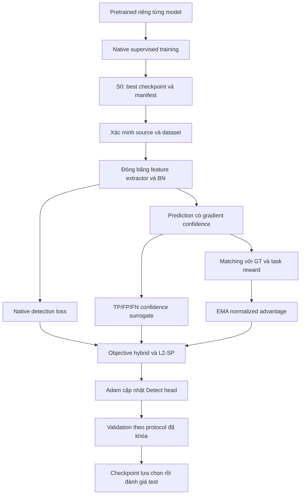
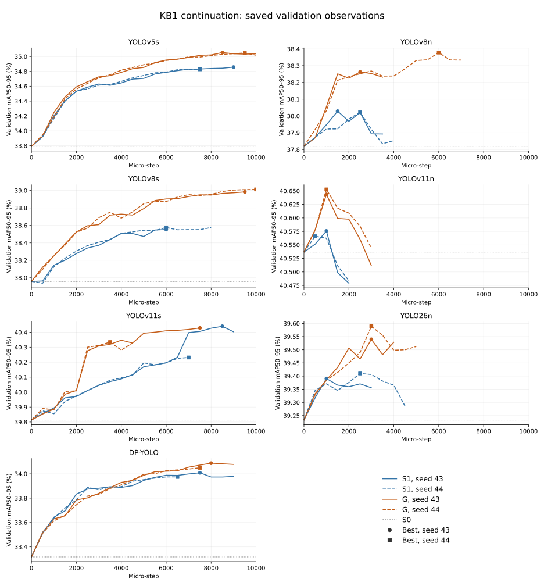
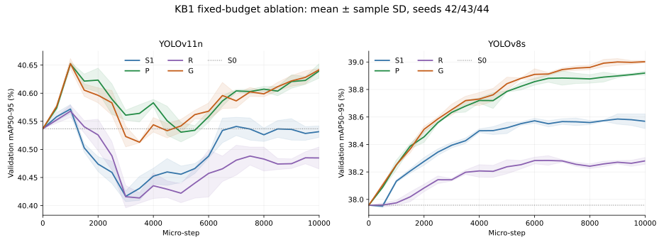
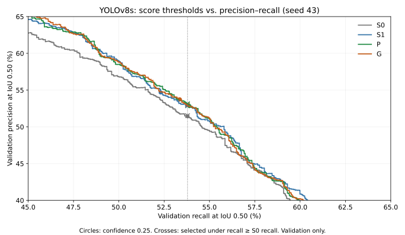

# BÁO CÁO KB1 — TỐI ƯU THÊM DETECTOR YOLO BẰNG REWARD-GUIDED FINE-TUNING

**Bản báo cáo gốc:** 15/10/2026. **Ngày tổng hợp kết quả:** 26/10/2026. **Cập nhật trình bày và phân tích:** 05/11/2026, Asia/Bangkok.

**Phạm vi đề tài:** tối ưu chất lượng phát hiện của các model YOLO bằng giai đoạn fine-tuning có hướng dẫn từ reward sau supervised training.

**Hướng nghiên cứu:** tối ưu thêm YOLO bằng reinforcement learning (RL). **Phương pháp triển khai:** reward-guided / RL-inspired fine-tuning trọng số Detect head.

**Dữ liệu:** `pre-data/data/v2i_cleanned`, 28 class. **Metric chính:** canonical mAP50–95.

**Quy ước trình bày:** AP/P/R/F1 dùng %, delta dùng điểm phần trăm; bảng số đo dùng dấu chấm thập phân. Mean ± SD là trung bình và độ lệch chuẩn mẫu qua continuation seed được nêu ở từng bảng, không mặc định là confidence interval.

## Tóm tắt

KB1 nghiên cứu quy trình hai giai đoạn cho detector YOLO. Giai đoạn thứ nhất huấn luyện supervised riêng từng kiến trúc và lưu checkpoint S0. Giai đoạn thứ hai, gọi là KB1B, bắt đầu từ S0 tương ứng và tối ưu Detect head bằng objective kết hợp native detection loss, reward-weighted confidence surrogate, confidence proxy theo TP/FP/FN và regularization về trọng số khởi đầu. Mục tiêu chính là xác định việc thêm KB1B cải thiện bao nhiêu so với supervised và kiến trúc guided nào đạt chất lượng tốt nhất.

Pipeline thực nghiệm đã hoàn tất cho bảy model. Cohort continuation có seed 42 và hai seed bổ sung 43/44; bộ ablation trên YOLOv11n/YOLOv8s dùng ba seed 42/43/44 tại cùng số update. Guided hơn S0 ở 21/21 cặp model–continuation seed đã quan sát. Riêng hai seed Ubuntu mới, mức tăng trung bình theo model nằm trong khoảng +0,172 đến +1,412 điểm phần trăm. YOLOv11n dẫn đầu cohort guided, với mean test mAP50–95 37,768% trên seed 43/44.

Các đối chứng cho thấy giá trị tăng thêm của reward phụ thuộc model. Tại cùng 10.000 micro-step, guided hơn proxy-only khoảng +0,070727 điểm ở YOLOv11n nhưng thấp hơn khoảng −0,049986 điểm ở YOLOv8s. Vì vậy kết quả ủng hộ lợi ích của quy trình hai giai đoạn trong phạm vi đã thử; đóng góp riêng của reward cần được phân biệt với lợi ích native continuation và proxy. Báo cáo dùng thuật ngữ RL-inspired vì code hiện tại không có stochastic detection policy với log-likelihood action tường minh.

Bản tổng hợp này thống nhất các kết quả đến ngày 26/10, thay cho cách ghép các thông báo trạng thái theo ngày. Lần cập nhật 03/11 bổ sung bảng validation, bước chọn/dừng, biểu đồ diễn biến huấn luyện và cấu hình augmentation từ CSV, log và code đã lưu. Các lần biên tập đến 03/11 không train hoặc inference lại. Ngày 04/11 bổ sung phân tích precision và một cohort validation CPU riêng cho 10 checkpoint YOLOv8s để kiểm tra precision khi giữ recall; không train hoặc inference lại test. Cohort CPU không thay số liệu CUDA lịch sử. Ngày 05/11 bổ sung cơ sở lý thuyết, các chứng minh có điều kiện và liên hệ minh chứng ở mục 5.6; lần bổ sung này chỉ biên tập tài liệu, không train hoặc inference mới. Artifact lịch sử được giữ nguyên.

## Mục lục

1. [Mục tiêu và câu hỏi nghiên cứu](#1-mục-tiêu-và-câu-hỏi-nghiên-cứu)
2. [Dữ liệu và thiết kế bài toán](#2-dữ-liệu-và-thiết-kế-bài-toán)
3. [Kiến trúc tổng thể và các model](#3-kiến-trúc-tổng-thể-và-các-model)
4. [Giai đoạn supervised](#4-giai-đoạn-supervised)
5. [Giai đoạn KB1B: reward và objective](#5-giai-đoạn-kb1b-reward-và-objective), gồm [cơ sở lý thuyết giải thích hiệu quả của proxy](#56-cơ-sở-lý-thuyết-và-minh-chứng-cho-các-giải-thích-về-p)
6. [Protocol huấn luyện và chọn checkpoint](#6-protocol-huấn-luyện-và-chọn-checkpoint)
7. [Metric và evaluator thống nhất](#7-metric-và-evaluator-thống-nhất)
8. [Phạm vi thực nghiệm đã hoàn tất](#8-phạm-vi-thực-nghiệm-đã-hoàn-tất)
9. [Kết quả continuation](#9-kết-quả-continuation)
10. [Ablation và đóng góp từng thành phần](#10-ablation-và-đóng-góp-từng-thành-phần)
11. [Kết quả YOLO26n](#11-kết-quả-yolo26n)
12. [Phân tích class và metric phụ](#12-phân-tích-class-và-metric-phụ)
13. [Chi phí tính toán và benchmark](#13-chi-phí-tính-toán-và-benchmark)
14. [Thảo luận và giới hạn](#14-thảo-luận-và-giới-hạn)
15. [Khả năng tái lập và artifact](#15-khả-năng-tái-lập-và-artifact)
16. [Kết luận KB1](#16-kết-luận-kb1)
17. [Tài liệu tham khảo và phụ lục](#17-tài-liệu-tham-khảo-và-phụ-lục)

## 1. Mục tiêu và câu hỏi nghiên cứu

Đối tượng tối ưu là trọng số của detector YOLO. Bảy model được khảo sát độc lập: mỗi model có S0 riêng và stage hai của model nào luôn dùng S0 của chính model đó. Ảnh đầu vào được biến đổi thành tập bounding box, class và confidence; chất lượng được đo trên cùng evaluator.

**RQ1:** Sau supervised training, thêm giai đoạn reward-guided fine-tuning thay đổi mAP50–95 bao nhiêu so với S0 tương ứng?

\[
\Delta_M^{G-S0}=100\big(\mathrm{mAP}_{M,G}-\mathrm{mAP}_{M,S0}\big).
\]

**RQ2:** Trong tập guided checkpoint được chọn bằng validation, kiến trúc nào đạt chất lượng tốt nhất?

\[
M^*=\arg\max_M\mathrm{mAP}_{val}(M,G_M^*).
\]

Validation dùng để chọn checkpoint và xác định model dẫn đầu. Test đo kết quả sau khi khóa lựa chọn; thứ hạng test được trình bày mô tả. Sau pilot sáu model, YOLO26n được bổ sung thành cohort bảy model; các phần mở rộng được ghi rõ nguồn và protocol.

Để giải thích nguyên nhân cải thiện, báo cáo bổ sung đối chứng native-only và ablation. Các đối chứng trả lời câu hỏi về đóng góp thành phần, còn phép so G−S0 vẫn là đánh giá trực tiếp ý tưởng hai giai đoạn của KB1.

**Bảng 1. Ký hiệu và ý nghĩa các nhánh**

| Ký hiệu | Mode trong code | Objective / vai trò |
|---|---|---|
| S0 | supervised | Checkpoint sau stage một, không cập nhật thêm trong phép so |
| S1 | native_only | Native loss + L2-SP; đối chứng tiếp tục fine-tune head |
| P | proxy_only | S1 + TP/FP/FN confidence proxy |
| R | reward_only | S1 + reward-weighted confidence surrogate |
| G | kb1b | S1 + proxy + reward; phương pháp chính KB1B |
| G-noSP | kb1b_no_sp | G bỏ L2-SP |

**Chú thích Bảng 1.** S0/S1/G có trong cohort bảy model. P/R/G-noSP được chạy cho YOLOv11n và YOLOv8s trong bộ ablation. “Native-only” ở đây dùng protocol stage hai, gồm cả L2-SP.

**Nhận xét Bảng 1.** G−S0 phản ánh toàn bộ stage hai; G−S1 phản ánh reward và proxy kết hợp; G−P đo phần tăng thêm của reward khi giữ proxy. Các phép so này cần được diễn giải riêng để xác định đúng đóng góp.

## 2. Dữ liệu và thiết kế bài toán

### 2.1. Annotation và quy mô

Dữ liệu dùng nhãn YOLO gồm `class, cx, cy, width, height`. Class biểu diễn loại cây và tình trạng lá/bệnh. Mỗi ảnh có thể có nhiều đối tượng; box được gán cho đối tượng lá trong ảnh. Chất lượng class/box là đầu ra cần tối ưu. Không đồng nhất AP theo box nhỏ với khả năng phân biệt mọi chi tiết bệnh bên trong một box lớn.

**Bảng 2. Quy mô split sạch**

| Split | Ảnh | File nhãn | Bounding box | Ảnh augment theo hậu tố |
|---|---|---|---|---|
| Train | 2411 | 2411 | 10333 | 667 |
| Validation | 479 | 479 | 1887 | 0 |
| Test | 239 | 239 | 1063 | 0 |
| Tổng | 3129 | 3129 | 13283 | 667 |

**Chú thích Bảng 2.** Số box đếm từ TXT; ảnh augment được nhận diện bằng các hậu tố flip/rotation đã biết. Train có 1.744 file không mang hậu tố augment, chứa 7.036 box. Các số này không bảo đảm từng file là một nguồn nội dung độc lập.

**Nhận xét Bảng 2.** Validation/test không chứa các dạng augment offline đã nhận diện. Box và ảnh cùng nguồn có tương quan; tăng số box bằng augment không tương đương tăng số quan sát độc lập. Test 239 ảnh khiến các class ít ảnh dễ có AP biến thiên mạnh.

### 2.2. Kiểm soát leakage và provenance

Audit clean không phát hiện source ID chung giữa train/validation/test sau khi bỏ hậu tố augment theo policy. Audit còn kiểm pairing ảnh–nhãn. Tập cũ từng có source overlap nên số liệu đó không được dùng để tính gain sạch. Kiểm tra source ID chưa phát hiện đầy đủ ảnh gần trùng mang ID khác; đây là giới hạn của bằng chứng về tính độc lập split.

Fingerprint dataset bao gồm nội dung ảnh, nhãn và cấu hình:

```text
cbd68ffc1da935ac300fba953ea5f9c97c831f53887e1b9391d500f9e40c0c95
```

Stage một ghi checkpoint SHA và dataset manifest. Stage hai xác minh lại source tương ứng trước khi train. Trên Ubuntu, thứ tự tên file được giữ tương đương Windows để bảo toàn fingerprint và ánh xạ seed–sampler. YAML runtime có đường dẫn cục bộ được sinh riêng; bytes YAML/manifest lịch sử được giữ nguyên.

### 2.3. Tiền xử lý và augmentation

Stage hai/evaluator resize cạnh dài về 640 rồi pad giữa bằng giá trị 114 thành 640×640; input là RGB float32 trong [0,1]. Validation/test không dùng random augmentation. Box được biến đổi đồng bộ với ảnh, clipping theo bounds; lỗi decode, nhãn sai định dạng hoặc transform phải báo lỗi.

Stage hai dùng pipeline Albumentations theo đúng thứ tự trong bảng dưới. Các xác suất được xét tại từng phép biến đổi; một ảnh có thể nhận nhiều phép trong cùng lượt đọc. Đây là augmentation online của stage hai; recipe native supervised được mô tả riêng ở mục 4.

**Bảng 3. Cấu hình preprocessing và augmentation online của stage hai**

| Thứ tự | Phép biến đổi | Xác suất p | Tham số hiệu lực |
|---|---|---|---|
| 1 | LongestMaxSize | 1.0 | Cạnh dài tối đa 640; nội suy bilinear |
| 2 | PadIfNeeded | 1.0 | Pad giữa tới 640×640, border constant, fill=114 |
| 3 | RandomBrightnessContrast | 0.5 | Brightness và contrast limit đều [−0.3, 0.3]; brightness_by_max=True |
| 4 | HueSaturationValue | 0.4 | Hue shift [−15, 15], saturation shift [−30, 30], value shift [−20, 20] |
| 5 | GaussNoise | 0.3 | std_range=[0.02, 0.12], mean_range=[0, 0], per_channel=True |
| 6 | MotionBlur | 0.2 | Kernel 3 hoặc 5; angle_range=[0, 360], direction_range=[−1, 1], allow_shifted=True |
| 7 | HorizontalFlip | 0.5 | Lật ngang |
| 8 | VerticalFlip | 0.3 | Lật dọc |
| 9 | Rotate | 0.4 | Góc [−15°, 15°], bilinear, border constant, fill=114; rotate_method=largest_box, crop_border=False |
| 10 | CLAHE | 0.2 | clip_limit hiệu lực [1.0, 2.0], tile_grid_size=(8, 8) |
| 11 | Normalize | 1.0 | mean=(0, 0, 0), std=(1, 1, 1), max_pixel_value=255; đưa ảnh về [0, 1] |
| 12 | ToTensorV2 | 1.0 | HWC → CHW tensor |

**Chú thích Bảng 3.** Nguồn: [get_train_transforms/get_val_transforms](../../kb1_reward_guided_training/dataloader.py) và [cấu hình hiệu lực được serialize](assets/kb1_20261103/augmentation_effective.json) trong Albumentations 2.0.8. std_range của GaussNoise là tỷ lệ theo giá trị cực đại của dtype ảnh; đây không phải variance. Code khai báo `CLAHE(clip_limit=2.0)`, được phiên bản này chuyển thành khoảng [1.0, 2.0]. Các tham số mặc định hiệu lực được ghi cùng tham số chỉ định để tránh thay đổi recipe khi đổi phiên bản thư viện.

**Nhận xét Bảng 3.** Stage hai kết hợp biến đổi hình học và quang học; cùng một ảnh nguồn có thể tạo nhiều input khác nhau qua các lượt sampler. Các nhánh cùng seed dùng cùng pipeline để kiểm soát đối chứng. Chưa có ablation riêng từng phép nên không quy mức tăng AP cho một augmentation cụ thể.

Box đi qua `BboxParams(format='yolo', label_fields=['class_labels'], clip=True, min_visibility=0.3, check_each_transform=True)`. Box có tỷ lệ diện tích còn nhìn thấy dưới 0,3 sau clipping của phép biến đổi bị loại, đồng thời loại class label tương ứng; bbox không được giữ nguyên khi ảnh bị lật hoặc xoay. Validation/test chỉ dùng bước 1–2 và 11–12, với bbox clipping và min_visibility mặc định 0,0; không áp dụng các phép ngẫu nhiên ở bước 3–10.

Sampler gắn augmentation RNG với seed, sampler epoch và chỉ số ảnh bằng `seed + epoch × N_train + image_index`. Thứ tự ảnh mỗi lượt dùng `randperm` với seed `seed + epoch`; mỗi lượt có `floor(2411/8)=301` micro-batch đầy đủ. Cơ chế này giúp các nhánh cùng seed nhận cùng thứ tự batch/transform và dựng lại batch khi resume. Augmentation online được áp dụng trên train vốn đã có augment offline; tác dụng từng phép biến đổi chưa được ablate riêng.

## 3. Kiến trúc tổng thể và các model

### 3.1. Luồng xử lý



Adapter chuẩn hóa interface cho các họ YOLO: native loss, prediction có gradient confidence, danh sách tham số và strict state loading. Nhờ đó, các nhánh trong cùng model có thể dùng chung data pipeline và evaluator dù head và native criterion khác nhau.

**Bảng 4. Các model và đặc điểm implementation**

| Model | Đặc điểm cần lưu ý |
|---|---|
| YOLOv5s | Anchor-based; native box/objectness/classification loss |
| YOLOv8n/s | Native box/classification/DFL; hai kích thước model |
| YOLOv11n/s | Native box/classification/DFL; hai kích thước model |
| YOLO26n | Dual-head; canonical one-to-many; native regression không DFL |
| DP-YOLO | Nhánh custom từ YOLOv5; P2/P3/P4/P5, deformable/CSP/Ghost, W3F/PSA |

**Chú thích Bảng 4.** Alias CLI `yolov11n/s` tương ứng asset `yolo11n/s.pt`. So sánh kiến trúc dựa trên recipe và checkpoint thực tế, không giả định mọi họ có cùng pretrain transfer hoặc cùng thang native loss.

**Nhận xét Bảng 4.** Adapter chung làm protocol đánh giá nhất quán. Tuy nhiên, khác biệt AP giữa hai kiến trúc không tự xác định nguyên nhân đến từ số tham số, một module hay một loại native loss; phép so gain quan trọng được ghép cặp trong chính model.

### 3.2. DP-YOLO trong dự án

DP giữ bốn scale P2/4, P3/8, P4/16 và P5/32. Backbone dùng D2C3 và D3C3; neck có PTCSP/C3Ghost. DCNv3 ở đây là implementation giản lược bằng torchvision với offset dùng chung, không phải toàn bộ operator nguyên bản. Nhánh Transformer trong PTCSP dùng adaptive average pooling xuống tối đa 400 token trước attention rồi nội suy bilinear về lưới ban đầu. Với input 640, P2 160×160 được gộp xuống 20×20 ở nhánh attention; nhánh CNN vẫn xử lý lưới ban đầu.

Manifest DP xác nhận W3F và PSA bật ở supervised và continuation. PSA xét cell lân cận 3×3, radius 1 grid unit, kèm anchor-ratio/bounds. Chưa đo phần tăng positive assignment trên dataset này.

Đặt u là IoU, d1²/d2² là khoảng cách bình phương hai góc box tương ứng, c_enc² là đường chéo bình phương enclosing box. Công thức custom trong code:

\[
L_{MPD}=1-u+\frac{d_1^2+d_2^2}{c_{enc}^2+\epsilon},\qquad
L_F=L_{MPD}+u-\max(u,\epsilon)^{0.5}.
\]

\[
R_W=\operatorname{stopgrad}\!\left[\exp\!\left(\operatorname{clip}\left(
\frac{\|c_p-c_g\|^2}{w_g^2+h_g^2+\epsilon},0,\log 10\right)\right)\right],
\quad L_{W3F}=r_{const}R_W L_F,
\]

trong đó r_const được clip [0,10] từ biểu thức `0.6 / (0.5 × 1.9^0.6 − 0.5 + 1e−9)`. Đây là constant focusing factor và power-IoU theo implementation hiện tại, không mô tả như dynamic WIoU v3 hoặc piecewise Focaler-IoU nguyên bản.

Patch dùng giá trị forward CIoU để objectness target ổn định, nhưng dùng gradient W3F cho box regression:

\[
q=\operatorname{stopgrad}(q_{CIoU})+q_{W3F}-\operatorname{stopgrad}(q_{W3F}).
\]

Vì vậy log scalar native box loss không trực tiếp bằng giá trị W3F thuần. DP là tổ hợp custom cần mô tả theo [YAML](../../kb1_reward_guided_training/models/dp_yolo/dp_yolo.yaml), [modules](../../kb1_reward_guided_training/models/dp_yolo/modules.py), [loss](../../kb1_reward_guided_training/models/dp_yolo/loss.py) và [PSA](../../kb1_reward_guided_training/models/dp_yolo/psa.py).

### 3.3. YOLO26n trong protocol chung

Adapter đặt `end2end=False` để lấy decoded one-to-many candidates có gradient score và áp dụng NMS thống nhất. Native loss vẫn giữ hai nhánh one-to-many/one-to-one. Theo criterion và runtime hiện được ghi, gain stage hai là 0,8 và 0,2:

\[
L_{native,26}=0.8L_{one\text{-}to\text{-}many}+0.2L_{one\text{-}to\text{-}one}.
\]

Runner không gọi `criterion.update()` nên không tiếp tục lịch gain native theo epoch. Reward/proxy đi qua score one-to-many; native loss cập nhật cả hai nhánh head. Checkpoint đã fuse bỏ one-to-many không phù hợp path này. Kiểm thử model/GT tổng hợp xác nhận native loss hữu hạn và gradient vào đúng nhánh; số đo accuracy lấy từ artifact dataset riêng.

## 4. Giai đoạn supervised

### 4.1. Recipe và checkpoint S0

Mỗi model khởi tạo từ pretrained tương ứng, dùng supervised trainer của framework. YOLOv5s và DP dùng native YOLOv5; các model còn lại dùng Ultralytics. DP nhận YOLOv5s pretrained, còn các module mới không có toàn bộ pretrain weights tương ứng.

Cấu hình chung là 640, SGD, tối đa 200 epoch, patience 30, seed 0. Ultralytics khai báo lr0=0,01, lrf=0,01, momentum=0,937, weight decay=0,0005, warmup 3 epoch; augment gồm HSV, degrees 10, translate 0,1, scale 0,5, flip, mosaic và mixup. YOLOv5/DP dùng `hyp.pest.yaml`; recipe thực lưu trong args/opt, nên không khẳng định mọi họ có cấu hình nội bộ hoàn toàn giống nhau.

Native trainer lưu best bằng fitness của framework, thường trên model-weight EMA. Với YOLOv5, fitness dùng `0.1 mAP50 + 0.9 mAP50–95`. S0 là best native checkpoint được chọn trong giai đoạn đó, chưa chứng minh là epoch có canonical validation AP cao nhất. Stage hai khởi tạo trọng số mới từ S0, không tiếp tục optimizer/scheduler stage một. Trainer Ultralytics bật AMP theo cấu hình supervised; các chi tiết framework khác được giữ theo args/opt của từng run. Việc chuyển từ SGD sang Adam và thu hẹp phạm vi cập nhật ở stage hai là một phần của recipe KB1, nên S1/G phải được so trong cùng recipe stage hai để giải thích đóng góp objective.

**Bảng 5. Log supervised của bảy model**

| Model | Epoch đã chạy | Native peak epoch | Batch | Seed | Native peak AP (%) |
|---|---|---|---|---|---|
| YOLOv5s | 151 | 144 | 16 | 0 | 39.384 |
| YOLOv8n | 166 | 136 | 16 | 0 | 41.432 |
| YOLOv8s | 126 | 96 | 8 | 0 | 42.159 |
| YOLOv11n | 161 | 131 | 16 | 0 | 43.792 |
| YOLOv11s | 167 | 137 | 8 | 0 | 44.718 |
| YOLO26n | 142 | 112 | 16 | 0 | 42.984 |
| DP-YOLO | 200 | 194 | 4 | 0 | 37.322 |

**Chú thích Bảng 5.** AP trong bảng là native validation mAP50–95 từ log supervised; epoch giữ quy ước đánh số của từng framework. Nguồn: [training_summary.csv](../../kb1_reward_guided_training/results/baseline_comparison_yolo26n_20261007/training_summary.csv).

**Nhận xét Bảng 5.** Các model dừng tại epoch khác nhau, DP chạy hết 200 epoch. Native peak của YOLOv11s cao nhất trong bảng này, nhưng cohort canonical test lại do YOLOv11n dẫn đầu. Cần dùng cùng evaluator/split khi so kết quả cuối, không so native peak với canonical test để tính gain.

### 4.2. Native loss và chuẩn hóa

YOLOv5 có native loss box/objectness/classification. YOLOv8/v11 có box/classification/DFL. YOLO26 dùng criterion riêng như mục 3.3; DP dùng ComputeLoss đã patch. Adapter chia native loss theo batch theo implementation để đưa về scale mỗi ảnh. Thang gradient vẫn có thể khác giữa họ model.

Hệ số 0,25 trong objective KB1 nhân lên toàn bộ native loss; nó không thay các gain box/class/objectness/DFL bên trong native criterion. Phân biệt hai cấp gain giúp tái lập đúng objective và tránh diễn giải sai vai trò của reward.

## 5. Giai đoạn KB1B: reward và objective

### 5.1. Prediction, matching và reward

Detector tạo các candidate box, nhãn class có score cao nhất và confidence. Nhánh YOLOv5/DP dùng score objectness × max-class probability; nhánh Ultralytics dùng max-class probability từ output decoded. Lọc confidence và NMS chọn prediction dùng cho reward. Chỉ score giữ gradient; tọa độ, class index và selection được detach.

Matching xử lý prediction theo score giảm dần. Mỗi prediction tìm GT cùng class chưa match có IoU lớn nhất; nhận match khi vượt ngưỡng. Mỗi GT chỉ được dùng một lần. Prediction sai class hoặc duplicate tạo FP; GT chưa match tạo FN.

Với ảnh i, predictions P_i, GT G_i, ngưỡng τ, đặt TP là số match và U là mean IoU của các match, bằng 0 nếu không có TP:

\[
P_{i,\tau}=\frac{TP_{i,\tau}}{\max(|P_i|,1)},\qquad
R_{i,\tau}=\frac{TP_{i,\tau}}{|G_i|},\qquad
r_i=\frac{1}{4}\sum_{\tau\in\{.5,.6,.7,.8\}}
\left(0.25P_{i,\tau}+0.45R_{i,\tau}+0.30U_{i,\tau}\right).
\]

Ảnh có GT nhưng không có prediction nhận reward 0. Ảnh không có GT nhận 1 nếu không có prediction, ngược lại nhận 0. Reward tính từ prediction–GT train bằng CPU matching và detach.

Reward này khuyến khích cân bằng precision, recall và localization, nhưng không bằng mAP: reward trung bình theo ảnh, không tích phân PR toàn tập hoặc class-macro cùng cách evaluator. Reward chỉ dùng bốn IoU tới 0,8 và ngưỡng confidence/NMS khác AP. Do đó reward tăng chưa bảo đảm AP tăng; lựa chọn checkpoint dựa trên validation vẫn cần thiết.

### 5.2. EMA baseline và advantage

Với batch mean reward r̄_t và mean square r²̄_t, decay α=0,99:

\[
b_t=\alpha b_{t-1}+(1-\alpha)\bar r_t,\quad
v_t=\alpha v_{t-1}+(1-\alpha)\overline{r^2}_t,
\]

\[
\sigma_t=\sqrt{\max(v_t-b_t^2,10^{-4})},\qquad
A_{i,t}=\operatorname{clip}\left(\frac{r_i-b_t}{\sigma_t},-3,3\right).
\]

Batch đầu khởi tạo mean/second moment bằng thống kê batch. Code cập nhật EMA bằng batch hiện tại trước khi tính A. Advantage chuẩn hóa độ lệch reward của ảnh so với mức nền đang theo dõi; clip hạn chế độ lớn contribution. Đây là heuristic standardization, chưa có chứng minh unbiased policy-gradient estimator cho implementation KB1. EMA reward baseline cũng khác EMA trọng số của supervised trainer.

### 5.3. Confidence surrogate TP/FP/FN

Sau matching IoU 0,5, gọi T_i là tập TP, F_i là FP, m_i là số GT bị bỏ sót, n_i là số GT và s_i^max là max candidate score toàn ảnh trước threshold. Score được clamp [1e−6,1−1e−6]. Surrogate:

\[
g_i=\mathbf{1}_{|T_i|>0}\frac{1}{|T_i|}\sum_{j\in T_i}\log s_{ij}
+0.5\mathbf{1}_{|F_i|>0}\frac{1}{|F_i|}\sum_{j\in F_i}\log(1-s_{ij})
+1.5\mathbf{1}_{m_i>0}\frac{m_i}{\max(n_i,1)}\log s_i^{max}.
\]

\[
L_{proxy}=-\frac1B\sum_i g_i,\qquad
L_{reward}=-\frac1B\sum_i\operatorname{stopgrad}(A_{i,t})g_i.
\]

Proxy tăng confidence TP, giảm confidence FP và cung cấp tín hiệu khi có FN. FN term có giới hạn: max score toàn ảnh không gắn riêng với từng GT bị bỏ sót, nên có thể tăng score của một candidate không liên quan. Native loss vẫn cung cấp supervision theo GT cụ thể.

Reward loss điều chỉnh contribution của cùng surrogate theo advantage: ảnh có reward cao/thấp so baseline được gán contribution khác nhau. Tên biến `log_prob` trong code không tự biến g_i thành log-likelihood của một policy. Định nghĩa và gradient cần được giải thích theo phép tính thực tế này.

### 5.4. Regularization và objective tổng

Gọi H là tập tensor trainable trong Detect head và θ⁰ là giá trị S0 đầu stage hai:

\[
L_{SP}=\frac1{|H|}\sum_{h\in H}\frac1{N_h}\|\theta_h-\theta_h^0\|_2^2.
\]

Code lấy mean trong từng tensor rồi mean qua các tensor, không lấy tổng bình phương tất cả parameter. Reference là supervised initialization của stage hai. Thành phần này được thiết kế để hạn chế drift, nhưng hiệu quả phải được kiểm tra bằng ablation.

\[
\boxed{L_G=0.25L_{native}+0.10L_{reward}+0.25L_{proxy}+0.001L_{SP}.}
\]

Hai thành phần confidence có thể viết lại:

\[
0.10L_{reward}+0.25L_{proxy}
=-\frac1B\sum_i(0.25+0.10A_i)g_i.
\]

Với A∈[−3,3], hệ số nằm trong [−0,05;0,55]; contribution có thể đảo dấu khi A<−2,5. Đây là hệ quả toán học của objective, chưa có log tần suất hoặc phân rã gradient để xác nhận nó gây giảm AP trong run nào.

**Bảng 6. Hệ số thực tế của các nhánh ablation**

| Nhánh | Native | Proxy | Reward | L2-SP |
|---|---|---|---|---|
| S1 | 0.25 | 0 | 0 | 0.001 |
| P | 0.25 | 0.25 | 0 | 0.001 |
| R | 0.25 | 0 | 0.1 | 0.001 |
| G | 0.25 | 0.25 | 0.1 | 0.001 |
| G-noSP | 0.25 | 0.25 | 0.1 | 0 |

**Chú thích Bảng 6.** Nguồn: [experiment_modes.py](../../kb1_reward_guided_training/experiment_modes.py) và effective_weights trong manifest run. S0 là checkpoint không train thêm nên không có hàng hệ số trong bảng.

**Nhận xét Bảng 6.** Các nhánh thay đổi thành phần objective trong khi giữ source/data/seed và protocol kiểm soát. G−P là phép so trực tiếp phần thêm reward trong điều kiện đã có proxy; R−S1 là reward khi không có proxy. Hai phép so có thể cho mức gain khác nhau do objective tương tác trong quá trình tối ưu.

### 5.5. Quan hệ với RL

REINFORCE chuẩn dùng action sample từ stochastic policy và gradient log-likelihood action. KB1 dùng detector inference xác định, class/box/NMS/matching detach và confidence surrogate. Do đó tên kỹ thuật của implementation là reward-guided hoặc RL-inspired fine-tuning. Hướng nghiên cứu “tối ưu thêm YOLO bằng RL” được hiện thực hóa ở đây bằng task reward và advantage để điều chỉnh cập nhật trọng số; không tuyên bố implementation tương đương PPO, GRPO hay REINFORCE chuẩn.

### 5.6. Cơ sở lý thuyết và minh chứng cho các giải thích về P

Phần này xây dựng cơ sở giải thích vì sao thêm proxy có thể cải thiện detector. Có ba mức kết luận: quan hệ toán học được chứng minh dưới giả thiết cụ thể; hướng tác động được xác nhận bằng code/gradient; và hiệu quả được quan sát bằng đối chứng. Các mức này bổ sung cho nhau, nhưng không tạo thành định lý rằng objective P luôn tăng mAP hoặc tổng quát hóa sang mọi dataset.

P dùng supervision từ GT qua matching, với objective thực tế:

\[
L_P=0.25L_{native}+0.25L_{proxy}+0.001L_{SP}.
\]

So với S1, P chỉ thêm proxy; hệ số reward bằng 0. Vì vậy, lý thuyết dưới đây giải thích một confidence surrogate có supervision, không quy lợi ích của P cho policy gradient. Công thức đầy đủ, gồm FN term, đã được định nghĩa ở mục 5.3.

#### 5.6.1. Log-loss tạo hướng cập nhật tăng score TP và giảm score FP

Xét một lần backward với tập prediction, class được chọn, matching và số phần tử mỗi nhóm giữ cố định. Gán y=1 cho TP và y=0 cho FP. Tách riêng phần TP/FP của proxy, loss trên một prediction có dạng:

\[
\ell(y,s)=-a\,y\log s-b(1-y)\log(1-s),\qquad a,b>0.
\]

Trong code, a và b bao gồm hệ số TP/FP cùng chuẩn hóa theo số phần tử của nhóm tương ứng; trọng số proxy 0,25 và trung bình theo batch là các hệ số dương bên ngoài. Khi một nhóm rỗng, term của nhóm đó được bỏ qua. Đây là dạng log-loss nhị phân có trọng số. Cơ sở chung về surrogate binary loss và proper loss được trình bày trong Reid và Williamson (2010), [Composite Binary Losses](https://jmlr.org/papers/v11/reid10a.html).

Trong miền score chưa chạm clamp, đạo hàm trực tiếp cho:

\[
\frac{\partial\ell}{\partial s}
=\begin{cases}
-a/s<0,&y=1,\\
b/(1-s)>0,&y=0.
\end{cases}
\]

Với score sigmoid s=σ(z), như nhánh classification của YOLOv8s đang xét:

\[
\frac{\partial\ell}{\partial z}
=\begin{cases}
a(s-1),&y=1,\\
bs,&y=0.
\end{cases}
\]

Gradient descent vì vậy tạo lực tăng logit của TP và giảm logit của FP. Với a/b cố định, TP có score thấp và FP có score cao nhận độ lớn gradient theo logit lớn hơn các trường hợp đã được chấm điểm đúng. Đây là hướng của riêng thành phần TP/FP, không bảo đảm từng score đều chuyển theo hướng đó sau một bước cập nhật tham số chung: native loss, FN term và tương tác giữa prediction còn cùng tác động lên model.

**Đối chiếu implementation.** [match_aware_objective](../../kb1_reward_guided_training/train_rl.py) thực hiện đúng hai term `log(scores[tp]).mean()` và `0.5*log1p(-scores[fp]).mean()`, sau đó đổi dấu để tạo proxy loss. Kiểm tra một TP và một FP có score đều bằng 0,4, không có FN, cho gradient theo hai score lần lượt −0,625 và +0,208333 sau khi nhân hệ số proxy 0,25. [Artifact kiểm tra](assets/kb1_precision_20261104/proxy_evidence_checks.json) ghi đầu vào và kết quả autograd; đây là kiểm tra loss, không cập nhật weights detector.

#### 5.6.2. Confidence gắn với detection đúng hỗ trợ thứ hạng và AP

AP phụ thuộc thứ tự confidence của detection và kết quả matching, không chỉ số prediction vượt một threshold. Chen et al. (2019), [Towards Accurate One-Stage Object Detection with AP-Loss](https://arxiv.org/abs/1904.06373), nghiên cứu trực tiếp cách học thứ hạng cho detection. Zhang et al. (2021), [VarifocalNet](https://arxiv.org/abs/2008.13367), nghiên cứu score kết hợp độ tin cậy có đối tượng với chất lượng định vị. Hai hướng này cung cấp cơ sở nghiên cứu cho việc làm confidence phù hợp hơn với chất lượng detection.

Có thể minh họa quan hệ thứ hạng bằng một chứng minh đơn giản. Giữ box và nhãn TP/FP cố định tại một class và một ngưỡng IoU. Với AP không nội suy:

\[
AP_{simple}=\frac1{N_{GT}}\sum_{k:y_k=1}\frac{\sum_{j\leq k}y_j}{k}.
\]

Nếu vị trí k là FP, vị trí k+1 là TP, và có t TP trước vị trí k, hoán đổi cặp này để TP đứng trước FP làm:

\[
\Delta AP_{simple}
=\frac{t+1}{N_{GT}}\left(\frac1k-\frac1{k+1}\right)
=\frac{t+1}{N_{GT}k(k+1)}>0.
\]

Các TP phía sau giữ nguyên số TP đứng trước, nên chỉ contribution của TP được chuyển vị trí thay đổi. Chứng minh này cho thấy một lý do toán học để sửa thứ hạng TP/FP. AP_simple là minh họa không nội suy, không phải công thức tính số COCO AP trong các bảng KB1.

**Suy luận áp dụng cho P.** Matching của proxy yêu cầu đúng class, IoU≥0,5 và GT chưa được prediction khác dùng. Do đó một prediction có score cao nhưng sai class, sai box hoặc duplicate có thể nhận FP loss. Tín hiệu này có thể giúp đưa detection đúng lên trước detection sai. Tuy nhiên, P không trực tiếp tối ưu AP-Loss hoặc Varifocal Loss; nó dùng nhãn TP/FP nhị phân và FN term riêng. Trong detector thật, NMS, matching và tập candidate có thể thay đổi khi score/box đổi; mAP còn trung bình qua nhiều IoU. Vì vậy, chứng minh hoán đổi trên không suy ra rằng giảm L_proxy luôn tăng canonical mAP50–95.

#### 5.6.3. Chuẩn hóa riêng TP/FP kiểm soát ảnh hưởng của số lượng prediction

Khi hai nhóm không rỗng, phần TP/FP trên mỗi ảnh là:

\[
L_{TP/FP}
=-\frac1{|T|}\sum_{j\in T}\log s_j
-\frac{0.5}{|F|}\sum_{j\in F}\log(1-s_j).
\]

Nếu lặp lại một nhóm prediction có cùng phân bố score, mean của nhóm giữ nguyên thay vì tăng tuyến tính theo số lượng như một loss lấy tổng. Đây là tính chất của phép chuẩn hóa. Nó giúp kiểm soát việc nhóm FP đông hơn lấn át contribution của TP chỉ vì số phần tử, nhưng không bảo đảm gradient norm của hai nhóm cân bằng: score, Jacobian và số lượng mẫu thực tế vẫn ảnh hưởng.

Lin et al. (2017), [Focal Loss for Dense Object Detection](https://arxiv.org/abs/1708.02002), chỉ ra tầm quan trọng của mất cân bằng foreground/background và thiết kế loss giảm ảnh hưởng của các mẫu dễ. P dùng chuẩn hóa theo nhóm và hệ số 0,5, không dùng focal factor của paper. Vì thế nguồn này hỗ trợ động cơ thiết kế; hiệu quả riêng của chuẩn hóa và hệ số hiện tại vẫn cần ablation để xác nhận.

#### 5.6.4. Giữ số TP và giảm FP làm precision tăng

Tại một operating point, với TP>0 giữ cố định:

\[
Precision=\frac{TP}{TP+FP},\qquad
\left.\frac{\partial Precision}{\partial FP}\right|_{TP}
=-\frac{TP}{(TP+FP)^2}<0.
\]

Đây là quan hệ xác định theo định nghĩa metric, không cần giả thiết về thuật toán học. Với một tập GT cố định, cùng số TP cũng tương ứng cùng tổng FN và recall.

**Minh chứng trong KB1.** Trên validation CPU YOLOv8s seed 43, sau khi chọn threshold theo cùng quy tắc giữ recall, S0/S1/P đều có TP=1.015 và FN=872; FP tương ứng là 955/905/895. P đạt precision 53,141361%, so với S1 52,864583% và S0 51,522843%. Số liệu trong [validation_thresholds.csv](assets/kb1_precision_20261104/validation_thresholds.csv) xác nhận precision tăng tại cùng tổng số TP/FN. Điều này không yêu cầu các đối tượng được match hoặc recall từng class giống nhau, và threshold vẫn được chọn trên validation đã biết nhãn.

#### 5.6.5. Native loss và proxy bổ sung tín hiệu trong objective tổng

Native loss tiếp tục supervision box/class theo criterion của model, còn proxy bổ sung tín hiệu confidence dựa trên TP/FP sau postprocessing. Kiểm tra backward riêng proxy trên một batch tám ảnh validation của YOLOv8s P ghi nhận 16 tensor classification có gradient khác 0, norm tổng khoảng 0,966334; cả 24 tensor nhánh box regression có gradient bằng 0. Kết quả này phù hợp đường truyền gradient trong adapter và cơ chế detach box/matching. [Artifact gradient trên model thật](assets/kb1_precision_20261104/proxy_model_gradient.json) ghi checkpoint hash và phạm vi tham số được kiểm, không thực hiện optimizer step.

Đối chứng S1/P giữ cùng S0, seed, config ngoài mode, code, runtime, protocol và 5.000 optimizer update; P chỉ thêm proxy với hệ số 0,25. Mean test P−S1 là +0,371644 điểm mAP ở YOLOv8s và +0,139272 điểm ở YOLOv11n; mean validation tương ứng là +0,351100 và +0,108031. Cả 12 phép so model×seed×split đều dương, nhưng không phải 12 quan sát độc lập. [CSV từng seed](assets/kb1_precision_20261104/proxy_ablation_evidence.csv) và [kiểm tra điều kiện đối chứng](assets/kb1_precision_20261104/proxy_evidence_checks.json) hỗ trợ kết luận thêm toàn bộ proxy có lợi trong thiết lập này. Chúng chưa tách được tác dụng riêng của TP/FP/FN hoặc chứng minh native/proxy luôn có gradient đồng hướng.

#### 5.6.6. Phạm vi kết luận lý thuyết và thực nghiệm

Các đạo hàm và quan hệ precision ở trên chứng minh hướng tác động dưới giả thiết đã nêu; nghiên cứu về thứ hạng detection giải thích động cơ thiết kế; còn kết quả S1/P xác nhận hiệu quả quan sát được của implementation KB1. Không dùng kết quả của paper khác như định lý bảo đảm cho objective custom của dự án.

Đặc biệt, nhãn TP/FP và tập candidate phụ thuộc model, loss chuẩn hóa riêng từng nhóm và có FN term dựa trên max score toàn ảnh. Vì vậy, các kết quả về log-loss/proper loss không tự bảo đảm score P đã được hiệu chuẩn thành xác suất đúng. Cũng chưa chứng minh FN term là nguyên nhân giữ recall, từng class đều cải thiện, proxy trực tiếp cải thiện localization, hoặc gain có significance trên nhiều S0/dataset.

Kết luận phù hợp là: **P bổ sung supervision cho confidence theo chất lượng prediction–GT. Log-loss tạo hướng tăng score TP và giảm score FP; thay đổi thứ hạng phù hợp có thể cải thiện AP, còn giảm FP tại cùng số TP chắc chắn tăng precision. Các đối chứng KB1 hỗ trợ lợi ích của toàn bộ proxy ngoài native continuation trong phạm vi đã thử; cơ chế riêng từng term và khả năng tổng quát hóa vẫn cần kiểm chứng thêm.**

## 6. Protocol huấn luyện và chọn checkpoint

**Bảng 7. Cấu hình stage hai**

| Thành phần | Thiết lập |
|---|---|
| Tham số cập nhật | Detect head; backbone/neck và BN statistics đóng băng |
| Optimizer / LR | Adam; max 5e−7, min 1e−7 |
| Warmup / schedule | 500 micro-step; cosine theo budget 10.000 |
| Batch / accumulation | 8 ảnh × 2 micro-batch = 16 ảnh mỗi optimizer update |
| Gradient clipping | Norm tối đa 0,5 |
| Budget chuẩn | 10.000 micro-step = 5.000 optimizer update |
| Validation interval | 500 micro-step = 250 optimizer update |
| Continuation early stopping | Patience 4; min-delta 0,0005 mAP = 0,05 điểm |
| Ablation fixed-budget | Tắt early stopping; đánh giá last ở step 10.000 |
| Seeds / workers | Continuation 42/43/44; run Ubuntu mới dùng workers=0 |

**Chú thích Bảng 7.** Nguồn: [run_verified.py](../../kb1_reward_guided_training/run_verified.py), [hyp.rl.yaml](../../kb1_reward_guided_training/configs/hyp.rl.yaml) và manifest của từng run. Runner cố định Adam, accumulation 2 và head-only; không phải mọi trường legacy trong YAML đều được sử dụng.

**Nhận xét Bảng 7.** Cùng budget tối đa chưa bảo đảm cùng số update khi dùng early stopping. Bộ fixed-budget giữ cùng 5.000 update, nhưng reward cần thêm tính toán nên chưa phải đối chứng cùng thời gian. Với 2.411 ảnh train, 10.000 micro-step tương đương khoảng 33,2 lượt sampler, không phải 10.000 epoch.

### 6.1. Learning rate và gradient

Với micro-step s, warmup W=500 và budget S=10.000:

\[
\eta_s=\begin{cases}
\eta_{min}+(\eta_{max}-\eta_{min})s/W,&s\leq W\\
\eta_{min}+\frac12(\eta_{max}-\eta_{min})[1+\cos(\pi(s-W)/(S-W))],&s>W.
\end{cases}
\]

LR nhỏ và head-only là lựa chọn thiết kế nhằm hạn chế thay đổi quá lớn so với S0; đây là mục đích của recipe, chưa phải kết luận từ ablation riêng về từng hyperparameter. Warmup tăng LR dần ở đầu run; cosine giảm LR theo budget đã khai báo.

Loss được chia 2 trước backward để accumulation hai micro-batch. Gradient được kiểm tra hữu hạn/khác 0, clip rồi Adam update. Early-stop trước S nghĩa cosine chưa đi hết lịch đến LR min. Vì vậy gain/cost của continuation phải đọc cùng stop-step thực tế.

### 6.2. Hai quy tắc lựa chọn checkpoint

**Continuation:** step zero S0 là candidate. Mọi mức tăng validation AP đều có thể cập nhật best; min-delta chỉ điều khiển patience. Best được giữ ngay cả khi last giảm. Sau train, runner reload best và kiểm mAP50/mAP50–95/AR300 khớp metric đã lưu.

**Ablation:** tất cả nhánh chạy đủ 10.000 micro-step. Best vẫn được ghi để quan sát, nhưng phép so kiểm soát số update dùng `last.pt` tại step 10.000, được khai báo trước. Không thay bằng best của từng nhánh khi diễn giải bảng matched-update.

### 6.3. State và resume

`last.pt` chứa model state, optimizer, step, EMA reward, trạng thái best/patience, Torch CPU/CUDA RNG và thời gian; phiên bản runner mới lưu thêm metadata và metrics của last. Thứ tự batch/augmentation được dựng lại theo seed. Lưu tại mỗi mốc validation nên phần update sau checkpoint gần nhất cần chạy lại khi gián đoạn.

Đã có run bị crash ở driver CUDA, sau đó resume và hoàn tất. Điều đó xác nhận có thể khôi phục state trong các run này, chưa thay thế test đối chiếu toàn bộ training liên tục với training bị ngắt. Runner chưa lưu Python/NumPy RNG toàn cục; từng file được atomic replace nhưng cả nhóm file chưa là một giao dịch nguyên tử.

### 6.4. Bước chọn checkpoint và diễn biến continuation thực tế

Bảng dưới trình bày đủ 28 nhánh S1/G của continuation seed 43/44. `best_step` là micro-step của checkpoint dùng cho bảng kết quả chính; `steps_run` là micro-step cuối thực sự đã chạy. Số optimizer update bằng steps_run/2 do accumulation hai micro-batch. Seed 42 thuộc cohort đối chiếu riêng ở mục 9.1, không gộp vào thống kê Ubuntu mới.

**Bảng 8. Bước best và bước dừng của continuation seed 43/44**

| Model | Seed | S1 best_step | S1 steps_run | G best_step | G steps_run | Kết thúc S1 / G |
|---|---|---|---|---|---|---|
| YOLOv5s | 43 | 9000 | 9000 | 8500 | 10000 | ES / Budget |
| YOLOv5s | 44 | 7500 | 7500 | 9500 | 10000 | ES / Budget |
| YOLOv8n | 43 | 1500 | 3500 | 2500 | 3500 | ES / ES |
| YOLOv8n | 44 | 2500 | 4000 | 6000 | 7000 | ES / ES |
| YOLOv8s | 43 | 6000 | 6000 | 9500 | 9500 | ES / ES |
| YOLOv8s | 44 | 6000 | 8000 | 10000 | 10000 | ES / Budget |
| YOLOv11n | 43 | 1000 | 2000 | 1000 | 3000 | ES / ES |
| YOLOv11n | 44 | 500 | 2000 | 1000 | 3000 | ES / ES |
| YOLOv11s | 43 | 8500 | 9000 | 7500 | 7500 | ES / ES |
| YOLOv11s | 44 | 7000 | 7000 | 3500 | 4500 | ES / ES |
| YOLO26n | 43 | 1000 | 3000 | 3000 | 4000 | ES / ES |
| YOLO26n | 44 | 2500 | 4500 | 3000 | 5000 | ES / ES |
| DP-YOLO | 43 | 7500 | 9000 | 8000 | 9000 | ES / ES |
| DP-YOLO | 44 | 6500 | 6500 | 7500 | 7500 | ES / ES |

**Chú thích Bảng 8.** Đơn vị là micro-step, không phải epoch hoặc optimizer update. ES: dừng theo patience/min-delta; Budget: chạy đủ 10.000 micro-step. Nguồn: completed.json của từng nhánh trong [continuation](../../kb1_reward_guided_training/checkpoint_reward_guide_trainning/remaining_seed43_44_ablation_v1/continuation), được trích sang [continuation_steps.csv](assets/kb1_20261103/continuation_steps.csv). Best vẫn có thể trùng bước dừng ES vì một cải thiện AP nhỏ cập nhật best nhưng chưa đủ min-delta để reset patience.

**Nhận xét Bảng 8.** YOLOv11n chọn S1 best ở 500–1.000 và G best ở 1.000 micro-step; S1 dừng ở 2.000, G ở 3.000 trong cả hai seed. Ngược lại, YOLOv8s G chọn best ở 9.500/10.000, muộn hơn S1 ở 6.000. Vì thời gian dừng và checkpoint được chọn khác nhau, continuation best-validation chưa phải phép so cùng số update. Bộ ablation ở mục 10 mới giữ mọi nhánh đến step 10.000 để đánh giá last.



**Hình 1. Diễn biến validation của S1 và G trong continuation.**

**Chú thích Hình 1.** Mỗi panel là một model; S1 màu xanh, G màu cam; seed 43 nét liền, seed 44 nét đứt. Đường chấm xám là S0; chấm tròn/vuông đánh dấu checkpoint best của seed 43/44. Các điểm lấy từ baseline.json và validation.jsonl, nối bằng đoạn thẳng để hỗ trợ quan sát; không nội suy thành quan sát mới hoặc kéo đường quá bước dừng. Trục y tự điều chỉnh theo panel, dùng để đọc diễn biến trong từng model. [CSV quan sát](assets/kb1_20261103/validation_observations.csv) lưu giá trị chưa làm tròn.

**Nhận xét Hình 1.** YOLOv11n đạt best sớm rồi AP validation giảm ở các mốc sau; ở seed 43, G best đạt 40,643573% tại step 1.000 nhưng last chỉ còn 40,511709% tại step 3.000. Việc giữ best bảo toàn checkpoint đã chọn. YOLOv8s tiếp tục tăng đến gần cuối budget, còn YOLOv8n có thời điểm chọn/dừng khác nhau giữa hai seed. Các đường cong cho thấy phản ứng phụ thuộc model/seed, chưa xác định nguyên nhân giảm AP là overfit hay một thành phần loss cụ thể.

## 7. Metric và evaluator thống nhất

### 7.1. AP, operating metrics và recall

IoU là diện tích giao chia diện tích hợp giữa hai box. AP đo chất lượng xếp hạng prediction và matching GT theo class. Trong protocol COCO-style, precision envelope được nội suy trên 101 recall points; mAP50–95 lấy mean AP qua class và 10 ngưỡng IoU 0,50:0,05:0,95. AP không phải tỷ lệ ảnh phân loại đúng hoặc mean confidence.

\[
\mathrm{mAP}_{50:95}=\frac1{10C}\sum_{c=1}^{C}\sum_{k=0}^{9}AP_{c,0.50+0.05k}.
\]

Tại confidence 0,25 và matching IoU 0,50, evaluator cộng TP/FP/FN trên toàn tập để tính micro P/R/F1:

\[
P=\frac{TP}{TP+FP},\quad R_{op}=\frac{TP}{TP+FN},\quad
F1=\frac{2TP}{2TP+FP+FN}.
\]

Macro-F1 là mean F1 theo class có counts. AR300 trung bình recall qua class và các IoU với cap prediction 300; khác operating recall tại 0,25/0,50. Cột `recall` legacy là alias AR300, nên báo cáo ưu tiên tên AR300 và R_op rõ ràng.

**Bảng 9. Contract evaluator và nhánh reward**

| Thành phần | Canonical validation/test | Nhánh tính reward |
|---|---|---|
| Input | RGB float32 [0,1], resize/pad 640 | Batch train đã augmentation |
| Confidence | 0,001 để tính AP | 0,20 |
| NMS IoU | 0,60, class-aware | 0,45, class-aware |
| Candidate class | Một class có score cao nhất | Một class có score cao nhất |
| IoU matching/metric | AP: 0,50:0,05:0,95 | Reward: 0,50/0,60/0,70/0,80 |
| Cap / max detections | 300 box/ảnh; metric [1,10,300] | Adapter tối đa 300 prediction |
| Metric trọng tâm | mAP50–95 class-macro trên toàn split | Reward trung bình theo ảnh |

**Chú thích Bảng 9.** Backend canonical: TorchMetrics MeanAveragePrecision + faster-coco-eval. Area bucket APs/APm/APl dùng box sau resize/pad 640. Nguồn: [canonical_eval.py](../../kb1_reward_guided_training/canonical_eval.py) và adapters/common.py.

**Nhận xét Bảng 9.** Protocol thống nhất cho các nhánh giúp delta có thể so sánh trong cùng model. Reward và AP khác ngưỡng và cách averaging nên không yêu cầu chúng luôn tăng cùng nhau. Cap 300 và area sau resize cũng khiến số đo không hoàn toàn đồng nhất một benchmark COCO mặc định.

### 7.2. Guard evaluation và khả năng truy nguyên

Evaluator hiện kiểm supervised manifest, source/dataset identity, completed status, metadata checkpoint so với run manifest, seed/mode, selected step/metrics và protocol trước inference. Với final-step ablation, yêu cầu fixed-budget đã hoàn tất và hash last checkpoint. Strict loading kiểm tensor key/shape; provenance guards kiểm nguồn thí nghiệm.

Output evaluation phải mới, gồm manifest/runtime/source hashes, full/delta CSV và completed. Lỗi trả exit code khác 0; không bỏ qua model lỗi để công bố một bảng thiếu hàng. Các script tiếp tục chạy kiểm hash artifact hoàn tất và dùng lại khi phù hợp; code/config/runtime thay đổi yêu cầu output mới. Những cải tiến này áp dụng cho path canonical hiện tại, không tự bổ sung ngược metadata còn thiếu cho CSV lịch sử.

## 8. Phạm vi thực nghiệm đã hoàn tất

**Bảng 10. Mức độ hoàn tất đến ngày 26/10/2026**

| Hạng mục | Kết quả xác nhận | Ý nghĩa |
|---|---|---|
| Supervised | 7/7 model | Mỗi model một S0 seed 0 |
| Cohort seed 42 | Đủ S0/S1/G cho 7 model | Sáu model lịch sử; YOLO26n có cặp Ubuntu mới |
| Continuation mới | 28/28 lượt | 7 model × 2 seed 43/44 × 2 nhánh |
| Preflight bổ sung | 20/20 lượt | Contract/gradient trước các run dài |
| Ablation | 30/30 lượt | 2 model × 3 seed × 5 nhánh |
| Evaluation bổ sung | 16/16 lượt | 156 hàng val/test; 116 delta; 48 mean/std |
| Pipeline bổ sung | status=complete, 58 lượt train | Không còn job theo kế hoạch script đang chờ |

**Chú thích Bảng 10.** Nguồn: [pipeline completed](../../kb1_reward_guided_training/checkpoint_reward_guide_trainning/remaining_seed43_44_ablation_v1/completed.json), [plan](../../kb1_reward_guided_training/checkpoint_reward_guide_trainning/remaining_seed43_44_ablation_v1/plan.json) và completed của từng nhánh. 58 là số lượt train dài bổ sung, không phải toàn bộ lịch sử KB1; các preflight được đếm riêng.

**Nhận xét Bảng 10.** KB1 đã hoàn tất phạm vi thực nghiệm đã chốt. Các nghiên cứu mở rộng như nhiều S0, tập kiểm tra độc lập khác hoặc sửa objective không phải job đang treo của pipeline hiện tại. Đánh giá kết quả cần giữ giới hạn phạm vi, không đồng nhất hoàn tất pipeline với chứng minh mọi giả thuyết.

**Bảng 11. Các nhóm kết quả cần đọc riêng**

| Nhóm | Seed / model | Lựa chọn | Cách sử dụng |
|---|---|---|---|
| Pilot seed 42 | 7 model; phần sáu model train lịch sử, YOLO26n train lại Ubuntu | Best validation | Đối chiếu với nghiên cứu ban đầu |
| Continuation mới | 7 model; seed 43/44, Ubuntu | Best validation; early stopping | Trả lời RQ1/RQ2 và kiểm tra biến thiên mới |
| Ablation kiểm soát | YOLOv11n/YOLOv8s; seed 42/43/44 | Last step 10.000 | Tách native/proxy/reward/SP ở cùng số update |

**Chú thích Bảng 11.** Ba nhóm dùng cùng S0 của từng model và cùng contract canonical, nhưng khác điều kiện training/lựa chọn như bảng. Mean/std continuation mới dùng riêng hai seed 43/44; ablation dùng ba seed trong cùng môi trường Ubuntu.

**Nhận xét Bảng 11.** Không gộp best-validation và final-step để tính chung một mean/std. Cũng không âm thầm trộn seed 42 huấn luyện trên Windows vào thống kê Ubuntu mới; các giá trị seed 42 được giữ để đối chiếu mô tả.

Kiểm tra integrity ngày 26/10 xác nhận hash plan/summary, 58 checkpoint lựa chọn, best/last/manifest của 58 training run và 16 bộ evaluation khớp. Bảy S0 và fingerprint dataset không thay đổi. Review 25/10 đã tính lại delta/mean/sample-std từ CSV gốc. Chi tiết kiểm tra ở [audit 26/10](assets/kb1_20261026/completion_audit.json) và [audit 25/10](assets/kb1_20261025/audit_summary.json). Các kiểm tra này chưa phải một lượt GPU tái inference độc lập.

## 9. Kết quả continuation

### 9.1. Cohort seed 42 dùng để đối chiếu

Bảng sau dùng lượt canonical evaluation trên Ubuntu cho cùng checkpoint seed 42. Sáu model ban đầu giữ checkpoint lịch sử; YOLO26n dùng cặp S1/G train lại trên Ubuntu. Các model đều đã có test S0/S1/G; trạng thái “chưa có YOLO26n native-only/test” trong tài liệu cũ đã được giải quyết.

**Bảng 12. Test mAP50–95 của cohort seed 42**

| Model | S0 (%) | S1 (%) | G (%) | G−S0 (điểm) | G−S1 (điểm) |
|---|---|---|---|---|---|
| YOLOv5s | 30.398 | 30.905 | 31.250 | +0.852 | +0.345 |
| YOLOv8n | 33.201 | 33.242 | 33.760 | +0.559 | +0.519 |
| YOLOv8s | 33.976 | 34.992 | 35.242 | +1.266 | +0.250 |
| YOLOv11n | 37.534 | 37.791 | 37.730 | +0.196 | -0.061 |
| YOLOv11s | 36.271 | 36.961 | 36.499 | +0.228 | -0.462 |
| YOLO26n | 33.357 | 33.559 | 33.804 | +0.447 | +0.245 |
| DP-YOLO | 28.913 | 29.294 | 29.469 | +0.556 | +0.175 |

**Chú thích Bảng 12.** AP dùng %, delta dùng điểm phần trăm, tính từ số chưa làm tròn. Nguồn: [CSV seed 42 đánh giá trên Ubuntu](../../kb1_reward_guided_training/results/canonical_clean/screening/ubuntu_all_models_seed42_20261022_v1/results_full.csv). CSV Windows 18 hàng ngày 28/09 được giữ riêng; sai khác AP nhỏ khi tái đánh giá được ghi trong review kết quả.

**Nhận xét Bảng 12.** Guided hơn S0 ở 7/7 model và hơn S1 ở 5/7; YOLOv11n/s thấp hơn S1. Pilot ủng hộ lợi ích thêm stage hai, đồng thời cho thấy cần đối chứng để không quy toàn bộ mức tăng cho reward.

### 9.2. Hai continuation seed mới 43/44

Các nhánh mới dùng cùng môi trường Ubuntu và paired source/seed trong từng model. S0 được đánh giá lặp lại để kiểm soát nguồn, không phải hai supervised initialization độc lập.

**Bảng 13. Canonical validation mAP50–95 tại checkpoint đã chọn, seed 43/44**

| Model | S0 AP (%) | S1 AP mean ± SD (%) | G AP mean ± SD (%) | G−S0 mean (điểm) | G−S1 mean (điểm) |
|---|---|---|---|---|---|
| YOLOv5s | 33.792445 | 34.842449 ± 0.021040 | 35.050514 ± 0.003831 | +1.258069 | +0.208065 |
| YOLOv8n | 37.819016 | 38.025638 ± 0.004248 | 38.320607 ± 0.081971 | +0.501591 | +0.294968 |
| YOLOv8s | 37.957838 | 38.564017 ± 0.016184 | 38.998044 ± 0.020049 | +1.040205 | +0.434026 |
| YOLOv11n | 40.536770 | 40.570967 ± 0.006893 | 40.648159 ± 0.006486 | +0.111389 | +0.077192 |
| YOLOv11s | 39.813232 | 40.335830 ± 0.147478 | 40.381743 ± 0.066801 | +0.568511 | +0.045913 |
| YOLO26n | 39.233035 | 39.400278 ± 0.013632 | 39.564475 ± 0.034965 | +0.331441 | +0.164197 |
| DP-YOLO | 33.317199 | 33.991699 ± 0.024022 | 34.068651 ± 0.026854 | +0.751452 | +0.076953 |

**Chú thích Bảng 13.** AP dùng %, delta dùng điểm phần trăm; mean và sample SD tính trên hai continuation seed 43/44. S0 là cùng supervised checkpoint seed 0 được đánh giá lại, không phải hai S0 độc lập. S1/G dùng best được chọn bằng canonical validation trong từng run; đây là metric dùng để chọn checkpoint nên không phải ước lượng trên holdout chưa tham gia lựa chọn. Nguồn: các hàng continuation/val trong [results_all.csv](../../kb1_reward_guided_training/checkpoint_reward_guide_trainning/remaining_seed43_44_ablation_v1/results_all.csv), được tổng hợp lại ở [validation_summary.csv](assets/kb1_20261103/validation_summary.csv).

**Nhận xét Bảng 13.** YOLOv11n có guided validation AP trung bình cao nhất 40,648159%, tiếp theo YOLOv11s 40,381743%; thứ hạng này làm căn cứ cho kết luận RQ2, thay vì chọn theo test. G−S0 validation dương ở cả bảy model. YOLOv11s có G−S1 validation trung bình dương nhẹ, trong khi test âm; vì vậy cải thiện tại metric chọn checkpoint chưa bảo đảm cải thiện trên split test.

**Bảng 14. Mean test AP và paired delta trên seed 43/44**

| Model | S0 AP (%) | S1 AP mean ± SD (%) | G AP mean ± SD (%) | G−S0 mean ± SD (điểm) | G−S1 mean ± SD (điểm) |
|---|---|---|---|---|---|
| YOLOv5s | 30.397668 | 31.025597 ± 0.037654 | 31.260705 ± 0.025128 | +0.863037 ± 0.025128 | +0.235108 ± 0.062782 |
| YOLOv8n | 33.201498 | 33.255391 ± 0.003774 | 33.560658 ± 0.243946 | +0.359160 ± 0.243946 | +0.305267 ± 0.247720 |
| YOLOv8s | 33.975533 | 35.010077 ± 0.066780 | 35.387301 ± 0.000173 | +1.411769 ± 0.000173 | +0.377224 ± 0.066607 |
| YOLOv11n | 37.533948 | 37.762545 ± 0.051716 | 37.767509 ± 0.040541 | +0.233561 ± 0.040541 | +0.004964 ± 0.011175 |
| YOLOv11s | 36.270821 | 36.895478 ± 0.050741 | 36.442430 ± 0.075390 | +0.171609 ± 0.075390 | -0.453047 ± 0.024650 |
| YOLO26n | 33.357334 | 33.448979 ± 0.128375 | 33.831050 ± 0.007007 | +0.473715 ± 0.007007 | +0.382070 ± 0.135382 |
| DP-YOLO | 28.912759 | 29.311356 ± 0.023539 | 29.365651 ± 0.027090 | +0.452892 ± 0.027090 | +0.054295 ± 0.050629 |

**Chú thích Bảng 14.** Mean và sample SD dùng n=2 qua hai continuation seed 43/44. S0 cố định seed 0. Delta được tính theo từng seed trước khi tổng hợp. Nguồn: [CSV đầy đủ đợt bổ sung](../../kb1_reward_guided_training/checkpoint_reward_guide_trainning/remaining_seed43_44_ablation_v1/results_all.csv) và [bảng mean/std](../../kb1_reward_guided_training/checkpoint_reward_guide_trainning/remaining_seed43_44_ablation_v1/summary_mean_std.csv).

**Nhận xét Bảng 14.** G−S0 dương ở cả 14 cặp mới. YOLOv8s có gain lớn nhất khoảng +1,412 điểm; YOLOv11n có AP guided cao nhất. G−S1 của YOLOv11n gần 0, còn YOLOv11s âm khoảng −0,453 điểm. Hai seed chưa đủ kết luận significance; SD nhỏ ở một model cũng không thay kiểm định trên nhiều S0 hoặc dữ liệu độc lập.

**Bảng 15. Guided test AP theo từng continuation seed**

| Model | G seed 42 (%) | G seed 43 (%) | G seed 44 (%) |
|---|---|---|---|
| YOLOv5s | 31.250 | 31.243 | 31.278 |
| YOLOv8n | 33.760 | 33.388 | 33.733 |
| YOLOv8s | 35.242 | 35.387 | 35.387 |
| YOLOv11n | 37.730 | 37.796 | 37.739 |
| YOLOv11s | 36.499 | 36.496 | 36.389 |
| YOLO26n | 33.804 | 33.836 | 33.826 |
| DP-YOLO | 29.469 | 29.346 | 29.385 |

**Chú thích Bảng 15.** Seed 42 là cohort đối chiếu lịch sử/Ubuntu nêu ở bảng trước; seed 43/44 là training Ubuntu mới. Đây là bảng mô tả, không lấy ba cột để tạo thống kê cùng môi trường cho sáu model lịch sử.

**Nhận xét Bảng 15.** YOLOv11n dẫn đầu guided ở các seed được quan sát. YOLOv8n có biến thiên đáng chú ý giữa seed 43/44; DP và YOLOv11s không có xu hướng mọi seed mới đều tốt hơn seed 42. Tác động seed cần được báo cáo thay vì chỉ chọn lần chạy có test cao nhất.

### 9.3. Trả lời hai câu hỏi chính

**RQ1:** guided cải thiện supervised trong phạm vi đã thử. Seed 42 có 7/7 và hai seed mới có 14/14 cặp G>S0; tổng số đếm mô tả là 21/21. Các cặp không độc lập hoàn toàn vì chung dataset/S0 và khác kiến trúc/môi trường lịch sử. Guided hơn native-only ở 16/21 cặp, nên cải thiện so S0 chưa đủ chứng minh reward luôn có lợi ngoài continuation.

**RQ2:** YOLOv11n là guided model dẫn đầu theo validation trong cohort chính. Trong seed 43/44, validation đạt 40,643573% / 40,652746% và test 37,796175% / 37,738842%. Mean tương ứng là 40,648159% validation và 37,767509% test. Không dùng test để chọn seed hoặc thay checkpoint.

Guided model đứng đầu khác với nhánh checkpoint test cao nhất trong mọi thí nghiệm. Ví dụ S1 YOLOv11n seed 43 đạt test 37,799114%, nhỉnh hơn G cùng seed 37,796175%; các checkpoint final-step của ablation thuộc protocol riêng.

## 10. Ablation và đóng góp từng thành phần

### 10.1. Chất lượng tại cùng số update

Năm nhánh S1/P/R/G/G-noSP được train từ cùng S0 và cùng seed/batch/augmentation, chạy đủ 10.000 micro-step. Evaluator đọc last tại step này. S0 trong bảng là cùng checkpoint được đánh giá lại; SD bằng 0 của S0 không biểu thị có ba supervised training độc lập.

**Bảng 16. Mean test mAP50–95 của ablation tại step 10.000**

| Nhánh | YOLOv11n mean ± SD (%) | YOLOv8s mean ± SD (%) |
|---|---|---|
| S0 | 37.533948 ± 0.000000 | 33.975533 ± 0.000000 |
| S1 | 37.625388 ± 0.007269 | 35.085922 ± 0.039491 |
| P | 37.764661 ± 0.020501 | 35.457566 ± 0.027894 |
| R | 37.641009 ± 0.008999 | 34.376187 ± 0.041921 |
| G | 37.835387 ± 0.015414 | 35.407580 ± 0.038423 |
| G-noSP | 37.835494 ± 0.015465 | 35.407823 ± 0.038346 |

**Chú thích Bảng 16.** n=3 continuation seed 42/43/44, mỗi model chỉ một S0 seed 0. P/R/G/no-SP khác thành phần objective theo Bảng 6; tất cả nhánh train có 5.000 optimizer update. Nguồn: [CSV đầy đủ đợt bổ sung](../../kb1_reward_guided_training/checkpoint_reward_guide_trainning/remaining_seed43_44_ablation_v1/results_all.csv).

**Nhận xét Bảng 16.** YOLOv11n G đạt mean 37,835387%, hơn S1 và P. YOLOv8s P đạt 35,457566%, cao hơn G 35,407580%. R vẫn giữ native loss và L2-SP như S1; trên YOLOv8s, thêm reward khi không có proxy làm giảm AP so với S1 trong thiết lập đã thử. Tên reward_only chỉ việc bật reward mà không bật proxy, không có nghĩa bỏ native supervision. Hiệu quả tổng thể và hiệu ứng từng thành phần cần đọc tách nhau.



**Hình 2. Diễn biến validation của ablation tại cùng budget 10.000 micro-step.**

**Chú thích Hình 2.** Đường biểu diễn mean canonical validation mAP50–95, dải màu là ± sample SD trên seed 42/43/44 tại cùng bước; dải này không phải confidence interval. Hình trình bày S1/P/R/G để đọc đóng góp native/proxy/reward, còn G-noSP vẫn có đầy đủ số cuối trong Bảng 16–17. Mỗi nhánh chạy đủ 5.000 optimizer update và dùng last ở step 10.000 cho bảng kết quả; các đỉnh giữa đường không được dùng thay last. Điểm lấy từ log ablation đã lưu trong [CSV quan sát](assets/kb1_20261103/validation_observations.csv).

**Nhận xét Hình 2.** Với bộ ablation, các nhánh tiếp tục chạy sau những mốc mà continuation có thể đã dừng; vì vậy bảng continuation và ablation không thể so trực tiếp như cùng một checkpoint. Đường validation cung cấp diễn biến trên split đã dùng để theo dõi training, còn tác dụng reward trên test phải đọc qua paired G−P ở Bảng 17–18. Không dùng đỉnh validation hoặc kết quả test để đổi quy tắc last đã định trước.

**Bảng 17. Paired delta test của từng thành phần objective**

| Phép so | YOLOv11n mean ± SD (điểm) | YOLOv8s mean ± SD (điểm) |
|---|---|---|
| G−S0: thêm stage hai | +0.301440 ± 0.015414 | +1.432047 ± 0.038423 |
| G−S1: thêm reward+proxy | +0.209999 ± 0.010706 | +0.321657 ± 0.034339 |
| G−P: thêm reward khi giữ proxy | +0.070727 ± 0.007724 | -0.049986 ± 0.048898 |
| G−R: thêm proxy khi giữ reward | +0.194379 ± 0.024409 | +1.031393 ± 0.047579 |
| G−G-noSP: tác dụng SP | -0.000106 ± 0.000110 | -0.000243 ± 0.000260 |

**Chú thích Bảng 17.** Delta tính trong từng seed rồi tổng hợp sample SD n=3, đơn vị điểm phần trăm mAP50–95. G−P là phép so phù hợp để đánh giá reward khi proxy giữ nguyên. Nguồn: [bảng mean/std](../../kb1_reward_guided_training/checkpoint_reward_guide_trainning/remaining_seed43_44_ablation_v1/summary_mean_std.csv).

**Nhận xét Bảng 17.** G−P dương nhỏ ở YOLOv11n và âm ở YOLOv8s. Phần proxy đóng góp đáng kể, nhất là YOLOv8s với G−R khoảng +1,031 điểm. Bỏ SP hầu như không đổi AP; chưa thấy lợi ích rõ của hệ số 0,001 trong thiết lập head-only/LR hiện có. Các kết quả này không hỗ trợ kết luận reward luôn là nguyên nhân chính của gain.

### 10.2. Validation và test của hiệu ứng reward

**Bảng 18. G−P theo từng seed trên validation và test**

| Model | Seed | G−P val (điểm) | G−P test (điểm) |
|---|---|---|---|
| YOLOv11n | 42 | -0.006956 | +0.063074 |
| YOLOv11n | 43 | +0.014475 | +0.070587 |
| YOLOv11n | 44 | -0.001031 | +0.078520 |
| YOLOv8s | 42 | +0.082183 | -0.005087 |
| YOLOv8s | 43 | +0.088170 | -0.102085 |
| YOLOv8s | 44 | +0.076786 | -0.042787 |

**Chú thích Bảng 18.** Cùng step cuối 10.000, cùng ba seed của bộ ablation; mỗi delta so hai nhánh cùng source/seed. Val/test là hai split khác nhau, không phải hai lần lấy mẫu seed.

**Nhận xét Bảng 18.** YOLOv11n có G−P test dương cả ba seed, trong khi validation gần 0 và đổi dấu. YOLOv8s có validation dương cả ba seed nhưng test âm cả ba. Đây là bất đồng giữa split; chưa thể quy riêng nguyên nhân cho overfit, nhãn, distribution hoặc bug khi chưa phân tích prediction. Không đổi metric chính hay tuning trên test để chọn nhánh thuận lợi.

### 10.3. Ý nghĩa đối với KB1

Ablation cung cấp bằng chứng giải thích mạnh hơn pilot. Quy trình G vẫn cải thiện S0 ở hai model được kiểm soát, nhưng gain gồm native continuation, proxy và reward. Reward mang thêm khoảng +0,071 điểm test ở YOLOv11n khi giữ proxy; trên YOLOv8s nó làm giảm AP so proxy-only trong cả ba seed. Đây là kết luận có điều kiện theo model, dataset, S0 và protocol đã thử.

Continuation best-validation và ablation final-step trả lời các câu hỏi khác nhau. G−S1 gần 0 của YOLOv11n continuation không mâu thuẫn với G−S1 khoảng +0,210 điểm trong ablation: thời điểm checkpoint và quá trình dừng khác nhau. Không chọn last chỉ vì test tốt hơn khi validation đã định nghĩa chọn best.

## 11. Kết quả YOLO26n

YOLO26n đã hoàn tất supervised, cặp S1/G trên Ubuntu seed 42 và continuation seed 43/44. Tái đánh giá checkpoint lịch sử trên Ubuntu từng có sai khác AP nhỏ vượt ngưỡng parity 1e−6; vì vậy seed 42 Ubuntu chạy lại cả cặp thay vì ghép S1 mới với G Windows thành một cặp mới. Các run đều bắt đầu từ cùng S0 đã xác minh.

**Bảng 19. YOLO26n: test AP và delta qua ba continuation seed**

| Seed | S0 (%) | S1 (%) | G (%) | G−S0 (điểm) | G−S1 (điểm) |
|---|---|---|---|---|---|
| 42 | 33.357334 | 33.558914 | 33.804214 | +0.446880 | +0.245300 |
| 43 | 33.357334 | 33.358204 | 33.836004 | +0.478670 | +0.477800 |
| 44 | 33.357334 | 33.539754 | 33.826095 | +0.468761 | +0.286341 |

**Chú thích Bảng 19.** Seed 42 dùng cặp mới trong ubuntu_yolo26_seed42_20261022_v3; seed 43/44 thuộc đợt remaining. Tất cả giữ S0 seed 0; seed 42 vẫn là cùng giá trị seed, không phải seed độc lập thứ tư.

**Nhận xét Bảng 19.** G hơn S0 và S1 ở cả ba seed. Riêng 43/44, mean G−S0 khoảng +0,474 điểm và G−S1 +0,382 điểm. Đây là hiệu quả guided tổng thể của YOLO26n; chưa có proxy-only trên model này nên chưa quy riêng lợi ích cho reward. AP tổng vẫn thấp hơn YOLOv11n.

## 12. Phân tích class và metric phụ

### 12.1. AP theo kích thước và F1

AP tổng là metric chính, nhưng theo dõi APs, macro-F1 và AR300 giúp nhận diện trade-off. APs/APm/APl dùng diện tích box sau resize/pad 640, với ngưỡng COCO-style 32² và 96². Khi đổi resolution hoặc cách preprocess, bucket có thể thay đổi nên không so trực tiếp mà thiếu mô tả area space.

**Bảng 20. Metric phụ của ablation, mean test qua ba seed**

| Model | Nhánh | APs (%) | Macro-F1 (%) | AR300 (%) |
|---|---|---|---|---|
| YOLOv11n | S0 | 3.375 | 47.762 | 54.213 |
| YOLOv11n | S1 | 3.875 | 48.052 | 54.105 |
| YOLOv11n | P | 3.824 | 48.234 | 54.507 |
| YOLOv11n | G | 3.823 | 48.343 | 54.383 |
| YOLOv8s | S0 | 5.245 | 44.479 | 52.247 |
| YOLOv8s | S1 | 4.843 | 45.636 | 53.803 |
| YOLOv8s | P | 4.891 | 45.904 | 53.073 |
| YOLOv8s | G | 4.866 | 46.160 | 52.862 |

**Chú thích Bảng 20.** Cùng nhóm ablation final-step như các bảng AP chính, n=3; S0 là checkpoint cố định được đánh giá lại. F1 đo tại confidence 0,25/IoU 0,50, còn AR300 trung bình qua các IoU.

**Nhận xét Bảng 20.** YOLOv8s G tăng mAP so S0 nhưng APs giảm từ 5,245% xuống 4,866%; P còn có APs nhỉnh hơn G. YOLOv11n G tăng APs so S0 nhưng thấp hơn S1. G của YOLOv8s có macro-F1 cao hơn P dù mAP thấp hơn: phương pháp thay đổi các trade-off, không cải thiện đồng thời mọi metric.

### 12.2. Class hiếm và mức hỗ trợ dữ liệu

Mỗi class có trọng số bằng nhau trong mAP. Một class chỉ có vài ảnh test vẫn tác động vào mean AP ngang class nhiều mẫu, nên gain nhỏ có thể chịu ảnh hưởng lớn từ ít quan sát. Trong pilot YOLOv11n, grape leaf black rot tăng khoảng +4,021 AP điểm trên 9 box; riêng class này đóng góp khoảng 0,144 điểm vào gain mAP 0,196 điểm của pilot. Đây là phân rã số học, chưa phải significance hoặc bằng chứng causal.

Potato leaf có 104 box train không augment đã nhận diện, nhưng chỉ 14 nhóm ảnh nguồn; 23 box test nằm trong 2 ảnh. Tăng box bằng flip không tạo đa dạng nội dung tương đương ảnh nguồn mới. Chi tiết 28 class và AP hiện tại được cung cấp ở phụ lục, thay cho suy đoán nguyên nhân từ mỗi AP thấp.

Phân tích sâu hơn cần prediction/GT trên validation để tách lỗi localization, sai class, duplicate, background và bỏ sót. Những phân tích đó có thể định hướng thay đổi objective trong nghiên cứu sau; không dùng tên class yếu hoặc APs thấp để khẳng định nguyên nhân chưa được kiểm tra.

### 12.3. Metric cải thiện nhiều nhất và phần đóng góp thực tế

Đối chiếu lại các metric của G với S0 trên continuation seed 43/44 cho thấy YOLOv8s có mức tăng precision lớn nhất trong nhóm metric vận hành P/R/micro-F1/macro-F1 đang xét: +3,710598 điểm. Đây là mức tăng của một metric ở một ngưỡng confidence, không phải bằng chứng precision là mục tiêu tốt nhất cho mọi detector. mAP50–95 vẫn là metric chính của KB1, còn mục tiêu phát triển tiếp được đặt thành giảm FP khi giữ recall.

**Bảng 21. Các mặt cải thiện và đánh đổi của YOLOv8s continuation trên test**

| Metric | S0 (%) | G mean (%) | G−S0 (điểm) |
|---|---|---|---|
| mAP50–95 | 33.975533 | 35.387301 | +1.411769 |
| mAP50 | 44.786668 | 46.179754 | +1.393086 |
| Precision | 47.231270 | 50.941868 | +3.710598 |
| Operating recall | 54.562559 | 53.433678 | -1.128881 |
| Micro-F1 | 50.632911 | 52.157987 | +1.525076 |
| Macro-F1 | 44.479387 | 46.119470 | +1.640083 |
| AR300 | 52.246946 | 52.801690 | +0.554743 |
| AP nhỏ | 5.244923 | 4.848752 | -0.396171 |

**Chú thích Bảng 21.** Mean G dùng n=2 continuation seed 43/44, checkpoint best-validation; S0 cố định seed 0. P/operating recall/F1 dùng confidence 0,25, matching IoU 0,50; AR300 và AP không dùng cùng định nghĩa recall này. Nguồn: [bảng kiểm lại metric](assets/kb1_precision_20261104/saved_metrics.csv), tính từ results_all.csv lịch sử. Đây không phải số đo của cohort CPU mới ở mục 14.3.

**Nhận xét Bảng 21.** Precision tăng mạnh nhưng operating recall và AP nhỏ giảm. Từ P/R và 1.063 GT test có thể tái dựng S0 có TP/FP/FN=580/648/483; G có TP=568 ở cả hai seed, FP=549/545 và FN=495. G giảm trung bình 101 FP nhưng mất 12 TP ở ngưỡng 0,25. Đây là bằng chứng giảm phát hiện sai tại operating point; chưa đủ kết luận khả năng xếp hạng TP/FP tốt hơn ở cùng recall. Các số đếm được tái dựng từ CSV, không phải một lượt test inference mới; xem [reconstructed_counts.csv](assets/kb1_precision_20261104/reconstructed_counts.csv).

**Bảng 22. Precision cao chưa bảo đảm AP cao: ablation YOLOv8s cùng budget**

| Nhánh | Test mAP50–95 (%) | Precision (%) | Operating recall (%) | Micro-F1 (%) |
|---|---|---|---|---|
| S0 | 33.975533 | 47.231270 | 54.562559 | 50.632911 |
| S1 | 35.085922 | 51.857596 | 52.085293 | 51.971185 |
| P | 35.457566 | 50.116754 | 53.841330 | 51.912314 |
| R | 34.376187 | 54.004145 | 49.482596 | 51.644584 |
| G | 35.407580 | 50.926091 | 53.465036 | 52.164625 |

**Chú thích Bảng 22.** Mean qua ba continuation seed 42/43/44; các nhánh train dùng last tại 10.000 micro-step, cùng S0 và cùng sampler/augmentation theo seed. S0 là một checkpoint được đánh giá lặp lại. P/R đo tại cùng operating point như bảng trước. Nguồn: [saved_metrics.csv](assets/kb1_precision_20261104/saved_metrics.csv), nhóm ablation/test; không trộn với continuation best-validation.

**Nhận xét Bảng 22.** R có precision cao nhất trong các nhánh này nhưng recall thấp nhất, trong khi P có mAP cao nhất. S1 cũng có precision cao hơn G tại 0,25 dù mAP thấp hơn. Vì vậy việc chỉ tăng precision ở một threshold có thể thưởng cho detector giảm prediction và tăng bỏ sót. Trong cùng protocol, S0→S1 tăng 1,110390 điểm mAP; S1→P tăng 0,371644; P→G giảm 0,049986. Native continuation đã đạt phần lớn mức tăng so S0, proxy bổ sung lợi ích, còn reward chưa tăng thêm mAP trên YOLOv8s. Đây là phân rã số học theo thứ tự đối chứng, không phải các tác động causal độc lập.

Về cơ chế, native loss tiếp tục supervision box/class; proxy tăng score TP, giảm score FP và thêm FN term; reward dùng advantage để điều chỉnh contribution của cùng surrogate. Các thành phần confidence có thể thay đổi ranking, NMS và prediction vượt ngưỡng. Tuy nhiên, việc FP giảm không tự chứng minh localization tốt hơn hoặc xác định riêng thành phần gây ra nó. Các biến đổi recipe giữa S0 và stage hai cũng chưa được ablate độc lập.

Gain mAP còn tập trung ở một số class ít mẫu. Với YOLOv8s, Tomato mold leaf tăng 15,721401 điểm AP class, đóng góp 0,561479 điểm mAP, khoảng 39,8% gain tổng, nhưng test chỉ có 5 box trong 4 ảnh. Với YOLOv11n, grape leaf black rot tăng 4,021326 điểm AP class, đóng góp 0,143619 điểm mAP, khoảng 61,5% gain tổng trên 9 box. Hai model đều có 20/28 class AP tăng trong mean continuation mới. Các tỷ lệ này được tính từ mAP class-macro, không phải tỷ lệ FP giảm hoặc bằng chứng significance; xem [phân rã theo class](assets/kb1_precision_20261104/class_contributions.csv). Không chọn class để tuning dựa trên test gain đã quan sát.

## 13. Chi phí tính toán và benchmark

### 13.1. Chi phí tại cùng số update

**Bảng 23. Thời gian ghi nhận trung bình trong completed của ablation**

| Nhánh | YOLOv11n (giây) | YOLOv8s (giây) |
|---|---|---|
| S1 | 1141.3 | 1603.4 |
| P | 1549.9 | 2330.0 |
| R | 1664.3 | 2775.3 |
| G | 1657.4 | 2673.9 |
| G-noSP | 1632.4 | 2511.8 |

**Chú thích Bảng 23.** Mỗi nhánh có 10.000 micro-step / 5.000 update, mean qua 3 seed. Timer của runner không nhất thiết gồm loading/baseline validation, preflight hoặc phần tính toán bị mất sau crash; không gọi đây là thời gian end-to-end.

**Nhận xét Bảng 23.** G tốn thời gian hơn S1 do thêm prediction forward, matching và reward; P cũng có overhead riêng. Bộ thí nghiệm đã kiểm soát số update, chưa kiểm soát thời gian. Không suy từ gain AP rằng phương pháp hiệu quả compute hơn mọi đối chứng.

### 13.2. Benchmark kích thước và tốc độ

Benchmark supervised ngày 07/10 lưu RTX 4060 Laptop GPU, torch 2.5.1+cu121, Ultralytics 8.4.163, FP32, batch 16. FPS đo forward+canonical NMS có synchronized CUDA, bỏ batch đầu; không gồm I/O hoặc decode/resize. Số đo này phục vụ mô tả model và protocol cũ, không so chênh FPS giữa các đợt để quy cho fine-tuning.

**Bảng 24. Model size và FPS của benchmark supervised ngày 07/10**

| Model | Parameters | Checkpoint (MiB) | FPS FP32 batch 16 |
|---|---|---|---|
| YOLOv5s | 7085641 | 13.862 | 55.89 |
| YOLOv8n | 3016308 | 5.972 | 85.31 |
| YOLOv8s | 11146436 | 21.485 | 44.17 |
| YOLOv11n | 2595300 | 5.230 | 80.79 |
| YOLOv11s | 9438628 | 18.303 | 39.66 |
| YOLO26n | 2514720 | 5.157 | 80.62 |
| DP-YOLO | 6177161 | 12.511 | 30.76 |

**Chú thích Bảng 24.** Nguồn: [CSV benchmark 07/10](../../kb1_reward_guided_training/results/baseline_comparison_yolo26n_20261007/results.csv). Parameters được đếm từ representation adapter load; fuse/dual-head làm representation khác nhau. Cột Checkpoint_MB được tính theo 1024² bytes nên trình bày là MiB.

**Nhận xét Bảng 24.** YOLOv11n có số tham số nhỏ và AP canonical tốt trong cohort, còn DP có throughput thấp hơn ở phép đo này. FPS batch 16 không phải latency batch 1. Chưa có phép đo FLOPs/peak VRAM thống nhất cho mọi run để bổ sung kết luận về tài nguyên.

## 14. Thảo luận và giới hạn

### 14.1. Đánh giá ý tưởng chính

Kết quả hỗ trợ việc thêm giai đoạn tối ưu sau supervised trong KB1: G cải thiện S0 ở các model/seed đã khảo sát. Native-only cũng thường cải thiện S0, nên một phần gain đến từ continuation. Proxy-only là đối chứng mạnh và cần giữ khi đánh giá đóng góp RL-inspired cụ thể.

YOLOv11n là lựa chọn guided dẫn đầu theo metric đã khóa của cohort hiện tại; YOLOv8s có gain so S0 lớn nhất trong hai seed mới. DP đứng cuối về AP tổng dù có gain stage hai. Khác biệt giữa model không xác định riêng nguyên nhân đến từ một module, pretrain transfer hoặc batch; DP custom chưa có ablation kiến trúc riêng.

### 14.2. Những giới hạn ảnh hưởng kết luận

Thí nghiệm có nhiều continuation seed nhưng mỗi model vẫn chỉ một supervised initialization seed 0. Các seed đo độ nhạy của stage hai có điều kiện trên S0 đó. Mean/std n=2 hoặc n=3 chưa thay thế confidence interval hoặc kiểm định significance.

Test 239 ảnh đã được xem từ các đợt trước; các kết quả bổ sung là exploratory trên split hiện có. Một tập kiểm tra độc lập khác và nhiều S0 sẽ cần nếu muốn mở rộng kết luận về khả năng tổng quát hóa. Đây là giới hạn của mức khẳng định, không phải yêu cầu chưa hoàn tất của pipeline đã chốt.

FN max-score toàn ảnh và hệ số confidence có thể âm là giới hạn objective; chưa có log đủ để quy chúng thành nguyên nhân kết quả cụ thể. Loss weight bằng nhau cũng không bảo đảm gradient từng term tương đương giữa model. Chẩn đoán gradient/advantage có thể giúp thiết kế biến thể tiếp theo, với output và protocol riêng.

Source-ID audit chưa bao phủ mọi near-duplicate khác ID; độ hỗ trợ của một số class còn rất ít. Bootstrap paired theo ảnh/source, giữ cùng resampled indices giữa nhánh và tính lại AP từ prediction thô sẽ hữu ích để mô tả độ bất định. Bootstrap trên box độc lập hoặc mean confidence không thay được bootstrap AP phù hợp.

**Bảng 25. Trạng thái các vấn đề chính và hướng mở rộng**

| Nội dung | Trạng thái hiện tại | Ý nghĩa đối với kết luận |
|---|---|---|
| YOLO26n S1/G/test | Đã hoàn tất | Cohort đã đủ 7 model |
| Continuation nhiều seed | Đã có 42/43/44 | Tách môi trường lịch sử khi tổng hợp |
| Proxy/reward/no-SP ablation | Đã có ở 2 model, 3 seed | Không ngoại suy đóng góp riêng reward sang mọi model |
| Cùng số update | Đã có bộ fixed-budget | Chưa là cùng thời gian |
| Evaluator/provenance/seed | Đã cải thiện và kiểm artifact | Path legacy không tự được nâng cấp ngược |
| Nhiều supervised initialization | Chưa thực hiện | Gain vẫn có điều kiện trên một S0 |
| Prediction error analysis / paired CI | Chưa có bộ xác nhận đầy đủ | Không tuyên bố significance |
| Biến thể FN/reward hoặc mở khóa feature | Chưa chạy | Thuộc nghiên cứu mở rộng với baseline mới nếu cần |

**Chú thích Bảng 25.** Đối chiếu kế hoạch 15/10 với completed/plan hiện tại. Các dòng “chưa” là giới hạn hoặc hướng nghiên cứu tiếp theo, không được đếm vào các job còn thiếu của script đã hoàn tất.

**Nhận xét Bảng 25.** Có thể chốt kết quả KB1 trong phạm vi hiện có. Ưu tiên tiếp theo hợp lý là phân tích validation và đối chứng S1/P/G trên nhiều S0 hoặc tập đánh giá khác, thay vì mặc định chạy thêm mọi biến thể khi chưa có giả thuyết rõ.

### 14.3. Kiểm chứng mới và mục tiêu tối ưu precision có ràng buộc recall

Để phân biệt chất lượng prediction với thay đổi confidence scale, ngày 04/11 đã tái inference validation cho S0 và S1/P/G của YOLOv8s, mỗi nhánh train có ba seed 42/43/44. Toàn bộ dùng CPU FP32, batch 8, cùng adapter, dataset fingerprint, confidence floor 0,001, class-aware NMS 0,60 và cap 300. Các nhánh train đều là checkpoint last tại step 10.000. Đây là một cohort mới thống nhất backend, không gộp AP với bảng CUDA cũ.

Một lượt kiểm tra ban đầu dừng vì G seed 42 trên CPU lệch AP lịch sử vượt ngưỡng parity 0,0001 AP. Lượt này được giữ nguyên ở precision_validation_20261104_v1. Cohort v2 ghi từng sai khác backend thay vì tuyên bố tương đương CUDA; ví dụ G seed 42 đạt CPU AP 39,013326%, so với CUDA đã lưu 38,997698%, lệch +0,015628 điểm. Sai khác chưa được xác định nguyên nhân đầy đủ; không dùng nó để thay số liệu lịch sử hoặc kết luận training đã thay đổi. Prediction cache được kiểm hash/source và protocol khi dùng lại ba lượt đã hoàn thành trong lần đầu.

Mức recall tham chiếu lấy từ S0 ở confidence 0,25 trên chính cohort CPU: 1.015/1.887 GT, tức 53,789083%. Với mỗi checkpoint, duyệt các threshold confidence thực sự đạt được và chọn precision lớn nhất với TP≥1.015. Các prediction đồng score được đưa vào cùng lúc. Đây là hiệu chỉnh threshold trên validation đã biết nhãn, chưa phải kết quả trên một holdout mới.

**Bảng 26. YOLOv8s validation CPU: so operating point cố định với ràng buộc recall**

| Nhánh | n | Precision @0.25 (%) | Recall @0.25 (%) | Precision tốt nhất với recall≥S0 (%) | Recall tại điểm chọn (%) | FP tại điểm chọn |
|---|---|---|---|---|---|---|
| S0 | 1 | 51.444501 | 53.789083 | 51.522843 | 53.789083 | 955.000 |
| S1 | 3 | 54.694738 | 52.375905 | 52.953653 | 53.842077 | 902.667 |
| P | 3 | 52.841342 | 53.877407 | 53.132208 | 53.789083 | 895.333 |
| G | 3 | 53.685109 | 53.400459 | 52.983125 | 53.806748 | 901.000 |

**Chú thích Bảng 26.** Các hàng là mean theo checkpoint: S0 n=1, S1/P/G n=3 continuation seed trên cùng S0. Ràng buộc TP≥1.015 áp dụng cho từng seed, không chỉ mean; recall tại điểm chọn có thể nhỉnh hơn mức tối thiểu do prediction đồng score. S0 cũng được hiệu chỉnh threshold theo cùng quy tắc để so công bằng. Threshold từng seed, sample SD và source hash ở [validation_thresholds.csv](assets/kb1_precision_20261104/validation_thresholds.csv), [validation_summary.csv](assets/kb1_precision_20261104/validation_summary.csv) và [evidence.json](assets/kb1_precision_20261104/evidence.json). Không gọi threshold này là ngưỡng tối ưu trên test.

**Nhận xét Bảng 26.** Nhánh P có precision trung bình cao nhất dưới ràng buộc recall trong cohort này. So các nhánh tại cùng confidence 0,25 có thể cho thứ hạng khác vì confidence scale khác nhau. Cả native continuation, proxy và G đều cần được so sau khi hiệu chỉnh operating point; không chỉ so G với S0 ở một threshold cố định rồi quy gain cho reward.

Hiệu chỉnh threshold của P trên validation tăng precision từ 52.841342% lên 53.132208% (+0.290866 điểm), trong khi recall vẫn bằng mức S0 53,789083%. Các threshold seed 42/43/44 lần lượt là 0,260536 / 0,257313 / 0,254094. Đây là cải thiện operating point trên tập dùng để chọn ngưỡng, không tăng AP và chưa xác nhận trên dữ liệu mới. G−P về precision dưới cùng ràng buộc có mean -0.149084 điểm; cả ba paired seed đều âm. Do đó chưa có bằng chứng reward tăng thêm precision ngoài proxy ở kiểm chứng này, dù G có validation mAP cao hơn P.



**Hình 3. Precision–recall thực đo của YOLOv8s trên validation CPU, seed 43.**

**Chú thích Hình 3.** Mỗi đường quét các threshold confidence của một checkpoint; vòng tròn là threshold 0,25, dấu × là điểm chọn với recall không thấp hơn S0. Đường dọc chấm là mức recall S0 tham chiếu. Các đường thuộc seed 43, S0 cố định; không pool prediction của ba seed thành một detector. Metric matching dùng IoU 0,50, khác mAP50–95. Xem [CSV threshold](assets/kb1_precision_20261104/validation_thresholds.csv) để đọc số cụ thể.

**Nhận xét Hình 3.** So sánh tại cùng vùng recall giúp nhận diện lợi ích về thứ hạng/khả năng phân biệt TP–FP sau khi giảm ảnh hưởng của một confidence threshold tùy ý. Tuy nhiên đường cong vẫn phụ thuộc NMS/cap và split đã biết nhãn; chưa chứng minh confidence calibration xác suất, nguyên nhân gradient hoặc chất lượng trên dữ liệu mới.

Ở operating point giữ recall tổng không thấp hơn S0, G giảm FP mạnh nhất trên validation ở Corn leaf blight (60→44,333 FP trung bình), Blueberry leaf (89→75,667) và Potato leaf late blight (67→55). Tuy nhiên TP các class này cũng giảm trung bình lần lượt 1/4/1,333; ràng buộc recall tổng chưa bảo đảm recall từng class được giữ. Các class còn nhiều FP nhất gồm Tomato Septoria leaf spot (84,333), Tomato leaf (78) và Blueberry leaf (75,667). Đây là nơi nên xem prediction để phân loại lỗi, thay vì chỉ tập trung vào class có test AP tăng mạnh. Counts đầy đủ nằm ở [validation_counts_per_class.csv](assets/kb1_precision_20261104/validation_counts_per_class.csv). Nếu dùng phát hiện này để thiết kế hard-negative mining, chỉ lấy mẫu và cập nhật trọng số từ train; validation tiếp tục dùng để đánh giá/chọn cấu hình.

Hướng phát triển tiếp là **precision tốt hơn dưới ràng buộc recall≥S0**, đồng thời giữ canonical mAP50–95 làm guard và theo dõi macro-F1/AP nhỏ. Mức sàn là AP của S0; để gọi một biến thể trọng số mới tốt hơn P/G, còn phải so paired với AP của baseline P/G tương ứng. Nếu precision tăng nhưng AP giảm, báo cáo đó là trade-off thay vì thắng tổng thể. Hiệu chỉnh threshold trên validation là bước cải thiện operating point có thể thực hiện với weights hiện tại; nó không làm tăng AP hay tự chứng minh model weights đã tốt hơn. Các threshold được lưu để kiểm chứng về sau, không thay contract confidence 0,25 trong bảng lịch sử.

Nếu tiếp tục tối ưu trọng số bằng reward, cần dùng P là đối chứng bắt buộc cùng S1/G, giữ cùng source/data/seed/budget và quy tắc chọn checkpoint. Trước khi sửa loss, đo tỷ lệ advantage A<−2,5 và hướng gradient TP/FP trên các batch train cố định: hệ số confidence hiện tại 0,25+0,10A có thể âm, nên đôi khi đảo hướng proxy. Chỉ khi chẩn đoán xác nhận vấn đề này, thử một biến thể duy nhất `max(0, 0.25+0.10*A)` và giữ các thành phần khác. Đây là giả thuyết chưa triển khai hoặc train, không phải nguyên nhân đã chứng minh của kết quả. Phân tích FP theo class phải dùng validation/train, không tập trung tăng loss cho class chỉ vì thấy test AP tăng lớn.

Thiết kế và threshold đề xuất được ghi ở [next_experiment.json](assets/kb1_precision_20261104/next_experiment.json). Giữ riêng mọi output và cấu hình mới; không sửa hyp.rl.yaml hoặc manifest của các run cũ để thử biến thể. Test hiện tại đã được xem nên các lựa chọn mới là exploratory; cần khóa cấu hình trước đánh giá tiếp và dùng dữ liệu độc lập nếu muốn khẳng định khả năng tổng quát hóa.

## 15. Khả năng tái lập và artifact

### 15.1. Môi trường và kiểm thử

Môi trường Ubuntu riêng là `.venv-ubuntu`, Python 3.10.20, torch 2.5.1+cu121, torchvision 0.20.1+cu121, Ultralytics 8.4.163, Albumentations 2.0.8, TorchMetrics 1.9.0 và faster-coco-eval 1.7.2. Dependency lock được lưu trong `requirements.ubuntu.lock.txt`. Driver/runtime và source loss/tasks/head được ghi theo run mới.

Bộ kiểm thử sau mở rộng mode có 22 unittest PASS; bộ kiểm tra legacy có 19/19 PASS ở lần xác minh khi tạo script. Các test gồm matching/NMS/score gradient, data/provenance, relocation, checkpoint WindowsPath, evaluator guards, YOLO26 dual-head và contract ablation. Đây là kiểm tra logic, không phải 22 benchmark accuracy. Các file kết quả và completed là bằng chứng thực nghiệm riêng.

Checkpoint Windows-origin chứa WindowsPath được đọc trên POSIX trong context chuyển sang PureWindowsPath, khôi phục class sau khi đọc. Không ghi lại weights/manifest gốc để vượt guard. Các thay đổi loader sau một run được phân biệt bằng source snapshot và code hash.

### 15.2. Thư mục kết quả và nguồn dữ liệu

**Bảng 27. Artifact và cách dùng trong báo cáo**

| Nguồn | Nội dung | Cách diễn giải |
|---|---|---|
| [CSV Windows 18 hàng](../../kb1_reward_guided_training/results/canonical_clean/screening/test/results_full.csv) | Pilot 6 model × S0/S1/G | Kết quả lịch sử; giữ nguyên |
| [CSV seed 42 đánh giá trên Ubuntu](../../kb1_reward_guided_training/results/canonical_clean/screening/ubuntu_all_models_seed42_20261022_v1/results_full.csv) | 7 model × S0/S1/G seed 42 | Lượt đánh giá canonical trên Ubuntu |
| [YOLO26 Ubuntu seed 42](../../kb1_reward_guided_training/checkpoint_reward_guide_trainning/ubuntu_yolo26_seed42_20261022_v3) | Cặp train lại và test đủ 3 nhánh | Không ghép S1 mới với G Windows |
| [CSV đầy đủ đợt bổ sung](../../kb1_reward_guided_training/checkpoint_reward_guide_trainning/remaining_seed43_44_ablation_v1/results_all.csv) | 156 hàng val/test mới | Tách continuation / ablation / seed |
| [bảng mean/std](../../kb1_reward_guided_training/checkpoint_reward_guide_trainning/remaining_seed43_44_ablation_v1/summary_mean_std.csv) | 48 mean/std | N=2 continuation; n=3 ablation |
| [Plan và source snapshot](../../kb1_reward_guided_training/checkpoint_reward_guide_trainning/remaining_seed43_44_ablation_v1/plan.json) | Ma trận, source/runtime/config hashes | Cố định protocol trước đánh giá |
| [Pipeline completed](../../kb1_reward_guided_training/checkpoint_reward_guide_trainning/remaining_seed43_44_ablation_v1/completed.json) | 58 train và hash các bảng tổng hợp | Xác nhận kế hoạch script đã hoàn tất |
| [Bổ sung phân tích 03/11](assets/kb1_20261103/sources.json) | CSV validation/bước chạy, biểu đồ và augmentation hiệu lực | Tạo từ artifact đã lưu; ghi source hash, không inference lại |
| [Kiểm chứng precision 04/11](assets/kb1_precision_20261104/evidence.json) | Metric/count kiểm lại và validation CPU S0/S1/P/G | Cohort CPU riêng; không train hoặc tái inference test |

**Chú thích Bảng 27.** Các link trỏ trực tiếp tới artifact trong workspace; thư mục generated có thể được gitignore. Để chia sẻ hoặc lưu lâu dài cần bảo toàn cả checkpoint, manifest, plan, lockfile và bảng kết quả, không chỉ file báo cáo.

**Nhận xét Bảng 27.** Bảng nguồn giúp truy số liệu mà không trộn checkpoint lịch sử, checkpoint train lại và evaluation mới. Mọi kết quả trong báo cáo phải được gắn đúng group/selection; đọc tên model hoặc đường dẫn chung chưa đủ xác định một thí nghiệm.

### 15.3. Lệnh làm việc

Từ root repository:

```bash
source .venv-ubuntu/bin/activate

# Chỉ in kế hoạch đã dùng; không train.
bash kb1_reward_guided_training/run_remaining_kb1.sh --plan

# Đọc chi tiết khôi phục môi trường và bố trí output.
# docs/report_final/UBUNTU_KB1_20261022.md
```

Các bảng nguồn và hai hình bổ sung ngày 03/11 được tạo lại bằng lệnh sau. Script chỉ đọc CSV/log/config transform và ghi asset báo cáo; không cập nhật checkpoint hoặc chạy model inference. Source hash được ghi trong [sources.json](assets/kb1_20261103/sources.json).

```bash
.venv-ubuntu/bin/python docs/report_final/assets/kb1_20261103/build_review_assets.py
```

Pipeline bổ sung đã hoàn tất, không cần chạy lại để đánh dấu xong. Khi có thí nghiệm mới, dùng output mới và giữ source/config/runtime ổn định trong lúc chạy. Guard có thể từ chối run lịch sử nếu mã đã đổi; không xóa hoặc sửa manifest để vượt guard. Hướng dẫn vận hành ở [Ubuntu KB1](UBUNTU_KB1_20261022.md); review/audit độc lập ở [25/10](KB1_RESULTS_REVIEW_20261025.md) và [26/10](KB1_FINAL_ASSESSMENT_20261026.md).

### 15.4. Tái lập kiểm chứng precision ngày 04/11

Hai lệnh dưới tạo một cohort CPU validation mới và bảng/biểu đồ báo cáo từ cohort đó. Dùng thư mục output mới, không trỏ vào thư mục đã có. Flag backend-difference chỉ cho phép so nội bộ cohort CPU và ghi sai khác AP với CUDA lịch sử; không bỏ kiểm checkpoint/source/dataset. Không có training hoặc test inference trong script.

```bash
.venv-ubuntu/bin/python scripts/analyze_kb1_precision.py \
  --infer-validation --device cpu --allow-backend-difference \
  --output kb1_reward_guided_training/results/precision_validation_NEW

.venv-ubuntu/bin/python scripts/review_kb1_precision.py \
  --audit kb1_reward_guided_training/results/precision_validation_NEW \
  --output docs/report_final/assets/kb1_precision_NEW
```

## 16. Kết luận KB1

### 16.1. Mức độ hoàn thành

KB1 đã hoàn tất quy trình tối ưu detector YOLO gồm supervised training và reward-guided fine-tuning theo kế hoạch thực nghiệm hiện tại. Có bảy S0, cohort S1/G ở các continuation seed 42/43/44, bộ ablation cùng số update trên hai model và toàn bộ evaluation/tổng hợp tương ứng. Các kiểm tra artifact xác nhận source và kết quả đã lưu; không còn job của kế hoạch bổ sung đang chờ.

### 16.2. Kết quả đối với hai câu hỏi nghiên cứu

**Thứ nhất, thêm KB1B cải thiện chất lượng so với supervised trong phạm vi đã thử.** G−S0 dương ở 21/21 cặp model–continuation seed, là số đếm mô tả. Riêng hai seed Ubuntu mới, mean gain theo model từ +0,172 đến +1,412 điểm mAP50–95. Đây là bằng chứng thực nghiệm ủng hộ ý tưởng hai giai đoạn của đề tài.

**Thứ hai, YOLOv11n là guided model dẫn đầu trong cohort chính theo validation đã khóa.** Mean validation/test của hai seed mới lần lượt khoảng 40,648% và 37,768%. YOLOv8s có mức tăng so S0 lớn nhất trong hai seed mới; mức gain và chất lượng tuyệt đối là hai tiêu chí khác nhau.

### 16.3. Đóng góp riêng của reward và cách diễn đạt kết quả

Guided hơn native-only ở 16/21 cặp mô tả, nhưng YOLOv11s thua S1 ở cả ba seed và YOLOv11n continuation chỉ có gain thêm rất nhỏ. Trong ablation ba seed, G−P là +0,070727 điểm test ở YOLOv11n nhưng −0,049986 điểm ở YOLOv8s. Do đó gain toàn bộ KB1B gồm tác động continuation, proxy và reward; không quy toàn bộ cho reward hoặc khẳng định reward luôn cải thiện mọi model.

Đối với proxy, [mục 5.6](#56-cơ-sở-lý-thuyết-và-minh-chứng-cho-các-giải-thích-về-p) nối cơ sở log-loss, vai trò thứ hạng detection và định nghĩa precision với các minh chứng gradient, S1/P và số đếm TP/FP/FN. Các chứng minh xác định hướng tác động dưới giả thiết cụ thể; gain AP của implementation vẫn là kết quả thực nghiệm có điều kiện. Vì P không bật reward, bằng chứng về P chưa chứng minh đóng góp riêng của RL-inspired reward term.

Kết luận phù hợp là: **KB1 xây dựng và kiểm chứng một quy trình hybrid reward-guided fine-tuning để tối ưu thêm detector YOLO sau supervised. Quy trình cải thiện chất lượng so checkpoint khởi đầu ở các model/seed đã khảo sát; lợi ích tăng thêm của từng thành phần phụ thuộc kiến trúc và protocol.** Đây là kết quả trong dataset 28 class và S0 hiện có, chưa phải chứng minh significance hay khả năng tổng quát sang mọi dữ liệu/initialization.

### 16.4. Đoạn kết luận đề xuất cho luận văn

> Đề tài thực hiện tối ưu thêm các detector YOLO bằng quy trình hai giai đoạn: supervised training và reward-guided fine-tuning Detect head. Objective giai đoạn hai kết hợp native detection loss, confidence surrogate có trọng số từ task reward, TP/FP/FN proxy và starting-point regularization. Trên dataset sạch 28 class, guided checkpoints cải thiện canonical test mAP50–95 so với supervised checkpoints tương ứng trong các continuation seed đã khảo sát; YOLOv11n dẫn đầu tập ứng viên guided theo validation. Các đối chứng và ablation tại cùng số update cho thấy lợi ích ngoài native continuation và proxy phụ thuộc model: reward tăng AP nhỏ trên YOLOv11n nhưng chưa tăng AP so proxy-only trên YOLOv8s. Kết quả xác nhận tính khả thi và hiệu quả có điều kiện của hướng reward-guided tối ưu detector, đồng thời xác định rõ phạm vi cần kiểm chứng thêm khi mở rộng dữ liệu hoặc supervised initialization.

## 17. Tài liệu tham khảo và phụ lục

### 17.1. Nguồn phương pháp và implementation

Các nguồn sau cung cấp cơ sở nghiên cứu; chúng không thay thế kết quả thực nghiệm KB1 và không chứng minh surrogate hiện tại tương đương thuật toán của paper.

1. Susano Pinto et al. (2023), *Tuning Computer Vision Models With Task Rewards*, ICML. [PMLR](https://proceedings.mlr.press/v202/susano-pinto23a.html). Cơ sở ý tưởng điều chỉnh model pretrained bằng task reward.
2. Williams (1992), *Simple Statistical Gradient-Following Algorithms for Connectionist Reinforcement Learning*. [DOI](https://doi.org/10.1007/BF00992696). Định nghĩa REINFORCE để phân biệt estimator chuẩn với surrogate hiện tại.
3. Li, Grandvalet và Davoine (2018), *Explicit Inductive Bias for Transfer Learning with Convolutional Networks*. [PMLR](https://proceedings.mlr.press/v80/li18a.html). Starting-point regularization; reference KB1 là S0 của stage hai.
4. Wang et al. (2023), *DP-YOLO: Effective Improvement Based on YOLO Detector*. [Publisher](https://www.mdpi.com/2076-3417/13/21/11676). Nguồn thành phần; DP dự án là tổ hợp custom.
5. MPDIoU / Wise-IoU / Focaler-IoU: [MPDIoU](https://arxiv.org/abs/2307.07662), [Wise-IoU](https://arxiv.org/abs/2301.10051), [Focaler-IoU](https://arxiv.org/abs/2401.10525). Công thức code và khác biệt được ghi rõ ở mục 3.2.
6. Framework/evaluator: [Ultralytics YOLO26](https://docs.ultralytics.com/models/yolo26/), [TorchMetrics MeanAveragePrecision](https://lightning.ai/docs/torchmetrics/stable/detection/mean_average_precision). Manifest/runtime thực chạy là bằng chứng cấu hình của dự án.
7. Mã KB1: [supervised](../../kb1_reward_guided_training/train_supervised.py), [verified runner](../../kb1_reward_guided_training/run_verified.py), [reward](../../kb1_reward_guided_training/reward.py), [surrogate](../../kb1_reward_guided_training/train_rl.py), [evaluator](../../kb1_reward_guided_training/canonical_eval.py).
8. Reid, M. D. và Williamson, R. C. (2010), *Composite Binary Losses*, Journal of Machine Learning Research, 11(83):2387–2422. [JMLR](https://jmlr.org/papers/v11/reid10a.html). Cơ sở về binary surrogate/proper loss; không tự bảo đảm calibration cho objective P có matching động và FN term.
9. Chen, K. et al. (2019), *Towards Accurate One-Stage Object Detection with AP-Loss*, CVPR. [Bản tác giả trên arXiv](https://arxiv.org/abs/1904.06373). Cơ sở về vai trò thứ hạng và tối ưu AP trong detection; P không triển khai AP-Loss của paper.
10. Zhang, H., Wang, Y., Dayoub, F. và Sünderhauf, N. (2021), *VarifocalNet: An IoU-Aware Dense Object Detector*, CVPR, 8514–8523. [Bản tác giả trên arXiv](https://arxiv.org/abs/2008.13367). Cơ sở về confidence gắn chất lượng localization; P không dùng IoU-aware soft target hoặc Varifocal Loss nguyên bản.
11. Lin, T.-Y. et al. (2017), *Focal Loss for Dense Object Detection*, ICCV, 2980–2988. [Bản tác giả trên arXiv](https://arxiv.org/abs/1708.02002). Động cơ xử lý foreground/background imbalance; chuẩn hóa theo nhóm của P khác focal factor của paper.

### 17.2. Phân bố 28 class và AP hiện tại

AP theo class dưới đây lấy mean test của guided continuation seed 43/44, ánh xạ đúng class ID. Counts lấy từ nhãn TXT; train-gốc chỉ các file không mang hậu tố augment đã nhận diện. Bảng này cung cấp support và chất lượng theo class, chưa xác định nguyên nhân mỗi lỗi.

**Bảng 28. Support theo class và guided class AP seed 43/44**

| ID | Class | Box train-gốc | Box train-all | Box val | Box test | v11n G AP (%) | 26n G AP (%) |
|---|---|---|---|---|---|---|---|
| 0 | Apple Scab Leaf | 136 | 319 | 32 | 18 | 40.973 | 16.746 |
| 1 | Apple leaf | 196 | 336 | 46 | 31 | 32.504 | 40.807 |
| 2 | Apple rust leaf | 129 | 346 | 46 | 22 | 39.085 | 57.088 |
| 3 | Bell_pepper leaf | 272 | 369 | 29 | 45 | 43.623 | 29.224 |
| 4 | Bell_pepper leaf spot | 205 | 320 | 49 | 23 | 36.870 | 30.684 |
| 5 | Blueberry leaf | 598 | 598 | 158 | 85 | 54.500 | 54.392 |
| 6 | Cherry leaf | 187 | 333 | 70 | 21 | 30.824 | 30.327 |
| 7 | Corn Gray leaf spot | 53 | 202 | 14 | 14 | 40.829 | 19.303 |
| 8 | Corn leaf blight | 311 | 327 | 56 | 34 | 49.515 | 51.003 |
| 9 | Corn rust leaf | 84 | 336 | 39 | 12 | 72.297 | 71.705 |
| 10 | Peach leaf | 410 | 410 | 70 | 178 | 31.566 | 34.151 |
| 11 | Potato leaf | 104 | 354 | 41 | 23 | 0.950 | 1.349 |
| 12 | Potato leaf early blight | 214 | 371 | 172 | 16 | 2.982 | 5.598 |
| 13 | Potato leaf late blight | 229 | 361 | 62 | 37 | 20.474 | 14.468 |
| 14 | Raspberry leaf | 520 | 520 | 130 | 17 | 51.112 | 44.519 |
| 15 | Soyabean leaf | 258 | 351 | 66 | 17 | 83.581 | 53.366 |
| 16 | Squash Powdery mildew leaf | 200 | 351 | 54 | 50 | 48.543 | 48.459 |
| 17 | Strawberry leaf | 380 | 380 | 93 | 67 | 67.684 | 60.375 |
| 18 | Tomato Early blight leaf | 198 | 354 | 40 | 10 | 19.867 | 5.912 |
| 19 | Tomato Septoria leaf spot | 389 | 389 | 60 | 45 | 32.097 | 23.817 |
| 20 | Tomato leaf | 307 | 397 | 125 | 37 | 38.533 | 41.554 |
| 21 | Tomato leaf bacterial spot | 224 | 352 | 60 | 11 | 24.890 | 19.865 |
| 22 | Tomato leaf late blight | 165 | 353 | 49 | 40 | 57.229 | 43.926 |
| 23 | Tomato leaf mosaic virus | 213 | 351 | 41 | 44 | 19.624 | 16.616 |
| 24 | Tomato leaf yellow virus | 523 | 523 | 164 | 124 | 25.439 | 30.798 |
| 25 | Tomato mold leaf | 262 | 325 | 50 | 5 | 6.931 | 33.993 |
| 26 | grape leaf | 160 | 355 | 57 | 28 | 32.878 | 27.380 |
| 27 | grape leaf black rot | 109 | 350 | 14 | 9 | 52.091 | 39.842 |

**Chú thích Bảng 28.** Counts là số box, không phải số ảnh độc lập. Class AP là AP50–95, mean qua hai guided continuation seed mới trên test; không phải AP50. Nguồn: TXT của split sạch và arrays classes/map_per_class trong [CSV đầy đủ đợt bổ sung](../../kb1_reward_guided_training/checkpoint_reward_guide_trainning/remaining_seed43_44_ablation_v1/results_all.csv).

**Nhận xét Bảng 28.** Class có support thấp cần được đọc thận trọng, đặc biệt Potato và một số Tomato class. Chênh AP giữa v11n/26n cho thấy kiến trúc có trade-off theo class, không có một model dẫn đầu mọi class. Không chọn model hoặc điều chỉnh loss theo test class AP sau khi đã xem bảng.

**Bảng 29. Số nhóm ảnh nguồn của một số class ít mẫu**

| Class | Nguồn train nhận diện | Ảnh val | Ảnh test | Box test |
|---|---|---|---|---|
| Potato leaf | 14 | 8 | 2 | 23 |
| Potato leaf early blight | 85 | 31 | 7 | 16 |
| Tomato Early blight leaf | 69 | 15 | 4 | 10 |
| Tomato leaf bacterial spot | 87 | 18 | 5 | 11 |
| Tomato mold leaf | 68 | 15 | 4 | 5 |
| grape leaf black rot | 62 | 11 | 7 | 9 |

**Chú thích Bảng 29.** Nhóm train được tạo bằng cách bỏ hậu tố augment đã biết. Val/test không có hậu tố augment này nên số ID được trình bày như số ảnh; đây vẫn chưa phải xác minh độc lập theo nội dung.

**Nhận xét Bảng 29.** Potato leaf có nhiều box hơn số ảnh nguồn rất nhiều và test chỉ nằm trong hai ảnh. Độ đa dạng nguồn mới là yếu tố cần xem cùng số box; không coi các box cùng ảnh như các mẫu độc lập khi đánh giá độ chắc chắn của AP.

### 17.3. Hash checkpoint supervised

Các hash sau xác định đúng S0 đã dùng trong các phép so. Chúng không thay numerical re-evaluation của mọi checkpoint guided hoặc xác minh chất lượng annotation.

**Bảng 30. SHA256 của S0 và cờ DP**

| Model | SHA256 best.pt | DP flags |
|---|---|---|
| YOLOv5s | `6567dba3bb2f8caaca78051aac73c2adb7a2e273ae2e945f1e15aca01c5d1c73` | {'w3f': False, 'psa': False} |
| YOLOv8n | `9a7ce8d2710b94453da2add079d3b3635fb2a9f9ae1078fbe260428a67c969f9` | {'w3f': False, 'psa': False} |
| YOLOv8s | `7e5ea3f770508a54b59e7a15a8aa8f52e6b7134f25f69c267623044a825694c2` | {'w3f': False, 'psa': False} |
| YOLOv11n | `339ee672b168f6995b7b977ed7c8d40e90d84971d772fef0cb417852a7eb3673` | {'w3f': False, 'psa': False} |
| YOLOv11s | `16216acea0e0fb7fe7f0bd748f49c84340c2b0e492caf0ec6c8cb265bec6fbbc` | {'w3f': False, 'psa': False} |
| YOLO26n | `a6620e20104cc12e656da22cefa93bbcf0e7be0c040b20067adf71496057bf21` | {'w3f': False, 'psa': False} |
| DP-YOLO | `a2c1dd4fc43416f2fbc25aa52c6047e3426760b80d65e39b4ef8cbb0c16c781c` | {'w3f': True, 'psa': True} |

**Chú thích Bảng 30.** Nguồn: supervised_manifest.json của từng model; audit 26/10 xác minh file hash và dataset identity. Hash được giữ nguyên sau chuyển môi trường; path cục bộ được xác minh bằng relocation guard.

**Nhận xét Bảng 30.** Các nhánh trong từng model dùng cùng S0 thực sự, thay vì chỉ cùng tên file. Đây là điều kiện nền tảng cho paired comparison. Manifest ghi cờ DP giúp tránh so các run vô tình bật/tắt custom loss hoặc assignment khác nhau.

### 17.4. Tài liệu hỗ trợ

- [Review kết quả chi tiết ngày 25/10](KB1_RESULTS_REVIEW_20261025.md): từng seed và ablation.
- [Đánh giá toàn bộ ngày 26/10](KB1_FINAL_ASSESSMENT_20261026.md): đối chiếu phạm vi hoàn tất và kết luận.
- [Hướng dẫn Ubuntu và script](UBUNTU_KB1_20261022.md): môi trường, output, resume.
- [Định nghĩa KB1 hiện hành](KB1.md): tóm tắt mục tiêu và các phép so.

Các tài liệu hỗ trợ giữ mục đích truy nguyên; báo cáo này là bản tổng hợp kết quả và kết luận hiện hành. Khi đọc tài liệu lịch sử của prototype, không dùng trạng thái hoặc expected gain cũ thay kết quả có completed/CSV hiện tại.
