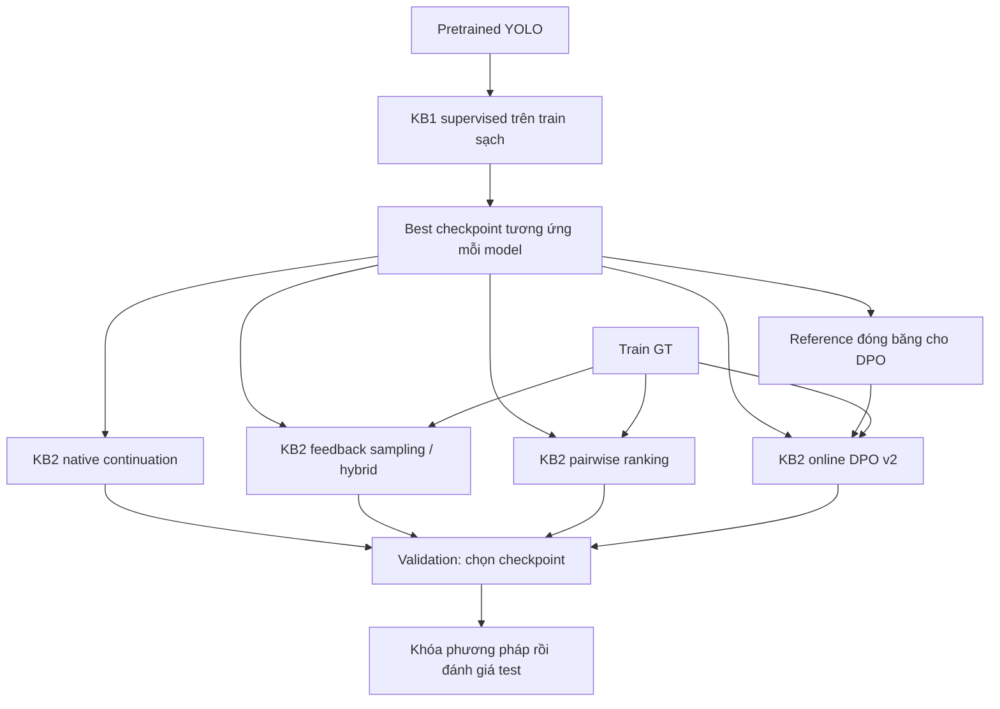

# Báo cáo KB2 — Feedback-guided fine-tuning, pairwise preference optimization và DPO online cho YOLO

**Ngày tổng hợp:** 15/10/2026, múi giờ Asia/Bangkok.  
**Phạm vi:** tài liệu KB2, code thực thi, feedback, checkpoint, kết quả JSON và log validation đang có trong workspace `RL-YOLO`.  
**Mô hình trong pipeline hiện tại:** YOLOv8n, YOLOv8s, YOLO11n, YOLO11s và YOLO26n. Trong CLI, hai model YOLO11 có tên `yolov11n`, `yolov11s`.  
**Phương pháp DPO đang chạy:** `candidate_selection_online_dpo_v2`, nguồn cặp `online_policy_gt_iou_v2`.  
**Nguyên tắc đọc báo cáo:** số thực nghiệm được lấy từ artifact; ý tưởng chưa chạy được ghi là đề xuất; paper làm căn cứ cho thiết kế và công thức, không thay thế bằng chứng thực nghiệm trên PlantDoc.

## Mục lục

- [1. Tóm tắt kết quả và kết luận có thể bảo vệ](#1-tóm-tắt-kết-quả-và-kết-luận-có-thể-bảo-vệ)
- [2. Mục tiêu nghiên cứu và quan hệ với KB1, KB3](#2-mục-tiêu-nghiên-cứu-và-quan-hệ-với-kb1-kb3)
- [3. Nguồn bằng chứng và cách xử lý tài liệu lịch sử](#3-nguồn-bằng-chứng-và-cách-xử-lý-tài-liệu-lịch-sử)
- [4. Dữ liệu, lớp và nguồn checkpoint](#4-dữ-liệu-lớp-và-nguồn-checkpoint)
- [5. Pipeline triển khai hiện tại](#5-pipeline-triển-khai-hiện-tại)
- [6. Feedback: matching, schema và sửa lỗi logic](#6-feedback-matching-schema-và-sửa-lỗi-logic)
- [7. Các objective đã triển khai trước DPO](#7-các-objective-đã-triển-khai-trước-dpo)
- [8. DPO: cơ sở nghiên cứu và phép tối ưu](#8-dpo-cơ-sở-nghiên-cứu-và-phép-tối-ưu)
- [9. Phép áp dụng DPO online v2 trong KB2](#9-phép-áp-dụng-dpo-online-v2-trong-kb2)
- [10. Tích hợp YOLO26n và khác biệt native recipe](#10-tích-hợp-yolo26n-và-khác-biệt-native-recipe)
- [11. Protocol train, validation và checkpoint selection](#11-protocol-train-validation-và-checkpoint-selection)
- [12. Metric đánh giá: định nghĩa và cách diễn giải](#12-metric-đánh-giá-định-nghĩa-và-cách-diễn-giải)
- [13. Kết quả lịch sử: feedback trên split cũ](#13-kết-quả-lịch-sử-feedback-trên-split-cũ)
- [14. Kết quả split sạch: feedback-guided và pairwise](#14-kết-quả-split-sạch-feedback-guided-và-pairwise)
- [15. DPO v1 và pilot DPO v2](#15-dpo-v1-và-pilot-dpo-v2)
- [16. DPO online v2: run dài trên cả năm model](#16-dpo-online-v2-run-dài-trên-cả-năm-model)
- [17. Phân tích log: model đang học gì và đã hội tụ chưa?](#17-phân-tích-log-model-đang-học-gì-và-đã-hội-tụ-chưa)
- [18. Kiểm chứng kỹ thuật và tính tái lập](#18-kiểm-chứng-kỹ-thuật-và-tính-tái-lập)
- [19. Những gì đã đạt và những gì chưa đạt](#19-những-gì-đã-đạt-và-những-gì-chưa-đạt)
- [20. Đề xuất nghiên cứu và triển khai tiếp theo](#20-đề-xuất-nghiên-cứu-và-triển-khai-tiếp-theo)
- [21. Lệnh tái lập và vị trí artifact](#21-lệnh-tái-lập-và-vị-trí-artifact)
- [22. Danh mục tài liệu đã đối chiếu và tài liệu nghiên cứu](#22-danh-mục-tài-liệu-đã-đối-chiếu-và-tài-liệu-nghiên-cứu)
- [23. Kết luận tổng hợp](#23-kết-luận-tổng-hợp)
- [Phụ lục A. Toàn bộ metric tại 63 lượt validation của DPO v2 dài](#phụ-lục-a-toàn-bộ-metric-tại-63-lượt-validation-của-dpo-v2-dài)

## 1. Tóm tắt kết quả và kết luận có thể bảo vệ

KB2 nghiên cứu việc dùng **prediction của YOLO và ground truth của tập train** để tạo phản hồi tự động, sau đó dùng phản hồi điều chỉnh quá trình fine-tune. Hướng đi đã phát triển từ sampling/loss theo lỗi, sang pairwise ranking và cuối cùng là một biến thể **DPO online cho hành động chọn dense candidate**. Native detection loss luôn là nền của trainer chính hiện tại.

KB2 **không học lại từ trọng số ngẫu nhiên**. Mỗi model bắt đầu từ `best.pt` supervised tương ứng của KB1. Các nhánh KB2 độc lập cùng bắt đầu từ checkpoint đó; DPO không tự động tiếp tục từ checkpoint pairwise, cũng không lấy checkpoint reward-guided KB1B làm đầu vào mặc định.

Đến mốc báo cáo, có các kết quả đáng chú ý:

1. Đã xây dựng pipeline sinh feedback chỉ trên train, schema `2.1`, matching đúng lớp và one-to-one, trạng thái GT độc quyền, difficulty/sampling, loss phụ, checkpoint/early stopping và kiểm tra provenance.
2. Đã chạy baseline/sampling/hybrid trên bốn model ở ngân sách 1.000 update; đã chạy pairwise trên bốn model và kiểm tra ba seed cho YOLOv8n.
3. Đã thêm DPO có reference đóng băng, policy categorical chuẩn hóa và log-ratio objective. Phiên bản v2 dùng **chất lượng hộp của policy hiện tại so với GT** để chọn A/B; reference chỉ chấm cùng chỉ số candidate.
4. Run DPO v2 dài `20261007T173941Z_330` đã hoàn tất trên **cả năm model**, với trần 15.000 bước, validation mỗi 1.000 bước, patience 5. Thực tế đã chạy **58.000 optimizer update**, xử lý **993.546 lượt cặp A/B**, có **63 lượt validation đầy đủ**. Đây là lượt cặp được dùng qua các batch, không phải 993.546 cặp độc lập hoặc duy nhất.
5. Cả năm model tăng mAP50–95 so với step 0 trong cùng run. YOLO11n cao nhất, đạt **0,431072**, tức **43,1072%**, tại bước 12.000. YOLO26n đạt **0,411577** tại bước 7.000.
6. **Chưa chứng minh phần tăng đó do riêng DPO:** run dài mới chỉ có nhánh DPO; chưa có native continuation và pairwise chạy dài cùng điều kiện để tách hiệu ứng học thêm khỏi hiệu ứng loss ưu tiên.
7. Có dấu hiệu objective ưu tiên còn yếu hoặc xung đột với native objective: trên các batch được ghi log, tỷ lệ điểm A cao hơn B tuyệt đối chỉ khoảng vài phần trăm; mean DPO loss ở cửa sổ cuối không giảm so với cửa sổ đầu của cả năm model. Các batch/cặp thay đổi theo thời gian nên đây là diagnostic, chưa phải một phép đo cố định chứng minh thất bại tối ưu.
8. Ngày 15/10 đã chạy lại bộ test: **53 test được phát hiện, 52 qua, 1 test GPU được skip trong discover và chạy riêng thành công**. Provenance của dữ liệu sạch và năm checkpoint đầu vào đều PASS.

**Kết luận hiện tại:** KB2 đã đạt một triển khai có thể kiểm chứng và có kết quả fine-tune dài trên nhiều kiến trúc. Các kết quả xác nhận pipeline hoạt động và mô hình sau fine-tune tốt hơn điểm xuất phát theo evaluator KB2. Chưa có đủ bằng chứng để tuyên bố DPO tốt hơn native continuation, cải thiện ổn định qua seed, hoặc đã đạt nghiệm tối ưu/hội tụ toàn cục.

Nguồn chính: [snapshot bằng chứng của báo cáo](assets/kb2_20261015/evidence_snapshot.json), [thư mục run DPO dài](../../kb2_preference_optimization/checkpoint_preference_optimization/ablation/20261007T173941Z_330), [trainer](../../kb2_preference_optimization/train_feedback.py), [loss](../../kb2_preference_optimization/feedback_loss.py).

## 2. Mục tiêu nghiên cứu và quan hệ với KB1, KB3

### 2.1. Bài toán KB2 thực sự giải quyết

Một detector có thể sinh nhiều candidate quanh cùng object. Hộp có confidence cao nhất không nhất thiết là hộp khớp GT nhất; model còn có thể bỏ sót object, nhầm lớp hoặc dự đoán thừa. KB2 đặt câu hỏi:

> Có thể dùng phản hồi từ những sai lệch đó để điều chỉnh việc học, sao cho detector nhận diện tốt hơn ngoài tập train, với cùng dữ liệu và checkpoint khởi đầu?

Các câu hỏi con:

- Sampling ảnh có lỗi nhiều hơn có lợi hơn shuffle thông thường không?
- Tăng trọng số loss theo ảnh/object có thêm thông tin hữu ích ngoài native loss không?
- Xếp điểm candidate chất lượng cao trên candidate chất lượng thấp có giúp ranking sau NMS và AP không?
- So ranking tương đối với reference có tốt hơn ranking trực tiếp không?
- Lợi ích có ổn định qua model, seed và ngân sách update không?

### 2.2. Ba loại baseline cần phân biệt

| Tên | Ý nghĩa | Câu hỏi được trả lời |
|---|---|---|
| KB1 supervised checkpoint / step 0 của KB2 | Model trước mọi update KB2 | Fine-tune thêm có thay đổi chất lượng so điểm xuất phát không? |
| KB2 native continuation baseline | Cùng checkpoint KB1, dữ liệu/augmentation/optimizer, chỉ native detection loss | Feedback/pairwise/DPO có đóng góp thêm ngoài việc học tiếp không? |
| KB1 native-only của thí nghiệm KB1 | Nhánh đối chứng riêng trong protocol KB1 | Reward-guided KB1 có đóng góp trong điều kiện KB1 không? |

Hai baseline có cùng tên “native” không tự động là cùng thí nghiệm. Khác loader, optimizer, thời lượng, NMS, `max_det` hoặc evaluator thì phải đối chiếu lại. Trong KB2, so DPO dài với step 0 trả lời câu hỏi thứ nhất; muốn chứng minh riêng DPO phải có baseline loại thứ hai với ngân sách tương ứng.

### 2.3. Sơ đồ liên hệ



KB3 nghiên cứu chọn/điều khiển hyperparameter huấn luyện. KB2 nghiên cứu tín hiệu học thêm từ prediction–GT. Có thể kết hợp sau này, nhưng phải thêm đối chứng để không quy cải thiện do search hoặc scheduler cho preference loss. Bối cảnh hai kịch bản khác được trình bày trong [report KB1 ngày 15/10](Report_KB1_15_10_2026.md) và [report KB3 ngày 15/10](Report_KB3_15_10_2026.md).

## 3. Nguồn bằng chứng và cách xử lý tài liệu lịch sử

### 3.1. Thứ tự ưu tiên khi các tài liệu mâu thuẫn

1. **Checkpoint/config và metrics JSONL của run cụ thể:** cho biết objective version, trần steps, bước thực chạy, best step, hash và các mốc validation.
2. **Code hiện tại:** mô tả hành vi hiện tại; không tự chứng minh code đó đã được dùng cho mọi run cũ.
3. **JSON kết quả/feedback summary:** dùng để xác nhận bảng số và điều kiện sinh feedback.
4. **Báo cáo/tài liệu Markdown lịch sử:** dùng truy vết ý tưởng, lỗi và quyết định; cần đối chiếu artifact trước khi dẫn số.
5. **Guide và kế hoạch:** nhiều nội dung là pseudocode hoặc mục tiêu tương lai, không phải kết quả đã triển khai.

Ví dụ, `KB2_FINAL_REPORT.md` dùng split cũ 1.722/495 và AP confidence 0,25. `docs/report_final/KB2.md` đã mô tả split sạch và DPO v2, nhưng đoạn “chưa có kết quả 15.000 bước” chưa phản ánh các artifact run dài hiện có. Báo cáo này cập nhật theo checkpoint/log, không lấy một tài liệu có tên “final” làm bằng chứng cao hơn artifact.

### 3.2. Các giai đoạn không được gộp thành một bảng xếp hạng

| Giai đoạn | Data/protocol | Bản chất | Cách sử dụng trong báo cáo |
|---|---|---|---|
| Guide ban đầu / legacy RL | Có ví dụ 10 lớp, UAV, 50k steps, confidence proxy | Ý tưởng và code cũ | Lịch sử nghiên cứu; không phải recipe của run hiện tại |
| Feedback cũ | Train 1.722, validation 495; schema 1.0; AP conf 0,25 | Sampling, object, dynamic, PCGrad-style | Số liệu lịch sử có giới hạn logic đã được review |
| Clean feedback / pairwise | Train 2.411, validation 479; schema 2.1; AP conf 0,001 | Feedback-guided + pairwise thực sự | Đối chứng nội bộ theo protocol tương ứng |
| Candidate DPO v1 | Clean split; cặp do reference chọn | Reference-relative candidate ranking | Tách riêng khỏi legacy anchor-DPO và v2 |
| Candidate DPO online v2 | Clean split; cặp do policy hiện tại và GT chọn | Native + online candidate-selection DPO loss | Phương pháp hiện hành, pilot và run dài |

Không suy luận “mAP giảm từ 0,668 xuống 0,431” vì các số đó đến từ dữ liệu, checkpoint và evaluator khác nhau. Tương tự, tăng từ baseline 1.000 bước lên DPO 12.000 bước không phải ước lượng riêng hiệu quả DPO.

## 4. Dữ liệu, lớp và nguồn checkpoint

### 4.1. Dữ liệu thực dùng

Dataset tại `pre-data/data/v2i_cleanned`, cấu hình YOLO gồm 28 lớp cây/lá và bệnh. Tên thư mục/module có chữ “pest” không có nghĩa thí nghiệm hiện tại đã đánh giá đầy đủ sâu, trứng hoặc UAV. Bài gốc [PlantDoc — Singh và cộng sự](https://arxiv.org/abs/1911.10317) là nguồn bối cảnh về nhận diện bệnh cây ngoài điều kiện phòng thí nghiệm; bản Roboflow/split của dự án phải được xác định bằng manifest riêng, không mặc định trùng toàn bộ dữ liệu và taxonomy của paper.

| Split | Ảnh | File nhãn | Bounding box trong file nhãn | Lớp có GT |
|---|---:|---:|---:|---:|
| Train | 2.411 | 2.411 | 10.333 | 28 |
| Validation (`valid`) | 479 | 479 | 1.887 | 28 |
| Test | 239 | 239 | 1.063 | 28 |

Số box trên được đếm trực tiếp từ nhãn ngày 15/10. Đây là thống kê dữ liệu, không phải đánh giá model trên test. Đếm support nhãn test không dùng prediction, không dùng để chọn hyperparameter trong báo cáo.

Manifest ghi train có **667 ảnh mang hậu tố augmentation đã biết**; valid/test không có hậu tố đó. Vì vậy “giữ nguyên dữ liệu” ở giai đoạn KB2 nghĩa là giữ split sạch đã khóa, không có nghĩa train hiện tại chỉ chứa ảnh nguồn nguyên bản. Loader còn áp dụng augmentation online.

### 4.2. Provenance đã kiểm tra

Dataset fingerprint:

```text
cbd68ffc1da935ac300fba953ea5f9c97c831f53887e1b9391d500f9e40c0c95
```

Ngày 15/10, hàm `dataset_manifest()` và `verify_supervised()` được chạy lại: năm checkpoint nền đều khớp manifest và dataset fingerprint hiện tại. Đồng thời đã đối chiếu hash nền với hash reference/config trong checkpoint DPO và hash feedback JSONL thực tế. Nguồn: [run_provenance.py](../../kb1_reward_guided_training/run_provenance.py), [manifest YOLOv8n](../../kb1_reward_guided_training/checkpoint_based/yolov8n/supervised_manifest.json).

Quy tắc source ID loại các hậu tố augmentation đã biết, kiểm tra nguồn trùng giữa split. Nó không bảo đảm phát hiện ảnh gần trùng đã đổi tên hoàn toàn; cũng không chứng minh nội dung toàn bộ tập pretraining bên ngoài. Kết luận phù hợp là **provenance trong phạm vi manifest dự án đã được xác minh**, không phải bảo đảm tuyệt đối không có mọi loại leakage.

### 4.3. Checkpoint đầu vào của run DPO dài

Các file nằm tại `kb1_reward_guided_training/checkpoint_based/<model>/weights/best.pt`.

| Model | SHA-256 checkpoint nền, cũng là reference khởi đầu |
|---|---|
| YOLOv8n | `9a7ce8d2710b94453da2add079d3b3635fb2a9f9ae1078fbe260428a67c969f9` |
| YOLOv8s | `7e5ea3f770508a54b59e7a15a8aa8f52e6b7134f25f69c267623044a825694c2` |
| YOLO11n | `339ee672b168f6995b7b977ed7c8d40e90d84971d772fef0cb417852a7eb3673` |
| YOLO11s | `16216acea0e0fb7fe7f0bd748f49c84340c2b0e492caf0ec6c8cb265bec6fbbc` |
| YOLO26n | `a6620e20104cc12e656da22cefa93bbcf0e7be0c040b20067adf71496057bf21` |

Reference là bản sao độc lập của model tại checkpoint nền. Thông tin `base_checkpoint_sha256 == reference_checkpoint_sha256` trong config nói về nguồn khởi đầu, không nói policy sau train còn giống reference.

### 4.4. Support theo lớp

| ID | Tên lớp theo YAML | Train box | Valid box | Test box |
|---|---|---|---|---|
| 0 | Apple Scab Leaf | 319 | 32 | 18 |
| 1 | Apple leaf | 336 | 46 | 31 |
| 2 | Apple rust leaf | 346 | 46 | 22 |
| 3 | Bell_pepper leaf | 369 | 29 | 45 |
| 4 | Bell_pepper leaf spot | 320 | 49 | 23 |
| 5 | Blueberry leaf | 598 | 158 | 85 |
| 6 | Cherry leaf | 333 | 70 | 21 |
| 7 | Corn Gray leaf spot | 202 | 14 | 14 |
| 8 | Corn leaf blight | 327 | 56 | 34 |
| 9 | Corn rust leaf | 336 | 39 | 12 |
| 10 | Peach leaf | 410 | 70 | 178 |
| 11 | Potato leaf | 354 | 41 | 23 |
| 12 | Potato leaf early blight | 371 | 172 | 16 |
| 13 | Potato leaf late blight | 361 | 62 | 37 |
| 14 | Raspberry leaf | 520 | 130 | 17 |
| 15 | Soyabean leaf | 351 | 66 | 17 |
| 16 | Squash Powdery mildew leaf | 351 | 54 | 50 |
| 17 | Strawberry leaf | 380 | 93 | 67 |
| 18 | Tomato Early blight leaf | 354 | 40 | 10 |
| 19 | Tomato Septoria leaf spot | 389 | 60 | 45 |
| 20 | Tomato leaf | 397 | 125 | 37 |
| 21 | Tomato leaf bacterial spot | 352 | 60 | 11 |
| 22 | Tomato leaf late blight | 353 | 49 | 40 |
| 23 | Tomato leaf mosaic virus | 351 | 41 | 44 |
| 24 | Tomato leaf yellow virus | 523 | 164 | 124 |
| 25 | Tomato mold leaf | 325 | 50 | 5 |
| 26 | grape leaf | 355 | 57 | 28 |
| 27 | grape leaf black rot | 350 | 14 | 9 |

Validation có lớp chỉ 14 GT box, trong khi có lớp trên 170 box. Vì mAP lấy trung bình theo lớp, class hiếm có thể tạo biến thiên đáng kể. Cần báo per-class AP và khoảng bất định khi xác nhận hiệu quả; chỉ một mAP tổng làm mất thông tin này.

## 5. Pipeline triển khai hiện tại

### 5.1. Luồng một lần chạy bằng script

1. `run_all_kb2.sh` chọn model, device, steps, seed và variants; `--model all` gồm năm model.
2. Preflight kiểm tra CUDA nếu cần, dataset và supervised checkpoint provenance cho toàn bộ model được chọn.
3. Với từng model, sinh feedback trên **train** bằng checkpoint KB1 tương ứng, không augmentation ngẫu nhiên.
4. Kiểm tra đủ 2.411 record và ánh xạ image ID–đường dẫn.
5. `run_ablation.py` khởi tạo từng nhánh độc lập, truyền cùng protocol nền tới `train_feedback.py`.
6. Trainer đánh giá step 0, chạy optimizer update, validation định kỳ, best selection và early stopping.
7. Ghi `*_last.pt`, `*_last_best.pt`, checkpoint trung gian, `*_last_metrics.jsonl` và `ablation_results.json`.

Script tạo `run_id` có timestamp/thông tin tiến trình và output riêng. Điều đó tránh mặc định ghi đè kết quả trước; không có nghĩa script tự skip các model đã chạy trong một run khác. Muốn chỉ thêm YOLO26n thì chọn `--model yolo26n`.

### 5.2. Module và trách nhiệm

| File | Chức năng thực tế |
|---|---|
| [generate_feedback.py](../../kb2_preference_optimization/generate_feedback.py) | Suy luận train, matching, ghi feedback JSONL/summary/hash |
| [feedback.py](../../kb2_preference_optimization/feedback.py) | Schema 2.1; matching; trạng thái GT; prediction errors; static preference phục vụ phân tích |
| [feedback_dataset.py](../../kb2_preference_optimization/feedback_dataset.py) | Validate record; difficulty; WeightedRandomSampler; object code theo gt_indices |
| [dataloader.py](../../kb2_preference_optimization/dataloader.py) | Ảnh/nhãn, letterbox, augmentation, collate, drop_last |
| [feedback_loss.py](../../kb2_preference_optimization/feedback_loss.py) | Hybrid/object/dynamic loss, projection, pairwise và DPO |
| [adapters/ultralytics_adapter.py](../../kb2_preference_optimization/adapters/ultralytics_adapter.py) | Native detection loss, dense output, post-NMS output; YOLO26 dual-head |
| [train_feedback.py](../../kb2_preference_optimization/train_feedback.py) | Tối ưu, reference, provenance, log, checkpoint, resume |
| [feedback_validation.py](../../kb2_preference_optimization/feedback_validation.py) | COCO-style AP, AR@100, early stopping |
| [run_ablation.py](../../kb2_preference_optimization/run_ablation.py) | Chạy năm variants và tổng hợp kết quả best checkpoint |
| [run_all_kb2.sh](../../kb2_preference_optimization/run_all_kb2.sh) | Preflight, feedback, ablation theo model |

`train_rl.py` còn tồn tại cho các level thử nghiệm cũ và được tái sử dụng một số helper tải adapter/checkpoint. Runner chính không gọi training loop legacy REINFORCE/anchor-DPO/DAPO của file đó.

### 5.3. Augmentation và một “step” có nghĩa gì

Train transforms hiện dùng `LongestMaxSize(640)` và padding về 640×640 với fill 114; sau đó brightness/contrast, HSV, noise, motion blur, horizontal/vertical flip, rotate ±15°, CLAHE, normalize và tensor conversion. GT được biến đổi đồng bộ, giữ `gt_indices`, loại box có visibility quá thấp.

Một step là **một batch 4 ảnh và một optimizer update**. Train có `drop_last=True`, nên một lượt loader có `floor(2411/4) = 602` batch, tương ứng 2.408 ảnh được lấy trong lượt đó. Sang lượt shuffle mới, ba ảnh bị bỏ không cố định.

```text
1.000 update ≈ 1,66 lượt loader
5.000 update ≈ 8,31 lượt loader
10.000 update ≈ 16,61 lượt loader
15.000 update ≈ 24,92 lượt loader
```

Với sampling có replacement, “một lượt” là 2.411 lượt lấy mẫu trước khi bỏ batch cuối, không phải bảo đảm mỗi ảnh xuất hiện một lần. Số cặp DPO không cố định: mỗi GT còn hợp lệ sau augmentation tạo tối đa một cặp; GT không có candidate đạt điều kiện thì bỏ. Pilot 100 bước có 1.620 cặp, còn run dài trung bình khoảng 17,1 cặp/step.

## 6. Feedback: matching, schema và sửa lỗi logic

### 6.1. Hai cấp trạng thái

**Cấp GT**, mỗi GT có đúng một trạng thái chính:

- `matched`: có primary prediction đúng lớp và IoU ≥ 0,5.
- `wrong_class`: chưa matched, có prediction sai lớp với IoU ≥ 0,5.
- `bad_localization`: chưa có hai trạng thái trên, có prediction IoU từ 0,1 đến dưới 0,5.
- `missed`: GT còn lại.

**Cấp prediction**, những prediction chưa dùng cho primary explanation:

- `duplicate`: đúng lớp, IoU đủ ngưỡng với GT đã matched đúng.
- `false_positive`: prediction còn dư khác. Vì vậy false positive không chỉ gồm hộp có IoU dưới 0,1; có thể là hộp sai lớp hoặc hộp dư trong vùng có GT.

Một wrong-class GT thường tương ứng một FN và một FP dưới cách đếm metric detection tại một operating point. Trong schema feedback, nó được ghi **một nguyên nhân chính** để tránh difficulty đếm trùng cùng GT; không được hiểu thống kê feedback là TP/FP/FN trực tiếp của evaluator COCO.

### 6.2. Matching thực tế

Code xây ma trận IoU và graph prediction–GT theo điều kiện hợp lệ. `_maximum_cardinality_matches()` thực hiện ghép hai phía có tái gán để tối đa số GT được bao phủ, với thứ tự prediction theo confidence/index và thứ tự GT theo IoU/index xác định. Tiến hành lần lượt đúng lớp, wrong-class, bad-localization.

Đây là **maximum-cardinality matching theo các tầng điều kiện**, không phải Hungarian tối ưu tổng IoU và không phải nguyên xi matching của COCO evaluator. Mục tiêu của feedback là explanation nhất quán; metric AP có matching riêng ở từng IoU threshold. Native task assignment của YOLO cũng là một cơ chế khác, không bị thay bằng matching feedback.

### 6.3. Những lỗi đã sửa

| Vấn đề trước đây | Sửa hiện tại | Vì sao cần |
|---|---|---|
| GT vừa matched vừa wrong-class/bad-localization | Một gt_status độc quyền | Không đưa object đã nhận diện đúng vào loss lỗi |
| Wrong-class/bad-localization đồng thời missed | Difficulty lấy từ trạng thái độc quyền | Không oversample vì đếm hai lần cùng lỗi |
| Prediction nearest-GT độc lập | Ghép đúng lớp one-to-one, tối đa coverage | Giảm missed/wrong-class giả khi object gần nhau |
| Rejected có thể là positive của GT khác | Quy tắc candidate cùng owner GT trong loss online | Không yêu cầu hạ điểm positive thuộc object khác |
| Feedback cũ bị trộn với code mới | Schema 2.1, policy ID và hash checks | Truy vết được tín hiệu huấn luyện |
| Dynamic status dùng max-IoU dense box bất kể output cuối | Runtime dynamic quyết định lỗi từ post-NMS output | Trạng thái phản ánh detector được đánh giá |
| AP lọc confidence 0,25 | AP hiện dùng 0,001 | Giữ phần score thấp để xây PR curve |
| BN drift ở batch nhỏ | Native loss train mode nhưng BatchNorm dùng running statistics đã học | Tránh mất chất lượng do thống kê batch quá nhỏ |
| Diagnostic projection ghi nhầm loss | Ghi riêng native/feedback/object loss | Không diễn giải nhầm thành phần objective |
| Đường dẫn WSL `/mnt/d/...` sang Windows Python | Runner truyền relative paths phù hợp | Tránh lỗi `D:\mnt\d\...` |

### 6.4. Những phần chưa nên tuyên bố “đã sửa hết”

- Dataloader vẫn có `except Exception` rồi fallback resize mà không log/counter. Nếu transform lỗi, distribution có thể thay đổi âm thầm. Đây là hạn chế còn trong code, cần fail-fast hoặc ghi rõ trước đợt xác nhận tiếp theo.
- Resume lưu model/optimizer/step/early-stop/config nhưng chưa đủ trạng thái RNG/sampler/Albumentations/vị trí batch. Không tương đương chính xác với run liên tục.
- Object auxiliary classification vẫn chủ yếu là `-log(p_true)`, không có penalty riêng trực tiếp cho class sai; native classification đã có signal âm. Thêm penalty phải kiểm chứng tránh đếm đôi.
- Một số comment legacy trong adapter/guide còn gọi class probability là logits hoặc mô tả mapping gần đúng, dù code hiện dùng sigmoid probability và chỉ số NMS thực.
- Helper dense-only dynamic status cũ còn tồn tại; runtime dynamic chính đã dùng post-NMS. Không được suy luận mọi helper đều có cùng semantics.

### 6.5. Feedback thực sinh cho năm model trong run dài

Feedback sinh từ checkpoint nền trên 2.411 ảnh train, confidence 0,25, NMS IoU 0,45, matching IoU 0,5 và localization floor 0,1. Các số đọc từ summary của chính run `20261007T173941Z_330`.

| Model | Matched GT | Wrong-class GT | Bad-localization GT | Missed GT | FP prediction | Duplicate prediction | Static preference pairs |
|---|---|---|---|---|---|---|---|
| YOLOv8n | 9730 | 116 | 105 | 382 | 3072 | 6 | 1007 |
| YOLOv8s | 9927 | 105 | 73 | 228 | 3359 | 8 | 966 |
| YOLO11n | 9703 | 126 | 122 | 382 | 3470 | 7 | 1123 |
| YOLO11s | 10049 | 56 | 42 | 186 | 2008 | 1 | 596 |
| YOLO26n | 9823 | 52 | 111 | 347 | 2538 | 7 | 785 |

Với mọi model, bốn cột trạng thái GT cộng lại bằng **10.333 GT**, đúng số box train. FP/duplicate thuộc cấp prediction nên không cộng vào tổng GT. Các số này mô tả model nền trên train ở confidence 0,25; không phải precision/recall validation của model sau DPO.

**Static preference pairs trong summary khác online DPO pairs.** Chúng được sinh trên output post-NMS, không augmentation ngẫu nhiên, chủ yếu phục vụ phân tích. DPO v2 tạo cặp mới từ dense prediction policy sau augmentation ở mỗi update; vì vậy số static pair vài trăm/một nghìn không giới hạn tổng gần một triệu lượt pair trong quá trình train. Trong nhánh DPO, JSONL vẫn được kiểm tra provenance để giữ protocol, nhưng difficulty/static pairs không trực tiếp vào objective hay sampler shuffle.

## 7. Các objective đã triển khai trước DPO

### 7.1. Native continuation

Với model tham số θ, ảnh x và GT Y:

$$L_{base}(\theta)=L_{native}(f_\theta(x),Y).$$

Trainer gọi `adapter.supervised_loss()` để dùng criterion native của Ultralytics; không tự thay bằng một IoU proxy. Với YOLOv8/YOLO11, có thể mô tả cấu trúc:

$$L_{native}=\lambda_{box}L_{CIoU}+\lambda_{cls}L_{BCE}+\lambda_{reg}L_{DFL},$$

trong đó assignment/soft targets và normalization theo criterion gốc, không phải mỗi GT chỉ ghép duy nhất một anchor như feedback. Adapter cộng các thành phần và chia batch size để đưa về thang loss dùng trong loop KB2.

YOLO26 có regression không DFL, dùng thành phần L1 tương ứng trong phiên bản thư viện đang kiểm tra và criterion cho cả one-to-many/one-to-one. Không gán công thức DFL của YOLOv8 cho YOLO26. Phần head/recipe được nói rõ ở mục 10.

### 7.2. Difficulty và feedback-guided sampling

Với ảnh i, số GT `N_i`, đếm trạng thái độc quyền và prediction errors:

$$d_i=\max\left(0,\frac{-0.10n_{matched}+1.00n_{wrong}+0.75n_{loc}+1.25n_{miss}+0.50n_{FP}+0.50n_{dup}}{\max(1,N_i)}\right).$$

Sampling weight và xác suất:

$$w_i^{sample}=\min(w_{max},1+s\,d_i),\qquad P(i)=\frac{w_i^{sample}}{\sum_jw_j^{sample}}.$$

Mặc định hiện tại `s=1`, `w_max=5`, `WeightedRandomSampler` lấy có replacement. Các trọng số lỗi là **heuristic thiết kế**, không phải tham số được suy ra từ một định lý bảo đảm tăng mAP.

Sampling thay phân phối dữ liệu tối ưu. Không có importance correction `1/P(i)` để khôi phục unbiased gradient của objective empirical risk đồng đều. Đó là lựa chọn chủ đích tập trung ảnh khó, nhưng cũng có thể tăng phương sai, nhấn mạnh label noise hoặc giảm tần suất ảnh dễ.

### 7.3. Image-level hybrid loss

Trong batch B:

$$u_i=\min(3,1+d_i),\qquad \bar w_i=\frac{u_i}{\frac1{|B|}\sum_{j\in B}u_j}.$$

$$L_{weighted}=\frac1{|B|}\sum_{i\in B}\bar w_iL_{native,i},$$

$$L_{hybrid}=(1-\alpha_{img})L_{native,batch}+\alpha_{img}L_{weighted}.$$

`u_i` được chặn trước normalization; `bar w_i` có trung bình một trong batch. Hybrid mặc định của runner dùng feedback sampling và `alpha_img=0,10`. Loss native mỗi ảnh được tính riêng; do normalization/assignment trong criterion, không nên mặc định trung bình các loss ảnh hoàn toàn bằng native loss của batch.

### 7.4. Static/dynamic object auxiliary loss

Với mỗi GT được gắn lỗi, chọn candidate dense có IoU lớn nhất với GT. Chỉ việc chọn index dùng box detach; box được chọn vẫn có gradient khi tính IoU loss:

$$L_{obj,j}=\begin{cases}
0,&matched,\\
-\lambda_c\log q_\theta(c_j|a_j,x),&wrong\_class,\\
\lambda_b(1-IoU(b_{a_j},g_j)),&bad\_localization,\\
-\lambda_c\log q_\theta(c_j|a_j,x)+\lambda_b(1-IoU(b_{a_j},g_j)),&missed.
\end{cases}$$

Lấy trung bình trên object lỗi rồi cộng `alpha_obj * L_obj` vào native/hybrid. Static dùng trạng thái từ checkpoint nền, được nối qua `gt_indices`; dynamic xác định lại trạng thái từ output post-NMS hiện tại rồi chọn candidate dense để truyền gradient.

Giới hạn: max-IoU candidate ngoài native assignment có thể không phải positive native; `-log(p_true)` không trực tiếp giảm một class sai độc lập; không có candidate overlap tốt thì signal IoU đơn giản cũng có thể yếu. Có gradient hữu hạn chưa chứng minh assignment thích hợp.

### 7.5. Gradient projection theo tinh thần PCGrad

Gọi `g_n = ∇L_native`, `g_f = ∇L_feedback`:

$$g_f'=g_f-\min\left(0,\frac{g_n^Tg_f}{\max(\|g_n\|^2,\epsilon)}\right)g_n,$$

$$g_{total}=g_n+\alpha_f g_f'.$$

Khi hai gradient xung đột, bỏ thành phần feedback ngược hướng native. Native gradient được giữ nguyên. Đây là projection bất đối xứng lấy cảm hứng từ [PCGrad — Yu và cộng sự, NeurIPS 2020](https://arxiv.org/abs/2001.06782), không tuyên bố tái lập toàn bộ thuật toán multi-task của paper. Với mẫu số không bị epsilon chi phối, tích vô hướng `g_nᵀg_f'` không âm sau projection; điều đó là tính chất đại số cục bộ, không bảo đảm AP hay generalization tăng sau AdamW/clipping.

### 7.6. Pairwise preference optimization

Pairwise hiện hành chọn từ prediction **policy hiện tại** trên cùng ảnh đã augment:

- Candidate thuộc GT có IoU cao nhất với nó.
- A: IoU lớn nhất trong owner GT, đủ `IoU ≥ 0,5`.
- B: cùng owner GT, `0,1 ≤ IoU < 0,5`, điểm **lớp GT** cao nhất.
- Không có cặp hợp lệ thì bỏ; box dùng chọn cặp được detach.

Đặt `z_A = logit(clamp(q_A))`, `z_B = logit(clamp(q_B))`, margin m:

$$L_{pair}=\frac1K\sum_{k=1}^K\operatorname{softplus}(m-(z_{A_k}-z_{B_k})),\qquad L=L_{native}+\alpha_{pair}L_{pair}.$$

Đây là logistic pairwise ranking với margin, có liên hệ với hướng học xếp hạng như [RankNet — Burges và cộng sự, ICML 2005](https://www.microsoft.com/en-us/research/publication/learning-to-rank-using-gradient-descent/). Trong KB2, nó **đã là một hình thức preference optimization** vì cặp A/B thật sự tham gia gradient. Nó không phải DPO do không có reference log-ratio.

Thực nghiệm chính dùng `alpha_pair=0,01`, `m=0,1`, shuffle như native baseline. Cặp lưu trong JSONL không được đưa thẳng vào loss này: prediction indices trước augmentation không còn đại diện chắc chắn cho output sau augmentation và sau update.

## 8. DPO: cơ sở nghiên cứu và phép tối ưu

### 8.1. Paper nào hỗ trợ điều gì?

[Rafailov và cộng sự, *Direct Preference Optimization: Your Language Model is Secretly a Reward Model*, NeurIPS 2023](https://arxiv.org/html/2305.18290v3) xây objective preference trực tiếp từ policy/reference bằng đổi biến reward trong bài toán tối ưu có KL regularization; Eq. 7 là loss KB2 tham chiếu. Paper dùng preference offline cho language model, không chứng minh trực tiếp online candidate ranking của YOLO.

Phần dưới trình bày các công thức nền, sau đó phân tích riêng phép áp dụng của KB2 từ code. Điều cần chứng minh là xác suất/action được định nghĩa nhất quán và gradient đi đúng hướng. Muốn chứng minh hiệu quả detection vẫn phải có đối chứng thực nghiệm.

### 8.2. Từ preference đến reference-relative objective

Với context x, action y, reward r, reference π_ref và β > 0, dạng tối ưu nền là:

$$\max_\pi\;\mathbb E_{y\sim\pi(\cdot|x)}[r(x,y)]-\beta D_{KL}(\pi(\cdot|x)\|\pi_{ref}(\cdot|x)).\tag{1}$$

Để minh họa bằng đại số, xét không gian action hữu hạn, reference dương trên các action. Thêm ràng buộc `sum π = 1`, lấy đạo hàm theo xác suất và chuẩn hóa:

$$\pi^*(y|x)=\frac{\pi_{ref}(y|x)\exp(r(x,y)/\beta)}{Z(x)}.\tag{2}$$

Sắp xếp lại:

$$r(x,y)=\beta\log\frac{\pi^*(y|x)}{\pi_{ref}(y|x)}+\beta\log Z(x).\tag{3}$$

Mô hình preference kiểu Bradley–Terry viết xác suất A được ưu tiên hơn B:

$$P(A\succ B|x)=\sigma(r(x,A)-r(x,B)).\tag{4}$$

Hiệu reward triệt tiêu `log Z(x)`. Thay π* bằng policy tham số hóa và lấy negative log-likelihood cho nhãn A ≻ B:

$$L_{DPO}=-\mathbb E\log\sigma\left(\beta\left[\log\frac{\pi_\theta(A|x)}{\pi_{ref}(A|x)}-\log\frac{\pi_\theta(B|x)}{\pi_{ref}(B|x)}\right]\right).\tag{5}$$

Các giả thiết về reward/preference/action là một phần của mô hình hóa. Việc có dạng loss (5) không tự xác nhận rằng một score tùy ý là likelihood của toàn bộ detection set, hoặc một rule online phụ thuộc θ có tất cả tính chất thống kê của preference dataset cố định.

### 8.3. Tại sao reference được đóng băng?

Trong code KB2, reference giữ mốc điểm ban đầu của **cùng action indices**. Khi policy đổi, hiệu log-prob mới được đo tương đối với mốc đó. Nếu liên tục cập nhật reference bằng đúng policy và cho hai nhánh cùng thay đổi, hiệu có thể triệt tiêu hoặc trở thành một objective khác; cần thiết kế và giải thích lại.

GT quyết định nhãn “A tốt hơn B”; reference chỉ cho biết model ban đầu đã ưu tiên các action đó ra sao. Đóng băng reference không có nghĩa model phải chọn hộp reference gần GT nhất.

### 8.4. β và α khác nhau

- `beta` nằm **trong sigmoid**, điều chỉnh thang của relative margin và độ nhạy của loss theo khoảng cách ranking.
- `alpha_dpo` nằm **ngoài DPO loss**, điều chỉnh đóng góp gradient phụ so với native loss.
- Trong cấu hình đang chạy, cả hai bằng 0,1; đây là giá trị thử, chưa có sweep đa seed chứng minh tối ưu.
- Không có phép đo hoặc chặn KL toàn detector ở mỗi update trong loop hiện tại. β không được diễn giải thành “KL chắc chắn nhỏ hơn 0,1”.
- Learning rate nhỏ và gradient norm clipping cũng không tương đương với PPO probability-ratio clipping hoặc một KL constraint cứng.

## 9. Phép áp dụng DPO online v2 trong KB2

### 9.1. Không gian action và xác suất được định nghĩa

Dense output có dạng `[B, 4 + C, M]`, thường C = 28 và M = 8.400 ở input 640. Bốn kênh đầu là decoded `cxcywh`; các kênh lớp là **sigmoid probabilities**, không phải raw logits.

Gọi qθ(a,c|x) là score lớp c tại candidate index a:

$$z_\theta(a,c|x)=\operatorname{logit}(\operatorname{clamp}(q_\theta(a,c|x),10^{-6},1-10^{-6})),\tag{6}$$

$$\pi_\theta(a|x,c)=\frac{\exp z_\theta(a,c|x)}{\sum_{a'=1}^{M}\exp z_\theta(a',c|x)}.\tag{7}$$

Đây là categorical policy **chọn chỉ số candidate theo ảnh và lớp GT**. Tổng xác suất theo a bằng một. Không coi sigmoid score đơn lẻ hay `log(mean confidence)` là likelihood của tập detection. Index của các model anchor-free là vị trí dense/grid, không phải anchor box cố định kiểu YOLOv5.

Mặc dù vòng chọn cặp duyệt từng GT, phân phối trong code condition trên `(x,c)`, chưa có GT-instance embedding riêng. Hai GT cùng lớp chia sẻ categorical score field; owner-GT được dùng khi chọn cặp, không đưa vào network như một context mới.

### 9.2. Chọn A/B từ GT và hộp policy hiện tại

Với GT j có hộp g_j, lớp c_j:

$$owner(a)=\arg\max_j IoU(b^\theta_a,g_j),$$

$$A_j=\arg\max_{a:owner(a)=j,\ IoU(b^\theta_a,g_j)\ge0.5}IoU(b^\theta_a,g_j),$$

$$\mathcal B_j=\{a:owner(a)=j,\ IoU(b^\theta_a,g_j)\ge0.1,\ IoU(b^\theta_a,g_j)<IoU(b^\theta_{A_j},g_j)-10^{-6}\},$$

$$B_j=\arg\max_{a\in\mathcal B_j}q_\theta(a,c_j|x).\tag{8}$$

Không có A hoặc B thì bỏ GT đó. Chọn từ tensor detach; tie có thứ tự index xác định; không ép tạo pair IoU hòa. Confidence dùng chọn **hard rejected** giữa các hộp đã có IoU thấp hơn A, không được đảo nhãn A/B.

Vì vậy A có IoU 0,9 và B có IoU 0,6 vẫn hợp lệ. Điều kiện B dưới 0,5 chỉ còn ở nhánh pairwise cũ. DPO không trực tiếp so “toàn bộ bộ hộp A” với “toàn bộ bộ hộp B”, cũng chưa có reward riêng về số lượng box.

### 9.3. Loss thực thi

Với mỗi cặp k, policy và reference chấm **cùng** `(image, class, A_index, B_index)`:

$$d^\theta_k=\log\pi_\theta(A_k|x,c)-\log\pi_\theta(B_k|x,c),$$

$$d^{ref}_k=\log\pi_{ref}(A_k|x,c)-\log\pi_{ref}(B_k|x,c),$$

$$\Delta_k=d^\theta_k-d^{ref}_k,$$

$$L_{DPO}^{KB2}=\frac1K\sum_{k=1}^{K}\operatorname{softplus}(-\beta\Delta_k),\qquad L_{total}=L_{native}+\alpha_{DPO}L_{DPO}^{KB2}.\tag{9}$$

Reference clone tạo trước resume, `requires_grad=False`, forward `no_grad`, không nằm trong optimizer. Không có pair thì trả loss zero gắn với graph policy để backward hợp lệ. Nhánh DPO hiện được kiểm tra không cộng đồng thời sampling/hybrid/object/pairwise/projection để giữ ablation dễ diễn giải.

Trong log DPO, `pairwise=0 pairs=0` là nhánh ranking riêng đang tắt. Cặp DPO ở `dpo_pairs`. `feedback` có thể bằng native trong diagnostic khi `feedback_alpha=0`; objective không cộng native hai lần.

### 9.4. Phân tích gradient trực tiếp từ công thức KB2

Với một cặp đã cố định index trong bước hiện tại:

$$\frac{\partial L_{DPO,k}}{\partial\Delta_k}=-\beta\sigma(-\beta\Delta_k).\tag{10}$$

Một tính chất quan trọng của policy (7):

$$d^\theta_k=(z_{A_k}-\log\sum_a e^{z_a})-(z_{B_k}-\log\sum_a e^{z_a})=z_{A_k}-z_{B_k}.\tag{11}$$

Do đó, ở mức logits độc lập và ngoài vùng clamp:

$$\frac{\partial(\alpha L_{DPO}^{KB2})}{\partial z_{A_k}}=-\frac{\alpha\beta}{K}\sigma(-\beta\Delta_k)<0,$$

$$\frac{\partial(\alpha L_{DPO}^{KB2})}{\partial z_{B_k}}=+\frac{\alpha\beta}{K}\sigma(-\beta\Delta_k)>0.\tag{12}$$

Gradient descent của **thành phần DPO riêng** khuyến khích tăng logit A, giảm logit B. Vì có chung backbone/tham số và còn native loss, không bảo đảm sau một update tổng hợp mọi q_A đều tăng và mọi q_B đều giảm.

Khi policy = reference, `Delta = 0`, loss bằng `log(2) ≈ 0,693147`, nhưng đạo hàm theo gap vẫn là `-beta/2`. Với α = β = 0,1, hệ số theo mỗi pair sau mean là `0,005/K`. Ở K ≈ 17, xấp xỉ 0,000294; không thể từ con số này suy trực tiếp tỷ lệ norm gradient toàn mạng.

**Hệ quả của (11):** normalization làm policy hợp lệ, nhưng trong loss chỉ dùng chênh log-prob, mẫu số softmax triệt tiêu. Không có gradient trực tiếp lên mọi candidate khác thông qua mẫu số của gap này; ảnh hưởng đến chúng đến từ tham số chung/native loss. Cũng không có một KL penalty đầy đủ trên toàn bộ candidate distribution được tính riêng trong implementation.

Nếu q rơi vào vùng bị clamp, gradient qua clamp có thể bằng zero. Test cho thấy nhánh có gradient trên batch thử, nhưng log hiện chưa đo tỷ lệ A/B bị clamp trong cả run; không được khẳng định mọi pair luôn có gradient hữu ích.

### 9.5. Relative ranking không đồng nghĩa ranking tuyệt đối

Ví dụ minh họa, không phải một số đo thực nghiệm:

```text
Reference: d_ref = -7
Policy:    d_policy = -6
Relative margin Delta = 1 > 0
beta = 0,1 → DPO loss ≈ 0,6444 < log(2)
```

Policy đã cải thiện khoảng cách so reference, nhưng `d_policy < 0`, tức vẫn cho B xác suất chọn cao hơn A. Tỷ lệ `pi(A)/pi(B) = exp(-6) ≈ 0,00248`. Vì thế phải log riêng:

- absolute win rate: `d_policy > 0`;
- reference win rate: `d_ref > 0` trên chính cặp index được chọn ở bước đó;
- relative win rate: `Delta > 0`;
- quality gap: `IoU(A,GT) - IoU(B,GT)`.

Không được dùng relative win rate làm AP, hoặc dùng IoU(A) cao làm bằng chứng A đã đi qua NMS và được detector chọn cuối cùng.

### 9.6. DPO v1, v2 và legacy anchor-DPO khác nhau thế nào?

| Phiên bản | Chọn cặp | Xác suất/loss | Phạm vi kết quả |
|---|---|---|---|
| Legacy anchor-DPO trong `train_rl.py` | Quy tắc anchor thử nghiệm riêng | Không phải protocol candidate v2 hiện tại | Chỉ số split/evaluator cũ trong báo cáo lịch sử |
| Candidate DPO v1 | Hộp reference định nhãn A/B | Categorical candidate log-ratio | Pilot 100 và run v1 1.000 bước |
| Online candidate DPO v2 | Hộp policy hiện tại so GT; B có thể ≥0,5 | Cùng log-ratio; nhãn refresh mỗi bước | Pilot mới 100 và run năm model 15k-max |

V1 có thể có stale geometry: A từng tốt theo reference nhưng hộp policy ở cùng index thay đổi. V2 sửa đúng yêu cầu ưu tiên hộp **hiện tại** khớp GT hơn. Điều đó không có nghĩa mọi offline preference lấy mẫu từ reference đều sai; trong DPO gốc, output/action được giữ cố định. Điểm khác ở đây là action KB2 là index và hộp decoded tại index phụ thuộc θ.

Version/schema được lưu trong checkpoint và resume từ chối v1 → v2. Không đổi tên checkpoint cũ để coi là đã chạy v2.

### 9.7. Những giới hạn lý thuyết còn lại

1. Preference dataset online phụ thuộc geometry/score của policy; selection được detach. Đây là semi-gradient theo cặp được chọn, không phải đạo hàm xuyên toàn bộ quá trình thay đổi phân phối cặp.
2. Action là candidate index; policy và reference không chấm likelihood của cùng một tọa độ hộp cố định hay một detection set cố định.
3. Loss DPO không có regression gradient trực tiếp qua tọa độ; box dùng chọn cặp đã detach. Backbone có thể đổi nên geometry vẫn thay đổi gián tiếp, nhưng native regression là tín hiệu chính.
4. A được chọn theo IoU đơn thuần, không bắt buộc là positive của native assigner, không bắt buộc score đủ confidence/NMS. Đây có thể là khác biệt lớn giữa “hộp decoded khít” và “detection đáng tin cậy”.
5. Cặp chỉ tồn tại khi có A IoU ≥0,5 và B đủ overlap; missed GT quá khó, FP xa GT, số lượng box và output sau NMS không được objective phụ xử lý đầy đủ.
6. Preference 0,9000001 so với 0,9 có thể bị bỏ theo epsilon; các chênh nhỏ khác vẫn được cho weight bằng các chênh lớn vì loss chưa weight theo quality gap.
7. So pairwise hiện tại với DPO v2 thay đổi đồng thời objective, β/α và miền chọn B; chưa cô lập hiệu ứng reference.

Do đó tên phù hợp là **native YOLO fine-tuning với online GT-derived candidate-selection DPO auxiliary loss**. Không gọi là DPO đã được chứng minh tăng mAP cho toàn bộ detection set.

## 10. Tích hợp YOLO26n và khác biệt native recipe

YOLO26n đã được đăng ký trong checkpoint map, CLI và `--model all`. Không chỉ là “có tên trong danh sách”: đã có run DPO v2 dài và artifact metrics trên 479 ảnh validation.

Theo code adapter hiện tại và [tài liệu chính thức YOLO26](https://docs.ultralytics.com/models/yolo26/), có hai head. KB2 sử dụng **one-to-many dense output và NMS** để feedback, pairwise, DPO và evaluator có output contract thống nhất. Native criterion vẫn học hai nhánh; unit test YOLO26 kiểm tra gradient của cả `cv3` và `one2one_cv3`.

Vì vậy:

- Các số YOLO26 trong báo cáo không phải benchmark NMS-free one-to-one.
- YOLO26 không DFL trong regression; bản Ultralytics kiểm tra trả `l1_loss` cho thành phần tương ứng.
- KB2 dùng AdamW riêng, không dùng nguyên recipe pretraining/training YOLO26 hoặc MuSGD được tài liệu chính thức mô tả.
- Local `E2ELoss` có hệ số one-to-many/one-to-one và hàm `update()` cho progressive schedule; loop KB2 không gọi `criterion.update()`. Không được khẳng định đã tái lập đầy đủ progressive training của trainer chính thức. Đây là một điểm cần audit khi làm đối chứng dài, không tự phủ định tính so sánh nội bộ nếu baseline dùng cùng loop.
- Checkpoint đã fuse bỏ one-to-many không phù hợp với dense feedback adapter hiện tại.

`model.eval()` chỉ điều chỉnh hành vi layer như BatchNorm/dropout, không tự tắt autograd. Adapter chủ động dùng eval để lấy decoded output, và dùng train + BN eval khi gọi native loss. Reference dùng thêm `no_grad`; policy score vẫn giữ graph. Cần phân biệt mode và gradient để không kết luận nhầm model không học vì thấy `eval()`.

## 11. Protocol train, validation và checkpoint selection

### 11.1. Cấu hình run dài đã kiểm tra từ checkpoint

| Thành phần | Giá trị |
|---|---|
| Run ID | `20261007T173941Z_330` |
| Variant thực sự chạy | `dpo` |
| Model | 5 model nêu đầu báo cáo |
| Base | KB1 supervised best tương ứng |
| Train/valid/test | 2.411 / 479 / 239; test không dùng trong selection |
| Input / train batch / val batch | 640 / 4 / 8 |
| Optimizer | AdamW |
| Learning rate / weight decay | `1e-6` / `5e-4` |
| Scheduler / warmup / EMA | Không có cơ chế tương ứng được triển khai trong loop KB2 hiện tại |
| Gradient clip | Global norm 1,0; log là norm **trước** clipping |
| BN running statistics | Giữ cố định khi native supervised loss |
| Sampling | Shuffle, không weighted sampler |
| Native coefficient | 1 |
| DPO alpha / beta | 0,1 / 0,1 |
| Các auxiliary khác | Tắt: image/object feedback, pairwise, projection |
| Seed / workers | 42 / 0 |
| Trần update | 15.000 mỗi model |
| Validation | Step 0 và mỗi 1.000 update |
| Early stopping | Patience 5; min_delta `1e-4`; maximize mAP50–95 |
| Intermediate save | Mỗi 2.000 update |
| Log train | Step 1 và mỗi 10 update |
| Objective version | `candidate_selection_online_dpo_v2` |

`pairwise_alpha=0,01` có thể có trong protocol tổng hợp runner, nhưng config trainer của nhánh DPO có `pairwise_alpha=0`. Không đọc tham số chung của runner thành loss đang cộng trong nhánh.

### 11.2. Validation thực hiện việc gì?

1. Duyệt đủ 479 ảnh valid, transforms xác định, không train augmentation ngẫu nhiên.
2. Forward ở eval trong `torch.no_grad()`: không backward, không optimizer update, không dùng GT valid để sinh train pairs.
3. Confidence filter 0,001; class-aware NMS IoU 0,45; `max_det=100`, `max_nms=5000` trong adapter.
4. Đưa boxes/scores/labels và GT về metric COCO-style, backend `faster_coco_eval`.
5. Tính mAP/AP-small/AR@100; cập nhật early-stop state và lưu best nếu cải thiện đủ.
6. Quay lại train tiếp nếu chưa đủ điều kiện dừng.

Validation không trực tiếp học gradient từ GT valid, nhưng được dùng chọn checkpoint, stop và phát triển phương pháp. Vì vậy valid không phải tập test độc lập sau quá trình tuning.

### 11.3. Công thức early stopping và best

Gọi b là best đã chấp nhận, v_t là mAP50–95 ở lần validate t:

$$improved_t=[v_t>b+10^{-4}].$$

Nếu improved, lưu best và reset bad counter; ngược lại tăng counter. Dừng khi counter ≥5. Với eval interval 1.000, phải có khoảng 5.000 update liên tiếp không cải thiện đủ sau best gần nhất để early stop. Step 0 được giữ nếu fine-tune không vượt nó.

`min_delta=0,0001` trên thang [0,1] tương đương **0,01 điểm phần trăm AP**. Best là best được chấp nhận theo tolerance, không nhất thiết là raw maximum nếu hai mốc chỉ chênh ít hơn tolerance. Trong năm run dài, best được lưu trùng raw maximum của trajectory đã kiểm tra.

File `dpo_last_best.pt` là model được chọn; `dpo_last.pt` là state lúc kết thúc, có thể tệ hơn. `ablation_results.json` lấy metric và pair count từ **best checkpoint**, không tự đại diện tổng pair của toàn run. Tổng run phải đọc `dpo_last.pt`.

## 12. Metric đánh giá: định nghĩa và cách diễn giải

### 12.1. IoU và matching

$$IoU(B,G)=\frac{|B\cap G|}{|B\cup G|}.$$

IoU đo độ khớp không gian, không tự bao gồm đúng class, số lượng detection hoặc confidence. AP đánh giá prediction theo score, class và matching one-to-one ở nhiều IoU threshold. GT box có thể đã khít nhưng class sai vẫn không thành TP đúng lớp.

### 12.2. Precision, recall và F1 tại một operating point

$$P=\frac{TP}{TP+FP},\quad R=\frac{TP}{TP+FN},\quad F_1=\frac{2PR}{P+R}.$$

Các công thức này chỉ có nghĩa đầy đủ khi khóa confidence, IoU matching, class handling và aggregation. Trainer KB2 hiện **không xuất P/F1 operating-point** ở mỗi validation. Chúng là metric nên thêm khi đánh giá cuối, không được tự dựng số từ cột AR@100 hiện có.

### 12.3. AP, mAP50 và mAP50–95

Với lớp c và IoU threshold t, khái quát AP là diện tích dưới precision–recall curve đã nội suy. Dạng COCO sử dụng 101 recall thresholds. Có thể biểu diễn:

$$AP_{c,t}=\frac1{101}\sum_{r\in\{0,0.01,\ldots,1\}}P^{interp}_{c,t}(r),$$

$$mAP50=\operatorname{mean}_{c\ hợp\ lệ}AP_{c,0.5},$$

$$mAP50\text{–}95=\operatorname{mean}_{c\ hợp\ lệ,\ t\in\{0.50,0.55,\ldots,0.95\}}AP_{c,t}.$$

Lớp/scale không có GT hợp lệ được backend xử lý theo contract, không tự gán zero rồi lấy trung bình 28 lớp ở mọi slice. Các định nghĩa tham khảo tại [COCO detection evaluation](https://cocodataset.org/dataset/detection-eval.htm) và [COCOeval chính thức](https://github.com/cocodataset/cocoapi/blob/master/PythonAPI/pycocotools/cocoeval.py).

mAP50–95 khắt khe hơn mAP50 về localization và là tiêu chí selection hiện tại. Confidence 0,001 là một cut-off triển khai thấp, không phải đánh giá toán học trên mọi score đến zero. `max_nms=5000`/`max_det=100` cũng giới hạn tập prediction; phải giữ nguyên khi so các nhánh.

### 12.4. AP-small

Theo COCO, small là area dưới `32²` pixel. Evaluator KB2 nhận box **sau resize/pad về input 640**, nên scale area dùng ở đây là không gian ảnh đã transform. Nếu evaluator khác dùng diện tích ảnh gốc thì AP-small không tự so trực tiếp được.

AP-small thấp có thể phản ánh khó khăn ở object nhỏ và support nhỏ; không tự chứng minh model thiếu khả năng tìm vết bệnh cực nhỏ nếu annotation thực tế là box toàn lá. Cần xem annotation và support theo area.

### 12.5. Cột `Recall` hiện tại chính xác là gì?

Trong `feedback_validation.py`:

```python
'Recall': float(result['mar_100'])
```

Do đó cột `Recall` là **COCO mean average recall với tối đa 100 detections/ảnh**, lấy trung bình trên các ngưỡng IoU đã cấu hình và lớp hợp lệ, viết gọn **AR@100**. Nó không phải recall đơn tại confidence 0,25/IoU 0,5. Báo cáo này giữ tên artifact khi cần đối chiếu nhưng chú thích đúng semantics.

### 12.6. FPS không phải latency detector thuần

Code tính `FPS = num_images / elapsed`, tính cả vòng loader/forward/NMS/cập nhật metric và thời gian `metric.compute()`, có CPU/GPU synchronization và overhead khác. Không có benchmark warmup/batch1 latency chuẩn hóa riêng trong loop này.

Vì vậy số FPS lưu trong JSON là **throughput của quy trình validation tại lần đo**, không dùng để chứng minh YOLO26 nhanh hơn YOLO11 hoặc tuyên bố đạt realtime triển khai. DPO chỉ dùng lúc train; inference không cần reference, nhưng tốc độ thực tế vẫn cần benchmark riêng.

### 12.7. Chênh lệch tuyệt đối, tương đối và điểm phần trăm

$$\Delta_{abs}=m_1-m_0,\quad \Delta_{pp}=100(m_1-m_0),\quad \Delta_{rel}(\%)=100\frac{m_1-m_0}{m_0}.$$

Ví dụ 0,374931 → 0,393629 là tăng khoảng **1,8698 điểm phần trăm AP**, không phải tăng 1,8698% tương đối. Bảng dưới dùng điểm phần trăm cho delta để tránh nhập nhằng.

## 13. Kết quả lịch sử: feedback trên split cũ

### 13.1. Vì sao vẫn ghi lại?

Các thử nghiệm cũ cho thấy quá trình hình thành phương pháp và những lỗi đã phát hiện. Tuy nhiên train 1.722, valid 495, confidence AP 0,25, feedback schema 1.0 và matching cũ làm chúng **không phải bằng chứng hiện hành trên split sạch**. Các tài liệu cũ có chỗ khẳng định baseline “đã gần tối ưu”; đó là giả thuyết diễn giải lúc đó, không phải kết luận hội tụ có thể chuyển sang model/split mới.

### 13.2. Legacy anchor-DPO

[KB2_FINAL_REPORT.md](../../kb2_preference_optimization/docs/KB2_FINAL_REPORT.md) ghi supervised mAP50–95 khoảng 0,66797 và anchor-DPO khoảng 0,65164; AP-small từ 0,17172 xuống 0,12172. Báo cáo này dẫn như **số lịch sử trong tài liệu**, không xem là một lần tái lập mới với checkpoint/evaluator hiện tại. Legacy anchor-DPO khác candidate DPO v1/v2 ở mục 9.

### 13.3. Multi-seed feedback cũ

Các artifact cũ dùng seed 42/43/44, batch 2, chỉ 10 update trong lượt multiseed sau tuning/pilot. Baseline mean `0,668234`.

| Phương pháp cũ | Mean mAP50–95 | Delta mean so baseline | Số seed thắng |
|---|---:|---:|---:|
| Native continuation | 0,668234 | 0 | — |
| Sampling strength 0,25 | 0,667926 | −0,000308 | 1/3 |
| Static object alpha 0,05 | 0,667823 | −0,000411 | 1/3 |
| Dynamic object alpha 0,001 | 0,668011 | −0,000223 | 1/3 |
| PCGrad-style alpha 0,001 | 0,667860 | −0,000374 | 1/3 |

Nguồn: [multiseed sampling](../../kb2_preference_optimization/multiseed/multiseed_results.json), [static object](../../kb2_preference_optimization/object_multiseed/object_feedback_results.json), [dynamic](../../kb2_preference_optimization/dynamic_feedback/dynamic_feedback_results.json), [PCGrad](../../kb2_preference_optimization/pcgrad/pcgrad_results.json), [tuning seed42](../../kb2_preference_optimization/tuning_seed42/tuning_results.json).

Kết quả đúng để nêu: implementation/protocol cũ chưa vượt native baseline ổn định. Không suy ra preference learning nói chung không phù hợp YOLO, vì có lỗi feedback và protocol đã được review. Cũng không nói đã kiểm tra hội tụ dài chỉ từ 10 update multiseed.

### 13.4. Các mốc kỹ thuật cũ khác

- `ablation_smoke` và `ablation_smoke_seeded`: smoke 1 step, chưa đủ để kết luận hiệu quả.
- `ablation_100_seed42`: trước sửa BN, baseline best khoảng 0,645012, hybrid khoảng 0,566358; dùng như bằng chứng regression kỹ thuật, không xếp hạng cuối.
- `ablation_100_seed42_bnfixed`: trần 100 bước, best ở step 10, cả ba dừng step 40 theo báo cáo cũ; baseline 0,667985, sampling 0,667624, hybrid 0,667623.
- `bn_regression_feedback`: regression check 25 bước, best giữ step 0.

## 14. Kết quả split sạch: feedback-guided và pairwise

### 14.1. Baseline/sampling/hybrid, trần 1.000 update, seed 42

| Model / nguồn | Baseline | Sampling | Hybrid | Delta sampling (điểm %) | Delta hybrid (điểm %) |
|---|---|---|---|---|---|
| [YOLOv8n](../../kb2_preference_optimization/checkpoint_preference_optimization/ablation/20260929T053020Z_352/yolov8n/ablation_results.json) | 0,385598 | 0,386184 | 0,386247 | 0,0586 | 0,0649 |
| [YOLOv8s](../../kb2_preference_optimization/checkpoint_preference_optimization/ablation/20260929T063049Z_326/yolov8s/ablation_results.json) | 0,395656 | 0,393787 | 0,393971 | -0,1870 | -0,1685 |
| [YOLO11n](../../kb2_preference_optimization/checkpoint_preference_optimization/ablation/20260929T074209Z_337/yolov11n/ablation_results.json) | 0,409761 | 0,407120 | 0,408073 | -0,2642 | -0,1688 |
| [YOLO11s](../../kb2_preference_optimization/checkpoint_preference_optimization/ablation/20260929T080433Z_347/yolov11s/ablation_results.json) | 0,407687 | 0,407272 | 0,407546 | -0,0416 | -0,0141 |

Các run ngày 29/09 dùng validation mỗi 250 update; bảng là **best checkpoint** ở các mốc đã đánh giá, không phải mọi model đều best step 1.000. YOLOv8n có sampling/hybrid tăng rất nhẹ, ba model còn lại giảm. Đây là kết quả hỗn hợp; không đủ cơ sở thay native continuation bằng feedback heuristic cho mọi model.

### 14.2. Pairwise bốn model, cùng trần 1.000 update

| Model | Native baseline | Pairwise | Delta (điểm %) | Best step pairwise |
|---|---:|---:|---:|---:|
| YOLOv8n | 0,385598 | 0,385295 | −0,0303 | 750 |
| YOLOv8s | 0,395656 | 0,395025 | −0,0632 | 1.000 |
| YOLO11n | 0,409761 | 0,410275 | +0,0514 | 750 |
| YOLO11s | 0,407687 | 0,407114 | −0,0574 | 750 |

Native lấy từ các run clean feedback tương ứng; pairwise ở các thư mục `pairwise_full_a001_s42*`. Đã đối chiếu cùng nền, split, batch, shuffle, trần update và AP protocol trong artifact/config theo báo cáo trước. Đây là so sánh với baseline lịch sử tương ứng, không phải một đợt chạy mới đồng thời ngày 15/10.

### 14.3. Pairwise YOLOv8n qua ba seed

| Seed | Native baseline | Pairwise | Delta (điểm %) |
|---|---:|---:|---:|
| 42 | 0,385598 | 0,385295 | −0,0303 |
| 43 | 0,387702 | 0,388343 | +0,0641 |
| 44 | 0,386110 | 0,386696 | +0,0586 |

Tính lại từ JSON:

```text
Native mean ± sample SD  = 0,386470 ± 0,001097
Pairwise mean ± sample SD = 0,386778 ± 0,001525
Paired delta mean ± SD   = +0,000308 ± 0,000530
Wins                    = 2/3 seed
```

Mean gain tương đương **+0,0308 điểm phần trăm**, SD của paired delta khoảng **0,0530 điểm phần trăm**. Ba seed, có tuning alpha trước đó trên validation và delta rất nhỏ không đủ để kết luận cải thiện ổn định. Không dùng mean dương nhỏ để bỏ qua việc ba trong bốn model seed42 giảm.

Nguồn: [seed42](../../kb2_preference_optimization/checkpoint_preference_optimization/pairwise_full_a001_s42/ablation_results.json), [seed43](../../kb2_preference_optimization/checkpoint_preference_optimization/pairwise_full_a001_s43/ablation_results.json), [seed44](../../kb2_preference_optimization/checkpoint_preference_optimization/pairwise_full_a001_s44/ablation_results.json).

### 14.4. Pilot alpha pairwise 100 update

Đã thử alpha 0,01; 0,03; 0,10 trên seed42. Alpha 0,01 có mAP50–95 0,378171 trong artifact riêng, alpha 0,03 đạt 0,377546, alpha 0,10 đạt 0,376971. Các pilot còn có native/mốc rerun hơi khác nhau; phải đối chiếu baseline riêng của từng artifact thay vì coi ba số là một sweep hoàn toàn đồng bộ.

Các run seed43/44 ở alpha 0,01 và 0,03 có trong thư mục `pairwise_pilot_*`; bằng chứng pilot chỉ dùng chọn hướng kiểm tra, không thay multi-seed 1.000 bước. Danh sách đầy đủ artifact và protocol đã chụp trong `evidence_snapshot.json`.

## 15. DPO v1 và pilot DPO v2

### 15.1. Hai pilot 100 update: phải tách theo phiên bản

| Phiên bản / nhánh | Baseline | Pairwise | DPO | Delta DPO so baseline (điểm %) |
|---|---:|---:|---:|---:|
| Candidate DPO v1, reference chọn cặp | 0,377923 | 0,377707 | 0,377847 | −0,0075 |
| Online DPO v2, policy/GT chọn cặp | 0,377736 | 0,377869 | 0,377642 | −0,0094 |

Mỗi pilot chạy mới ba nhánh, seed42, 100 update, validation step 0/50/100; cả ba best step100. DPO mỗi pilot xử lý 1.620 cặp trên 100/100 bước. Chênh lệch baseline giữa hai pilot cho thấy không nên lấy chênh v1–v2 làm phép đo causal riêng tác dụng sửa pair generation.

Nguồn: [pilot v1](../../kb2_preference_optimization/checkpoint_preference_optimization/dpo_pilot_20261007_s42_100/ablation_results.json), [pilot v2](../../kb2_preference_optimization/checkpoint_preference_optimization/dpo_online_v2_20261007_s42_100/ablation_results.json).

### 15.2. DPO v1 YOLOv8n trần 1.000 bước

| Mốc validation | mAP50–95 | mAP50 | AP-small | AR@100 |
|---|---:|---:|---:|---:|
| 0 | 0,374931 | 0,488979 | 0,041219 | 0,549668 |
| 250 | 0,383136 | 0,497734 | 0,053154 | 0,557746 |
| 500 | 0,380733 | 0,495729 | 0,056325 | 0,552194 |
| 750 | 0,384278 | 0,501334 | 0,059478 | 0,555242 |
| 1.000 | 0,385223 | 0,500910 | 0,060874 | 0,556928 |

Best step1.000, xử lý 17.306 cặp. So historical native 1.000-max 0,385598, thấp hơn khoảng 0,0375 điểm phần trăm. AP-small nhỉnh hơn nhưng mAP tổng chưa tăng. Run v1 này không chứng minh hiệu quả của v2 và không được resume thành v2.

Nguồn: [v1 run 1.000 update](../../kb2_preference_optimization/checkpoint_preference_optimization/ablation/20261007T075619Z_354/yolov8n/ablation_results.json) và metrics cùng thư mục.

## 16. DPO online v2: run dài trên cả năm model

### 16.1. Kết quả best checkpoint

| Model / JSON nguồn | Best step | mAP50–95 | mAP50 | AP-small | AR@100 |
|---|---|---|---|---|---|
| [YOLOv8n](../../kb2_preference_optimization/checkpoint_preference_optimization/ablation/20261007T173941Z_330/yolov8n/ablation_results.json) | 5.000 | 0,393629 | 0,511092 | 0,060978 | 0,564144 |
| [YOLOv8s](../../kb2_preference_optimization/checkpoint_preference_optimization/ablation/20261007T173941Z_330/yolov8s/ablation_results.json) | 6.000 | 0,407205 | 0,512672 | 0,040611 | 0,559822 |
| [YOLO11n](../../kb2_preference_optimization/checkpoint_preference_optimization/ablation/20261007T173941Z_330/yolov11n/ablation_results.json) | 12.000 | 0,431072 | 0,549362 | 0,060870 | 0,583480 |
| [YOLO11s](../../kb2_preference_optimization/checkpoint_preference_optimization/ablation/20261007T173941Z_330/yolov11s/ablation_results.json) | 5.000 | 0,416263 | 0,515302 | 0,056186 | 0,554864 |
| [YOLO26n](../../kb2_preference_optimization/checkpoint_preference_optimization/ablation/20261007T173941Z_330/yolo26n/ablation_results.json) | 7.000 | 0,411577 | 0,531119 | 0,054232 | 0,567325 |

Tất cả số là **validation**, không phải test. Đây là kết quả native + DPO của mỗi model, chưa phải delta riêng DPO.

### 16.2. So step 0 và thời điểm kết thúc

| Model | Step0 mAP | Best mAP | Gain so step0 (điểm %) | Final mAP | Bước kết thúc | Lý do |
|---|---|---|---|---|---|---|
| YOLOv8n | 0,374931 | 0,393629 | 1,8698 | 0,393332 | 10.000 | Early stop: 5 bad eval |
| YOLOv8s | 0,376746 | 0,407205 | 3,0459 | 0,403289 | 11.000 | Early stop: 5 bad eval |
| YOLO11n | 0,402864 | 0,431072 | 2,8208 | 0,427870 | 15.000 | Chạm trần; 3 bad eval |
| YOLO11s | 0,397043 | 0,416263 | 1,9220 | 0,407182 | 10.000 | Early stop: 5 bad eval |
| YOLO26n | 0,389751 | 0,411577 | 2,1826 | 0,402635 | 12.000 | Early stop: 5 bad eval |

Model tăng từ step0 đến best là bằng chứng có thay đổi hữu ích sau fine-tune theo evaluator KB2. Vì còn native loss, không được quy toàn bộ delta cho preference. Checkpoint được chọn ở mốc validation rời rạc, nên “best step” không có nghĩa đã đo mọi optimizer update.

### 16.3. Toàn bộ mốc mAP50–95 đã chạy

Bảng sau được trích từ metrics JSONL; dấu `—` là model đã kết thúc, không phải metric zero hoặc một lần đánh giá thất bại.

| Step | YOLOv8n | YOLOv8s | YOLO11n | YOLO11s | YOLO26n |
|---|---|---|---|---|---|
| 0 | 0,374931 | 0,376746 | 0,402864 | 0,397043 | 0,389751 |
| 1.000 | 0,385953 | 0,395384 | 0,411980 | 0,406211 | 0,400456 |
| 2.000 | 0,387653 | 0,400539 | 0,418882 | 0,409550 | 0,403800 |
| 3.000 | 0,391888 | 0,402424 | 0,422578 | 0,414612 | 0,403870 |
| 4.000 | 0,390395 | 0,405573 | 0,421036 | 0,412854 | 0,404620 |
| 5.000 | 0,393629 | 0,406786 | 0,421889 | 0,416263 | 0,408187 |
| 6.000 | 0,392488 | 0,407205 | 0,426071 | 0,411015 | 0,409463 |
| 7.000 | 0,391091 | 0,405975 | 0,427034 | 0,410943 | 0,411577 |
| 8.000 | 0,391587 | 0,406692 | 0,425098 | 0,414411 | 0,408168 |
| 9.000 | 0,388456 | 0,406251 | 0,423702 | 0,408863 | 0,406844 |
| 10.000 | 0,393332 | 0,404627 | 0,427675 | 0,407182 | 0,403824 |
| 11.000 | — | 0,403289 | 0,425738 | — | 0,407461 |
| 12.000 | — | — | 0,431072 | — | 0,402635 |
| 13.000 | — | — | 0,429129 | — | — |
| 14.000 | — | — | 0,428141 | — | — |
| 15.000 | — | — | 0,427870 | — | — |


**Hình 1.** Điểm tròn là mốc validation thật, đường nối chỉ giúp đọc trajectory; dấu sao là best checkpoint. Đường dừng ở bước thực kết thúc. [Bản SVG](assets/kb2_20261015/dpo_v2_validation.svg) và [dữ liệu gốc đã chụp](assets/kb2_20261015/evidence_snapshot.json) đi kèm để xuất hình/bảng.

### 16.4. Early stopping hoạt động đúng cấu hình

- **YOLOv8n:** best 5.000; 6k/7k/8k/9k/10k không vượt best đủ min_delta → dừng 10.000. Step10k là 0,393332, thấp hơn best 0,393629; checkpoint best được giữ.
- **YOLOv8s:** best 6.000; không cải thiện đủ từ 7k đến 11k → dừng 11.000.
- **YOLO11s:** best 5.000; không cải thiện đủ từ 6k đến 10k → dừng 10.000.
- **YOLO26n:** best 7.000; không cải thiện đủ từ 8k đến 12k → dừng 12.000.
- **YOLO11n:** best 12.000; 13k/14k/15k không vượt best nhưng mới ba lần → chạm trần 15.000, `stopped_early=False`, không phải early stop.

Tổng 58.000 update, so 75.000 nếu năm model đều chạm trần. Đây là tiết kiệm số update do stopping; không suy ra chính xác tiết kiệm GPU giờ vì các model có cost khác nhau và validation/feedback còn overhead.

### 16.5. Hoạt động của cặp preference

| Model | Cặp tại best | Cặp toàn run | Steps có cặp / steps thực | Trung bình cặp/step |
|---|---|---|---|---|
| YOLOv8n | 85.733 | 171.286 | 10.000/10.000 | 17,13 |
| YOLOv8s | 102.690 | 188.556 | 11.000/11.000 | 17,14 |
| YOLO11n | 205.499 | 256.869 | 15.000/15.000 | 17,12 |
| YOLO11s | 85.759 | 171.327 | 10.000/10.000 | 17,13 |
| YOLO26n | 119.913 | 205.508 | 12.000/12.000 | 17,13 |

Tất cả model có pair ở mọi update thực chạy. “Có pair” không đồng nghĩa mọi pair tạo update hữu ích: còn normalization, clamp, gradient chia sẻ, native loss và clipping.

Các số cặp ở best và final khác nhau đáng kể. Ví dụ YOLOv8n best có 85.733 lượt cặp, toàn run có 171.286. Nếu chỉ cộng trường `dpo_pairs_seen` trong `ablation_results.json`, sẽ thiếu phần sau best checkpoint.

### 16.6. Có thể xếp hạng kiến trúc từ run này đến đâu?

Theo best validation trong cùng họ thí nghiệm, thứ tự mAP50–95 là YOLO11n, YOLO11s, YOLO26n, YOLOv8s, YOLOv8n. Nhưng đây là **xếp hạng checkpoint của năm pipeline cụ thể**, một seed, base riêng và early stop riêng. Không phải kết luận phổ quát rằng bản n luôn tốt hơn bản s, hay DPO hỗ trợ một kiến trúc hơn kiến trúc khác.

YOLO11n đạt 0,431072 cao nhất; YOLOv8n có AP-small 0,060978 nhỉnh hơn YOLO11n 0,060870 trong bảng best, nên model tốt nhất theo mAP tổng không nhất thiết đứng đầu mọi metric. Không chuyển tiêu chí chọn sau khi thấy số để tuyên bố một phương pháp thắng toàn diện.

## 17. Phân tích log: model đang học gì và đã hội tụ chưa?

### 17.1. Cách tính các diagnostic dưới đây

Train log có step1 và mỗi 10 bước. Báo cáo so cửa sổ đầu **step1–1.000** với **1.000 bước cuối thực chạy** của từng model:

- Mean native/DPO loss: trung bình các record được ghi trong cửa sổ, không phải mean mọi batch của toàn run.
- Win rate/relative margin: tính trung bình có trọng số số pair trong các record, do mỗi batch có số pair khác nhau.
- Cửa sổ đầu có 101 record, cửa sổ cuối có 100 record.
- Ảnh augmentation và index A/B thay đổi; đây là online diagnostic, không phải benchmark trên một preference dataset cố định.

### 17.2. Native loss giảm, DPO loss không giảm theo cùng cách

| Model | Native loss đầu | Native loss cuối | DPO loss đầu | DPO loss cuối | Cửa sổ cuối |
|---|---|---|---|---|---|
| YOLOv8n | 2,770190 | 2,583792 | 0,701449 | 0,714972 | 9.001–10.000 |
| YOLOv8s | 2,497576 | 2,249940 | 0,700679 | 0,707418 | 10.001–11.000 |
| YOLO11n | 2,779253 | 2,405944 | 0,697047 | 0,716154 | 14.001–15.000 |
| YOLO11s | 2,246286 | 2,086959 | 0,719745 | 0,743957 | 9.001–10.000 |
| YOLO26n | 1,537833 | 1,308013 | 0,703425 | 0,723771 | 11.001–12.000 |

Trên cả năm model, native loss trung bình cuối thấp hơn đầu; DPO loss cuối cao hơn đầu. Không nên mô tả run dài là “DPO loss giảm đều, preference đã hội tụ”. Những kết quả này phù hợp với việc tổng training chủ yếu cải thiện native objective, trong khi preference online còn khó hoặc có xung đột. Tuy nhiên do phân phối cặp thay đổi, chưa thể chỉ từ mean loss kết luận DPO không tạo lợi ích causal.

### 17.3. Absolute và relative win rate cuối run

| Model | Policy A>B (%) | Reference A>B (%) | Relative win (%) | Mean relative margin | Mean quality gap |
|---|---|---|---|---|---|
| YOLOv8n | 2,91 | 6,32 | 48,02 | -0,251934 | 0,069669 |
| YOLOv8s | 3,43 | 8,31 | 48,65 | -0,117927 | 0,054332 |
| YOLO11n | 2,82 | 6,57 | 52,35 | -0,175497 | 0,066550 |
| YOLO11s | 3,74 | 7,60 | 44,36 | -0,583412 | 0,045877 |
| YOLO26n | 2,90 | 8,83 | 48,61 | -0,344950 | 0,061532 |

Tỷ lệ A>B tuyệt đối ở policy khoảng 2,8–3,7% trong các cửa sổ cuối được ghi; reference win rate trên cùng cặp current-policy-selected khoảng 6,3–8,8%. Relative win rate quanh 44–52%, và mean relative margin âm. Điều này **không chứng minh nhãn ưu tiên sai**: theo code/audit, quality gap vẫn dương. Nó cho thấy ưu tiên hình học và ưu tiên score chưa được căn chỉnh tốt trên các hard pairs được chọn.

B chọn theo score lớn nhất trong các candidate IoU thấp hơn A nên diagnostic bị cố ý thiên về cặp khó. Không thể dùng win rate vài phần trăm làm “accuracy detection”, cũng không thể so trực tiếp với win rate human preference của paper DPO ngôn ngữ.

### 17.4. Vì sao pairwise/DPO có thể tạo chênh lệch nhỏ?

Các giả thuyết có căn cứ từ cơ chế code, chưa phải kết quả ablation đã chứng minh:

1. **Native signal đã mạnh và gần mục tiêu:** classification/localization native đã học bằng GT; loss ưu tiên có thể thêm thông tin trùng hoặc xung đột.
2. **Lựa chọn A theo geometry đơn thuần:** dense candidate khít nhất có thể có score rất thấp hoặc nằm ngoài native positive assignment. DPO muốn đẩy một candidate mà native coi là background; cần đo foreground mask để xác nhận.
3. **Candidate tốt không nhất thiết detection cuối tốt:** tăng ranking pre-NMS chưa chắc đổi top detection sau confidence/NMS hoặc AP ở nhiều IoU threshold.
4. **Chỉ score nhận gradient trực tiếp:** DPO không trực tiếp sửa box, số lượng detections hay missed GT quá khó.
5. **Pair loss lấy mean:** nhiều pair hơn không tự làm tổng gradient phụ mạnh hơn theo tỷ lệ số pair.
6. **α/β thử ban đầu:** alpha 0,1 không có nghĩa DPO norm bằng 10% native; beta và saturation/clamp cũng điều chỉnh gradient. Test batch cho tỷ lệ khoảng 3,53%, chưa đại diện mọi model/update.
7. **Global clipping và AdamW:** quan hệ loss scalar với update trọng số không tuyến tính đơn giản; grad norm lớn trong log là trước clipping.
8. **Moving labels:** hộp policy đổi → A/B đổi, nên mỗi lần vừa học ranking vừa đổi bài toán; loss không có cùng tập đánh giá qua thời gian.
9. **Reference là offset cố định cho index được chọn:** target relative có thể cải thiện mà vẫn giữ B cao hơn A, hoặc native update làm relative margin xấu đi.
10. **Noise và support dữ liệu:** biến thiên augmentation, class ít mẫu, annotation noise và một seed có thể che gain nhỏ.

Không có thí nghiệm ở đây chứng minh nguyên nhân chính là “COCO không có sâu bệnh”. Transfer initialization là bối cảnh, nhưng model đầu vào đã fine-tune PlantDoc trong KB1. Muốn kiểm tra nguyên nhân do pretraining phải có ablation pretrained/source/domain tương ứng, không suy từ kết quả DPO nhỏ.

### 17.5. Hội tụ: kết luận theo mức bằng chứng

| Khái niệm | Bằng chứng hiện có | Kết luận |
|---|---|---|
| Train có thực sự update không? | Gradient test, loss/metric thay đổi, checkpoint mới | Có |
| Validation không cải thiện đủ trong một khoảng? | Bốn run có bad_evaluations=5 | Có, theo protocol hiện tại |
| Native train loss giảm? | Mean cửa sổ đầu/cuối thấp hơn ở cả năm model | Có trên các log đã ghi |
| DPO ranking đã giải tốt? | Absolute win thấp, relative margin mean âm | Chưa có bằng chứng; còn vấn đề cần phân tích |
| Đã hội tụ tối ưu tổng objective? | Không có gradient stationarity/fixed objective audit | Chưa chứng minh |
| Model đã đạt trần generalization? | Một seed/split/recipe, chưa đối chứng dài | Chưa chứng minh |
| DPO tốt hơn native continuation? | Thiếu baseline dài cùng điều kiện | Chưa xác định |

Với YOLO11n, chạy đủ 15k không đồng nghĩa còn đang cải thiện: ba mốc cuối thấp hơn best12k. Với bốn model early-stop, không nên chỉ nâng steps tiếp vì mAP đã không vượt best trong 5k bước; cần xem recipe/diagnostic và baseline trước. Đây là đánh giá từ trajectory hiện có, không phải lời khẳng định không thể cải thiện bằng cấu hình khác.

## 18. Kiểm chứng kỹ thuật và tính tái lập

### 18.1. Kiểm tra chạy lại ngày 15/10/2026

| Kiểm tra | Kết quả | Phạm vi được xác nhận |
|---|---|---|
| `unittest discover` KB2 | 53 test, 52 pass, 1 skip GPU opt-in | Logic/matching/dataset/loss/trainer/ablation/YOLO26 unit tests |
| Real YOLOv8n DPO integration | Pass riêng | Forward/backward với train batch thật; reference immutable |
| Dataset + năm supervised manifests | PASS | Hash dữ liệu/source checkpoint theo manifest hiện tại |
| Hash base/ref/feedback trong năm run dài | PASS | Không trộn nguồn nền/reference/feedback |
| Tổng loss tại mọi record train của run dài | Khớp `native + 0,1*dpo` trong tolerance | Không cộng nhầm native/feedback/pairwise |
| Quality gap ở mọi record train có log | Dương | Chosen mean IoU cao hơn rejected mean IoU trên các log |
| Số mốc validation / num_images | Khớp step thực; luôn 479 | Trajectory và bảng tổng không suy từ trần steps |
| Best metric JSON so best checkpoint | Khớp | Bảng kết quả truy được nguồn |

Test matching/loss còn kiểm tra riêng từng cặp trong tình huống synthetic. Audit mean quality gap dương trên record thực không thay thế được kiểm tra từng cặp cho toàn bộ run nếu pair-level log không được lưu.

### 18.2. Real integration test: số đo cụ thể

```text
Model                         YOLOv8n
Batch train augmentation       4 ảnh, seed 42
Valid online pairs             24
DPO initial loss               0,693147
||alpha * grad_DPO|| / ||grad_native|| = 0,035336 ≈ 3,5336%
DPO loss sau 1 update kết hợp   0,692895
Mean current-GT quality gap    0,049637
Reference parameters/buffers   Không đổi; không nhận gradient
Thay geometry reference        Không đổi nhãn ưu tiên/loss với cùng scores
```

Đây là **một batch kiểm thử**, không phải tỷ lệ gradient trung bình của 58.000 update, không phải kết quả validation và không chứng minh DPO cải thiện AP.

### 18.3. Môi trường lúc xác minh

| Thành phần | Phiên bản/ngữ cảnh |
|---|---|
| Python | 3.10.20 |
| PyTorch / torchvision | 2.5.1+cu121 / 0.20.1+cu121 |
| CUDA runtime của PyTorch | 12.1 |
| Ultralytics | 8.4.163 |
| Torchmetrics | 1.9.0 |
| Albumentations | 2.0.8 |
| faster-coco-eval | 1.7.2 |
| NumPy / Matplotlib | 2.2.6 / 3.10.9 |
| GPU được nhận diện | NVIDIA GeForce RTX 4060 Laptop GPU |

Đây là environment snapshot ngày báo cáo, không mặc định chứng minh từng package version đã giống hệt ở mọi run cũ. Checkpoint KB2 chưa lưu đủ environment/git/transform fingerprints cho việc xác nhận bitwise reproducibility.

### 18.4. Checkpoint và resume

Đã lưu model `state_dict`, optimizer, step, config, early-stop state, pair counters và version/provenance. Save checkpoint dùng file tạm rồi replace. DPO reference được dựng lại từ base gốc, trước load policy resume; kiểm tra objective/source hash tránh thay thuật toán giữa chừng.

Chưa lưu đủ Python/NumPy/Torch/CUDA RNG, sampler generator và batch cursor; chưa chứng minh `run 20` bằng `run10 + resume10`. Một số state của criterion như progressive schedule cũng cần audit/lưu nếu dùng. Do đó run dài hiện tại đáng tin ở chỗ config ghi `resume=null`, không cần giả định exact resume.

## 19. Những gì đã đạt và những gì chưa đạt

### 19.1. Thành tựu triển khai

- Đưa ý tưởng feedback thành pipeline chạy thật, có train-only feedback và đối chiếu GT.
- Sửa lỗi matching/double-count/status để tín hiệu có ý nghĩa rõ hơn.
- Giữ native objective và tạo đối chứng riêng, thay vì bỏ toàn bộ detector loss để tối ưu một confidence proxy.
- Có pairwise loss thật sự dùng A/B; có DPO reference-relative với policy xác suất được định nghĩa.
- Phân biệt v1/v2, chặn resume sai version và giữ kết quả lịch sử.
- Hỗ trợ thực nghiệm năm model, gồm YOLO26n với dense output/native loss phù hợp.
- Có validation step0, best selection, early stopping, checkpoint intermediate, JSONL diagnostic và test GPU thật.

### 19.2. Thành tựu thực nghiệm

- Hoàn thành feedback/pairwise ablation trên clean split và multi-seed YOLOv8n.
- Hoàn thành DPO v1 pilot/run1k, DPO v2 pilot và DPO v2 dài trên năm model.
- Chứng minh trên log hiện có rằng model có thể học thêm từ checkpoint KB1 và tăng mAP trong cùng protocol.
- Xác định được các best-step thực tế và các trường hợp early stop, tránh mặc định mọi model cần đủ15k.
- Phát hiện tín hiệu ranking còn yếu, tạo được một câu hỏi nghiên cứu cụ thể hơn cho bước tiếp theo.

### 19.3. Các tuyên bố chưa được dữ liệu hỗ trợ

- “DPO đã vượt native baseline dài trên cả năm model.”
- “Mức tăng từ step0 hoàn toàn là nhờ DPO.”
- “Preference optimization/DPO luôn tăng mAP.”
- “Tất cả model đã hội tụ hoặc đạt tối ưu.”
- “Có công thức DPO nên có bảo đảm lý thuyết cho online detection-set optimization.”
- “Recall trong bảng là recall@0,25/IoU0,5.”
- “FPS trong JSON là tốc độ realtime inference thuần.”
- “Đã có kết quả test cuối hoặc xác nhận DPO đa seed dài.”

Chưa tìm thấy artifact KB2 test-set evaluation cho các checkpoint DPO dài trong nguồn đã kiểm tra. Báo cáo không chạy thêm đánh giá test hay train dài để hoàn thiện số; không bịa giá trị còn thiếu.

## 20. Đề xuất nghiên cứu và triển khai tiếp theo

### 20.1. Ưu tiên cao nhất: đối chứng dài để tách tác dụng DPO

Trước khi thêm thuật toán phức tạp, chạy **native continuation** với đúng model, base hash, clean split, shuffle/augmentation, AdamW/lr/weight decay, evaluator, batch và seed42 của run DPO dài. Mặc định trần15k, eval1k, patience5.

Phân tích theo hai góc:

1. **Cùng stopping protocol:** so best validation của pipeline cùng trần và quy tắc dừng; báo cả bước thực chạy và cost.
2. **Cùng update budget:** so tại các mốc chung hoặc chạy ngân sách cố định đã khóa. Early stopping khác nhau có thể làm thời lượng hai nhánh khác nhau; phải báo rõ, không gọi là cùng số update nếu không đúng.

Có thể bắt đầu YOLOv8n để debug chi phí thấp và YOLO11n vì đang có best mAP cao nhất, sau đó mở sang năm model. Đây là thứ tự đề xuất, chưa phải run đã làm.

### 20.2. Ablation để xác định đúng giá trị của reference

Hiện pairwise và DPO khác miền chọn B, alpha/margin/temperature. Thiết kế kiểm tra nên giữ **cùng candidate selector** và chạy:

| Nhánh đề xuất | Objective | Câu hỏi |
|---|---|---|
| A | Native only | Continued training đóng góp bao nhiêu? |
| B | Native + logistic ranking, cùng cặp v2, cùng temperature | Thêm pairwise relation có lợi không? |
| C | Native + DPO, cùng cặp/temperature và thang gradient tương ứng | Reference-relative offset có lợi gì ngoài B? |
| D | Native + DPO với B<0,5 | Miền chọn B rộng hơn có giúp không? |
| E | Native + DPO, native-assignment-constrained candidates | A/B hiện tại có mâu thuẫn assignment không? |

Không đổi tất cả một lúc rồi quy kết quả cho DPO. Đối với ảnh có nhiều GT cùng lớp, kiểm tra riêng cặp/gradient để bảo đảm owner heuristic không gây hệ quả ngoài ý muốn.

### 20.3. Đo chất lượng signal trước khi tăng alpha

Thêm diagnostic trên tập train audit cố định, không dùng test:

- Score/logit của A và B; phần trăm q nằm ngoài miền clamp.
- A/B có thuộc native foreground mask không; native target score/assignment của từng candidate.
- Tỷ lệ pair có A score quá thấp, A/B có qua confidence/NMS không.
- Phân bố IoU gap theo class/size; số GT bỏ vì không có A hoặc không có B.
- Norm gradient DPO/native, cosine, tỷ lệ update bị clipping; log theo nhiều thời điểm/model.
- Số cặp duy nhất/độ lặp, class coverage, tỷ lệ object rất khó chưa có signal.

Nên có hai phép đo riêng: **fixed-index preference audit** để theo dõi ranking ổn định qua thời gian, và **online GT-quality audit** để bảo đảm nhãn vẫn đúng với geometry hiện tại. Một phép đo không thay thế phép kia.

### 20.4. Cải thiện candidate selection theo native assignment

Một hướng là chỉ chọn candidate trong vùng/top-k/native positives liên quan GT, rồi rank trong tập chất lượng hợp lệ. Hướng khác là quality score kết hợp IoU và xác suất lớp, nhưng cần tránh dùng chính confidence để gán nhãn khiến model tự xác nhận ranking sai.

[TOOD — Feng và cộng sự, ICCV 2021](https://arxiv.org/abs/2108.07755) nghiên cứu alignment giữa classification/localization và task-aligned assignment. [Generalized Focal Loss — Li và cộng sự, NeurIPS 2020](https://arxiv.org/abs/2006.04388) nghiên cứu biểu diễn score có thông tin localization quality. Hai hướng là cơ sở tham khảo cho việc căn chỉnh score–box; chúng không chứng minh một auxiliary DPO ghép ngoài assigner hiện tại sẽ tự cải thiện PlantDoc.

Thiết kế mới phải có phiên bản riêng, ví dụ `...v3`; không trộn kết quả với v2. Đầu tiên kiểm tra gradient/coverage và một pilot đối chứng, sau đó mới xác nhận dài.

### 20.5. Xử lý preference nhiễu hoặc chênh IoU rất nhỏ

Các lựa chọn nghiên cứu, **chưa có trong code hiện tại**:

- Đặt minimum quality gap thực dụng thay vì chỉ epsilon số học.
- Weight pair theo quality gap hoặc uncertainty, nhưng giữ normalization rõ để không làm strength biến đổi theo số pair.
- Dùng soft preference thay vì nhãn cứng cho cặp gần hòa.
- Chọn nhiều candidate theo GT hoặc listwise ranking, có đối chứng cost và class/size coverage.

Mỗi lựa chọn đánh đổi coverage với độ tin cậy; tăng minimum gap có thể loại quá nhiều cặp tốt, nhất là khi detector đã khít. Không có giá trị gap tối ưu được chứng minh trong báo cáo này.

### 20.6. Bổ sung signal cho missed GT/false positives

Nếu mục tiêu thật sự bao gồm **số lượng box, bỏ sót và dự đoán thừa**, phải thêm thành phần/assignment xử lý chúng. Candidate DPO v2 chỉ rank giữa các candidate có overlap phù hợp.

Hướng khả thi là trọng số lỗi tích hợp thẳng vào native classification/regression/assignment, hoặc formulation detection-set có matching và probability model rõ ràng. Set-level DPO cần định nghĩa likelihood của cùng output/action, cơ chế sampling, invariance theo thứ tự box và cách penalize cardinality; không chỉ lấy tổng confidence rồi gọi đó là log-prob toàn set.

### 20.7. Hoàn thiện recipe và reproducibility

1. Ghi lỗi augmentation và fail-fast trong audit; không để silent fallback không đếm được.
2. Lưu environment/code/transform hash, checkpoint/base/reference/feedback/data hashes vào metadata.
3. Exact resume: RNG CPU/CUDA/NumPy/Python/Albumentations/sampler và batch cursor; test continuous so save/resume.
4. Audit criterion state, đặc biệt YOLO26 progressive loss; khóa hoặc cập nhật có chủ đích và dùng giống baseline.
5. Nếu đổi scheduler/warmup/EMA/optimizer sang native trainer, chạy lại baseline cùng recipe; không gộp thay đổi recipe với thay đổi preference rồi quy gain cho preference.
6. Phân biệt BN affine trainable với running statistics frozen; kiểm tra không mutate reference buffers.

### 20.8. Xác nhận thống kê và đánh giá cuối

- Khóa một nhóm cấu hình nhỏ sau diagnostic; không sweep vô hạn trên cùng valid.
- Chạy ít nhất các seed42/43/44 cho native và DPO dài với paired protocol; thêm seed nếu delta nhỏ so SD và ngân sách cho phép.
- Báo mean, sample SD và paired delta; nếu dùng bootstrap nên resample theo source/image phù hợp, không coi các box cùng ảnh là độc lập.
- Thêm per-class AP, area support, P/R/F1 ở operating threshold đã khóa và bảng confusion/errors.
- Khóa tiêu chí chấp nhận trước, gồm minimum useful improvement theo ứng dụng và các ràng buộc metric khác; báo cáo này chưa định một ngưỡng gain như kết quả được tối ưu.
- Chỉ sau khi khóa phương pháp/checkpoint policy mới đánh giá test239, báo cả kết quả dương/âm. Không dùng test để quay lại chọn alpha/beta hoặc model nhiều lần.
- Benchmark inference riêng: warmup, device/batch/precision/head/NMS, synchronize, latency/throughput distribution. DPO reference chỉ tồn tại lúc train.

### 20.9. Lộ trình thực dụng

| Thứ tự | Công việc | Bằng chứng cần có trước khi đi tiếp |
|---|---|---|
| 1 | Baseline dài + đối chiếu evaluator/recipe | Native vs DPO matched budget/protocol, tránh đánh giá gain học thêm thành gain DPO |
| 2 | Audit assignment/score/clamp và fixed diagnostics | Biết A/B có gradient hữu ích và không xung đột assignment tràn lan |
| 3 | Cùng pair selector, ranking vs DPO | Tách giá trị của reference khỏi selector/temperature |
| 4 | Thử thay đổi selector/quality-gap có version | Pilot + gradient/coverage + matched baseline |
| 5 | Multi-seed dài trên model mục tiêu | Mean/SD/paired effect; không chỉ một seed thắng |
| 6 | Final test và deployment benchmark | Cấu hình đã khóa, test độc lập, latency đúng contract |

## 21. Lệnh tái lập và vị trí artifact

### 21.1. Kiểm tra trước khi train

Từ repository root:

```bash
bash kb2_preference_optimization/run_all_kb2.sh --model all --check-only
```

Preflight kiểm nguồn dữ liệu/checkpoint và device. Nó không thay thế một training run hoặc chứng minh mAP tăng.

### 21.2. Chạy mới DPO năm model với cấu hình hiện hành

```bash
bash kb2_preference_optimization/run_all_kb2.sh \
  --model all --variants dpo \
  --steps 15000 --eval-interval 1000 --patience 5 \
  --save-interval 2000 --seed 42 --dpo-alpha 0.1 --dpo-beta 0.1
```

Đây là lệnh tạo run mới; không cần chạy lại chỉ để đọc kết quả đã có. Lệnh sẽ sinh feedback và train tuần tự các model được chọn. `--variants dpo` không chạy native/pairwise.

### 21.3. Chạy đối chứng ba nhánh, nếu triển khai đề xuất

```bash
bash kb2_preference_optimization/run_all_kb2.sh \
  --model yolov8n --variants baseline pairwise dpo \
  --steps 15000 --eval-interval 1000 --patience 5 \
  --save-interval 2000 --seed 42
```

Chạy cả ba mới này cho baseline so sánh, nhưng pairwise còn miền B khác DPO như đã nêu. Muốn chỉ bổ sung native dài cho năm model dùng `--model all --variants baseline` và giữ các tham số còn lại. Các lệnh đề xuất trong báo cáo **chưa được thực thi như thí nghiệm mới ngày 15/10**.

### 21.4. Kiểm thử đã chạy để viết báo cáo

```powershell
$env:NO_ALBUMENTATIONS_UPDATE='1'
.venv/Scripts/python.exe -m unittest discover -s kb2_preference_optimization/tests -p 'test_*.py' -q
$env:KB2_RUN_REAL_DPO='1'
.venv/Scripts/python.exe kb2_preference_optimization/tests/test_dpo_integration.py
```

### 21.5. Artifact hiện tại

| Nhóm | Vị trí |
|---|---|
| DPO v2 dài, năm model | [ablation/20261007T173941Z_330](../../kb2_preference_optimization/checkpoint_preference_optimization/ablation/20261007T173941Z_330) |
| Best YOLOv8n | [dpo_last_best.pt](../../kb2_preference_optimization/checkpoint_preference_optimization/ablation/20261007T173941Z_330/yolov8n/dpo_last_best.pt) |
| Best YOLOv8s | [dpo_last_best.pt](../../kb2_preference_optimization/checkpoint_preference_optimization/ablation/20261007T173941Z_330/yolov8s/dpo_last_best.pt) |
| Best YOLO11n | [dpo_last_best.pt](../../kb2_preference_optimization/checkpoint_preference_optimization/ablation/20261007T173941Z_330/yolov11n/dpo_last_best.pt) |
| Best YOLO11s | [dpo_last_best.pt](../../kb2_preference_optimization/checkpoint_preference_optimization/ablation/20261007T173941Z_330/yolov11s/dpo_last_best.pt) |
| Best YOLO26n | [dpo_last_best.pt](../../kb2_preference_optimization/checkpoint_preference_optimization/ablation/20261007T173941Z_330/yolo26n/dpo_last_best.pt) |
| Feedback run dài | [feedback_data_clean](../../kb2_preference_optimization/feedback_data_clean), các file `<model>_train_20261007T173941Z_330.*` |
| Pilot v2 đồng thời ba nhánh | [dpo_online_v2_20261007_s42_100](../../kb2_preference_optimization/checkpoint_preference_optimization/dpo_online_v2_20261007_s42_100) |
| DPO v1 1k | [20261007T075619Z_354/yolov8n](../../kb2_preference_optimization/checkpoint_preference_optimization/ablation/20261007T075619Z_354/yolov8n) |
| Snapshot số liệu/hash dùng báo cáo | [evidence_snapshot.json](assets/kb2_20261015/evidence_snapshot.json) |
| Hình trajectory | [PNG](assets/kb2_20261015/dpo_v2_validation.png), [SVG](assets/kb2_20261015/dpo_v2_validation.svg) |

Các checkpoint/feedback lớn có thể nằm ngoài Git. Bản báo cáo Markdown không tự chứa trọng số hoặc toàn bộ ảnh; snapshot ghi số liệu và hash để truy vết, không thay thế backup artifact gốc.

## 22. Danh mục tài liệu đã đối chiếu và tài liệu nghiên cứu

### 22.1. Tài liệu nội bộ và vai trò

| Tài liệu | Vai trò trong báo cáo mới |
|---|---|
| [KB2 README](../../kb2_preference_optimization/README.md) | Entry points, five variants, defaults |
| [DPO.md](../../kb2_preference_optimization/docs/DPO.md) | Định nghĩa candidate policy/v2, versioning và limits |
| [KB2.md](KB2.md) | Lịch sử sửa logic, pairwise và DPO v1/v2 pilot |
| [KB2_FINAL_REPORT.md](../../kb2_preference_optimization/docs/KB2_FINAL_REPORT.md) | Kết quả feedback split cũ, số liệu multiseed lịch sử |
| [KB2_LOGIC_REVIEW.md](../../kb2_preference_optimization/docs/KB2_LOGIC_REVIEW.md) | Lỗi matching/object/dynamic/evaluator/resume và acceptance gates |
| [KB2_FEEDBACK_IMPLEMENTATION_PLAN.md](../../kb2_preference_optimization/docs/KB2_FEEDBACK_IMPLEMENTATION_PLAN.md) | Kế hoạch ban đầu; không dùng loss/selection score dự kiến như code hiện tại |
| [project_analysis.md](../../kb2_preference_optimization/docs/project_analysis.md) | Thiết kế DP-YOLO và legacy REINFORCE/confidence proxy |
| [rl-yolo-comprehensive-guide.md](../../kb2_preference_optimization/docs/rl-yolo-comprehensive-guide.md) | Pseudocode DPO/GRPO/DAPO/KTO cũ; không coi là run v2 |
| [guide-rl-finetune-detection-from-llm.md](../../kb2_preference_optimization/docs/guide-rl-finetune-detection-from-llm.md) | Liên hệ LLM–detection; các giả thiết/proxy phải kiểm tra lại |
| [guide-rl-yolo-thuc-hanh.md](../../kb2_preference_optimization/docs/guide-rl-yolo-thuc-hanh.md) | Recipe/ma trận legacy; không gộp với trainer native+DPO |
| [guide-dp-yolo-sau-benh.md](../../kb2_preference_optimization/docs/guide-dp-yolo-sau-benh.md) | Hướng kiến trúc/PSA/IoU loss ngoài scope DPO hiện hành |
| [DPO, GRPO, DAPO guide.md](../../kb2_preference_optimization/docs/DPO,%20GRPO,%20DAPO%20guide.md) | Ghi chú nền tảng phương pháp; không phải primary paper |
| [dp-yolo-report.md](../../kb2_preference_optimization/docs/dp-yolo-report.md) | Literature notes DP-YOLO; không phải số KB2 |
| [dp-yolo traffic sign detection.md](../../kb2_preference_optimization/docs/dp-yolo%20traffic%20sign%20detection.md) | Ghi chú kiến trúc/loss từ bài khác; không đưa metric sang PlantDoc |
| [dp-yolo Rail Fastener Defects.md](../../kb2_preference_optimization/docs/dp-yolo%20Rail%20Fastener%20Defects.md) | Bối cảnh ứng dụng khác; không chứng minh DPO |
| [YOLO26N_INTEGRATION.md](../YOLO26N_INTEGRATION.md) | Head contract, DFL-free, adapter/runtime |
| [YOLO26N_BASELINE_COMPARISON.md](../YOLO26N_BASELINE_COMPARISON.md) | Đối chiếu KB1/YOLO26; không dùng canonical metric khác như cùng evaluator KB2 |
| [Phân tích YOLO26n PlantDoc](../Phan_tich_chi_tiet_YOLO26n_PlantDoc.md) | Literature/background kiến trúc; số paper không phải run dự án |
| [Checkpoint paths](CHECKPOINT_PATHS_CLEAN.md) | Nguồn/đích checkpoint và mốc làm lại dữ liệu |
| [Pretrained audit](PRETRAINED_CHECKPOINT_AUDIT.md) | Phân biệt pretrained gốc với model đã fine-tune |
| [README review chung](README.md), [KB1](KB1.md), [KB3](KB3.md) | Bối cảnh ba kịch bản và protocol cần tách |
| [Report KB1 15/10](Report_KB1_15_10_2026.md), [Report KB3 15/10](Report_KB3_15_10_2026.md) | Đối chiếu quan hệ phương pháp/evaluator/provenance ở thời điểm báo cáo |

Các guide cũ có một số phép tương tự không thể dùng như định lý: “LR nhỏ là implicit KL constraint”, “gradient clipping tương đương PPO clipping”, “group augmentation tự trở thành GRPO”, “confidence proxy là likelihood full detector”. Báo cáo mới dùng định nghĩa xác suất/action và code v2, không kế thừa các khẳng định đó như bằng chứng.

### 22.2. Paper và nguồn chính thức đã kiểm tra

1. **Rafailov, R.; Sharma, A.; Mitchell, E.; Ermon, S.; Manning, C. D.; Finn, C. (2023).** *Direct Preference Optimization: Your Language Model is Secretly a Reward Model*. NeurIPS 2023. [arXiv](https://arxiv.org/abs/2305.18290), [bản HTML, Eq. 3–7](https://arxiv.org/html/2305.18290v3). Dùng làm nguồn cho DPO objective; giới hạn áp dụng sang KB2 đã phân tích ở mục 9.
2. **Burges, C. và cộng sự (2005).** *Learning to Rank using Gradient Descent*. ICML 2005, pp. 89–96. [Microsoft Research](https://www.microsoft.com/en-us/research/publication/learning-to-rank-using-gradient-descent/). Cơ sở tham khảo logistic pairwise ranking; margin/candidate selector của KB2 là lựa chọn riêng.
3. **Yu, T.; Kumar, S.; Gupta, A.; Levine, S.; Hausman, K.; Finn, C. (2020).** *Gradient Surgery for Multi-Task Learning*. NeurIPS 2020. [arXiv](https://arxiv.org/abs/2001.06782), [paper NeurIPS](https://papers.neurips.cc/paper_files/paper/2020/file/3fe78a8acf5fda99de95303940a2420c-Paper.pdf). Nguồn cảm hứng projection; KB2 giữ native gradient và chiếu feedback theo một chiều.
4. **Feng, C.; Zhong, Y.; Gao, Y.; Scott, M. R.; Huang, W. (2021).** *TOOD: Task-aligned One-stage Object Detection*. ICCV 2021. [arXiv](https://arxiv.org/abs/2108.07755), [CVF](https://openaccess.thecvf.com/content/ICCV2021/papers/Feng_TOOD_Task-Aligned_One-Stage_Object_Detection_ICCV_2021_paper.pdf). Liên quan alignment score/localization và assignment, làm căn cứ cho đề xuất tiếp theo.
5. **Li, X. và cộng sự (2020).** *Generalized Focal Loss: Learning Qualified and Distributed Bounding Boxes for Dense Object Detection*. NeurIPS 2020. [arXiv](https://arxiv.org/abs/2006.04388). Nguồn về quality-aware score/distributed regression; không đồng nhất với DPO hay mặc định gán DFL cho YOLO26.
6. **Singh, D.; Jain, N.; Jain, P.; Kayal, P.; Kumawat, S.; Batra, N. (2019/2020).** *PlantDoc: A Dataset for Visual Plant Disease Detection*. [arXiv](https://arxiv.org/abs/1911.10317). Nguồn dataset gốc; split/28 lớp hiện hành được xác minh từ local YAML/manifest.
7. **COCO official evaluation.** [Metric definitions](https://cocodataset.org/dataset/detection-eval.htm), [COCOeval code](https://github.com/cocodataset/cocoapi/blob/master/PythonAPI/pycocotools/cocoeval.py). Tham chiếu AP/AR/area/maxDets; contract KB2 vẫn phải khóa theo adapter và transforms cụ thể.
8. **Ultralytics YOLO26, tài liệu chính thức.** [Model](https://docs.ultralytics.com/models/yolo26/), [end-to-end detection](https://docs.ultralytics.com/guides/end2end-detection/). Tham chiếu dual-head/DFL-free; code local 8.4.163 và unit test là bằng chứng implementation thực dùng.

### 22.3. Bản đồ luận điểm — bằng chứng — giới hạn

| Luận điểm | Bằng chứng | Điều chưa được chứng minh |
|---|---|---|
| Có thể định nghĩa policy categorical chọn candidate | Softmax theo index, unit test normalization | Likelihood của tọa độ/tập box |
| DPO phụ khuyến khích gap A/B theo hướng đúng | Công thức đạo hàm, gradient tests, real test | Mọi pair cải thiện sau native+DPO update |
| Reference là mốc cố định | Freeze/no_grad/clone tests, hash nguồn | Có hard KL bound toàn detector |
| Cặp v2 dùng GT của prediction hiện tại | Selector/code tests, quality-gap log | Native assignment/NMS của A luôn phù hợp |
| Fine-tune dài tăng validation mAP so step0 | 63 validation records, best checkpoints | Gain riêng DPO so native continuation |
| DPO v2 chạy được YOLO26 | Artifact run dài, dual-head unit test | Benchmark NMS-free/realtime deployment |
| Early stopping theo patience5 hoạt động | Final state/counter/trajectory | Hội tụ tối ưu toàn cục |
| Phương pháp có nền tảng nghiên cứu | Paper DPO/RankNet/PCGrad và algebra đối chiếu code | Bảo đảm mAP tăng trên PlantDoc mà không có ablation |

## 23. Kết luận tổng hợp

KB2 đã đi từ ý tưởng “dùng phản hồi để fine-tune YOLO” đến một pipeline có version/provenance, native baseline, feedback ablation, pairwise ranking và online DPO candidate-selection. Bước tiến quan trọng là biến nhãn ưu tiên thành objective có gradient thực, đồng thời giữ GT/native detection loss để học classification và localization.

Run v2 dài xác nhận **cả năm model đã được chạy**, không còn chỉ là pilot100 bước: 58.000 update thực, gần một triệu lượt pair, 63 validation passes, best mAP50–95 cao nhất 0,431072 ở YOLO11n. Đây là thành quả thực nghiệm của **native + DPO fine-tuning**, chưa phải bằng chứng DPO tự nó tốt hơn continued supervised training.

Hướng tiếp theo có giá trị nhất là **baseline dài phù hợp và audit candidate/gradient**, sau đó ablation cùng selector để tách tác dụng reference, xác nhận đa seed và cuối cùng đánh giá test đã khóa. Thêm công thức phức tạp hoặc kéo dài steps khi chưa có những đối chứng đó sẽ không giải quyết được câu hỏi causal chính của KB2.

Việc trích dẫn DPO và các paper liên quan cho phép giải thích vì sao thiết kế đáng nghiên cứu và kiểm tra được phép tối ưu. Phần chứng minh detector thực sự tốt hơn phải đến từ thí nghiệm có đối chứng, đúng metric/protocol và kết quả được báo đầy đủ, kể cả khi hiệu quả nhỏ hoặc âm.

## Phụ lục A. Toàn bộ metric tại 63 lượt validation của DPO v2 dài

Các bảng dưới giữ thang [0,1], đọc trực tiếp từ metrics JSONL đã chụp. Dấu ★ đánh dấu best checkpoint được chọn theo mAP50–95. AP-small/AR@100 ở các mốc khác giúp kiểm tra trade-off; không đổi tiêu chí selection sang metric phụ sau khi thấy số.

### A. yolov8n — 11 lượt validation

Nguồn: [dpo_last_metrics.jsonl](../../kb2_preference_optimization/checkpoint_preference_optimization/ablation/20261007T173941Z_330/yolov8n/dpo_last_metrics.jsonl).

| Step | mAP50–95 | mAP50 | AP-small | AR@100 | Best |
|---:|---:|---:|---:|---:|---|
| 0 | 0,374931 | 0,488979 | 0,041219 | 0,549668 |  |
| 1.000 | 0,385953 | 0,502551 | 0,062125 | 0,559381 |  |
| 2.000 | 0,387653 | 0,503480 | 0,062436 | 0,558834 |  |
| 3.000 | 0,391888 | 0,507980 | 0,065164 | 0,563584 |  |
| 4.000 | 0,390395 | 0,508047 | 0,062619 | 0,560550 |  |
| 5.000 | 0,393629 | 0,511092 | 0,060978 | 0,564144 | ★ |
| 6.000 | 0,392488 | 0,510121 | 0,061830 | 0,565265 |  |
| 7.000 | 0,391091 | 0,508197 | 0,061659 | 0,562474 |  |
| 8.000 | 0,391587 | 0,508186 | 0,057520 | 0,559655 |  |
| 9.000 | 0,388456 | 0,503588 | 0,059379 | 0,556423 |  |
| 10.000 | 0,393332 | 0,509403 | 0,059114 | 0,562087 |  |

### A. yolov8s — 12 lượt validation

Nguồn: [dpo_last_metrics.jsonl](../../kb2_preference_optimization/checkpoint_preference_optimization/ablation/20261007T173941Z_330/yolov8s/dpo_last_metrics.jsonl).

| Step | mAP50–95 | mAP50 | AP-small | AR@100 | Best |
|---:|---:|---:|---:|---:|---|
| 0 | 0,376746 | 0,485037 | 0,052994 | 0,536844 |  |
| 1.000 | 0,395384 | 0,499856 | 0,035811 | 0,549578 |  |
| 2.000 | 0,400539 | 0,504658 | 0,034727 | 0,558877 |  |
| 3.000 | 0,402424 | 0,506050 | 0,038825 | 0,562595 |  |
| 4.000 | 0,405573 | 0,509818 | 0,035731 | 0,563130 |  |
| 5.000 | 0,406786 | 0,511087 | 0,036436 | 0,560145 |  |
| 6.000 | 0,407205 | 0,512672 | 0,040611 | 0,559822 | ★ |
| 7.000 | 0,405975 | 0,508698 | 0,032690 | 0,560408 |  |
| 8.000 | 0,406692 | 0,510711 | 0,030700 | 0,563444 |  |
| 9.000 | 0,406251 | 0,508833 | 0,031005 | 0,560018 |  |
| 10.000 | 0,404627 | 0,506299 | 0,034214 | 0,557545 |  |
| 11.000 | 0,403289 | 0,504965 | 0,034279 | 0,555882 |  |

### A. yolov11n — 16 lượt validation

Nguồn: [dpo_last_metrics.jsonl](../../kb2_preference_optimization/checkpoint_preference_optimization/ablation/20261007T173941Z_330/yolov11n/dpo_last_metrics.jsonl).

| Step | mAP50–95 | mAP50 | AP-small | AR@100 | Best |
|---:|---:|---:|---:|---:|---|
| 0 | 0,402864 | 0,524239 | 0,036938 | 0,557810 |  |
| 1.000 | 0,411980 | 0,531294 | 0,052703 | 0,566284 |  |
| 2.000 | 0,418882 | 0,538675 | 0,075102 | 0,573984 |  |
| 3.000 | 0,422578 | 0,544365 | 0,061745 | 0,577636 |  |
| 4.000 | 0,421036 | 0,540207 | 0,073702 | 0,574813 |  |
| 5.000 | 0,421889 | 0,538402 | 0,070158 | 0,573896 |  |
| 6.000 | 0,426071 | 0,544534 | 0,057352 | 0,578588 |  |
| 7.000 | 0,427034 | 0,543806 | 0,068312 | 0,581114 |  |
| 8.000 | 0,425098 | 0,540983 | 0,054019 | 0,577441 |  |
| 9.000 | 0,423702 | 0,540698 | 0,067749 | 0,575472 |  |
| 10.000 | 0,427675 | 0,544503 | 0,064606 | 0,578772 |  |
| 11.000 | 0,425738 | 0,542002 | 0,071613 | 0,577735 |  |
| 12.000 | 0,431072 | 0,549362 | 0,060870 | 0,583480 | ★ |
| 13.000 | 0,429129 | 0,547183 | 0,052789 | 0,582229 |  |
| 14.000 | 0,428141 | 0,545478 | 0,052301 | 0,580908 |  |
| 15.000 | 0,427870 | 0,544882 | 0,057695 | 0,579828 |  |

### A. yolov11s — 11 lượt validation

Nguồn: [dpo_last_metrics.jsonl](../../kb2_preference_optimization/checkpoint_preference_optimization/ablation/20261007T173941Z_330/yolov11s/dpo_last_metrics.jsonl).

| Step | mAP50–95 | mAP50 | AP-small | AR@100 | Best |
|---:|---:|---:|---:|---:|---|
| 0 | 0,397043 | 0,504301 | 0,050290 | 0,543433 |  |
| 1.000 | 0,406211 | 0,505530 | 0,047470 | 0,546258 |  |
| 2.000 | 0,409550 | 0,509147 | 0,047994 | 0,550773 |  |
| 3.000 | 0,414612 | 0,516147 | 0,048362 | 0,556413 |  |
| 4.000 | 0,412854 | 0,513044 | 0,048714 | 0,559172 |  |
| 5.000 | 0,416263 | 0,515302 | 0,056186 | 0,554864 | ★ |
| 6.000 | 0,411015 | 0,511301 | 0,057038 | 0,551108 |  |
| 7.000 | 0,410943 | 0,510626 | 0,055752 | 0,548337 |  |
| 8.000 | 0,414411 | 0,515185 | 0,055681 | 0,551380 |  |
| 9.000 | 0,408863 | 0,508780 | 0,032900 | 0,548824 |  |
| 10.000 | 0,407182 | 0,507377 | 0,032331 | 0,545222 |  |

### A. yolo26n — 13 lượt validation

Nguồn: [dpo_last_metrics.jsonl](../../kb2_preference_optimization/checkpoint_preference_optimization/ablation/20261007T173941Z_330/yolo26n/dpo_last_metrics.jsonl).

| Step | mAP50–95 | mAP50 | AP-small | AR@100 | Best |
|---:|---:|---:|---:|---:|---|
| 0 | 0,389751 | 0,507302 | 0,056680 | 0,558258 |  |
| 1.000 | 0,400456 | 0,520925 | 0,054494 | 0,559869 |  |
| 2.000 | 0,403800 | 0,523858 | 0,056071 | 0,566904 |  |
| 3.000 | 0,403870 | 0,524148 | 0,055863 | 0,566956 |  |
| 4.000 | 0,404620 | 0,524723 | 0,059735 | 0,566558 |  |
| 5.000 | 0,408187 | 0,529718 | 0,070276 | 0,568352 |  |
| 6.000 | 0,409463 | 0,528742 | 0,059310 | 0,568270 |  |
| 7.000 | 0,411577 | 0,531119 | 0,054232 | 0,567325 | ★ |
| 8.000 | 0,408168 | 0,528199 | 0,065540 | 0,566481 |  |
| 9.000 | 0,406844 | 0,523256 | 0,066585 | 0,560560 |  |
| 10.000 | 0,403824 | 0,521868 | 0,069884 | 0,560970 |  |
| 11.000 | 0,407461 | 0,527417 | 0,064921 | 0,566194 |  |
| 12.000 | 0,402635 | 0,521133 | 0,069661 | 0,559089 |  |

