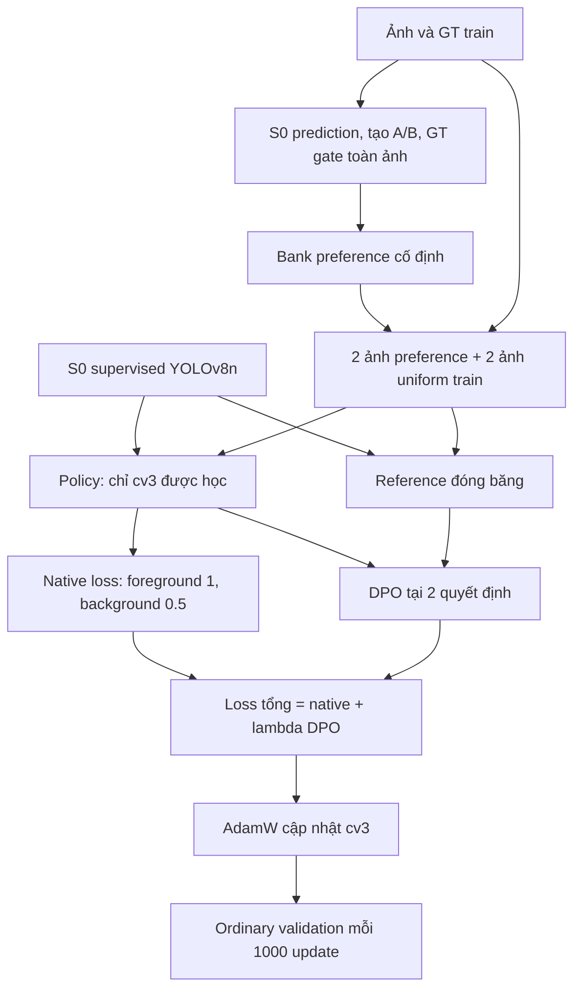

# BÁO CÁO KB2: TỐI ƯU YOLO BẰNG DIRECT PREFERENCE OPTIMIZATION

**Phạm vi:** từ quyết định chọn DPO làm hướng phát triển chính ngày 26/10/2026 đến kết quả xác nhận ba seed ngày 03/11/2026.  
**Mô hình thực nghiệm chính:** YOLOv8n, khởi tạo từ checkpoint supervised của KB1.  
**Phiên bản đang được đánh giá:** conditional keep/drop DPO, native background weighting 0,5, DPO λ = 0,1.  
**Trạng thái:** đã hoàn tất đối chứng native/DPO ở ba seed 42/43/44; kết quả trên validation, chưa đánh giá hiệu năng test.

## Tóm tắt

KB2 nghiên cứu việc chuyển ý tưởng học từ cặp ưu tiên của DPO sang bài toán phát hiện đối tượng. Với một ảnh và ground truth (GT), hệ thống xây dựng hai phương án detection A/B, xác định phương án tốt hơn bằng GT rồi tối ưu mô hình để ưu tiên quyết định đó so với mô hình tham chiếu cố định. Cả policy và reference đều bắt đầu từ S0: best checkpoint supervised tương ứng của KB1.

Quá trình phát triển đi từ lấy mẫu toàn bộ action detection, thay đổi bộ chấm F1/F2 và ưu tiên cặp khôi phục GT, đến thiết kế hiện tại: A/B chỉ khác quyết định giữ/bỏ một candidate; tác động vẫn được kiểm trên toàn ảnh sau NMS. Chỉ nhánh classification của YOLOv8n được cập nhật. Regression, backbone/neck và thống kê BatchNorm được giữ cố định. Native loss được dùng cùng DPO; phần classification tại các slot background được giảm hệ số xuống 0,5.

Qua ba seed, best DPO đạt mAP50–95 **38,1707 ± 0,0429%**, so S0 **37,8218%** và native-only **38,1196 ± 0,0608%**. DPO có mAP/AP50/AP75 cao hơn native ở cả ba seed; tại cùng 15.000 update, chênh mAP trung bình là **+0,1075 ± 0,0337 điểm phần trăm**. So S0, precision và F1 tăng nhưng recall tại confidence 0,25 giảm. Kết quả cho thấy lợi ích AP lặp lại theo seed trong điều kiện hiện tại, đồng thời còn hạn chế về class, object nhỏ và khả năng tổng quát hóa.

## 1. Mục tiêu và vị trí của KB2 trong đề tài

### 1.1. Quyết định phạm vi sau khi chốt hướng DPO

KB1, KB2 và KB3 là các hướng tối ưu độc lập. Liên hệ chung là sử dụng checkpoint supervised của KB1 làm mốc so sánh và điểm khởi đầu tương ứng từng kiến trúc. KB2 không tiếp tục từ checkpoint reward-guided của KB1 hoặc kết quả HPO của KB3.

Ý tưởng cốt lõi được chốt cho KB2 là: **trên cùng ảnh, tạo hai bộ prediction, dùng GT so chất lượng và học ưu tiên phương án tốt hơn**. Các nhánh sampling/hybrid/pairwise cũ trước quyết định này không còn là các hướng nghiên cứu chính của KB2. Báo cáo tập trung vào DPO và các chỉnh sửa phục vụ hướng đó.

Mục tiêu thực nghiệm là cải thiện chất lượng detector trên nhiều mặt: AP, precision, recall, F1, FP/FN và kết quả theo class/kích thước. Không yêu cầu mọi metric phải đồng thời tăng; mỗi kết quả cần ghi rõ lợi ích và đánh đổi. Cải thiện so S0 và lợi ích riêng khi thêm DPO là hai câu hỏi khác nhau.

### 1.2. Ba đối tượng so sánh

| Đối tượng | Vai trò | Cách hình thành |
|---|---|---|
| **S0 supervised** | Mốc ban đầu cố định | Best checkpoint supervised YOLOv8n của KB1 |
| **Native-only** | Đối chứng KB2 không DPO | Bắt đầu từ S0, dùng cùng pipeline KB2 và native loss đã giảm background; hệ số DPO thực tế bằng 0 |
| **Native + DPO** | Phương pháp KB2 đang đánh giá | Giống native-only nhưng thêmλ×DPO loss |

Native-only không phải một hướng nghiên cứu KB2 mới, cũng không phải chạy lại nguyên recipe supervised thông thường. Nó giữ cùng mask tham số, batch, optimizer, dữ liệu và ngân sách của KB2 để tách lợi ích của DPO khỏi lợi ích của việc tiếp tục train và giảm sức ép background.

## 2. Cơ sở lý thuyết

### 2.1. DPO và mô hình tham chiếu

DPO của Rafailov và cộng sự tối ưu trực tiếp cặp chosen/rejected so với reference cố định, xuất phát từ bài toán reward có điều chuẩn KL. Không cần huấn luyện một reward model riêng hoặc dùng PPO. Có thể gọi đây là hướng tối ưu preference có liên hệ với RLHF; không nên mô tả mọi update DPO là một bước policy-gradient RL. [DPO gốc](https://arxiv.org/abs/2305.18290).

Mốc lý thuyết là tối ưu reward trong khi hạn chế lệch khỏi reference:

$$
\max_\pi\;\mathbb E_{x\sim\mathcal D,\,y\sim\pi(\cdot\mid x)}[r(x,y)]
-\beta\,\mathbb E_{x\sim\mathcal D} D_{KL}\!\left(\pi(\cdot\mid x)\,\|\,\pi_{\mathrm{ref}}(\cdot\mid x)\right).
$$

Với input $x$, chosen $y_w$, rejected $y_l$, objective chuẩn có dạng:

$$
\mathcal L_{\mathrm{DPO}}
=-\mathbb E\log\sigma\!\left[
\beta\left(
\log\frac{\pi_\theta(y_w\mid x)}{\pi_{\mathrm{ref}}(y_w\mid x)}
-\log\frac{\pi_\theta(y_l\mid x)}{\pi_{\mathrm{ref}}(y_l\mid x)}
\right)\right].
$$

$\theta$ là tham số được học; $\pi_{\mathrm{ref}}$ đóng băng; $\beta>0$ điều khiển thang contrast trong objective. Khi policy và reference giống nhau, contrast bằng 0 và loss một cặp bằng $\log2$. Công thức và cách liên hệ với reward/KL được trình bày trong [bài báo DPO, mục 4](https://arxiv.org/html/2305.18290v3#S4).

### 2.2. Khó khăn khi chuyển sang object detection

Đầu ra LLM là chuỗi có thứ tự; detector trả một tập box/class/score và còn đi qua threshold, NMS, giới hạn số detection. YOLO thông thường không cung cấp sẵn likelihood của toàn bộ tập detection sau NMS. Do đó, không thể lấy trực tiếp mAP, confidence trung bình hoặc negative detection loss rồi mặc nhiên gọi đó là $\log\pi(y\mid x)$.

KB2 phải định nghĩa rõ ba thành phần riêng:

1. **Action:** mô hình đang lựa chọn điều gì?
2. **Policy probability:** xác suất chuẩn hóa của lựa chọn đó lấy từ đâu?
3. **Preference judge:** GT dùng quy tắc nào để chọn phương án tốt hơn?

Loss preference giảm chỉ chứng minh mô hình đang tối ưu objective đã định nghĩa. Nó chưa bảo đảm ordinary prediction sẽ tăng recall/AP, vì threshold/NMS và các candidate cạnh tranh có thể làm thay đổi đầu ra cuối.

### 2.3. Native detection loss

Native loss là hàm huấn luyện detector gốc theo GT. Với YOLOv8n đang dùng, có các phần box, classification và DFL. API Ultralytics tách head regression `cv2` và classification `cv3`; native criterion triển khai assignment và các thành phần detection loss. [Ultralytics Detect](https://docs.ultralytics.com/reference/nn/modules/head/#ultralytics.nn.modules.head.Detect), [v8DetectionLoss](https://docs.ultralytics.com/reference/utils/loss/#ultralytics.utils.loss.v8DetectionLoss).

Box loss đo sai lệch hình học với GT. Classification loss điều chỉnh điểm class tại các candidate theo native assignment. DFL học phân phối rời rạc của khoảng cách tới các cạnh box trước khi giải mã tọa độ; vì vậy lấy mẫu DFL bins ở thiết kế đầu khác với dùng box decode thông thường để đánh giá.

**Nguồn nghiên cứu của các thành phần native:**

- **Task-Aligned Assignment:** dòng nghiên cứu Task Alignment Learning được trình bày trong *TOOD: Task-Aligned One-Stage Object Detection* của Feng và cộng sự, ICCV2021. KB2 sử dụng `TaskAlignedAssigner` có sẵn trong Ultralytics để gán candidate cho GT bằng thông tin classification/localization; không tái triển khai toàn bộ kiến trúc TOOD. [Paper TOOD](https://arxiv.org/abs/2108.07755), [implementation Ultralytics](https://docs.ultralytics.com/reference/utils/tal/#ultralytics.utils.tal.TaskAlignedAssigner).
- **Distribution Focal Loss:** DFL có nguồn từ *Generalized Focal Loss: Learning Qualified and Distributed Bounding Boxes for Dense Object Detection* của Li và cộng sự,2020. Code `DFLoss` trong bản Ultralytics đang dùng dẫn trực tiếp paper này. KB2 kế thừa phần DFL/biểu diễn box qua YOLOv8; không có nghĩa đã sử dụng toàn bộ GFL hoặc Quality Focal Loss cho classification. [Paper GFL](https://arxiv.org/abs/2006.04388).
- **Complete IoU — CIoU:** native `BboxLoss` đang gọi `bbox_iou(..., CIoU=True)`. CIoU được giới thiệu trong nghiên cứu *Distance-IoU Loss: Faster and Better Learning for Bounding Box Regression* của Zheng và cộng sự, với các yếu tố overlap, khoảng cách tâm và tỉ lệ cạnh. Đây là box loss được kế thừa, không phải loss geometry mới của KB2. [Paper DIoU/CIoU](https://arxiv.org/abs/1911.08287).

Ở recipe hiện tại, regression đóng băng nên việc còn tính CIoU/DFL không phải bằng chứng KB2 đã học sửa box. Nguồn paper giải thích các thành phần nền tảng; mức đóng góp của DPO vẫn phải đo bằng đối chứng trong đề tài.

Trong KB2, native loss giúp tiếp tục học trên toàn bộ GT của các ảnh trong batch, còn DPO bổ sung tín hiệu ưu tiên trên những quyết định đã chọn. Vì GT cũng tạo preference, đây là **học preference tự động có giám sát bởi GT**, không phải học từ nhãn sở thích của con người.

## 3. Cách ánh xạ DPO vào YOLO

### 3.1. Bảng ánh xạ

| Thành phần DPO | Ánh xạ trong KB2 hiện tại |
|---|---|
| Input/prompt $x$ | Ảnh train sau resize/pad xác định |
| Policy $\pi_\theta$ | YOLOv8n được fine-tune, thông qua policy Bernoulli cho một quyết định candidate |
| Reference $\pi_{\mathrm{ref}}$ | Bản sao S0 đóng băng, chấm cùng ảnh và batch với policy |
| Action | Giữ hoặc bỏ candidate tại slot $j$, class $c$ |
| Hai response A/B | Hai bộ detection dựng từ cùng context, chỉ khác active-bit của candidate đang xét |
| Chosen/rejected | Phương án tốt/xấu hơn theo GT gate trên toàn ảnh sau NMS |
| Log-probability | Log-prob Bernoulli lấy từ raw class logit tại đúng slot/class |
| Preference dataset | Bank offline trên tập train; không dùng validation/test để sinh cặp |
| Học tham số | Backprop qua classification `cv3`, reference không nhận gradient |
| Đánh giá cuối | Ordinary deterministic YOLO inference, không cần GT hoặc GT judge lúc predict |

Context là cấu trúc phục vụ tạo/chấm cặp và replay, **không phải một input phụ đưa vào network**. Model vẫn nhận ảnh. Một đơn vị học có thể được ký hiệu $(x,C_0,j,c)$, nhưng $z_\theta$ thực tế được lấy từ forward ảnh tại $j,c$; $C_0$ dùng để kiểm hậu quả của quyết định trên toàn ảnh.

### 3.2. Từ class logit đến policy Bernoulli

Gọi $z_\theta(x)_{j,c}$ là raw class logit. Định nghĩa policy phụ:

$$
q_\theta(a=1)=\sigma(z_\theta),\qquad
q_\theta(a=0)=1-\sigma(z_\theta),
$$

trong đó $a=1$ là keep,$a=0$ là drop. Hai xác suất cộng bằng 1 nên đây là policy hợp lệ cho quyết định nhị phân đã định nghĩa.

Đặt $s=+1$ khi GT chọn keep,$s=-1$ khi chọn drop. Vì:

$$
\log q_\theta(1)-\log q_\theta(0)=z_\theta,
$$

contrast DPO của hai action đối nhau rút gọn thành:

$$
m=s(z_\theta-z_0),\qquad
\mathcal L_{\mathrm{DPO}}=\mathbb E\,\operatorname{softplus}(-\beta m),
$$

với $z_0$ lấy từ reference S0. Đây là công thức thực sự trong [conditional/policy.py](../../kb2_preference_optimization/conditional/policy.py), không phải log-probability suy ra từ điểm mAP.

Một cách đọc tương đương của **policy nhị phân hiện tại** là:

$$
\mathcal L_{\mathrm{DPO}}
=\operatorname{BCEWithLogits}\big(\beta(z_\theta-z_0),a_w\big),
$$

trong đó $a_w$ là quyết định chosen. Quan hệ này cho thấy thiết kế hiện tại gần với một objective phân loại preference có tâm theo reference. Nó không tự chứng minh DPO tốt hơn mọi dạng hard-example BCE; cần đối chứng phù hợp để kiểm điều đó.

### 3.3. Gradient đang dạy gì?

Với một quyết định:

$$
\frac{\partial\mathcal L_{\mathrm{DPO}}}{\partial z_\theta}
=-\beta s\,\sigma[-\beta s(z_\theta-z_0)].
$$

Nếu chosen là keep, riêng đạo hàm này khuyến khích tăng logit; nếu chosen là drop, nó khuyến khích giảm logit. Tuy nhiên update thực tế cộng gradient từ nhiều ảnh/candidate, native loss, AdamW và clipping. Vì tham số dùng chung, score ở một target không được bảo đảm tăng chỉ vì gradient riêng tại output đó có dấu đúng.

Đặc biệt,$q_\theta(keep)$ là xác suất của **action phụ đã định nghĩa**; nó không bằng xác suất box sẽ sống sót qua threshold, đổi argmax class và NMS của ordinary inference. Đây là lý do luôn phải đánh giá lại output thật.

## 4. Kiến trúc và luồng huấn luyện hiện tại

Với input 640×640, YOLOv8n đang dùng ba mức detection stride8/16/32: lưới80×80,40×40,20×20, tổng8.400 slot trước NMS. Mỗi slot có28 class logits và4×16 regression logits cho DFL (`reg_max=16`). Candidate trong bank gắn với một slot và class cụ thể, không phải một số thứ tự box sau NMS có thể thay đổi.

YOLOv8 dùng các class sigmoid riêng, không có objectness logit tách riêng như YOLOv5. Policy keep/drop hiện tại lấy một class logit trong số đó để định nghĩa Bernoulli; không biến toàn bộ28 class thành softmax C+1 ở phiên bản conditional này.



Không thêm reward model hoặc một detection head mới. Backbone/neck, regression `cv2`, DFL integral và BN running statistics giữ cố định; 24 parameter tensors của classification `cv3` được mở học. BN ở chế độ eval để không làm thay đổi buffer trong forward native.

Giữ geometry cố định giúp tách câu hỏi ban đầu: **có thể học quyết định giữ/bỏ tốt hơn bằng tín hiệu preference hay không?** Đổi lại, KB2 hiện chưa trực tiếp học chỉnh tọa độ. Box/DFL vẫn được tính theo criterion; các phần này không cập nhật regression khi nhánh đó đóng băng. Giá trị loss có thể thay đổi do native assignment được tính lại, nhưng không đồng nghĩa box regression đã học.

## 5. Sinh hai bộ detection và dùng GT chọn preference

### 5.1. A/B không đến từ gọi predict hai lần

Với cùng ảnh, weights và recipe inference xác định, gọi predict hai lần không tạo một nguồn đa dạng A/B chủ động. Phiên bản đầu đã thử lấy mẫu class/background/DFL để sinh output khác nhau. Phiên bản hiện tại tạo **hai phương án can thiệp vào cùng một candidate**:

```text
Context C: cùng box, class, score S0 và trạng thái candidate của ảnh
A: giữ candidate j + phần còn lại của C
B: bỏ candidate j + phần còn lại của C
→ chạy NMS/cap toàn ảnh cho từng phương án
→ đối chiếu với GT để quyết định chosen/rejected
```

“Phần dùng chung” không có nghĩa là các prediction đó đều đúng, cũng không có nghĩa mỗi lá là một phần riêng được cố định vĩnh viễn. Nó chỉ bảo đảm A/B có cùng điều kiện trước NMS ngoài đúng một active-bit đang xét. Một ảnh nhiều lá có thể tạo nhiều quyết định riêng, mỗi quyết định đều phải kiểm hậu quả lên các lá khác.

Candidate và box lấy từ S0. GT được dùng offline để xác định GT bỏ sót, lọc proposal theo class/IoU và chấm cặp; GT không sinh box mới, không thay box dự đoán, không sửa score để giả lập model tốt hơn. Model không nhận GT ở ordinary inference.

### 5.2. Bốn nhóm quyết định

| Nhóm | Đối tượng | Preference cần học |
|---|---|---|
| **Recovery** | GT bị ordinary S0 bỏ sót, có candidate đúng class/đủ IoU nhưng score thấp | Keep phải cứu đúng GT, không mất GT khác và không tăng FP |
| **Preservation** | Candidate đang giúp S0 phát hiện GT | Keep phải có đóng góp thật; bỏ candidate phải làm mất GT mục tiêu |
| **Background** | Candidate FP xa mọi GT, tâm không nằm trong GT | Drop phải giảm FP, giữ mọi GT đang phát hiện |
| **Duplicate** | Candidate dư thừa cho một GT đã phát hiện | Drop phải thực sự giảm FP mà không mất GT |

Không tự coi mọi prediction không match là background: sai class, localization chưa đủ hoặc box nằm trong lá có thể là trường hợp nhập nhằng, cần loại khỏi negative-background đơn giản.

**Nghiên cứu liên quan về chọn mẫu khó:** *Training Region-Based Object Detectors With Online Hard Example Mining* của Shrivastava, Gupta và Girshick, CVPR2016, nghiên cứu tập trung huấn luyện vào các ví dụ khó thay vì để số lượng lớn ví dụ dễ chi phối. [Paper OHEM](https://openaccess.thecvf.com/content_cvpr_2016/papers/Shrivastava_Training_Region-Based_Object_CVPR_2016_paper.pdf). Đây là tài liệu đối chiếu cho động cơ chọn quyết định cần học. KB2 hiện không triển khai OHEM: bank được tạo offline từ S0 và GT gate, sau đó lấy mẫu có cân bằng; không chọn online các RoI có loss lớn theo thuật toán của paper. Bốn nhóm recovery/preservation/background/duplicate và quy tắc chấm toàn ảnh là thiết kế của KB2.

### 5.3. Gate toàn ảnh

Gọi $G_w,G_l$ là tập GT ID matched của chosen/rejected và $FP_w,FP_l$ là số FP sau NMS. Điều kiện chung:

$$G_l\subseteq G_w,\qquad FP_w\le FP_l.$$

Keep còn cần GT mục tiêu thuộc $G_w\setminus G_l$; drop còn cần $FP_w<FP_l$. Matching dùng đúng class, một-một, confidence-ordered greedy tại IoU 0,5. So cả tập ID giúp tránh trường hợp cứu một lá nhưng làm mất lá khác trong cùng ảnh.

**Ví dụ minh họa, không phải số đo thực nghiệm:** ảnh có 8GT. Bỏ candidate $j$ cho5TP/2FP; giữ nó cho6TP/2FP và giữ nguyên5GT cũ: keep có thể được nhận. Nếu giữ $j$ cứu lá6 nhưng làm mất lá3 qua NMS, gate loại dù tổng TP không đổi hoặc điểm cục bộ tốt hơn.

Trong recovery, renderer cho candidate score dưới 0,25 được tham gia phương án keep để kiểm “nếu được phát ra thì có ích không”. Score S0 vẫn giữ nguyên, không được nâng lên 0,25. GT judge chấm cấu trúc output đã render; evaluator chính sau train vẫn áp dụng threshold thật. Vì vậy, cặp keep hợp lệ **không bảo đảm** model sẽ nâng candidate qua ngưỡng sau huấn luyện.

### 5.4. Preference bank và cân bằng class

Full train có 2.411 ảnh/10.333GT; S0 còn bỏ sót544GT tại protocol train này. Bank hiện tại có:

| Nhóm | Tổng cặp | Cặp DPO train | Cặp probe thuộc train |
|---|---:|---:|---:|
| Recovery | 296 | 263 | 33 |
| Preservation | 91 | 77 | 14 |
| Background | 353 | 292 | 61 |
| Duplicate | 44 | 31 | 13 |
| **Tổng** | **784** | **663** | **121** |

Cặp nằm trên 435 ảnh; 378 ảnh có cặp DPO train. Có 1.976 ảnh không có cặp qua gate nhưng vẫn có cơ hội đi vào native uniform stream. Sampler cân bằng keep/drop, nhóm lỗi, class và GT; trộn50% trọng số theo tần suất cặp với 50% theo class/target, sau đó chặn xác suất mỗi ảnh tối đa $5/378\approx1,323\%$ cho mỗi lần lấy mẫu.

Đây là giới hạn xác suất kỳ vọng, không phải số lần lặp cứng hoặc bảo đảm gradient bằng nhau giữa class. DPO train có 27/28 class; class 9 Corn rust leaf không có cặp DPO train. Native vẫn dùng ảnh/GT toàn tập train. Probe bị loại khỏi DPO vẫn có thể đi vào native và đã được S0 học, nên không phải holdout độc lập.

**Nghiên cứu liên quan về cân bằng class:** *Class-Balanced Loss Based on Effective Number of Samples* của Cui và cộng sự, CVPR2019, đề xuất reweighting theo số mẫu hiệu dụng để xử lý phân bố lệch class. [Paper Class-Balanced Loss](https://openaccess.thecvf.com/content_CVPR_2019/html/Cui_Class-Balanced_Loss_Based_on_Effective_Number_of_Samples_CVPR_2019_paper.html). Nghiên cứu này phù hợp để thảo luận vì sao số lượng mẫu và độ phủ class cần được kiểm soát, nhưng sampler KB2 không dùng công thức effective number của paper. Mixture class/GT 0,5 và cap ảnh 5/N là lựa chọn riêng được ghi trong manifest, chưa có nguồn paper chứng minh hai giá trị đó tối ưu.

“GT bị bỏ sót” ở đây là **GT có annotation nhưng detector không phát hiện**, khác với object chưa được gán nhãn. Không thay ảnh hoặc annotation để tạo kết quả mới. GT judge vẫn phụ thuộc chất lượng annotation hiện có, không giải quyết tự động mọi nhãn thiếu.

## 6. Native loss, DPO loss và chỉnh background

### 6.1. Objective tổng

$$
\mathcal L_{\mathrm{total}}
=\mathcal L_{\mathrm{native},\alpha_{bg}}
+\lambda\mathcal L_{\mathrm{DPO}}.
$$

Trong cấu hình xác nhận:$\alpha_{bg}=0,5$, $\lambda=0,1$, $\beta=0,1$. Hệ số native là 1. Native-only có cùng công thức nhưng hệ số DPO thực tế bằng 0.

Với $F$ là các slot được native assigner gán foreground,$B$ là slot còn lại, và $t_{jc}$ là soft target native:

$$
\mathcal L_{cls}^{(\alpha)}
=\frac{g_{cls}}{\max(\sum_{j,c}t_{jc},1)}
\left[
\sum_{j\in F,c}\operatorname{BCE}(z_{jc},t_{jc})
+\alpha_{bg}\sum_{j\in B,c}\operatorname{BCE}(z_{jc},t_{jc})
\right].
$$

Công thức thể hiện phần mask background; class weighting nếu có vẫn theo criterion. Assignment, soft target, mẫu số, box/DFL và các gain khác không bị thay thế. Tại slot foreground, cả class đúng lẫn các class có target0 đều giữ trọng số1. **Không nhân0,5 vào mọi phần tử target0**, vì như vậy sẽ làm thay đổi cả tín hiệu class tại foreground.

Mặt nạ foreground được lấy trực tiếp từ native `TaskAlignedAssigner` đã giới thiệu ở mục2.3, không suy từ danh sách TP sau NMS của GT judge. Native assignment có thể gán nhiều slot cho một GT, còn matching để chấm A/B và tính TP/FN ở điểm vận hành là một-một. Hai phép gán phục vụ hai vai trò khác nhau và không được tráo đổi khi giảm background.

### 6.2. Vì sao giảm background?

Audit gradient tìm thấy các recovery candidate đã được native assigner gán foreground đúng GT; riêng term của chúng muốn tăng score. Tuy nhiên gradient từ nhiều background slot, thông qua tham số classification dùng chung, có thể tạo hướng giảm score mạnh hơn. Vì vậy, không thể quy mọi score giảm cho việc GT bị gán sai background hoặc cho lỗi dấu của DPO.

Giảm $\alpha_{bg}$ nhằm bớt sức ép này trong khi giữ native positive. Kiểm thử tại cùng batch/S0 cho thấy $\alpha=1$ khớp loss và gradient bản gốc; $\alpha=0,5$ giữ phần foreground và giảm phần background một nửa. Đây là kiểm cơ chế trên batch cố định, không bảo đảm assignment/positive set bất biến sau nhiều update. [Audit gradient](KB2_CONDITIONAL_GRADIENT_AUDIT_20261031.md), [đối chứng background](KB2_NATIVE_BACKGROUND_PILOT_20261031.md).

**Liên hệ với nghiên cứu foreground/background imbalance:** *Focal Loss for Dense Object Detection* của Lin và cộng sự, ICCV2017, chỉ ra tác động của số lượng lớn ví dụ nền dễ trong dense detection và giảm đóng góp của ví dụ dễ bằng trọng số phụ thuộc độ khó. [Paper Focal Loss](https://openaccess.thecvf.com/content_iccv_2017/html/Lin_Focal_Loss_for_ICCV_2017_paper.html).

Focal Loss có dạng cơ bản $\operatorname{FL}(p_t)=-(1-p_t)^\gamma\log p_t$, trong đó trọng số thay đổi theo dự đoán. KB2 hiện vẫn dùng BCE và nhân một hệ số cố định 0,5 cho mọi slot **không được native assigner gán foreground**, giữ hệ số 1 tại foreground. Hai cách cùng liên quan đến mất cân bằng nền/object nhưng không tương đương. Vì vậy, Focal Loss là nghiên cứu liên quan để giải thích vấn đề, không phải nguồn trực tiếp của công thức background 0,5; giá trị này đến từ audit và đối chứng của KB2.

### 6.3. Vì sao còn native khi đã dùng DPO?

Bank chỉ phủ một phần ảnh, class và kiểu lỗi. Native học toàn bộ GT của 4 ảnh trong batch, bổ sung tín hiệu ngoài2 quyết định DPO. Bỏ native sẽ là một thiết kế khác chưa được xác nhận ở các run này. Ngược lại, giữ native không có nghĩa mọi cải thiện đều do DPO; đó là lý do cần native-only cùng điều kiện.

Reference trong DPO tạo contrast theo S0, nhưng objective hiện tại không trực tiếp cộng một KL của toàn detector. Không suy từ công thức DPO rằng detector được bảo đảm giữ toàn bộ kiến thức S0 hoặc không thể overfit.

## 7. Những chỉnh sửa từ khi chốt hướng DPO

Các hàng dưới ghi quá trình phát triển, không phải các ablation chỉ khác một biến. Đặc biệt, recipe whole-action trước31/10 và conditional hiện tại khác action space, mask tham số và precision; không xếp hạng trực tiếp mọi con số lịch sử như cùng một thí nghiệm.

| Giai đoạn | Vấn đề/câu hỏi | Chỉnh sửa và bài học |
|---|---|---|
| 26/10: thiết kế lại whole-action | Cần đưa preference về hai output detection trên cùng ảnh | Policy class/background và DFL bins; GT chấm toàn output bằng F1 và GT-normalized IoU. Không còn lấy nhánh feedback/pairwise cũ làm hướng chính |
| 26/10: reference same-batch | Cache reference batch 1 và policy batch 4 có lệch số học, margin khác0 dù cùng weights | Forward policy/reference trên cùng tensor/batch; reference no-grad. Cache chỉ dùng replay/diagnostic |
| 26–28/10: train dài và F2 scorer | FP giảm nhưng FN tăng; có thể bộ chấm F1 chưa ưu tiên recall đủ | Thay F1 bằng F2 trong quality score, chạy ba seed. Recall chỉ tăng trung bình0,0353 điểm %, mAP giảm 0,0162 điểm so F1; chưa giải quyết bỏ sót |
| 29–30/10: chọn/cân bằng recovery pair | Muốn tăng cơ hội học từ cặp khôi phục GT, cân bằng class | Đã chạy dài, sau đó audit tại GT. Trong 328GT “được chosen cứu so rejected”,170GT vốn đã được ordinary S0 phát hiện. Recovery giữa hai action không đồng nghĩa cứu FN thực tế |
| 30/10: audit margin/score/box | Vì sao preference margin tăng nhưng ordinary recall không tăng? | Score tại nhiều GT cần cứu vẫn giảm; margin có thể cải thiện nhờ các slot khác. Chuyển sang local decision với phần chung có kiểm soát |
| 31/10: conditional keep/drop V0 | Cần gắn tín hiệu DPO vào quyết định có ý nghĩa trực tiếp hơn | A/B chỉ khác một candidate; gate toàn ảnh; chỉ train classification, giữ geometry cố định; native có stream uniform toàn train |
| 31/10: audit native gradient | Có phải DPO sai dấu hay target bị native coi là background? | Không thấy lỗi đó ở recovery đã audit; gradient tổng và tương tác qua tham số dùng chung mới là điểm cần kiểm |
| 31/10: background 0,5 | Kiểm giảm sức ép nền mà giữ native positive | Đối chứng2×2 background 1/0,5 × native/DPO; pilot rồi15k. Giảm mất GT đáng kể so recipe background 1, nhưng DPO λ = 0,01 gần native |
| 01/11: sweepλ và selector | DPO λ = 0,01 quá yếu so native; recall gate khiến best luôn là S0 | Pilotλ = 0/0,01/0,03/0,1. Chọn best_AP, lưu mọi checkpoint eval; không dùng recall gate cho thí nghiệm mới |
| 01/11: audit candidate swap | Có thể ưu tiên box khít hơn trong các box S0 đã có? | Gate chất lượng chặt chỉ cho20 cặp/15 train; xét hết proposal chỉ 28/22 train. Chưa train nhánh này vì độ phủ thấp |
| 01–03/11: xác nhận dài | Pilot 2k không đủ đánh giá lợi ích cuối quỹ đạo | DPO λ = 0,1 chạy15k; sau đó chạy mới native/DPO cho cả ba seed. AP cải thiện lặp lại theo seed, cùng một recipe |

### 7.1. Bản sửa same-batch là sửa sai lệch tính toán

Pilot reference ban đầu có initial margin−0,01383268 và DPO loss0,69383968; sau sửa, margin bằng 0 và loss0,69314718. Preference pairs giữ nguyên. Điều này khôi phục điều kiện đúng ở khởi tạo, không tự chứng minh model tốt hơn sau train. Bản hiện tại còn kiểm reference/frozen state và raw box replay. [Chi tiết bản sửa](KB2_REFERENCE_BATCH_FIX_20261026.md).

### 7.2. Vì sao không chỉ tiếp tục tăng cân bằng recovery?

Scorer whole-action từng dùng:

$$
Q(Y,GT)=0,8\,\operatorname{mean}_{t=0,50:0,05:0,95}F_1(t)
+0,2\frac{\sum\operatorname{IoU}_{matched@0,5}}{N_{GT}}.
$$

Biến thể F2 thay $F_1$ bằng $F_2=5TP/(5TP+4FN+FP)$. Dù nhấn mạnh FN hơn, chosen/rejected vẫn có thể khác ở nhiều slot; loss tổng có thể tối ưu các khác biệt dễ hơn thay vì score tại GT thực sự bị S0 bỏ sót. Audit recovery-long trên 143GT train thực sự bị S0 bỏ sót cho thấy mean score tại slot nguồn0,149083→0,125160 ở best14k; chỉ 10/143GT được ordinary predict phát hiện. Đây là cơ sở đổi đơn vị học, không chỉ đổi trọng số scorer. [F2](KB2_F2_EXPERIMENT_20261028.md), [audit GT](KB2_DPO_GT_ALIGNMENT_AUDIT_20261030.md).

### 7.3. Bằng chứng thực nghiệm cho các chỉnh sửa gần nhất

Các hàng sau cùng conditional protocol, seed 42, checkpoint15k và cùng S0 mới37,8218%; không phải so best khác step:

| Recipe DPO | Background | λ | mAP (%) | Precision (%) | Recall (%) | FP | FN |
|---|---:|---:|---:|---:|---:|---:|---:|
| Conditional V0 | 1 | 0,01 | 38,0096 | 57,0836 | 51,0334 | 724 | 924 |
| Giảm native background | 0,5 | 0,01 | 38,0072 | 53,1881 | 53,0472 | 881 | 886 |
| Tăng sức mạnh DPO | 0,5 | 0,1 | **38,1254** | 53,1599 | 53,0472 | 882 | 886 |

Giảm background làm recall tăng mạnh so recipe trước, đồng thời FP tăng so recipe trước nhưng vẫn thấp hơn S0. Tăngλ tạo thêm lợi thế AP, chưa tạo thêm lợi thế FN tại 0,25 trong seed 42. Các số này không chứng minh từng thay đổi là tối ưu toàn cục.

## 8. Các tham số đã chọn và cơ sở lựa chọn

Phân biệt **tham số có đối chứng trực tiếp**, **giá trị khởi đầu có lý do kỹ thuật**, và **quy tắc đánh giá được cố định**. Không có một cuộc tìm kiếm đầy đủ chứng minh mọi giá trị trong bảng là tốt nhất.

### 8.1. Model, optimizer và ngân sách

| Tham số | Giá trị | Vì sao chọn / giới hạn |
|---|---|---|
| Model | YOLOv8n | Có S0 verified; model nhỏ phù hợp thử nghiệm nhanh trên GPU laptop. Chưa so tối ưu DPO giữa mọi kiến trúc |
| Điểm bắt đầu | Best supervised KB1 của YOLOv8n | Cùng năng lực khởi đầu và mốc so sánh; tránh huấn luyện lại từ COCO làm thay đổi câu hỏi nghiên cứu |
| Tham số được học | Classification `cv3` | Tập trung kiểm keep/drop/confidence, tránh đồng thời đổi geometry; giới hạn khả năng sửa box/class phức tạp |
| Input | 640×640 | Giữ transform/canonical protocol: resize cạnh dài, pad114, normalize. Chưa sweep resolution |
| Optimizer | AdamW | Giữ nhất quán các lượt đối chứng; chưa chứng minh tốt hơn SGD/MuSGD cho KB2 |
| Learning rate | 1e-6 | Fine-tune thận trọng từ S0 đã học tốt; giữ cố định để tách ảnh hưởng của preference. Chưa có LR sweep đầy đủ |
| Weight decay | 5e-4 | Kế thừa recipe đối chứng, không tuning riêng cho DPO |
| Clip norm | 1 | Hạn chế norm gradient trước optimizer khi loss có gradient lớn; AdamW/clipping khiến norm loss không bằng mức ảnh hưởng thực tế |
| Native batch | 4 ảnh | 2 uniform toàn train +2 ảnh preference; có GT coverage ngoài bank và phù hợp ngân sách GPU |
| DPO batch | 2 quyết định/update | Đúng2 pair records đi kèm2 ảnh preference; không có nghĩa mỗi update chỉ học2 ảnh vì native dùng cả 4 |
| Steps | 15.000/arm | Từ pilot 2k chuyển sang quỹ đạo dài để quan sát thay đổi muộn. Chưa phải chứng minh hội tụ hoặc ngân sách tối ưu |
| Seeds | 42,43,44 | Ba lần lặp stochastic fine-tuning có đối chứng ghép seed; không có ý nghĩa đặc biệt cho các con số seed và không thay cho lặp dữ liệu/S0 |
| Numerics | FP32, TF32 off; BN stats frozen | Nhất quán generation/replay/policy/reference, hạn chế tín hiệu giả do số học; không tối ưu tốc độ bằng mixed precision trong run này |
| Augmentation khi fine-tune | Resize/pad xác định | Pair slot/box được cache; biến đổi ngẫu nhiên mà không ánh xạ lại sẽ làm cặp sai. Ảnh train gốc có thể đã chứa augmentation từ trước |

Mỗi arm15k có 30.000 lượt rút pair từ 663 cặp train, có lặp và có weighting; không phải30.000 cặp độc lập mới. Không diễn giải số step thành số epoch uniform chính xác vì nửa batch native được lấy theo preference. Checkpoint lưu optimizer/RNG nhưng trainer hiện đánh dấu không hỗ trợ exact resume; các run đều bắt đầu mới từ S0.

**Nguồn của optimizer:** AdamW dựa trên *Decoupled Weight Decay Regularization* của Loshchilov và Hutter, ICLR2019, tách weight decay khỏi bước cập nhật theo gradient của Adam. [Paper AdamW](https://arxiv.org/abs/1711.05101). KB2 dùng implementation `torch.optim.AdamW`; đây là lựa chọn optimizer có nền tảng nghiên cứu, nhưng paper không xác lập LR1e-6, weight decay5e-4 hoặc clip norm1 là tối ưu cho bài toán này. Các giá trị cụ thể vẫn thuộc cấu hình thực nghiệm cần đối chứng.

### 8.2. Hệ số loss và selector

| Tham số | Giá trị | Cơ sở chọn |
|---|---|---|
| Native coefficient | 1 | Giữ objective GT làm tín hiệu nền trong khi đo phần thêm của DPO; chưa ablate bỏ native |
| Background $\alpha_{bg}$ | 0,5 | Đã đối chứng với 1 trong pilot 2×2 rồi xác nhận dài. Giảm mất GT so recipe cũ. Chưa sweep0,25/0,75 hoặc lịch thay đổiα |
| DPO $\beta$ | 0,1 | Giá trị khởi đầu cố định cho contrast; chưa sweepβ. Không nhầm với hệ sốλ hoặc hệ số recall trong F2 |
| DPO $\lambda$ | 0,1 | Đã pilot 0/0,01/0,03/0,1 và theo dõi gradient; λ = 0,1 cho ảnh hưởng lớn hơn nên được kiểm dài. Đây là lựa chọn phát triển trên validation, không phải best đã chứng minh trên test |
| Eval interval | 1.000 update | Theo dõi đủ quá trình với chi phí hợp lý; best chỉ là best trong các mốc đã đo |
| Chọn best | mAP50–95 tăng hơn best hiện tại 1e-4 | Tương ứng0,01 điểm %. Có step 0/S0, không recall gate; dùng cùng quy tắc cho native/DPO, lưu mọi mốc để phân tích trade-off |
| Pareto diagnostic | mAP/P/R | Giữ các lựa chọn không bị trội đồng thời trên ba metric này; không coi đây là tổng điểm thay cho tất cả metric |

Ở pilot seed 42, mean norm(weighted DPO)/norm(native) xấp xỉ1,34%/4,01%/13,38% choλ = 0,01/0,03/0,1. Ở lượt dàiλ = 0,1 seed 42, mean qua 151 điểm diagnostic khoảng 16,67%. Vì vậy không thể nóiλ = 0,1 có nghĩa chính xác10% cập nhật là DPO. Pilot 2k cũng chưa cho thấyλ = 0,1 vượt native rõ; lợi thế AP cuối run là kết quả phải kiểm bằng 15k và nhiều seed. [Pilot hệ số DPO](KB2_DPO_STRENGTH_PILOT_20261101.md).

Việc bỏ recall gate là thay đổi **quy tắc lựa chọn cho các thí nghiệm mới**, phù hợp mục tiêu cải thiện nhiều metric. Nó không sửa ngược kết quả cũ. Trong các run cũ, `best.pt` có thể vẫn là S0 dù `last.pt` đã được train và AP tăng; cần đọc step/manifest thay vì chỉ nhìn tên file.

### 8.3. Tham số tạo/chấm cặp

| Tham số | Giá trị | Ý nghĩa và lý do |
|---|---:|---|
| Ordinary operating confidence | 0,25 | Xác định S0 đang phát hiện/bỏ sót gì ở điểm vận hành đã khóa; không phải ngưỡng tối ưu cho mọi model |
| Recovery proposal score tối thiểu | 0,05 | Tìm box có sẵn nhưng confidence chưa đủ, tránh lấy toàn bộ candidate rất yếu |
| Recovery IoU tối thiểu | 0,60 | Cần geometry tương đối tốt trước khi yêu cầu tăng confidence; chặt hơn IoU match0,5 |
| Class của recovery | Argmax S0 phải đúng class GT | Tách bài toán confidence khỏi sửa class; đổi lại không cứu được lỗi class sai bằng bank hiện tại |
| Background IoU tối đa | 0,10 với mọi GT, tâm ngoài mọi GT | Lọc negative rõ hơn, tránh phạt trực tiếp candidate bên trong lá hoặc gần GT chỉ vì chưa match |
| Whole-image match IoU | 0,50 | Cùng nghĩa TP/FN tại điểm vận hành; gate bảo vệ tập GT ID |
| NMS IoU / max_det | 0,60 /300 | Giữ canonical output contract của các đối chứng; không tuning riêng cho DPO |
| Recovery attempts | Tối đa3/GT | Giới hạn chi phí; chỉ nhận tối đa một recovery pair/GT qua gate |
| Pair cap | Tối đa4/nhóm/ảnh | Tránh ảnh nhiều candidate lấn át bank; không phải giới hạn tổng4 cặp/ảnh |
| Class/target mix | 0,5 | Trộn weighting theo tần suất với cân bằng class/GT; chặn việc ép quá mạnh nhóm rất hiếm |
| Image exposure cap | 5/N ảnh có cặp train | Giới hạn xác suất kỳ vọng tập trung vào một ảnh, giữ coverage giữa các ảnh |

Các ngưỡng proposal/gate là lựa chọn thiết kế bảo thủ đã được audit, chưa được chứng minh tối ưu bằng sweep. Không hạ gate sau khi thấy ít cặp chỉ để tăng số lượng; muốn đổi cần tạo một phiên bản bank mới và đánh giá lại.

**Phân định nguồn của thiết kế:** keep/drop với context chung, gate bảo vệ GT sau NMS, bốn nhóm quyết định, mask chỉ train `cv3` và các hệ số/ngưỡng cụ thể là các lựa chọn triển khai của KB2 trong chuỗi thí nghiệm này. Những paper về mất cân bằng/chọn mẫu giúp đặt vấn đề trong bối cảnh nghiên cứu trước, nhưng không phải bằng chứng rằng đã triển khai nguyên thuật toán của các paper đó hoặc rằng tổ hợp tham số hiện tại được chúng bảo đảm tối ưu.

## 9. Dữ liệu, protocol và metric

### 9.1. Dữ liệu và provenance

| Split | Ảnh | GT / vai trò |
|---|---:|---|
| Train | 2.411 | 10.333GT; sinh preference và native learning |
| Validation | 479 | 1.887GT,28 class; chọn tham số/checkpoint và phân tích |
| Test | 239 | Chưa đánh giá hiệu năng trong chuỗi thí nghiệm này |

Source S0: `kb1_reward_guided_training/checkpoint_based/yolov8n/weights/best.pt`. SHA256: `9a7ce8d2710b94453da2add079d3b3635fb2a9f9ae1078fbe260428a67c969f9`.

Manifest lưu hash S0, ảnh/nhãn, code, bank/context/pairs, transform và runtime. Việc so source ID theo quy tắc hiện có không thay thế kiểm chứng độc lập mọi quan hệ gần trùng giữa ảnh hoặc nguồn pretrained. Không sửa annotation và không tạo preference từ validation/test.

Runtime chính: PyTorch 2.5.1+cu121, Ultralytics 8.4.163, TorchMetrics 1.9.0, faster-coco-eval1.7.2; GPU RTX4060 Laptop. Tài liệu Ultralytics online có thể thay đổi; kết quả thực nghiệm gắn với **bản cài và code hash trong manifest**, không mặc nhiên là mọi phiên bản mới nhất.

### 9.2. Hai lớp đánh giá cần tách biệt

| Nhóm metric | Protocol và câu hỏi |
|---|---|
| mAP50–95, AP50, AP75 | Predictions giữ từ confidence 0,001, NMS0,6/cap 300; đánh giá chất lượng ranking và localization ở các mức IoU |
| Precision/recall/F1, TP/FP/FN | Confidence 0,25, IoU match0,5; detector đang vận hành thế nào tại một threshold cố định? |
| Macro recall/F1 | Tính theo class rồi trung bình; bổ sung góc nhìn khi support không đồng đều |
| AP small/medium/large | Theo diện tích GT trong hệ tọa độ ảnh đã transform, ngưỡng32²/96²; kèm support94/577/1.216GT validation |
| AR300 | Average recall với tối đa300 detection, không phải recall tại confidence 0,25 |
| GT recovered/lost | Cứu GT S0 bỏ sót hay làm mất GT S0 đã phát hiện; so đúng GT ID |
| Matched IoU và coverage | Kiểm geometry của subset được match; matcher hình học max-cardinality/IoU được ghi riêng, không đồng nhất với matcher operating |
| Cùng FP984 | Quét cutoff global chính xác theo score/ties trên validation; diagnostic phân biệt thay đổi điểm vận hành, không thay kết quả threshold chính |

**Nguồn của protocol AP/AR:** [COCO evaluator chính thức](https://github.com/cocodataset/cocoapi/blob/master/PythonAPI/pycocotools/cocoeval.py) định nghĩa phép đánh giá theo dải IoU0,50:0,05:0,95, nhiều mức recall và nhóm diện tích object. KB2 sử dụng đánh giá COCO-style thông qua TorchMetrics/faster-coco-eval, đồng thời đặt giới hạn detection ở300 và báo AR300. Mặc định COCO có maxDets100; vì vậy phải giữ cùng cấu hình300 khi so S0/native/DPO, không gọi đây là toàn bộ protocol COCO mặc định. Các số P/R/F1 tại confidence0,25 và bảng cùngFP984 là phép đo vận hành/diagnostic được bổ sung riêng của thí nghiệm KB2.

Với ordinary matching:$P=TP/(TP+FP)$,$R=TP/(TP+FN)$,$F_1=2PR/(P+R)$. Precision/FP và recall/FN liên hệ trực tiếp; không đếm chúng như các bằng chứng độc lập để tạo một tổng điểm tùy ý.

Mean±SD giữa các seed dùng **độ lệch chuẩn mẫu, ddof=1, n=3**. Delta DPO−native được tính theo từng seed trước khi lấy mean/SD. Ba seed là ba quỹ đạo fine-tune từ một S0/bank, không phải hàng chục phép lặp độc lập từ mọi checkpoint eval.

## 10. Kết quả YOLOv8n

### 10.1. Thiết kế xác nhận ba seed

Root: `kb2_preference_optimization/outputs/yolov8n_strength_long_3seeds_20261103_095853_370249/`.

Mỗi seed 42/43/44 có `native/` và `dpo/`, mỗi arm15.000 update; tổng6 lượt mới. Cả 6 dùng cùng trainer, selector và cấu hình; trong mỗi seed, native/DPO có toàn bộ stream ảnh/pair giống nhau. Reference/policy đều khởi tạo lại từ S0; không resume pilot hoặc best của lượt trước.

### 10.2. Best checkpoint từng lượt

AP/P/R/F1 tính theo%; FP/FN dùng confidence 0,25. Native và DPO chọn best độc lập bằng cùng quy tắc nên step có thể khác nhau.

| Seed | Model | Best step | mAP50–95 | AP50 | AP75 | Precision | Recall | F1 | FP | FN |
|---|---|---:|---:|---:|---:|---:|---:|---:|---:|---:|
| — | S0 | 0 | 37,8218 | 49,1225 | 42,9680 | 50,9227 | 54,1070 | 52,4666 | 984 | 866 |
| 42 | Native | 1.000 | 38,0625 | 49,3843 | 43,2058 | 51,2355 | 53,8421 | 52,5065 | 967 | 871 |
| 42 | DPO | 12.000 | **38,1363** | 49,5543 | 43,2303 | 53,0063 | 53,2591 | 53,1324 | 891 | 882 |
| 43 | Native | 12.000 | 38,1835 | 49,5626 | 43,3513 | 53,1599 | 53,0472 | 53,1034 | 882 | 886 |
| 43 | DPO | 15.000 | **38,2187** | 49,6316 | 43,4666 | 53,3298 | 53,0472 | 53,1881 | 876 | 886 |
| 44 | Native | 13.000 | 38,1128 | 49,4829 | 43,2382 | 53,1915 | 52,9942 | 53,0926 | 880 | 887 |
| 44 | DPO | 15.000 | **38,1570** | 49,5567 | 43,3754 | 53,1383 | 52,9412 | 53,0396 | 881 | 888 |

Best DPO hơn best native về mAP lần lượt **+0,0738/+0,0353/+0,0441 điểm %**. Cảba seed có AP50 và AP75 tăng. Riêng seed 44, DPO có precision/F1 thấp hơn native và FP/FN đều tăng 1; không có ưu thế đồng thời trên mọi metric.


### 10.3. Tổng hợp best qua ba seed

| Metric | S0 | Native mean±SD | DPO mean±SD | Mean DPO−S0 |
|---|---:|---:|---:|---:|
| mAP50–95 (%) | 37,8218 | 38,1196±0,0608 | **38,1707±0,0429** | **+0,3489 điểm %** |
| AP50 (%) | 49,1225 | 49,4766±0,0893 | **49,5809±0,0439** | +0,4583 điểm % |
| AP75 (%) | 42,9680 | 43,2651±0,0764 | **43,3574±0,1191** | +0,3894 điểm % |
| Precision (%) | 50,9227 | 52,5289±1,1203 | **53,1581±0,1626** | +2,2354 điểm % |
| Recall (%) | 54,1070 | 53,2945±0,4750 | 53,0825±0,1619 | −1,0246 điểm % |
| Macro recall (%) | 54,5463 | 54,4189±0,0784 | 54,5256±0,1606 | −0,0207 điểm % |
| F1 (%) | 52,4666 | 52,9009±0,3416 | **53,1200±0,0750** | +0,6534 điểm % |
| Macro F1 (%) | 51,3707 | 52,2238±0,5742 | **52,6405±0,1284** | +1,2699 điểm % |
| AR300 (%) | 56,2044 | 56,3711±0,4766 | 56,0177±0,1503 | −0,1867 điểm % |
| AP small (%) | 4,3965 | 4,1360±0,1486 | 4,0525±0,0253 | −0,3441 điểm % |
| AP medium (%) | 17,9704 | 17,8119±0,0462 | 18,0267±0,2365 | +0,0563 điểm % |
| AP large (%) | 42,5676 | 42,9588±0,0608 | **43,0127±0,0166** | +0,4451 điểm % |
| FP | 984 | 909,67±49,66 | **882,67±7,64** | −101,33 |
| FN | 866 | 881,33±8,96 | 885,33±3,06 | +19,33 |

Paired mAP DPO−native của các best là **+0,0511±0,0202 điểm %**; AP50 **+0,1042±0,0570**, AP75 **+0,0923±0,0597**. Mean precision/F1 tốt hơn ở best không tự chứng minh tác dụng ở cùng số update, vì native seed 42 chọn 1k trong khi DPO chọn 12k.

### 10.4. So cùng checkpoint15k

| Seed | Native mAP (%) | DPO mAP (%) | Delta (điểm %) | Native FP/FN | DPO FP/FN |
|---|---:|---:|---:|---|---|
| 42 | 38,0099 | **38,1254** | +0,1155 | 878/886 | 882/886 |
| 43 | 38,0823 | **38,2187** | +0,1365 | 877/887 | 876/886 |
| 44 | 38,0864 | **38,1570** | +0,0706 | 879/887 | 881/888 |
| Mean±SD | 38,0595±0,0430 | **38,1670±0,0475** | **+0,1075±0,0337** | 878,00/886,67 | 879,67/886,67 |

Tại 15k, DPO có AP50 trung bình cao hơn 0,1381 điểm và AP75 cao hơn 0,1805 điểm so native, cùng chiều ở 3/3 seed. Recall trung bình hai nhánh bằng 53,0118%; precision DPO 53,2093% thấp hơn native53,2564%; F1 DPO 53,1104% thấp hơn native53,1339%. Như vậy lợi thế thêm hiện rõ hơn ở AP/ranking, chưa nhất quán ở FP/FN của điểm vận hành cố định.


### 10.5. Kiểm tra cùng FP984

| Seed | Native best FN | DPO best FN | Native last15k FN | DPO last15k FN |
|---|---:|---:|---:|---:|
| 42 | 864 | **859** | 860 | **859** |
| 43 | 859 | **855** | 856 | **855** |
| 44 | 860 | **858** | 862 | **858** |
| Mean±SD | 861,00±2,65 | **857,33±2,08** | 859,33±3,06 | **857,33±2,08** |

S0 có FN866 ởFP984. DPO best giảm trung bình8,67FN so S0 và3,67FN so native best; ở cùng 15k, giảm 1/1/4FN so native. Lợi ích này nhỏ nhưng lặp lại tại điểm FP đang xét. Cutoff khác nhau giữa model và được tìm trên validation; không thay thế bảng chính ở 0,25 hoặc chứng minh toàn PR curve trội hơn.

### 10.6. Class, kích thước và GT được cứu/mất

DPO best có 14/28 class tăng AP so S0 ởseed42,14/28 ởseed43 và12/28 ởseed44. Lấy mean AP từng class qua ba seed thì12 class tăng,16 class giảm. Một số ví dụ:

| Class | GT validation | Mean delta AP DPO best−S0 (điểm %) |
|---|---:|---:|
| Corn Gray leaf spot | 14 | +17,8458 |
| Bell_pepper leaf spot | 49 | +2,9520 |
| Soyabean leaf | 66 | +2,8441 |
| Blueberry leaf | 158 | +2,5310 |
| Tomato mold leaf | 50 | +2,4370 |
| Apple Scab Leaf | 32 | −3,1759 |
| Corn rust leaf | 39 | −3,1158 |
| Potato leaf late blight | 62 | −3,7702 |
| grape leaf black rot | 14 | −7,3778 |

Corn Gray có ít support nhưng đóng góp khoảng+0,6373 điểm vào macro mAP; 27 class còn lại cộng ròng−0,2884 điểm, tạo gain tổng+0,3489 điểm. Vì mAP trung bình theo class, không thể diễn giải gain này là phần lớn object hoặc phần lớn class đều tốt lên.

Ở 0,25, DPO best cứu trung bình30,67GT S0 bỏ sót nhưng mất 50GT S0 từng phát hiện: ròng−19,33TP. APsmall giảm; APmedium tăng nhẹ trung bình nhưng có biến thiên lớn; APlarge tăng. Mean matched IoU cũng tăng nhưng thuộc subset được match khác nhau, trong khi geometry-normalized coverage giảm. Chưa có bằng chứng model đã học sửa tọa độ hoặc giải quyết toàn diện ảnh đông lá.


## 11. Kiểm chứng và khả năng tái hiện

Đánh giá không chỉ dựa vào dòng cuối terminal. Các lần review đã kiểm:

1. Đủ 6 completed arms, cấu hình15k và16 mốc eval/arm; hash96 checkpoint eval cùng 12 file best/last.
2. Cả 6 weights step 0 bằng S0; best/last bằng checkpoint step tương ứng. Không nhầm `best.pt` cũ còn là S0 với weights đã fine-tune.
3. Nạp best/last trên GPU:10 trạng thái train khác nhau, vì DPO seed 43/44 có best=last15k. Full metric, từng class và GT transitions khớp log; chỉ bỏ thời gian eval/metadata selector khi đối chiếu.
4. Độc lập dựng lại15.000 batch/pair cho từng seed. Native/DPO trong seed có stream byte-identical; ba seed có stream khác nhau.
5. Reference/frozen state bất biến; code/data/bank/runtime provenance hợp lệ; checkpoint không bị ghi đè trong review.
6. Seed 42 chạy lại đủ 15k: cả native và DPO tái hiện16 mốc validation/probes của lượt cũ, model state và optimizer tại 15k bằng nhau chính xác. Do đó việc đổi selector/lưu checkpoint đã được kiểm trực tiếp ở đủ ngân sách, không chỉ suy từ pilot 2k.

Đây là kiểm chứng của experiment hiện có, không phải bảo đảm mọi GPU/runtime khác đều cho kết quả bitwise giống nhau. Mỗi run vẫn cần giữ manifest và code hash tương ứng.

## 12. Nhận xét khoa học

### 12.1. Những gì kết quả hỗ trợ

- **So S0:** recipe KB2 hiện tại có tăng mAP/AP50/AP75, precision và F1 ở cả ba seed. Theo mục tiêu cải thiện nhiều metric, đây là kết quả tích cực dù recall giảm.
- **So native-only:** thêm DPO cải thiện các metric AP ở cả ba seed, kể cả khi so cùng 15k. Bằng chứng này rõ hơn việc chỉ quan sát một seed hoặc preference loss giảm.
- **Về thiết kế:** đưa preference về quyết định nhỏ, giữ geometry và chấm toàn ảnh giúp trace lỗi, kiểm gradient và định nghĩa likelihood minh bạch hơn whole-action ban đầu.
- **Về chỉnh background:** đã có đối chứng cho thấy giảm native background hạn chế mất GT so recipe background 1; không phải sửa annotation hoặc chỉ thay threshold đánh giá.

### 12.2. Những gì chưa được chứng minh

- Mức tăng thêm của DPO còn nhỏ; phần lớn cải thiện so S0 cũng xuất hiện ở native-only. Không quy toàn bộ gain+0,3489 điểm mAP cho riêng DPO.
- Ba seed cùng một S0/bank và validation đã dùng phát triển chưa đủ chứng minh tổng quát hóa sang nguồn ảnh khác, mọi class hoặc mọi kiến trúc.
- Chưa có kiểm định/CI đủ mạnh để khẳng định ý nghĩa thống kê từ chỉ 3 seed; không dùng16 mốc eval như16 thí nghiệm độc lập.
- Chưa ablate BCE/hard-example supervision với ngân sách tuning/gradient thích hợp. Bernoulli DPO hiện tại có dạng BCE trên contrast đã trừ reference, nên chưa chứng minh ưu thế riêng so mọi objective giám sát khác.
- Chưa kiểm joint tuningβ/λ, nhiều mứcα, nhiều LR/resolution hoặc regression policy. Không gọi recipe hiện tại là tối ưu toàn cục.
- Preference gate ngăn tác hại **giữa hai action ở S0/context đã lưu**, không bảo đảm một update tham số dùng chung sẽ không làm hại lá khác hoặc ảnh khác.
- GT judge không phải reward oracle hoàn hảo. Nhãn thiếu, sai class hoặc box GT chưa chính xác vẫn ảnh hưởng preference; không mặc định đó là nguyên nhân chính của các FN đã quan sát.

### 12.3. Hạn chế về likelihood và mục tiêu detection

Tên mô tả chính xác là **conditional keep/drop DPO cho YOLO detection**. Action probability chuẩn hóa trên hai lựa chọn tại candidate; chưa có likelihood đầy đủ của unordered post-NMS detection set. Native+DPO với bank GT mining và policy phụ không tự kế thừa mọi bảo đảm lý thuyết của DPO gốc cho toàn detector.

Mục tiêu ban đầu bao gồm “box khít hơn”; phiên bản hiện tại mới xử lý phần score/giữ-bỏ. AP75 có thể tăng nhờ ưu tiên candidate có sẵn, nhưng chưa phải học thay đổi tọa độ. Chuyển phần geometry thành policy hợp lệ và kiểm ảnh hưởng inference là phần còn mở.

## 13. Định hướng tương lai

### 13.1. Ưu tiên kiểm chứng trước khi mở rộng objective

Khóa recipe/selector hiện tại, lưu toàn bộ ba seed và đánh giá trên holdout chưa dùng phát triển theo kế hoạch rõ ràng. Nếu đánh giá test, không dùng test để chọn lạiλ, confidence hoặc seed tốt nhất. Cần báo cả native đối chứng và S0 dưới cùng protocol.

Checkpoint AP cao nhất quan sát trong sáu lượt là `s43/dpo/best.pt` ở 15k, mAP38,2187%. Có thể giữ làm ứng viên theo validation; kết quả đại diện phương pháp vẫn là mean±SD ba seed. Nhiều seed hơn hoặc nhiều S0 supervised độc lập là bước tăng bằng chứng nếu mức gain nhỏ tiếp tục là trọng tâm nghiên cứu.

### 13.2. Mở rộng sang các model của đề tài

| Model | Trạng thái đối với recipe DPO hiện tại | Công việc cần trước khi chạy |
|---|---|---|
| YOLOv8n | Đã có kết quả xác nhận ba seed | Giữ mốc tham chiếu hiện tại |
| YOLOv8s | Chưa có kết quả conditional mới | Tổng quát hóa model selector, sinh bank từ S0 riêng, kiểm memory/gradient |
| YOLOv11n | Chưa có kết quả conditional mới | Dùng head classification/regression tương thích, xác minh raw-output/loss contract |
| YOLOv11s | Chưa có kết quả conditional mới | Như YOLOv11n và kiểm ngân sách GPU |
| YOLO26n | Cần adapter/loss riêng | Checkpoint đề tài dùng one-to-many, có hai training branches và reg_max = 1; adapter DFL hiện chặn trường hợp này |
| YOLOv5s | Cần policy/adapter riêng | Confidence là objectness×class; bảo vệ các kênh box trong head chung, sửa native background handling |
| DP-YOLO | Cần adapter custom theo họ YOLOv5 | Giữ đúng bốn mức detection và custom module/loss, không mặc định là head YOLOv8 |

Mỗi model bắt đầu từ S0 supervised **của chính model đó** và cần bank riêng. Không nạp weights YOLOv8n sang YOLOv11/YOLO26 như checkpoint tiếp tục cùng kiến trúc; không tái dùng slot IDs/geometry của bank YOLOv8n.λ = 0,1/background 0,5 chỉ là điểm thử ban đầu, cần pilot trước khi xác nhận dài từng model.

### 13.3. Nâng chất lượng preference

Audit chọn box tốt hơn đã thử A giữ box IoU cao/bỏ box kém và B ngược lại, yêu cầu bảo vệ toàn ảnh. Chỉ 20 cặp hợp lệ/15 train; xét hết proposal cùng gate chỉ 28/22 train. Trong nhiều attempts, box tốt vẫn bị candidate khác trong common context NMS loại. Chưa train nhánh này và không xem audit là kết quả model mới. [Candidate-ranking audit](KB2_CANDIDATE_RANK_AUDIT_20261101.md).

Hướng tiếp là xem nhóm candidate cạnh tranh có giới hạn, kiểm rằng action probability và loss thực sự học được những thay đổi mà renderer giả định. Nếu xóa một competitor chỉ trong context nhưng loss không cập nhật score của nó, output giả lập tốt hơn có thể không chuyển sang ordinary inference.

Cần mở rộng coverage cho class/kiểu lỗi chưa có pair, kiểm refresh bank có kiểm soát khi policy thay đổi, và đo score tại target lẫn GT recovered/lost. Không chỉ tăng số cặp hoặc cân bằng tần suất mà bỏ qua chất lượng cặp.

### 13.4. Geometry và các ablation tiếp theo

Học tọa độ có thể nghiên cứu qua DFL hoặc một policy tọa độ được chuẩn hóa, nhưng phải kiểm log-prob, gradient, reference, absolute IoU và ảnh hưởng NMS. Chỉ ưu tiên hai action về thứ hạng chưa bảo đảm box decode thông thường tốt hơn. Nên tách thử nghiệm geometry khỏi thayλ/bank/background cùng lúc và giữ native anchor phù hợp.

Các ablation có giá trị gồm: DPO so BCE có reference/no-reference, gradient-strength matching, sweepβ vàλ có ngân sách cố định, native backgroundα, class/GT sampling mix và augmentation có ánh xạ candidate đúng. Không có bằng chứng hiện tại cho phép hứa rằng tăng step hoặcλ sẽ tự khắc phục recall.

## 14. Artifact, mã nguồn và nguồn tham khảo

### 14.1. Các đường dẫn chính

| Nội dung | Đường dẫn |
|---|---|
| S0 supervised | `kb1_reward_guided_training/checkpoint_based/yolov8n/weights/best.pt` |
| Bank conditional | `kb2_preference_optimization/outputs/yolov8n_conditional_bank_20261031_v1/preferences/` |
| Runλ = 0,1 seed 42 ban đầu | `kb2_preference_optimization/outputs/yolov8n_strength_long_lambda010_s42_20261101_180757_848916/` |
| Sáu lượt xác nhận mới | `kb2_preference_optimization/outputs/yolov8n_strength_long_3seeds_20261103_095853_370249/` |
| Policy/loss DPO | [conditional/policy.py](../../kb2_preference_optimization/conditional/policy.py) |
| Tạo A/B và GT judge | [conditional/pairs.py](../../kb2_preference_optimization/conditional/pairs.py) |
| Bank/sampler | [conditional/bank.py](../../kb2_preference_optimization/conditional/bank.py) |
| Native background loss | [conditional_bg/loss.py](../../kb2_preference_optimization/conditional_bg/loss.py) |
| Trainer đang dùng | [conditional_strength/train.py](../../kb2_preference_optimization/conditional_strength/train.py) |
| Script kiểm chứng ba seed | [review_kb2_strength_multiseed.py](../../scripts/review_kb2_strength_multiseed.py) |
| Báo cáo chi tiết run/ba seed | [KB2_DPO_STRENGTH_LONG_REVIEW_20261101.md](KB2_DPO_STRENGTH_LONG_REVIEW_20261101.md) |

Các lệnh cũ trong báo cáo lịch sử có thể trỏ tới objective/selector khác. Để tái hiện recipe cuối, cần dùng đúng trainer `conditional_strength`, bank và manifest nêu trên; runner V0 mặc định không tự động đại diện cho recipeλ = 0,1/background 0,5/selector AP.

### 14.2. Nguồn số liệu thực nghiệm

- [Review JSON ba seed](assets/kb2_strength_multiseed_20261103/review.json): checks provenance, checkpoint, stream và tái hiện seed 42.
- [Summary từng arm/best/last](assets/kb2_strength_multiseed_20261103/summary.csv), [mean/SD](assets/kb2_strength_multiseed_20261103/statistics.csv), [paired delta](assets/kb2_strength_multiseed_20261103/paired_deltas.csv).
- [Per-class](assets/kb2_strength_multiseed_20261103/classes.csv), [class mean/SD](assets/kb2_strength_multiseed_20261103/class_statistics.csv), [matched-FP](assets/kb2_strength_multiseed_20261103/exact_fp_budget.csv), [mọi mốc validation](assets/kb2_strength_multiseed_20261103/validation.csv).
- [Thiết kế lại26/10](KB2_REDESIGN_20261026.md), [sửa same-batch](KB2_REFERENCE_BATCH_FIX_20261026.md), [F2](KB2_F2_EXPERIMENT_20261028.md), [recovery-long](KB2_RECOVERY_LONG_REVIEW_20261030.md), [audit score/box/margin](KB2_DPO_GT_ALIGNMENT_AUDIT_20261030.md).
- [Conditional implementation](KB2_CONDITIONAL_V0_IMPLEMENTATION_20261031.md), [gradient audit](KB2_CONDITIONAL_GRADIENT_AUDIT_20261031.md), [background pilot](KB2_NATIVE_BACKGROUND_PILOT_20261031.md), [background long](KB2_NATIVE_BACKGROUND_LONG_REVIEW_20261031.md), [λ pilot](KB2_DPO_STRENGTH_PILOT_20261101.md).

### 14.3. Tài liệu lý thuyết và thư viện

1. Rafailov et al., *Direct Preference Optimization: Your Language Model is Secretly a Reward Model*, arXiv:2305.18290,2023; bản v3,2024. [Bài báo](https://arxiv.org/abs/2305.18290).
2. Ultralytics, *Detect head reference*: cấu trúc regression/classification và output contract. [Tài liệu](https://docs.ultralytics.com/reference/nn/modules/head/#ultralytics.nn.modules.head.Detect).
3. Ultralytics, *v8DetectionLoss reference*: native assignment, classification/box/DFL. [Tài liệu](https://docs.ultralytics.com/reference/utils/loss/#ultralytics.utils.loss.v8DetectionLoss).
4. Feng et al., *TOOD: Task-Aligned One-Stage Object Detection*, ICCV2021. Nguồn nghiên cứu TAL; KB2 sử dụng assigner qua Ultralytics, không triển khai toàn bộ TOOD. [Paper](https://arxiv.org/abs/2108.07755), [TaskAlignedAssigner](https://docs.ultralytics.com/reference/utils/tal/#ultralytics.utils.tal.TaskAlignedAssigner).
5. Li et al., *Generalized Focal Loss: Learning Qualified and Distributed Bounding Boxes for Dense Object Detection*,2020. Nguồn DFL được kế thừa qua native YOLOv8. [Paper](https://arxiv.org/abs/2006.04388).
6. Zheng et al., *Distance-IoU Loss: Faster and Better Learning for Bounding Box Regression*. Nguồn CIoU trong native box loss. [Paper](https://arxiv.org/abs/1911.08287).
7. Loshchilov và Hutter, *Decoupled Weight Decay Regularization*, ICLR2019. Nguồn thuật toán AdamW, không phải nguồn xác lập các giá trị hyperparameter KB2. [Paper](https://arxiv.org/abs/1711.05101).
8. COCO, *COCOeval*, mã nguồn chính thức. Cơ sở đánh giá AP/AR; KB2 cấu hình max detections300 thay cho mặc định100. [Mã nguồn](https://github.com/cocodataset/cocoapi/blob/master/PythonAPI/pycocotools/cocoeval.py).
9. Lin et al., *Focal Loss for Dense Object Detection*, ICCV2017. Nghiên cứu liên quan về mất cân bằng foreground/background; KB2 hiện không dùng công thức Focal Loss cho chỉnh sửa background0,5. [Paper](https://openaccess.thecvf.com/content_iccv_2017/html/Lin_Focal_Loss_for_ICCV_2017_paper.html).
10. Shrivastava, Gupta và Girshick, *Training Region-Based Object Detectors With Online Hard Example Mining*, CVPR2016. Nghiên cứu liên quan về chọn mẫu khó; KB2 không triển khai OHEM. [Paper](https://openaccess.thecvf.com/content_cvpr_2016/papers/Shrivastava_Training_Region-Based_Object_CVPR_2016_paper.pdf).
11. Cui et al., *Class-Balanced Loss Based on Effective Number of Samples*, CVPR2019. Nghiên cứu liên quan về mất cân bằng class; sampler KB2 không dùng effective-number weighting. [Paper](https://openaccess.thecvf.com/content_CVPR_2019/html/Cui_Class-Balanced_Loss_Based_on_Effective_Number_of_Samples_CVPR_2019_paper.html).

## 15. Kết luận

KB2 đã xây dựng và kiểm chứng một pipeline DPO cho quyết định detection có điều kiện, sử dụng GT train để tạo preference, reference S0 cố định và native loss làm tín hiệu bổ sung. Việc chuyển từ whole-action sang keep/drop, kiểm GT sau NMS toàn ảnh, sửa reference same-batch, giảm native background và xác nhận nhiều seed tạo thành các bước phát triển có bằng chứng thực nghiệm.

Trên YOLOv8n, recipe hiện tại tăng mAP/P/F1 so S0 ở ba seed; thêm DPO cũng tăng các metric AP so native-only ở cả ba seed. Tuy nhiên gain riêng của DPO còn nhỏ, tập trung theo class, recall tại ngưỡng chính giảm và geometry chưa được học trực tiếp. Kết quả phù hợp để báo cáo một cải thiện thực nghiệm trên validation cùng các giới hạn cụ thể; chưa đủ để kết luận DPO vượt trội trên mọi metric, mọi model hoặc dữ liệu mới.
