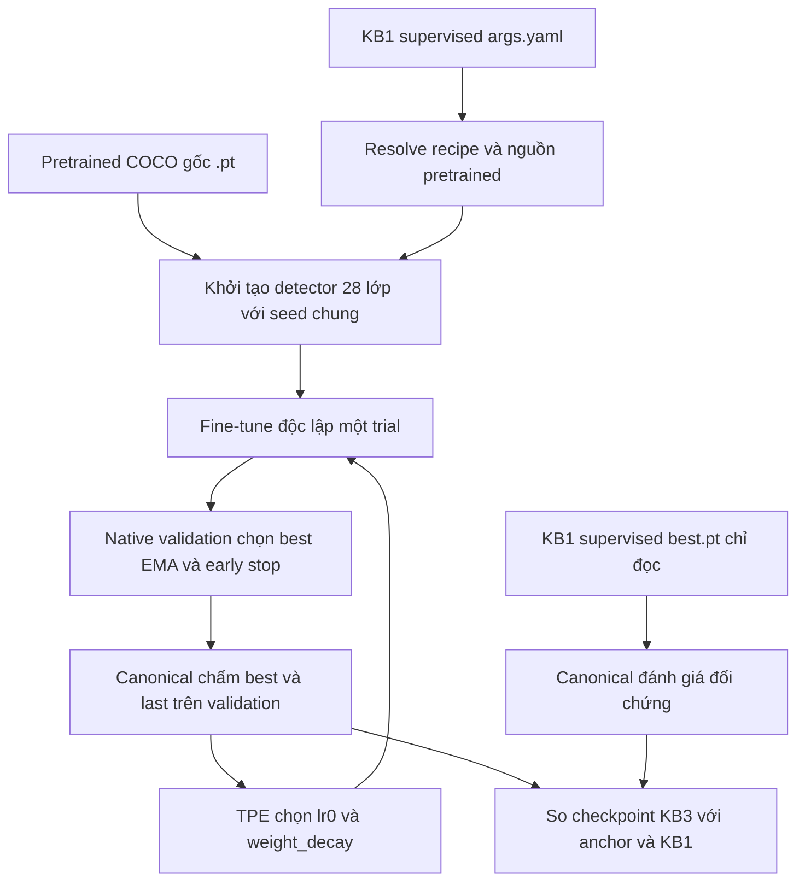
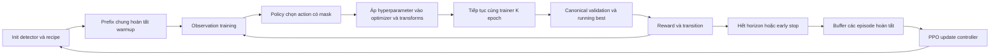

# Báo cáo KB3: tối ưu hyperparameter YOLO, kết quả đã đạt và hướng nghiên cứu

**Ngày báo cáo:** 15/10/2026. **Dự án:** RL-YOLO. **Phạm vi:** KB3-A và KB3-B, đối chiếu với supervised baseline của KB1.

**Mốc dữ liệu thực nghiệm trong báo cáo:** `2026-10-15T02:31:17.4204133+07:00` (Asia/Bangkok). Các kết quả của lượt train đang chạy được đóng băng theo mốc này; báo cáo không tự cập nhật khi các trial tiếp theo hoàn tất.

**Nguồn kiểm chứng:** toàn bộ Markdown trong `docs/` tại thời điểm đọc; README và tài liệu thiết kế/review trong KB3; source trainer, TPE, PPO, evaluator; các JSON/CSV/log và manifest thực nghiệm còn lưu. Đây là tổng hợp tài liệu và audit kết quả có sẵn, không phải một lượt train mới.

## Mục lục

1. [Kết luận và trạng thái bằng chứng](#1-kết-luận-và-trạng-thái-bằng-chứng)
2. [Lịch sử phát triển và cách đọc các protocol](#2-lịch-sử-phát-triển-và-cách-đọc-các-protocol)
3. [Mục tiêu, vai trò KB1 và khởi tạo pretrained](#3-mục-tiêu-vai-trò-kb1-và-khởi-tạo-pretrained)
4. [Dữ liệu, môi trường và provenance](#4-dữ-liệu-môi-trường-và-provenance)
5. [Các mốc supervised KB1 đã đánh giá](#5-các-mốc-supervised-kb1-đã-đánh-giá)
6. [KB3-A: bài toán và TPE](#6-kb3-a-bài-toán-và-tpe)
7. [KB3-A: cấu hình và luồng triển khai](#7-kb3-a-cấu-hình-và-luồng-triển-khai)
8. [Công thức huấn luyện detector](#8-công-thức-huấn-luyện-detector)
9. [Lựa chọn checkpoint và early stopping](#9-lựa-chọn-checkpoint-và-early-stopping)
10. [Metric đánh giá và công thức so sánh](#10-metric-đánh-giá-và-công-thức-so-sánh)
11. [Artifact, resume và kiểm chứng kỹ thuật](#11-artifact-resume-và-kiểm-chứng-kỹ-thuật)
12. [Kết quả scratch lịch sử: tám trial](#12-kết-quả-scratch-lịch-sử-tám-trial)
13. [Kết quả pretrained đang chạy](#13-kết-quả-pretrained-đang-chạy)
14. [Overfitting, tính tái lập và giới hạn kết luận](#14-overfitting-tính-tái-lập-và-giới-hạn-kết-luận)
15. [Đề xuất công việc KB3-A](#15-đề-xuất-công-việc-kb3-a)
16. [KB3-B: ý tưởng và khả thi lý thuyết](#16-kb3-b-ý-tưởng-và-khả-thi-lý-thuyết)
17. [KB3-B: môi trường, observation và action](#17-kb3-b-môi-trường-observation-và-action)
18. [KB3-B: reward, GAE và PPO](#18-kb3-b-reward-gae-và-ppo)
19. [KB3-B: vấn đề còn phải giải quyết](#19-kb3-b-vấn-đề-còn-phải-giải-quyết)
20. [KB3-B: hướng nghiên cứu tương lai](#20-kb3-b-hướng-nghiên-cứu-tương-lai)
21. [Chi phí, thiết kế đánh giá và lộ trình chung](#21-chi-phí-thiết-kế-đánh-giá-và-lộ-trình-chung)
22. [Danh mục tài liệu, code, artifact và nguồn học thuật](#22-danh-mục-tài-liệu-code-artifact-và-nguồn-học-thuật)

## 1. Kết luận và trạng thái bằng chứng

### 1.1. Những gì có thể xác nhận

KB3 đã xây dựng được hai hướng tối ưu hyperparameter: **A chọn một cấu hình trước mỗi lần train**; **B dùng controller chọn thay đổi trong quá trình train**. Luồng mặc định hiện tại chỉ thực thi **A–TPE pretrained**, protocol `kb3_tpe_v2_kb1_pretrained`. B được giữ trong code và tài liệu để nghiên cứu tiếp, không chạy kèm script mặc định.

Theo ý tưởng cuối cùng đã thống nhất, YAML supervised KB1 xác định recipe và **nguồn pretrained gốc** của mỗi trial KB3-A. Best checkpoint supervised KB1 chỉ làm đối chứng. Mỗi trial tải lại nguồn COCO pretrained, fine-tune một detector mới, không tiếp tục từ best KB1 hoặc checkpoint của trial trước.

Tám trial trước đó thuộc **protocol scratch v1**, đã hoàn tất và đã xóa tám selected checkpoint theo yêu cầu ngày 14/10/2026. Logs, scores, curves và manifest còn lưu nên vẫn phân tích được lịch sử; không thể dùng những weights đã xóa để inference lại. Kết quả tốt nhất của scratch là trial 5: **36,1185% mAP50–95**, tăng **1,2629 điểm phần trăm** so với scratch anchor, nhưng thấp hơn supervised KB1 **1,7022 điểm phần trăm**. Đây là cải thiện trong thí nghiệm scratch một seed, không phải kết quả pretrained và không phải thành tích RL.

Tại mốc snapshot, lượt pretrained mới đã hoàn tất **2/8 trial**, đang chạy trial 2. Trial 0 là anchor, đạt **36,0677%**; trial 1 là startup random, đạt **37,7225%**. Trial 1 cao hơn anchor **1,6548 điểm phần trăm**, nhưng vẫn thấp hơn KB1 **0,0982 điểm phần trăm**. Chưa có kết quả hoàn tất của trial do TPE đề xuất trong lượt pretrained này; chưa có winner cuối của cả tám lượt.

### 1.2. Những gì chưa được chứng minh

| Câu hỏi | Trạng thái tại mốc báo cáo | Bằng chứng còn thiếu |
|---|---|---|
| Recipe pretrained mới chạy đúng nguồn khởi tạo? | Đã có kiểm chứng kỹ thuật và hai trial thực | Tiếp tục xác minh hash/contract cho tất cả trial |
| A–TPE scratch có tìm được cấu hình cao hơn anchor? | Có, trên validation và seed 42 | Seed xác nhận mới; weights cũ đã xóa |
| A–TPE pretrained vượt KB1? | Chưa; tốt nhất trong hai lượt còn thấp hơn KB1 | Hoàn tất search, đối chứng ghép seed và đánh giá cuối |
| TPE tốt hơn random search trong dự án này? | Chưa có đối chứng đủ | Nhiều search seed và ngân sách tương đương |
| B thay hyperparameter đúng mà không restart trainer? | Có các integration gate cho quality B | Gate mới với pretrained recipe hiện tại nếu mở lại B |
| PPO học được chính sách hữu ích trên bộ dữ liệu thật? | Chưa có bằng chứng đủ | Learning curve, frozen-policy evaluation, ablation |
| B tốt hơn A? | Chưa thể kết luận | Cùng init, recipe, evaluator, seed và ngân sách |
| KB3 tổng thể cải thiện generalization trên test? | Chưa có kết quả final phù hợp | Freeze phương pháp trước đánh giá test |

**TPE là HPO truyền thống, không phải RL.** A hiện giúp xây đối chứng, kiểm tra recipe và độ nhạy tham số. Nếu mục tiêu luận văn là tối ưu YOLO bằng RL, kết quả A không tự thay thế phần chứng minh RL; hướng B hoặc một hướng A-RL riêng vẫn cần nghiên cứu.

### 1.3. Đóng góp kỹ thuật đã đạt

Những tiến bộ có giá trị gồm: tách rõ config/initialization/reference; dùng recipe thực thay vì hardcode; xác minh backbone pretrained đã được chuyển; chọn checkpoint gắn đúng epoch và hash; tách metric native khỏi canonical; tính đủ thời gian toàn trial; resume theo completed trial có kiểm tra contract; ngăn hai tiến trình cùng output; giữ baseline KB1 chỉ đọc; kiểm chứng trên CPU/GPU trước khi chạy nghiên cứu dài.

Các thành quả này làm kết quả dễ kiểm tra và giảm việc chạy lại vì sai luồng. Chúng chứng minh các hợp đồng phần mềm trong những trường hợp đã test, chưa chứng minh hyperparameter tối ưu hoặc policy hội tụ.

## 2. Lịch sử phát triển và cách đọc các protocol

### 2.1. Vì sao tài liệu có những phát biểu khác nhau

Kho tài liệu lưu cả kế hoạch, review tại một thời điểm, sửa lỗi và protocol đã được thay thế. Một câu như “KB3 train từ đầu”, “chưa có checkpoint”, “run-all chạy cả PPO” có thể đúng ở phiên bản cũ nhưng không đúng với entry point hiện tại. Báo cáo này ưu tiên source/config/artifact hiện hữu khi xác định trạng thái hiện tại, đồng thời giữ các kết quả lịch sử theo đúng điều kiện của chúng.

| Giai đoạn | Khởi tạo/recipe | Search và đánh giá | Cách sử dụng trong báo cáo |
|---|---|---|---|
| Kế hoạch ban đầu | Detector và controller được thiết kế theo segment | Default, random search, TPE, bandit, PPO; reward tổng hợp | Cơ sở ý tưởng, không coi toàn bộ kế hoạch đã hoàn thành |
| Legacy thăm dò 08/10 | Scratch; recipe kiểm soát, nhiều subprocess | 10 epoch/detector, 3 trial/episode và 3 eval seed | Debug, đo chi phí; không coi 10 epoch là hội tụ |
| Quality pilot | Scratch 300 epoch, recipe/batch cũ | Một trajectory để quan sát học muộn | Pilot riêng; không phải B hoặc matched anchor mới |
| Quality v2/v3 KB1-start | Recipe KB1 nhưng A/B vẫn scratch | Trainer liên tục, canonical chọn best; v3 ngân sách 128 mỗi nhánh | Lịch sử sửa correctness và protocol lớn |
| Quality v4 staged | Scratch, maximum 300, stopping canonical | Search theo đợt 4/8; tuning/final khi chốt | Thiết kế chia giai đoạn; hiện không là mặc định |
| A–TPE v1 KB1-start | Scratch; seed 42, maximum 300 | 4 rồi mở rộng thành 8 trial, chỉ LR/WD | Thí nghiệm hoàn tất; weights đã xóa, logs giữ lại |
| **A–TPE v2 KB1-pretrained** | **Nguồn `.pt` từ KB1 args; seed/horizon/patience kế thừa** | **8 trial do người dùng yêu cầu; mặc định config vẫn 4** | **Protocol nghiên cứu đang chạy tại snapshot** |

### 2.2. Review đã phát hiện và sửa những gì

| Vấn đề từng có | Ảnh hưởng | Hướng sửa/hiện trạng |
|---|---|---|
| Worker chia segment bằng nhiều lần resume | Có thể reset RNG/dataloader hoặc tiếp tục từ EMA thay raw model | Quality B giữ trainer sống trong một episode; legacy vẫn là backend lịch sử riêng |
| Best native và final canonical không đồng thứ hạng | Có thể gọi một checkpoint là “best canonical” khi chưa quét canonical | V1/quality chọn canonical mỗi epoch; v2 chủ động giữ native selection như KB1 và công bố rõ |
| AP small placeholder vẫn đi vào reward | Reward không phản ánh đối tượng nhỏ | Legacy yêu cầu canonical nếu reward cần APs; quality tính APs thật |
| `tanh(loss)` bão hòa | Controller khó phân biệt diễn biến loss | Quality dùng `log1p(loss)/4`, validity flag và trends |
| Scheduler/warmup ghi đè action | `args` đổi nhưng optimizer thực không đổi theo ý định | Test actual parameter groups; quality giữ schedule, action tác động base LR |
| Policy và evaluator dùng chung RNG với detector | Cùng seed nhưng training trajectory bị ảnh hưởng bởi controller/evaluation | RNG tách riêng, fork CPU/CUDA, evaluator phục hồi backend/RNG |
| Best metric ghép sai weights/epoch | Bảng kết quả không tái kiểm tra được | Immutable selected checkpoint, metadata và SHA |
| Chỉ cộng thời gian tại best epoch | Báo chi phí thấp hơn train thực tế | Dùng `result.elapsed_seconds` toàn trial |
| Một lệnh âm thầm chạy ma trận rất lớn | Người chạy tưởng chỉ 10 epoch hoặc vài detector | Mặc định một model/A-only, preflight và budget rõ |
| Resume chỉ thấy file là skip | Có thể trộn output sai init/source/data/code | Contract fingerprint và xác thực result/checkpoint |
| Scratch bị hiểu là kế thừa đầy đủ YAML pretrained KB1 | Sai câu hỏi thí nghiệm người dùng mong muốn | V2 tải nguồn pretrained từ args, không ép 300/seed 42/stopper cũ |

### 2.3. Những số liệu legacy đáng giữ

Review 08/10 ghi run `20261008T014055204488Z` mặc định gồm 24 detector/model, 240 epoch/model; năm model là 120 detector, 1.200 epoch. YOLOv8n đã hoàn thành 24 detector, tổng elapsed worker khoảng **4,443 giờ**. Phần ngoài worker như import/setup/orchestration có thể chưa được tính đầy đủ.

PPO legacy trong ảnh log có ba episode, mỗi episode 10 epoch và 5 decision. Tổng 15 transition rất ít cho controller; entropy cuối khoảng 4,8819 gần cực đại `ln(135) ≈ 4,9053`. Loss PPO âm không phải bằng chứng detector tốt hoặc policy đã học tốt. Những log đó chứng minh pipeline thăm dò đã chạy, không trả lời câu hỏi B vượt strong HPO.

Review còn ghi 9/100 response có final canonical cao hơn reported native-best canonical, và 77/100 response có best epoch trùng final epoch. Đây là động lực sửa checkpoint selection và tránh evaluation trùng, không phải tỷ lệ lỗi của protocol pretrained mới.

## 3. Mục tiêu, vai trò KB1 và khởi tạo pretrained

### 3.1. Mục tiêu KB3

Với một kiến trúc detector đã chọn, KB3 tối ưu các tham số điều khiển quá trình học để cải thiện chất lượng detection. Không tìm kiến trúc mạng mới, không đổi class mapping trong một episode, không dùng RL để cập nhật trực tiếp hàng triệu trọng số YOLO.

Hai tầng tối ưu phải được phân biệt:

- **Tầng detector:** native detection loss và SGD cập nhật trọng số YOLO.
- **Tầng tìm kiếm/controller:** A–TPE đề xuất một vector cho lần train tiếp theo; B–PPO học policy thay đổi vector theo phản hồi trong train.

### 3.2. Ba artifact có ba vai trò khác nhau

| Artifact | Ví dụ YOLOv8n | Vai trò |
|---|---|---|
| YAML cấu hình supervised | `kb1_reward_guided_training/checkpoint_based/yolov8n/args.yaml` | Recipe xuất phát và nguồn `.pt` |
| Pretrained nguồn | `yolov8n.pt` ở root | Khởi tạo lại mỗi trial |
| Best supervised KB1 | `checkpoint_based/yolov8n/weights/best.pt` | Đối chứng để chấm và so sánh |

`args.yaml` là YAML **tham số train**, khác với `yolov8n.yaml` là YAML **kiến trúc**. Chỉ lấy LR/WD từ args rồi dựng architecture YAML ngẫu nhiên không tương đương kế thừa recipe pretrained KB1.

### 3.3. Luồng v2 đúng với ý tưởng đã chốt



Mỗi trial là một phiên fine-tune mới từ cùng nguồn pretrained. Trial sau chỉ nhận **thông tin scores/hyperparameters** từ history của TPE; không nhận weights đã train của trial trước. Điều này cô lập tác dụng cấu hình trong điều kiện khởi tạo chung.

### 3.4. Những kiểm tra bảo vệ khởi tạo

Code yêu cầu recipe `pretrained: true`, `resume: false`, `val: true`, `time: null`; source tồn tại, suffix `.pt`, tên phù hợp model đã chọn, checkpoint có 80 lớp COCO và tensor layout đúng kiến trúc. Source không được cùng đường dẫn hoặc cùng SHA với best KB1.

Vì source YOLOv8 cũ thiếu một số metadata kiến trúc, code so toàn bộ tên và shape tensor với kiến trúc 80 lớp dự kiến. Sau khi dựng detector 28 lớp, kiểm tra từng tensor ngoài Detect head đã chuyển từ source vào live model. Với trial YOLOv8n hiện tại có **270 tensor ngoài head được xác minh bằng nhau**. Nhãn 28 lớp làm head được setup theo native training; không được mô tả mọi tensor của detector 28 lớp là nguyên bản COCO.

Hai trial pretrained hoàn tất có cùng `initial_weights_sha256`; source và KB1 reference được kiểm hash sau train. Đây là bằng chứng mạnh về cùng khởi tạo giữa các trial mới. KB1 lịch sử không lưu một hash live initialization tương đương, nên chưa chứng minh khởi tạo head lịch sử giống từng bit.

## 4. Dữ liệu, môi trường và provenance

### 4.1. Dataset hiện dùng

| Tập | Ảnh | Tệp nhãn | Vai trò trong protocol hiện tại |
|---|---:|---:|---|
| Train | 2.411 | 2.411 | Cập nhật trọng số detector |
| Validation | 479 | 479 | Native stopping/selection; canonical objective/search |
| Test | 239 | 239 | Không chấm trong A–TPE v1/v2; dành bước final |
| Tổng | 3.129 | 3.129 | 28 lớp |

Root: `pre-data/data/v2i_cleanned`. Config: `kb1_reward_guided_training/configs/pest.yaml`. Train có 667 ảnh nhận diện được là augmentation theo quy tắc tên hiện có. Không coi 2.411 ảnh là 2.411 nguồn chụp độc lập, hoặc suy 1.744 ảnh còn lại đều độc lập hoàn toàn chỉ từ tên.

Dataset SHA256 trong supervised provenance:

```text
cbd68ffc1da935ac300fba953ea5f9c97c831f53887e1b9391d500f9e40c0c95
```

Class mapping gồm các lớp lá khỏe/bệnh; hộp bao là đối tượng được gán nhãn trong dữ liệu. Không đánh đồng AP small với phát hiện từng đốm bệnh nếu ground truth bao quanh cả lá. Bài PlantDoc/YOLO26 được phân tích trong docs là tài liệu tham khảo, không phải kết quả trên dataset này.

### 4.2. Kiểm tra rò rỉ và giới hạn

Manifest kiểm tra known source ID bằng quy tắc bỏ hậu tố flip/rotation và ID Roboflow đầy đủ; không thấy overlap theo quy tắc đó giữa các split. Đây không phải kiểm tra near-duplicate bằng nội dung, ảnh cùng cây/phiên chụp đổi tên, hoặc tất cả kiểu crop/augmentation.

Fingerprint hash các ảnh/nhãn của cả train, validation và test để kiểm tra toàn vẹn. **Đọc bytes/hash test không tương đương dùng test score để tune.** A hiện không lấy test metric làm objective. Tuy nhiên, test baseline đã được xem trong báo cáo so sánh ngày 07/10; không thể gọi toàn bộ dự án là chưa từng nhìn test. Các kết luận final phải khai báo lịch sử này, tránh điều chỉnh phương pháp theo test và cân nhắc tập xác nhận ngoài nếu cần tuyên bố generalization nghiêm ngặt.

### 4.3. Môi trường của manifest pretrained mới

| Thành phần | Phiên bản/thiết bị |
|---|---|
| GPU đã dùng trong integration và nghiên cứu | NVIDIA GeForce RTX 4060 Laptop GPU, VRAM 8 GB |
| Torch | `2.5.1+cu121` |
| Torchvision | `0.20.1+cu121` |
| Ultralytics | `8.4.163` |
| Optuna | `4.5.0` |
| TorchMetrics | `1.9.0` |
| faster-coco-eval | `1.7.2` |
| pycocotools | `2.0.11` |
| NumPy | `2.2.6` |
| Albumentations | `2.0.8` |
| Shell/lệnh người dùng | PowerShell gọi Bash/Git Bash, mỗi lệnh một dòng |

Git HEAD khi review: `3b0151fdc8117b70f320084019a20f1d49a41b1d`. Các sửa đổi pretrained ngày 14/10 đang có trong working tree, chưa commit tại lúc đọc. Vì vậy commit một mình không đủ tái lập source đang chạy; manifest hash source bytes mới là bằng chứng cho run hiện tại.

Identity SHA256 của run pretrained:

```text
02bbbf0fd0bbd802cec5c84f3afea5eb3d3b55ba7d8556c1d07bbeb4acaa943c
```

Trong phiên lập báo cáo này chỉ bổ sung báo cáo/snapshot bằng chứng; không chỉnh trainer/config, không khởi động hoặc dừng lượt research đang chạy.

## 5. Các mốc supervised KB1 đã đánh giá

### 5.1. Mốc chính: supervised KB1, không phải reward-guided KB1

“Nửa đầu KB1” trong yêu cầu là **supervised training** ở `checkpoint_based/<model>`, chưa áp cơ chế reward-guided. Best của phần này được giữ để làm mốc. Cần dùng đúng checkpoint, không thay bằng KB1 continuation/reward-guided, KB2 hoặc source pretrained COCO chưa fine-tune.

Mỗi KB1 model lịch sử dùng seed 0, SGD, maximum 200 epoch, patience 30. Các model s dùng batch 8; model n dùng batch 16. Best được native trainer chọn rồi canonical evaluator chấm lại.

### 5.2. Canonical validation references đã chuẩn bị cho năm model

Số sau lấy từ `quality/kb1_start_v3/<model>/kb1_reference.json`, cùng FP32/TF32-off evaluation contract. Đây là **inference lại checkpoint có sẵn**, không phải năm thí nghiệm A mới.

| Model | mAP50–95 (%) | mAP50 (%) | AP small (%) | P micro (%) | R vận hành (%) | F1 micro (%) | AR300 (%) |
|---|---:|---:|---:|---:|---:|---:|---:|
| YOLOv8n | 37,8207 | 49,1187 | 4,3965 | 50,9227 | 54,1070 | 52,4666 | 56,2044 |
| YOLOv8s | 37,9547 | 48,9229 | 5,2897 | 51,4445 | 53,7891 | 52,5907 | 54,9750 |
| YOLO11n | 40,5214 | 52,5551 | 4,0556 | 53,6941 | 54,6900 | 54,1875 | 57,0374 |
| YOLO11s | 39,8054 | 50,4671 | 5,1838 | 56,7735 | 53,5241 | 55,1009 | 55,0722 |
| YOLO26n | 39,2284 | 50,8816 | 6,2410 | 56,1086 | 52,5702 | 54,2818 | 57,0086 |

Mốc YOLOv8n của run pretrained v2 trùng mAP50–95/mAP50 với reference này. Bảng baseline ngày 07/10 có một số P/R/AP small khác nhẹ do điều kiện số học/backend của lượt inference; không copy các số làm tròn từ báo cáo cũ thay cho reference đã khóa của thí nghiệm hiện tại.

### 5.3. Training budget thực của baseline

| Model | Epoch thực lịch sử | Max epoch | Batch | Seed | Thời gian trong cột time của native log (giây) |
|---|---:|---:|---:|---:|---:|
| YOLOv8n | 166 | 200 | 16 | 0 | 8.369,91 |
| YOLOv8s | 126 | 200 | 8 | 0 | 8.439,60 |
| YOLO11n | 161 | 200 | 16 | 0 | 8.266,29 |
| YOLO11s | 167 | 200 | 8 | 0 | 11.075,40 |
| YOLO26n | 142 | 200 | 16 | 0 | 8.151,78 |

Các thời gian này đến từ [báo cáo baseline](../YOLO26N_BASELINE_COMPARISON.md). Chúng không cùng định nghĩa với `result.elapsed_seconds` của KB3 gồm setup/post-evaluation; không dùng để tính speedup trực tiếp.

YOLOv8n có native peak mAP50–95 khoảng **41,432% tại epoch 136**, kết thúc epoch 166. Minimum native val loss ở epoch 146. Canonical mAP50–95 của best có sẵn là **37,8207%**. Đỉnh native và score canonical là hai phép đo khác nhau, không phải một score bị giảm do mô hình được train lại.

### 5.4. Kết quả test baseline từng được công bố

Để minh bạch test-access history, báo cáo baseline 07/10 đã ghi: YOLOv8n test mAP50–95 khoảng 33,20%, YOLOv8s 33,98%, YOLO11n 37,53%, YOLO11s 36,27%, YOLO26n 33,36%. Đây là baseline lịch sử, không phải test của KB3-A/B và không là tiêu chí chọn trial hiện tại. Không so validation của KB3 với test của KB1 để kết luận cải thiện.

## 6. KB3-A: bài toán và TPE

### 6.1. Bài toán tối ưu chính xác

Ký hiệu:

- $h=(\eta_0,\lambda)$: base learning rate `lr0` và weight decay.
- $c$: recipe cố định gồm scheduler, augmentation, batch, optimizer, seed rules, stopping.
- $w_{\mathrm{COCO}}$: nguồn pretrained gốc đã khóa hash.
- $\xi$: ngẫu nhiên của setup head, data order, augmentation và số học training.
- $w_e(h;c,\xi)$: detector/EMA sau epoch $e$.
- $f_{\mathrm{nat}}(w_e)$: native validation fitness.
- $J_{\mathrm{can}}(w)$: canonical validation mAP50–95.

Epoch được native chọn:

$$
e^*(h)=\operatorname{NativeSelect}\{f_{\mathrm{nat}}(w_e):1\le e\le E_{\mathrm{actual}}(h)\}.
$$

Objective của TPE hiện tại:

$$
F(h;\xi)=J_{\mathrm{can}}\big(w_{e^*(h)}(h;c,\xi)\big),\qquad
\hat h=\arg\max_{h_i\in\mathcal H_{\mathrm{tested}}}F(h_i;\xi_0).
$$

Đây là tối đa hóa canonical score của **checkpoint được native chọn**, không phải quét canonical mọi epoch, không phải tối thiểu training loss, không phải trực tiếp tối đa test AP. Search một detector seed đang đo $F(h;\xi_0)$; mục tiêu muốn generalize trên seed mới gần hơn với $\max_h\mathbb E_\xi[F(h;\xi)]$ và cần bước xác nhận.

### 6.2. A thay tham số vào thời điểm nào

**Cơ sở paper của vòng ngoài HPO:** Bergstra et al. (2011), mục 2 và Figure 1, mô tả SMBO đề xuất cấu hình, đánh giá hàm đắt tiền rồi cập nhật history/surrogate. Luồng A vận dụng cấu trúc này; objective detector cụ thể vẫn do protocol dự án định nghĩa. [Paper gốc, mục 2](https://papers.nips.cc/paper_files/paper/2011/file/86e8f7ab32cfd12577bc2619bc635690-Paper.pdf).

Mỗi trial chọn $h_i$ trước khi train và giữ base parameters đó. Trial kết thúc hoặc early stop thì mới cập nhật history và đề xuất $h_{i+1}$. TPE không chọn action sau từng epoch của một detector.

“Cấu hình cố định” không có nghĩa actual LR hằng số: warmup, linear decay và close-mosaic vẫn là các lịch được xác định trước trong recipe. Đây là HPO của một quy trình training hoàn chỉnh có lịch, không phải SGD với một LR bất biến từ đầu đến cuối.

### 6.3. Cơ chế TPE

TPE mô hình hóa vùng tham số của các observations tốt và phần còn lại rồi ưu tiên tỷ số mật độ của vùng tốt. Optuna 4.5.0 mặc định có startup 10; repository đặt startup 2 để một pilot bốn lượt có đề xuất TPE thật từ trial 2. `n_ei_candidates=24` là số candidate nội bộ để đề xuất, **không phải 24 detector trainings**. [Tài liệu TPESampler 4.5.0](https://optuna.readthedocs.io/en/v4.5.0/reference/samplers/generated/optuna.samplers.TPESampler.html).

Để diễn giải bằng dạng minimization, đặt $y_i=-F(h_i)$. Với ngưỡng phân vị $y^*$ và $\alpha=P(y<y^*)$:

$$
l(h)=p(h\mid y<y^*),\qquad g(h)=p(h\mid y\ge y^*),
$$

$$
p(h)=\alpha l(h)+(1-\alpha)g(h),
\qquad EI(h)=\mathbb E[\max(y^*-Y,0)\mid h].
$$

Trong mô hình TPE, việc ưu tiên EI tương ứng ưu tiên $l(h)/g(h)$; trực giác là đề xuất gần vùng observations tốt nhưng vẫn có mật độ/prior hỗ trợ khám phá. Đây là mô hình surrogate mật độ, không phải policy RL hoặc Gaussian-process BO của code này. [Bergstra et al., Algorithms for Hyper-Parameter Optimization](https://papers.nips.cc/paper_files/paper/2011/hash/86e8f7ab32cfd12577bc2619bc635690-Abstract.html).

Repository dùng default **independent TPE** (`multivariate=False`): mô hình hóa từng chiều, chưa học một mật độ joint LR–WD đầy đủ. Hai biến vẫn được train/evaluate cùng nhau, nhưng surrogate độc lập có thể bỏ lỡ tương tác. Với rất ít observations, density và vùng tốt còn mong manh; việc trial mang nhãn `tpe` không bảo đảm proposal đã chính xác.

### 6.4. Search space địa phương và log scale

**Nguồn công thức TPE ở mục 6.3:** Expected Improvement nằm ở Eq. (1), mục 2; cách chia $l(h),g(h)$ và ưu tiên density ratio nằm ở mục 4 của Bergstra et al. (2011). Các công thức đã đổi ký hiệu sang $h$ và $y=-F$ cho bài toán maximize AP. Miền LR/WD, startup=2 và sampler seed rule là lựa chọn của repository, không được paper quy định. [Bergstra et al., 2011 — PDF](https://papers.nips.cc/paper_files/paper/2011/file/86e8f7ab32cfd12577bc2619bc635690-Paper.pdf).

| Tham số | Giá trị KB1 | Local factors | Miền v2 YOLOv8n | Được tìm? |
|---|---:|---|---|---|
| `lr0` | 0,01 | `[0.5, 1.5]` | `[0.005, 0.015]` | Có, log scale |
| `weight_decay` | 0,0005 | `[0.5, 2.0]` | `[0.00025, 0.001]` | Có, log scale |
| `momentum` | 0,937 | Giữ nguyên | 0,937 | Không |
| `augmentation_strength` | 0,5 | Mô tả recipe gốc | 0,5 | Không |

Miền thực là giao của local range và global bounds. Với một biến dương $x\in[L,U]$, startup log-uniform tương ứng:

$$
z\sim\mathcal U(\ln L,\ln U),\quad x=e^z,
\quad p(x)=\frac1{x\ln(U/L)}.
$$

Log scale so khoảng theo tỷ lệ, thích hợp LR/WD dương; không được mô tả startup là uniform tuyến tính. Không tìm toàn bộ optimizer/augmentation/scheduler nên đây là **local 2D HPO quanh KB1**, không phải tối ưu tất cả hyperparameter của YOLO.

Giữ hai chiều giúp điều tra nguyên nhân dễ hơn và tận dụng baseline có sẵn. Nó có thể bỏ lỡ cấu hình tốt ngoài vùng hoặc lịch/optimizer tốt hơn. Nếu optimum quan sát nằm sát biên, mở range là một thí nghiệm tiếp theo có contract mới, không sửa range giữa run đang chạy.

### 6.5. Phân bổ trial và seed

**Cơ sở đối chứng random:** Bergstra và Bengio (2012) xem random search là baseline để đánh giá các phương pháp HPO tuần tự. Paper không kết luận hai biến LR/WD là đủ cho YOLO; giới hạn hai chiều quanh KB1 ở đây là thiết kế pilot của dự án. [Random Search for Hyper-Parameter Optimization, JMLR](https://jmlr.org/papers/v13/bergstra12a.html).

| Logical trial | Mode | Số observations hoàn tất khi đề xuất | Detector seed v2 | Sampler seed |
|---:|---|---:|---:|---:|
| 0 | `kb1_anchor` | 0 | 0 | 42 |
| 1 | `startup_random` | 1 | 0 | 43 |
| 2 | `tpe` | 2 | 0 | 44 |
| 3 | `tpe` | 3 | 0 | 45 |
| 4–7 nếu target 8 | `tpe` | 4–7 | 0 | 46–49 |

Trial 0 enqueued bằng đúng LR/WD KB1. Nó là detector train thật để kiểm tra anchor mới, không phải inference best KB1. Vì trial 0 tính là completed observation, sau trial 1 đã đủ startup=2.

`--trials 4` nghĩa là **tổng bốn lượt**, gồm một anchor, một random và hai TPE; `--trials 8` gồm một anchor, một random và sáu TPE. Resume từ tổng 4 lên tổng 8 thêm bốn lượt, không thêm tám. Tám trial cùng detector seed không phải tám seed đánh giá độc lập.

### 6.6. Tái dựng study và đề xuất có thể resume

Trước proposal $i$, code dựng study trong bộ nhớ với sampler seed $42+i$, thêm các completed observations đúng thứ tự, rồi `ask()/suggest_float()`; trial 0 được enqueue. `trial_spec.json` lưu number, seed, parameters, mode và history objectives.

Nếu resume, proposal được tái dựng từ history và so với spec đã lưu. Mismatch bị chặn. Cách này tái lập lịch đề xuất của **implementation hiện tại**; không khẳng định giống từng proposal với một study Optuna dài dùng duy nhất một RNG seed không reset.

TPE chỉ nhận score của completed result hợp lệ. Run dở không được dùng như observation thành công; các scores scratch cũ không được nhập vào pretrained study mới.

### 6.7. Vì sao bốn/tám lượt là pilot

**Nguồn framework và phạm vi BO:** Akiba et al. (2019) trình bày Optuna; Snoek et al. (2012) nghiên cứu BO dùng Gaussian process. Hai paper giúp đặt A trong hướng tối ưu tuần tự, nhưng source hiện tại dùng TPE của Optuna, không triển khai GP của Snoek hay pruning/multi-fidelity chỉ vì Optuna hỗ trợ chúng. [Optuna paper](https://arxiv.org/abs/1907.10902), [Practical Bayesian Optimization of Machine Learning Algorithms](https://papers.nips.cc/paper_files/paper/2012/hash/05311655a15b75fab86956663e1819cd-Abstract.html).

Bốn/tám là mốc ngân sách do thiết kế/người dùng chọn, không xuất phát từ định lý số chiều hoặc đảm bảo hội tụ. Bốn lượt chỉ có hai proposals TPE; tám chỉ có sáu. Có thể thấy độ nhạy và tìm ứng viên, nhưng không chứng minh TPE hơn random, đạt global optimum hoặc đạt kỳ vọng ổn định.

Search thêm có ích khi chưa khảo sát vùng hứa hẹn; xác nhận nhiều seed có ích khi đã có ứng viên nhưng chưa biết lợi ích có bền. Không có một con số trial chung như 16/32/128 bảo đảm “rõ”. Quyết định dựa trên effect size, variability, learning/optimization curve, mức chọn lọc validation và câu hỏi cần trả lời.

## 7. KB3-A: cấu hình và luồng triển khai

### 7.1. Entry point đang hoạt động

`run_all_kb3.sh` và `run_quality_kb3.sh` đi vào `quality.tpe_pipeline`; config `configs/kb3_tpe.yaml` khai báo `method: tpe`, `rl_enabled: false`, `recipe_source: kb1_supervised`, `initialization: pretrained`, default trials 4. Config dùng `null` cho epoch/seed/patience/batch/imgsz/warmup/lrf để kế thừa actual args của model đã chọn.

`all` trong **stage** nghĩa là KB1 inference → A search → validation report. Nó không có nghĩa chạy cả A/B, học PPO, train tuning/final seed hay test. `--model all` nghĩa là năm model, mỗi model nhận target riêng; target 8 là 40 detector trainings, tối đa tổng 8.000 epoch nếu mọi model maximum 200.

### 7.2. Recipe YOLOv8n hiện tại

| Nhóm | Trường | Giá trị |
|---|---|---|
| Khởi tạo | model/pretrained/resume | `yolov8n.pt` / `true` / `false` |
| Ngân sách | epochs/patience/seed | 200 / 30 native / 0 |
| Input | imgsz/batch/workers/device | 640 / 16 / 0 / GPU 0 |
| Optimizer | optimizer/nbs/AMP | SGD / 64 / true |
| Learning rate | lr0/lrf/cos_lr | 0,01 anchor / 0,01 / false |
| Warmup | epochs/momentum/bias LR | 3 / 0,8 / 0,1 |
| Regularization | weight_decay/momentum | 0,0005 anchor / 0,937 |
| Loss gains YOLOv8n | box/cls/dfl | 7,5 / 0,5 / 1,5 |
| Data policy | fraction/rect/single_cls/multi_scale | 1 / false / false / 0 |
| Freeze | freeze/dropout | null / 0 |
| Aug HSV | hsv_h/hsv_s/hsv_v | 0,015 / 0,7 / 0,4 |
| Geometry | degrees/translate/scale/shear/perspective | 10 / 0,1 / 0,5 / 0 / 0 |
| Flip | flipud/fliplr/bgr | 0,3 / 0,5 / 0 |
| Mix | mosaic/mixup/cutmix/copy_paste | 1 / 0,1 / 0 / 0 |
| Final phase | close_mosaic | 10 |
| Reproducibility | deterministic/cache | true / false |
| Native validation | val/conf/iou/max_det | true / null native resolution / 0,7 / 300 |
| Output KB3 | save/save_period/plots | true / −1 / false |

Các trường output/project/name/save-period/plots được điều chỉnh để quản lý artifact. Không copy mù mọi key suy luận/export trong args vào training. `TRAIN_RECIPE_KEYS` chọn các trường có tác dụng train/native selection, rồi đối chiếu với `train_args` của KB1 checkpoint. Reseed ngay trước model setup đảm bảo khởi tạo head các trial mới đồng nhất sau các import lần đầu. Chính thay đổi kiểm soát RNG này cần được xem xét khi audit sai khác với baseline lịch sử.

Một số native settings không được truyền riêng trong `TRAIN_RECIPE_KEYS` mà lấy defaults của phiên bản đã khóa. Snapshot actual args trial 0 xác nhận `cls_remap=true`, `compile=false`, `channels_last=null`, phù hợp các giá trị KB1 tương ứng. `cls_remap` cho phép remap hàng classification head theo tên lớp khi fine-tune giữa datasets; không được mô tả detector 28 lớp là giữ nguyên head COCO. Khi nâng thư viện hoặc mở rộng recipe, cần audit cả các defaults này, không chỉ các keys đã truyền.

`augmentation_strength=0.5` là trường thống nhất của abstraction KB3, chỉ biểu thị giữ recipe KB1. V2 không truyền nó thành một argument augmentation native chưa tồn tại và không tìm scalar này. Các transform Albumentations phụ thuộc version cũng là một phần môi trường; không suy rằng YAML liệt kê hết mọi transform runtime.

### 7.3. Preflight trước khi train

Preflight xác minh dữ liệu/classes, provenance/hash KB1, recipe thực và nguồn pretrained; không train detector nghiên cứu và không tạo output thí nghiệm mới trong `--check-only`. Với nhiều model, kiểm tra cả matrix trước model đầu để không train một phần rồi mới phát hiện model sau thiếu source.

Source `.pt` phải phù hợp 80 lớp/kiến trúc; actual KB1 args phải phù hợp checkpoint. Trừ smoke, override khác các trường phải kế thừa bị từ chối. OOM dẫn native trainer thay batch sẽ fail contract thay vì âm thầm biến thành experiment khác.

### 7.4. Pseudocode thực thi một run

```text
resolve actual KB1 args + original pretrained source + comparison checkpoint
verify provenance, classes, source tensors, dependencies and configuration
compute fingerprint; verify/create manifest and YAML snapshots
acquire exclusive output lock
canonical-score KB1 best once, or reuse verified reference cache
history = []
for logical_trial in 0 .. target-1:
    propose using completed history and sampler_seed + logical_trial
    verify or persist trial_spec before expensive training
    if committed result exists:
        verify parameters, seed, source, weights, initialization and selector
        skip training
    else:
        archive interrupted content if present
        reload original pretrained source
        setup native detector with common seed; verify transferred tensors
        train continuously with fixed trial LR0/WD and native recipe
        native-select best EMA; stop using native patience
        verify best artifact matches recorded selected EMA
        canonical-score selected best and last
        verify source and KB1 reference unchanged
        atomically persist result + selected metadata
    append validated result to history; persist actual cost/progress
verify common initial live weights across completed trials
rank selected native-best checkpoints by canonical validation mAP50-95
write versioned JSON/CSV/Markdown/trajectory report from cached results
release output lock
```

Báo cáo cuối không train thêm để “đánh giá”. Native validation vẫn chạy trong train; canonical best/last được chấm sau train. Native `final_eval()` có thể validation lại best; callback này bị loại khỏi epoch history để tránh ghi thêm một epoch giả sau early stop.

### 7.5. Lệnh thao tác khi cần sau run đang chạy

Mỗi lệnh dưới đây phải nằm trên một dòng PowerShell. **Không mở thêm process cùng output đang chạy.** Các lệnh chỉ là hướng dẫn tái lập, không được thực thi trong phiên lập báo cáo.

```powershell
bash kb3_hyperparameter_optimization/run_all_kb3.sh --model yolov8n --trials 8 --check-only
```

Chạy mới khi thư mục output chưa chứa experiment:

```powershell
bash kb3_hyperparameter_optimization/run_all_kb3.sh --model yolov8n --trials 8 --output-dir kb3_hyperparameter_optimization/checkpoint_hyperparameter_optimization/quality/tpe_kb1_pretrained_v2/yolov8n
```

Resume sau khi process cũ đã dừng, cùng source/config/data:

```powershell
bash kb3_hyperparameter_optimization/run_all_kb3.sh --model yolov8n --trials 8 --resume --output-dir kb3_hyperparameter_optimization/checkpoint_hyperparameter_optimization/quality/tpe_kb1_pretrained_v2/yolov8n
```

Tạo lại report khi đã đủ target, không train thêm:

```powershell
bash kb3_hyperparameter_optimization/run_quality_kb3.sh --model yolov8n --stage evaluate --trials 8 --resume --output-dir kb3_hyperparameter_optimization/checkpoint_hyperparameter_optimization/quality/tpe_kb1_pretrained_v2/yolov8n
```

Hoàn tất thành công khi có thông báo `VALIDATION REPORT`, `A-TPE stage complete`, artifacts report hợp lệ và terminal trả dấu nhắc. `Get-Content ... -Tail ... -Wait` chỉ theo dõi log, không bắt đầu training; bản thân `-Wait` có thể tiếp tục chờ sau khi trainer đã xong. Traceback/process exit không thành công không phải hoàn tất nghiên cứu.

## 8. Công thức huấn luyện detector

### 8.1. Loss detector và hai tham số A đang tìm

Với YOLOv8n, native loss có dạng tổng các thành phần đã được framework chuẩn hóa:

$$
\mathcal L_{\mathrm{det}}=7.5\,\mathcal L_{\mathrm{box}}
+0.5\,\mathcal L_{\mathrm{cls}}+1.5\,\mathcal L_{\mathrm{DFL}}.
$$

Đây là biểu diễn các gain của recipe, không tự thay thế công thức assignment/normalization/batch scaling native. A không sửa các thành phần này. Với YOLO26, regression/head khác và không dùng DFL như YOLOv8; không áp công thức DFL này cho mọi model. Worker đọc loss regression tương ứng gồm `l1_loss` nếu framework trả về.

LR quyết định độ lớn bước cập nhật; weight decay điều chỉnh regularization trên những nhóm weight được áp decay. Cùng một WD input không có nghĩa tất cả tensor đều chịu decay: bias và normalization groups có WD bằng 0.

### 8.2. SGD với momentum và Nesterov

Native SGD recipe hiện dùng Nesterov. Với một parameter group chịu decay, biểu diễn cập nhật PyTorch theo momentum không dampening:

$$
g_t=\nabla_w\mathcal L_t+\lambda_{\mathrm{eff}}w_t,
\qquad b_t=\mu b_{t-1}+g_t,
$$

$$
\tilde g_t=g_t+\mu b_t,
\qquad w_{t+1}=w_t-\eta_t\tilde g_t.
$$

Buffer lần đầu được khởi tạo theo gradient đầu; công thức trên mô tả những bước sau với quy ước phù hợp. Đây là coupled weight decay của SGD; không gọi nó là AdamW hoặc regularization decoupled. `momentum=0.937` không được TPE thay đổi. Native AMP/scaler, gradient accumulation và clipping vẫn do trainer thực hiện.

### 8.3. Linear schedule

Với zero-based native epoch $e$, maximum horizon $E=200$, `lrf=0.01`, `cos_lr=False`:

$$
q(e)=\max(1-e/E,0)(1-0.01)+0.01,
\qquad\eta_e=\eta_0q(e)
$$

sau warmup. Ví dụ $q(100)=0.505$, nên trial anchor có base LR 0,01 nhưng actual LR giữa lịch khoảng 0,00505. Nếu early stop ở epoch 121, schedule không được nén lại thành 121 epoch; nó vẫn được định nghĩa theo maximum 200. Zero-based versus epoch hiển thị 1-based cần đọc trace để tránh lệch một.

### 8.4. Warmup

Native trainer nội suy theo global batch iteration $n$ trong warmup. Dạng khái niệm theo source đang cài:

$$
\eta_{n,g}=\operatorname{interp}\big(n;[0,n_w],
[\eta_{g,\mathrm{start}},\eta_{0,g}q(e)]\big),
$$

$$
\mu_n=\operatorname{interp}(n;[0,n_w],[0.8,0.937]).
$$

Bias group bắt đầu với `warmup_bias_lr=0.1`, các nhóm còn lại bắt đầu 0. Warmup iterations ở phiên bản này dùng `round(min(warmup_epochs, E−1) × number_of_batches)`. Không ghi mặc định một mức tối thiểu iteration từ phiên bản Ultralytics khác.

Warmup có thể làm actual LR khác `lr0`; không được coi trace đó là TPE đổi tham số trong một trial.

### 8.5. Weight decay và effective batch

Native initialization:

$$
A=\max(\operatorname{round}(nbs/B),1),\qquad
\lambda_{\mathrm{eff}}=\lambda_{\mathrm{input}}\frac{BA}{nbs}.
$$

Với $B=16$, $nbs=64$, $A=4$ thì factor bằng 1, nên weight group nhận WD input. Warmup có thể nội suy accumulation; không tự suy mọi optimizer step có effective batch chính xác 64. Batch/nbs phải được khóa giữa các trial, vì thay chúng thay optimizer dynamics và mức regularization.

### 8.6. EMA và checkpoint

EMA là trung bình trượt của trọng số live, được cập nhật sau optimizer steps:

$$
\bar w_u=d(u)\bar w_{u-1}+[1-d(u)]w_u,
\qquad d(u)=0.9999\,[1-e^{-u/2000}].
$$

$u$ là số cập nhật EMA, không phải epoch. Native validation/checkpoint dùng EMA. Native serialization lưu EMA half; canonical evaluation chuyển model được nạp sang FP32 để inference, không phục hồi những bit đã mất khi serialize half. V1 quality từng lưu selected EMA full precision; đó là một khác biệt cần khai báo khi so lịch sử scratch với pretrained v2.

### 8.7. Augmentation và pha cuối

Recipe gốc dùng mosaic/mixup/geometry/flips. `close_mosaic=10` là lịch native đóng các phép mix tương ứng cuối horizon; với maximum 200, pha này ở phần cuối quanh epoch index 190. Early stopping trước đó có thể làm detector chưa trải qua pha này. Native stopping v2 không có “bảo vệ pha cuối” như quality scratch cũ.

Train loss trước/sau thay augmentation không nhất thiết cùng phân phối độ khó, nên loss nhảy không tự chứng minh overfit. Val loss và AP đo những khía cạnh khác nhau; không chọn checkpoint theo val loss nếu contract đã khóa native fitness.

## 9. Lựa chọn checkpoint và early stopping

### 9.1. Hai tầng lựa chọn

**Tầng 1 trong detector:** native validation chọn epoch/EMA. Source `ultralytics/utils/metrics.py` phiên bản 8.4.163 dùng weights `[0,0,0,1]` cho `[P,R,mAP50,mAP50–95]`, tức fitness detection hiện tại là native mAP50–95. Không dùng công thức cũ `0.1*mAP50+0.9*mAP95` khi mô tả phiên bản đang cài.

**Tầng 2 giữa detector trials:** canonical evaluator chấm native best, TPE/report xếp theo canonical mAP50–95. Nếu hai trial bằng score, reporting ưu tiên logical trial number nhỏ hơn. Không chọn trial theo AP small sau khi đã xem kết quả nếu objective chính là mAP50–95.

Native lưu best khi fitness bằng best fitness hiện tại; metadata của A cập nhật ties tương ứng để giữ epoch/hash đúng. Early stopper cập nhật epoch cải thiện theo quy tắc native riêng; ties và plateau cần đọc source, không giả định mọi callback cùng dùng strict `>`.

### 9.2. Native patience v2

Đặt $e_{\mathrm{imp}}$ là epoch native stopper ghi nhận cải thiện. Nó dừng khi:

$$
e-e_{\mathrm{imp}}\ge30,
$$

hoặc đạt maximum 200. Có xử lý riêng giai đoạn fitness bằng 0 ở native source. **Không có min_epochs=100, min_delta=0.0005 hay segment boundary 5** trong stopping của A pretrained v2.

Ví dụ thực: trial 0 best ở epoch 91, hoàn tất 121; trial 1 best ở 149, hoàn tất 179. Số epoch này phù hợp patience 30 trong hai lượt đọc, không bảo đảm mọi trial đều stop chính xác best-reported+30 khi có ties/khác trạng thái stopper.

### 9.3. Vì sao giữ native selection khi canonical là objective search

Để so với best KB1 được tạo theo native selection, A v2 giữ cùng loại selection/early stop. Canonical đóng vai trò thước đo chung ngoài trainer. Đây là lựa chọn có thể diễn giải được, không phải lỗi nếu được công bố rõ.

Giới hạn là native-best không được bảo đảm là canonical-best trên toàn trajectory. V2 chỉ chấm canonical best/last sau train; không biết canonical AP của tất cả epoch khác. Do đó phải gọi “canonical score của native-selected best”, không viết “maximum canonical AP trong 200 epoch”. Muốn canonical-best mọi epoch là một protocol khác và phải xử lý công bằng với baseline/chi phí.

### 9.4. Native và canonical không cùng số

Native có preprocessing/validation/native P-R/fitness settings của framework; canonical có contract riêng, gồm NMS IoU 0,60 và fixed operating threshold. Hai đường có thể cho AP khác nhau và xếp epoch khác nhau.

Trong `result.metrics`, AP/P/R đã được thay bằng canonical scores, nhưng train/val loss và elapsed-at-epoch còn lấy từ native row. Vì vậy đây là record kết hợp có ý nghĩa theo từng field, không phải một “loss canonical” mới. Để phân tích curves, dùng `epochs.json` và `trajectory_metrics_protocol` thay vì nối native curve vào canonical endpoint như cùng thước đo.

## 10. Metric đánh giá và công thức so sánh

### 10.1. Canonical contract dùng chung KB1/KB3

| Thành phần | Quy tắc |
|---|---|
| Input | RGB BCHW, float `[0,1]`, letterbox 640 |
| Precision đánh giá | FP32; TF32 tắt; deterministic bật |
| Dataloader đánh giá | 479 validation images, workers 0, không augmentation training |
| Candidate confidence để AP | 0,001 |
| Hậu xử lý | Class-aware NMS, IoU NMS 0,60, max_det 300 |
| Backend AP | TorchMetrics MeanAveragePrecision, faster-coco-eval |
| IoU AP | 0,50:0,05:0,95 |
| Ngưỡng operating P/R/F1 | Confidence 0,25, matching IoU 0,50 |
| YOLO26 path | One-to-many + NMS trong adapter chung |
| Tốc độ trong TPE result | `measure_latency=False`; FPS=0 là chưa đo |

NMS IoU và matching IoU là hai vai trò khác nhau: một ngưỡng loại prediction chồng nhau, một ngưỡng quyết định prediction khớp ground truth. Confidence 0,001 giữ candidate cho đường PR; confidence 0,25 xác định điểm vận hành báo P/R/F1.

### 10.2. IoU, TP, FP và FN

$$
IoU(B_p,B_g)=\frac{|B_p\cap B_g|}{|B_p\cup B_g|}.
$$

Ở operating point, code sắp prediction confidence giảm dần, chỉ giữ confidence ≥0,25. Mỗi prediction được ghép với ground truth cùng lớp chưa được ghép, chọn IoU cao nhất; đủ IoU≥0,50 thì TP, không đủ thì FP. Ground truth còn lại là FN. Một GT không tạo nhiều TP, prediction trùng có thể thành FP. Sai lớp đóng góp FP của lớp dự đoán và FN của lớp thật.

### 10.3. P/R/F1 micro và macro-F1

$$
P_{\mathrm{micro}}=\frac{\sum_cTP_c}{\sum_c(TP_c+FP_c)},\qquad
R_{\mathrm{op}}=\frac{\sum_cTP_c}{\sum_c(TP_c+FN_c)},
$$

$$
F1_{\mathrm{micro}}=\frac{2P_{\mathrm{micro}}R_{\mathrm{op}}}{P_{\mathrm{micro}}+R_{\mathrm{op}}},
\qquad MacroF1=\frac1{|\mathcal C_{\mathrm{count}}|}\sum_{c\in\mathcal C_{\mathrm{count}}}\frac{2P_cR_c}{P_c+R_c}.
$$

Implementation dùng mẫu số được bảo vệ khỏi 0; macro-F1 trung bình trên các class xuất hiện trong dictionary counts, gồm lớp có GT hoặc prediction được đếm. Đây là quy tắc code, không mặc định average trên mọi class cấu hình nếu một class hoàn toàn vắng mặt. F1 từ P/R micro không bằng macro-F1.

### 10.4. AP và mAP

AP tích hợp chất lượng xếp hạng prediction theo confidence trên đường precision–recall. Dạng COCO 101 recall points:

$$
AP_c(\tau)=\frac1{101}\sum_{r\in\{0,.01,\ldots,1\}}P^{\mathrm{interp}}_c(r;\tau),
$$

$$
mAP50=\frac1{|\mathcal C_{\mathrm{valid}}|}\sum_cAP_c(0.50),\qquad
mAP50\text{–}95=\frac1{10|\mathcal C_{\mathrm{valid}}|}\sum_c\sum_{k=0}^{9}AP_c(0.50+0.05k).
$$

Evaluator loại các entries không có support hợp lệ theo quy tắc COCO. AP không phải accuracy phân loại ảnh, không phải phần trăm ảnh không có lỗi, không phải confidence trung bình. Khác biệt giữa mAP50 và mAP95 gợi ý suy giảm khi yêu cầu localization chặt hơn nhưng không tự xác định nguyên nhân.

Các ngưỡng IoU, recall grid và size ranges được đối chiếu với [mã COCO evaluation chính thức](https://github.com/cocodataset/cocoapi/blob/master/PythonAPI/pycocotools/cocoeval.py). Công thức/counts ở đây mô tả evaluator và contract repository, không dùng một metric của bài báo ngoài thay thế.

### 10.5. AP small/medium/large

**Nguồn benchmark:** Lin et al. (2014) giới thiệu COCO và bài toán detection trên ảnh có nhiều đối tượng trong ngữ cảnh. Các thresholds/grid/area ranges mà evaluator hiện dùng phải đối chiếu thêm mã COCO evaluation; không coi mọi chi tiết AP101 hoặc preprocessing riêng của dự án là công thức được paper COCO 2014 quy định. [Microsoft COCO: Common Objects in Context](https://arxiv.org/abs/1405.0312).

Các ngưỡng diện tích pixel của COCO là small dưới khoảng $32^2$, medium trong khoảng $32^2$ đến $96^2$, large trên khoảng $96^2$, với chi tiết boundary theo evaluator. **Trong dự án, tọa độ đưa vào metric nằm trên ảnh đã resize/letterbox 640**, nên area được tính trên hệ này, không phải nguyên kích thước ảnh gốc.

APs là AP qua nhiều IoU trên subset kích thước nhỏ, không phải recall small hay phần trăm tổn thương nhận diện đúng. Nếu subset ít hộp, APs biến động mạnh; cần báo số instance/classes có support trước khi dùng làm kết luận riêng. Giá trị sentinel −1 khi không có support không được đọc là AP bằng 0 hoặc −100%.

### 10.6. AR300 và sự nhập nhằng field recall

AR300 là average recall của evaluator qua IoU/classes với tối đa 300 detections/ảnh. Nó không phải operating recall ở confidence 0,25. `canonical_eval.py` trả cả `AR300` và alias `recall` bằng cùng giá trị; operating recall nằm ở `operating_recall`.

Vì thế `result.metrics.recall` trong abstraction KB3 là AR300; native `epochs.json` có recall của Ultralytics. Không gộp ba field khác ý nghĩa vào một cột tên “recall” mà không chú thích. Báo cáo này luôn viết rõ R vận hành hoặc AR300.

### 10.7. Chênh lệch theo điểm phần trăm

Nếu AP được lưu ở `[0,1]`:

$$
\Delta_{\mathrm{anchor,pp}}=100\,[J_i-J_0],\qquad
\Delta_{\mathrm{KB1,pp}}=100\,[J_i-J_{\mathrm{KB1}}].
$$

Scratch trial 5:

$$
100(0.3611848652-0.3485558331)=+1.26290321\ \text{điểm phần trăm}.
$$

Tăng tương đối là phép khác:

$$
\mathrm{relative\ gain}(\%)=100\,\frac{J_i-J_0}{J_0}.
$$

Không viết +1,2629 điểm phần trăm thành +1,2629% tăng tương đối. Trong v2 tên đúng là `delta_pretrained_anchor_map_points`; tên `delta_scratch_anchor_map_points` chỉ áp dụng v1.

### 10.8. Best, final và cost

$$
\Delta_{\mathrm{final-selected,pp}}=100\,[J(w_{\mathrm{last}})-J(w_{\mathrm{selected}})],
\qquad T_{\mathrm{trial,h}}=\frac{\mathrm{result.elapsed\_seconds}}{3600}.
$$

Chất lượng selected và final phải tách riêng. Cost của trial được tính tới lúc post-evaluation xong, không lấy `metrics.elapsed_seconds` ở epoch best rồi bỏ phần train/evaluation sau đó. Tổng cost completed không gồm đầy đủ trial đang dở, retry và mọi overhead ở process cha; không gọi đó là đo GPU-active-hours nếu chưa có profiler.

FPS=0 trong current TPE result nghĩa là **chưa bật đo latency**, không có nghĩa detector suy luận 0 ảnh/giây. Native GPU memory/log tốc độ và throughput benchmark riêng không được suy từ placeholder này.

## 11. Artifact, resume và kiểm chứng kỹ thuật

### 11.1. Cấu trúc output A hiện tại

```text
quality/tpe_kb1_pretrained_v2/yolov8n/
├── manifest.json                 # fingerprint đầy đủ của thí nghiệm
├── train_contract.json           # nguồn/recipe/selector/stopping đã khóa
├── dataset.yaml                  # snapshot đường dẫn dữ liệu
├── kb1_recipe.yaml               # snapshot đầy đủ args.yaml nguồn
├── starting_train.yaml           # kwargs resolved dùng để train
├── starting_parameters.json      # mốc hyperparameter
├── kb1_reference.json            # score canonical của best KB1
├── status.json                   # stage/trial đang hoạt động
├── trial_history.json            # completed observations và cost
├── tpe/
│   └── trial_000N/
│       ├── trial_spec.json       # proposal ghi trước train
│       ├── initial.json          # source transfer + hash live initialization
│       ├── epochs.json           # native epoch trajectory
│       ├── decisions.json        # rỗng trong A-only
│       ├── result.json           # result commit sau train và canonical eval
│       ├── selected_best.json    # epoch, selector, SHA và scores
│       ├── selected_best.pt      # bản selected checkpoint được giữ
│       └── native/weights/       # best.pt và last.pt native
├── evaluation.json               # báo cáo mới nhất khi đủ target
├── comparison.csv
├── report.md
└── reports/trials_000N/          # bản report theo cumulative target
```

Các report files chưa tồn tại ở run pretrained tại snapshot vì search target 8 chưa đủ. Danh sách là cấu trúc khi các stage tương ứng hoàn tất; không phải xác nhận mọi file đã xuất ngay khi bắt đầu run.

### 11.2. Fingerprint bảo vệ những gì

Fingerprint gồm protocol, settings, search space, model/architecture, source `.py` của KB1 và KB3 (loại tests/vendor YOLOv5), bytes ảnh/nhãn, data config, dependency versions, nguồn pretrained/recipe/reference và semantics objective/seed/selection. Hash này xác định experiment đang chạy kể cả source chưa commit.

Ngoài fingerprint, snapshots YAML được so khi resume, completed result được kiểm parameters/seed/init/selector/source/SHA và proof transfer. Hai trial cùng detector seed phải có cùng hash initialization. Khóa hệ điều hành trên output ngăn process trùng sử dụng cùng study.

Thay code, dependency, dữ liệu hoặc recipe giữa run có thể làm resume bị từ chối; đó là cơ chế phát hiện thí nghiệm khác, không nên tắt guard để tiếp tục cho tiện. `--trials` là budget tích lũy được xử lý riêng để cho phép mở rộng cùng protocol. Chỉnh code khi job đang chạy có thể làm child/import hoặc lần resume dùng source mới; vì vậy phiên này chỉ viết docs.

### 11.3. Resume có giới hạn rõ ràng

| Tình huống | Hành vi đúng của A hiện tại |
|---|---|
| Trial đã có committed result hợp lệ | Verify rồi skip, không train lại |
| Có spec nhưng chưa train | Giữ proposal đó và bắt đầu trial |
| Trial bị ngắt giữa train hoặc sau train trước result commit | Archive thư mục dở, train lại cùng proposal |
| Report cần tạo lại, đủ completed results | Đọc cached scores/curves, không train |
| Source/data/recipe/dependency khác manifest | Dừng, cần output/protocol mới |
| Giảm target thấp hơn completed work | Từ chối để không che kết quả đã có |
| Scratch v1 vào pretrained v2 | Từ chối/tránh resume; hai thí nghiệm riêng |

**Chưa có mid-trial exact resume.** Native `.pt` có optimizer state trong một số giai đoạn không đồng nghĩa orchestration A phục hồi toàn bộ trainer/dataloader/RNG; cuối train còn có strip optimizer. Không hứa `--resume` tiết kiệm phần detector đang dở. Một result commit hợp lệ là ranh tái sử dụng an toàn hiện tại.

### 11.4. Validation trước lượt pretrained dài

Nguồn: `pretrained_a_validation_summary.json` ngày 14/10 và các logs cùng thư mục checkpoint.

| Kiểm chứng | Kết quả đã lưu | Ý nghĩa |
|---|---|---|
| Regression suite | 82 test, 81 pass, 1 optional legacy integration skipped | Contract/state/TPE/report/resume guards trong các trường hợp test |
| CPU smoke toàn pipeline | 4 pretrained toy trials, tổng 12 epoch; pass | Baseline/search/report chạy end-to-end trên dữ liệu tổng hợp |
| Resume CPU smoke | 2→4 giữ completed; repeat all/evaluate không retrain | Resume ở trial boundary và cached report đúng |
| Snapshot tampering | Sửa pretrained snapshot bị từ chối | Không trộn khởi tạo scratch/pretrained |
| Native CPU/GPU gates | Transfer backbone, read-only reference, common initialization; native early stop | Kiểm tra trainer thật, không chỉ mock |
| CUDA native gates | 2 gates pass; final transfer guard pass riêng | RTX 4060/AMP thực trong cấu hình nhỏ |
| Preflight năm model | Pass | Nguồn/pretrained tensor layout/provenance/recipe hợp lệ |
| Preflight lệnh người dùng 8 trial | Pass; max 1.600 epoch | Xác nhận budget và identity trước launch |
| Protected checkpoints | Source và KB1 SHA giữ nguyên | Trial không ghi đè đối chứng/nguồn |

Smoke 64px/ít ảnh không chứng minh loss/convergence/VRAM của research 640px. Những test này đủ phát hiện nhiều lỗi trước một lượt dài, nhưng không là bằng chứng A cải thiện detector trên validation/test thật. Trong JSON validation ngày 14/10, `research_training_started:false` chỉ ghi trạng thái lúc kiểm thử; ngày 15/10 đã có job thật người dùng khởi chạy.

### 11.5. Kiểm chứng quality B trước đây

Quality v3 từng có suite 60 test: 59 pass, 1 optional legacy skip, GPU gate 3 detector ×3 epoch và synthetic smoke 12 detector ×3 epoch. V4 mở rộng suite 68 test: 67 pass, 1 skip, kiểm staged 4→8 giống direct 8, terminal reward/early-stop và selection lock. A scratch v1 về sau có suite 77 test: 76 pass, 1 skip.

Những số là **các suite theo phiên bản**, có nhiều test trùng nhau; không cộng 60+68+77+82 thành số test độc lập. B có hold equivalence/action/RNG/EMA/accumulation gates ở recipe quality cũ, không suy tự động rằng B pretrained tương lai đã qua cùng kiểm chứng.

## 12. Kết quả scratch lịch sử: tám trial

### 12.1. Điều kiện của thí nghiệm đã hoàn tất

Output: `quality/tpe_kb1_start_v1/yolov8n`. Protocol: `kb3_tpe_v1_kb1_start`. Detector từ kiến trúc YAML, `pretrained=False`, seed 42; recipe HP KB1 nhưng horizon maximum 300, canonical checkpoint selection mọi epoch, stopping canonical riêng. Không fine-tune từ pretrained.

Search dừng không trước 100 epoch, patience 50, major improvement >0,0005; dừng tại boundary 5 epoch; bảo vệ phần cuối close-mosaic. Native patience được vô hiệu hóa bằng ngân sách lớn hơn horizon. Scheduler vẫn theo maximum 300. Best thật của mọi epoch được lưu dù stopper chỉ cập nhật mốc cải thiện đáng kể; hai khái niệm này không hoàn toàn trùng.

LR/WD là hai chiều active như hiện tại; momentum 0,937 và augmentation 0,5 cố định. Khởi tạo live của tám trial cùng hash:

```text
34d2f842120ed2955a620a62fb266f0f433d3fddf6ea7f86004131028ba488fc
```

Điều này giúp so scratch trial với scratch anchor; không làm scratch và pretrained KB1 thành phép ablation chỉ đổi HPO.

### 12.2. Toàn bộ proposals và kết quả validation

Trial number trong artifacts bắt đầu 0. Người dùng gọi “trial 5” trong các trao đổi tương ứng ID 5 ở bảng, không tự đổi thành lượt thứ năm đếm từ 1.

| ID | Cách chọn | lr0 | weight_decay | mAP50–95 (%) | mAP50 (%) | APs (%) | Best epoch | Epoch thực | Δ scratch anchor (điểm %) | Giờ toàn trial |
|---:|---|---:|---:|---:|---:|---:|---:|---:|---:|---:|
| 0 | KB1-recipe scratch anchor | 0,0100000000 | 0,0005000000 | 34,8556 | 45,9997 | 4,8915 | 263 | 300 | 0,0000 | 4,8339 |
| 1 | Startup random | 0,0056736819 | 0,0005816137 | 34,3567 | 45,7218 | 3,7053 | 263 | 300 | −0,4989 | 5,9277 |
| 2 | TPE | 0,0130884936 | 0,0002828281 | 34,1096 | 46,5407 | 1,8519 | 195 | 245 | −0,7460 | 7,2512 |
| 3 | TPE | 0,0099596917 | 0,0009835783 | 34,5168 | 46,1297 | 3,7554 | 223 | 275 | −0,3388 | 5,4179 |
| 4 | TPE | 0,0077496762 | 0,0004667997 | 34,4061 | 45,7577 | 1,5879 | 260 | 300 | −0,4494 | 7,9690 |
| 5 | TPE | 0,0143892681 | 0,0004827583 | **36,1185** | **48,1424** | 2,7373 | 171 | 225 | **+1,2629** | 3,6030 |
| 6 | TPE | 0,0145222821 | 0,0002899122 | 35,9688 | 48,0895 | **5,6928** | 238 | 300 | +1,1132 | 5,0847 |
| 7 | TPE | 0,0070263527 | 0,0007540661 | 35,0385 | 46,8907 | 2,8384 | 266 | 300 | +0,1830 | 5,3390 |

Ranking theo primary metric: **5 → 6 → 7 → 0 → 3 → 4 → 1 → 2**.

### 12.3. Metric operating và AR300 từng trial

| ID | P micro (%) | R vận hành (%) | F1 micro (%) | Macro-F1 (%) | AR300 (%) | AP medium (%) | AP large (%) |
|---:|---:|---:|---:|---:|---:|---:|---:|
| 0 | 49,5303 | 50,2915 | 49,9080 | 47,9085 | 53,3794 | 15,1562 | 39,0270 |
| 1 | 47,8939 | 48,8076 | 48,3465 | 46,9869 | 53,6438 | 14,8983 | 38,9098 |
| 2 | 48,1370 | 50,6624 | 49,3674 | 46,8554 | 53,9853 | 14,3174 | 38,1430 |
| 3 | 48,1215 | 49,5495 | 48,8251 | 47,1552 | 53,8163 | 13,6751 | 39,4197 |
| 4 | 49,1429 | 50,1325 | 49,6327 | 47,7667 | 54,9778 | 15,8580 | 38,9537 |
| 5 | **50,5518** | 50,9804 | **50,7652** | 48,9138 | **56,7439** | 16,2687 | **40,8899** |
| 6 | 47,4192 | **52,0933** | 49,6465 | **49,0737** | 55,8371 | **16,3384** | 40,3639 |
| 7 | 47,2362 | 49,8145 | 48,4911 | 46,9291 | 53,5190 | 14,5106 | 40,2695 |

Trial 5 ưu tiên primary AP/F1/P/AR300, trong khi trial 6 có AP small và operating recall cao hơn. Không thể nói một trial tốt hơn ở mọi khía cạnh. Nếu AP small là mục tiêu chính trong một nghiên cứu sau, cần định nghĩa objective trước và kiểm support/variance; không đổi winner retrospective rồi coi cùng hypothesis.

### 12.4. Diễn biến qua hai đợt search

Sau bốn trial đầu, anchor 0 vẫn cao nhất: 34,8556%. Hai proposal TPE đầu 2/3 không vượt anchor. Mở target thành tám đã tìm trial 5 tốt hơn. Điều này minh họa **một lịch search thực tế có thể cần thêm khám phá**, không chứng minh tám là đủ hoặc cứ thêm bốn luôn sẽ cải thiện.

| Đợt | Detector train thêm | Epoch thực thêm | Giờ thực thêm | Best cumulative mAP50–95 |
|---|---:|---:|---:|---:|
| ID 0–3 | 4 | 1.120 | 23,4307 | 34,8556% |
| ID 4–7 | 4 | 1.125 | 21,9956 | 36,1185% |
| Tổng | 8 | **2.245** | **45,4263** | 36,1185% |

45,4263 giờ là tổng `elapsed_seconds` của completed trials, không phải GPU-active time profiler. Native/canonical validation và hệ thống tải khác có thể làm run nhiều epoch hơn nhưng elapsed thấp hơn; không suy LR cao trực tiếp gây train nhanh gấp đôi từ bảng cost.

### 12.5. So với KB1 pretrained

| Mốc | Init | Seed | Selection/horizon | Canonical mAP50–95 (%) | Δ so KB1 (điểm %) |
|---|---|---:|---|---:|---:|
| KB1 supervised best | COCO pretrained | 0 | Native best; maximum 200/patience 30 | **37,8207** | 0 |
| Scratch anchor 0 | Random architecture | 42 | Canonical best; maximum 300/canonical stop | 34,8556 | −2,9651 |
| Scratch winner 5 | Random architecture | 42 | Canonical best; maximum 300/canonical stop | 36,1185 | −1,7022 |
| Scratch candidate 6 | Random architecture | 42 | Canonical best; maximum 300/canonical stop | 35,9688 | −1,8519 |

Scratch winner tốt hơn anchor trong cùng protocol, nhưng vẫn thấp hơn baseline pretrained lịch sử. **Không tách được riêng tác dụng pretraining** vì init, seed, horizon, stopping, checkpoint precision/selection đều khác. Kết quả không chứng minh “ít dữ liệu thì scratch luôn kém”; nó mô tả các runs đã thực hiện.

Hai winner scratch có LR sát biên trên miền local. Đây là tín hiệu khảo sát thêm nếu vẫn nghiên cứu scratch, nhưng không là cơ sở nhập proposal/observations đó vào search pretrained. Trọng số khởi tạo khác có thể đổi optimum và tốc độ hội tụ.

### 12.6. Final-versus-best và chẩn đoán suy giảm

Các curve v1 là canonical validation mAP mỗi epoch. Chẩn đoán tìm epoch đầu sau best mà **năm epoch liên tiếp** thấp hơn best >0,005 AP (0,5 điểm phần trăm).

| ID | Best epoch | Min val-loss epoch | First sustained AP decline | Final − best (điểm %) |
|---:|---:|---:|---:|---:|
| 0 | 263 | 231 | 273 | −0,8691 |
| 1 | 263 | 263 | 270 | −0,8725 |
| 2 | 195 | 225 | 233 | −0,4303 |
| 3 | 223 | 221 | 225 | −1,5128 |
| 4 | 260 | 232 | 268 | −0,7921 |
| 5 | 171 | 224 | 178 | −0,4346 |
| 6 | 238 | 223 | 239 | −1,6163 |
| 7 | 266 | 246 | 270 | −1,2572 |

Trial 5 final epoch 225 đạt 35,6839%, mean 20 epoch cuối 35,4059%, vẫn cao hơn anchor best 34,8556%. Vì val loss tiếp tục cải thiện đến 224, không nên khẳng định “overfit bắt đầu chính xác epoch 178”. AP và loss chưa cùng objective; có thể plateau/biến động ranking/localization.

Trial 6 final 34,3524%, giảm 1,6163 điểm phần trăm; val loss minimum 223 rồi tăng, train loss giảm đến cuối. Dấu hiệu suy giảm generalization rõ hơn trial 5, nhưng thay đổi close-mosaic cuối train còn ảnh hưởng train-loss distribution. Epoch 239 là **mốc heuristic AP decline**, không phải bằng chứng causal của onset overfit.

### 12.7. Pilot scratch cũ và trial dở 10 epoch

Pilot `quality/20261008T132415770380Z/pilot/result.json` dùng scratch 300 epoch, recipe/batch khác: best khoảng 37,6659% tại epoch 255, final 36,7959%; elapsed 22.330,8148 giây ≈6,2030 giờ. Val-loss minimum khoảng 214; AP small có đỉnh riêng khoảng 176. Pilot cho thấy scratch có thể cải thiện muộn; không phải kết quả PPO, không dùng thay matched anchor v1/v2.

Quality v3 còn có trial khởi đầu bị ngắt sau 10 epoch/start epoch 11, mAP95 khoảng 3,0027%, elapsed khoảng 740,764 giây. Đây là run **chưa hoàn tất**, không phải thí nghiệm max 10 epoch để so với một model đã hội tụ. Checkpoint dở đã được xóa theo yêu cầu; logs không biến thành result final.

### 12.8. Trạng thái checkpoint đã xóa

Tombstone `tpe_kb1_start_v1/yolov8n/checkpoints_deleted.json` ghi xóa tám `selected_best.pt` vào `2026-10-14T17:26:00.6045022+07:00`, mỗi file 12.357.114 bytes, giữ logs/reports và bảo toàn source/KB1 reference. Tổng weights xóa khoảng 98,86 MB theo đơn vị decimal.

`evaluation.json` lịch sử vẫn trỏ đường dẫn weights cũ; đó là metadata đã lưu, **không phải xác nhận file còn tồn tại**. Để làm inference mới trên winner scratch phải train lại/thay artifact hợp lệ; trong hướng hiện tại không có lý do tự train lại scratch chỉ để tái tạo weights đã chủ động bỏ.

## 13. Kết quả pretrained đang chạy

### 13.1. Trạng thái đúng tại mốc snapshot

Output: `quality/tpe_kb1_pretrained_v2/yolov8n`. Manifest protocol `kb3_tpe_v2_kb1_pretrained`, target 8. `status.json` ghi `stage: search`, `status: running`, `active_trial: 2`, `completed_trials: 2`. Trial 2 đã có epoch log tới **53** tại snapshot.

Số 53 chỉ là tiến độ native của trial đang dở. Không lấy score native tại đó làm canonical final result; chưa có `result.json` commit của trial 2. Trial 3–7 chưa có completed results trong snapshot. Không có report toàn tám ở thời điểm này là trạng thái bình thường của pipeline.

### 13.2. Hai trial đã hoàn tất

| Mốc | Mode | lr0 | weight_decay | Seed | Native selected epoch | Epoch thực | Canonical mAP50–95 (%) | Canonical mAP50 (%) | APs (%) | Δ anchor mới (điểm %) | Δ KB1 (điểm %) | Giờ toàn trial |
|---|---|---:|---:|---:|---:|---:|---:|---:|---:|---:|---:|---:|
| KB1 reference | Historical supervised | 0,01 | 0,0005 | 0 | Native historical | 166 | **37,8207** | 49,1187 | 4,3965 | +1,7530 | 0 | Không cộng inference thành detector train |
| Trial 0 | KB1 pretrained anchor | 0,01 | 0,0005 | 0 | 91 | 121 | 36,0677 | 47,7005 | 1,5128 | 0 | −1,7530 | 1,9258 |
| Trial 1 | Startup random | 0,0056736819 | 0,0005816137 | 0 | 149 | 179 | 37,7225 | **49,4553** | 4,2680 | **+1,6548** | **−0,0982** | 2,7537 |

Completed cost: **300 epoch**, **4,6795 giờ** (16.846,0856 giây). Không cộng epoch 53 của trial 2 vào bảng completed và không coi 4,6795 giờ là cost toàn search tám lượt.

Trial 1 có mAP50 cao hơn KB1 nhưng mAP50–95 vẫn thấp hơn; đây là trade-off metric, chưa có vượt baseline ở objective chính. Cải thiện trial 1 so anchor đến từ **proposal startup random**, chưa phải bằng chứng TPE mới đã tìm tốt hơn.

### 13.3. Best và last của từng trial

| Checkpoint | mAP50–95 (%) | mAP50 (%) | APs (%) | APm (%) | APl (%) | P micro (%) | R vận hành (%) | F1 micro (%) | Macro-F1 (%) | AR300 (%) |
|---|---:|---:|---:|---:|---:|---:|---:|---:|---:|---:|
| KB1 best | 37,8207 | 49,1187 | 4,3965 | 17,9704 | 42,5662 | 50,9227 | 54,1070 | 52,4666 | 51,3707 | 56,2044 |
| Trial 0 native-selected best | 36,0677 | 47,7005 | 1,5128 | 16,4392 | 40,7117 | 49,0785 | 49,3906 | 49,2340 | 47,4128 | 55,6950 |
| Trial 0 last, epoch 121 | 34,2572 | 45,4573 | 4,0849 | 17,7370 | 38,4586 | 47,2762 | 52,8882 | 49,9250 | 47,4619 | 53,3345 |
| Trial 1 native-selected best | 37,7225 | 49,4553 | 4,2680 | 16,0198 | 43,7802 | 49,5915 | 54,6900 | 52,0161 | 49,7445 | 56,8293 |
| Trial 1 last, epoch 179 | 37,1416 | 48,4150 | 4,9162 | 16,8520 | 42,8157 | 51,1275 | 55,2729 | 53,1194 | 50,8881 | 56,5233 |

Last của hai trial có operating recall/F1/APs cao hơn selected best trong một số cột nhưng primary AP thấp hơn. Đây là lý do cần khóa objective: “best” luôn có nghĩa best theo selector đã định, không phải tối đa mọi metric.

### 13.4. Native trajectory và stopping

| Trial | Native best mAP50–95 (%) | Native best mAP50 (%) | Native train loss tại best | Native val loss tại best | Native min val-loss epoch | Native sustained decline heuristic | Canonical last − selected (điểm %) |
|---:|---:|---:|---:|---:|---:|---:|---:|
| 0 | 39,5840 | 52,0170 | 3,591832 | 3,852360 | 100 | 92 | −1,8105 |
| 1 | 42,1530 | 54,6280 | 3,171648 | 3,747670 | 167 | 150 | −0,5809 |

Sustained decline dùng native AP curve sau native-selected best, năm epoch liên tiếp giảm hơn 0,005. Nó có thể bắt đầu rất gần best do curve nhiễu. Không trộn ngưỡng so với canonical selected score thấp hơn native curve.

Trial 0 canonical final giảm nhiều dù APs tăng; trial 1 final giảm ít hơn nhưng có một số operating metrics tăng. Không đủ evidence xác định một epoch onset overfit chính xác chỉ từ hai checkpoint canonical. Val-loss minima còn muộn hơn native AP-best ở cả hai lượt.

### 13.5. Trial 2 đang được TPE thử

Proposal đã lưu:

```yaml
number: 2
mode: tpe
detector_seed: 0
sampler_seed: 44
lr0: 0.005354944281299181
weight_decay: 0.0009130337123429847
momentum: 0.937
augmentation_strength: 0.5
history_objectives:
  - 0.3606765866279602
  - 0.3772250711917877
```

TPE pretrained đề xuất khác scratch trial 2 dù startup trial 1 có cùng LR/WD, vì objective history khác. Điều này xác nhận không copy winner/history scratch sang lượt mới. Proposal nằm gần LR thấp của trial 1 và WD cao hơn; chưa thể suy ra kết quả tốt từ hình thức đề xuất.

### 13.6. Audit hashes quan trọng

| Artifact | SHA256 |
|---|---|
| Original `yolov8n.pt` | `f59b3d833e2ff32e194b5bb8e08d211dc7c5bdf144b90d2c8412c47ccfc83b36` |
| KB1 supervised best | `9a7ce8d2710b94453da2add079d3b3635fb2a9f9ae1078fbe260428a67c969f9` |
| KB1 args recipe | `cbfebea30c2d8f933648eaa5c4972d8eda89019fd70e48d196057c0597f30f42` |
| Live initialization trial 0 và 1 | `edef3b9abfab22c8a425f6860b2d9210c8713f6b5bfa3cf79083ec8b8fb727f2` |
| Selected best trial 0 | `d3c82f5a564c8841e19e0510c35415d2ae8d3a7752a25b577fb8be7a066a4d71` |
| Selected best trial 1 | `3bda508e3998c7be6660095dd1de64ebc2e939f5f638822b9ec0f7125f2bc6ac` |

Supervised manifest KB1 hiện cũng ghi cùng pretrained SHA, class-config SHA và dataset SHA. Audit pretrained trước đây báo tensor storages YOLOv8n khớp official asset (359/359 storages), còn metadata/file serialization có khác biệt. Không cần giả định weights root là model sâu bệnh chỉ vì đã tồn tại trong repo; source 80 lớp và tensor-transfer checks xác minh vai trò nó.

Hash trong manifest là bằng chứng ghi nhận artifact. Không có hash live head/optimizer/data order tại thời điểm KB1 bắt đầu; không suy rằng manifest hiện có chứng minh mọi trạng thái runtime lịch sử giống trial 0.

## 14. Overfitting, tính tái lập và giới hạn kết luận

### 14.1. Phân biệt bốn hiện tượng

| Hiện tượng | Dấu hiệu | Điều không được kết luận quá mức |
|---|---|---|
| Optimization chưa hội tụ | Loss/metric còn cải thiện muộn | 10 epoch thấp không chứng minh phương pháp kém |
| Plateau/metric noise | AP dao động quanh vùng ổn định | Một epoch giảm không xác định overfit |
| Detector overfitting | Train tốt hơn nhưng validation suy giảm có hệ thống | Không suy onset chính xác chỉ từ AP best |
| Search/controller overfit validation | Winner/policy được chọn qua nhiều lần xem validation | AP validation cao chưa chứng minh generalization |

Checkpoint selection và early stopping luôn tạo selection effect. TPE càng thử nhiều config, winner validation càng có thể lạc quan. B còn nhận reward validation nhiều lần nên nguy cơ không thấp hơn chỉ vì dùng RL.

### 14.2. Cách xác định mốc suy giảm có thể báo cáo

**Cơ sở selection bias cho cả A/B:** Cawley và Talbot (2010) phân biệt overfit trong training với overfit tiêu chí model selection trên mẫu hữu hạn. Điều này hỗ trợ yêu cầu tách search/selection khỏi đánh giá xác nhận; không chứng minh các trial KB3 cụ thể đã overfit hay xác định onset theo epoch. [On Over-fitting in Model Selection and Subsequent Selection Bias in Performance Evaluation](https://jmlr.org/papers/v11/cawley10a.html).

Report hiện có heuristic: sau selected-best epoch, tìm cửa sổ năm epoch đều có AP thấp hơn selected curve-best >0,005. Cần ghi rõ curve là canonical v1 hay native v2, ngưỡng và window. Đây là chẩn đoán có thể tái tính, không là kiểm định thống kê hoặc causal proof.

Để đánh giá overfit kỹ hơn, xem đồng thời: train loss cùng augmentation phase, val loss, AP/AR/per-class curves, khoảng cách selected–last, support theo class/size, sự phục hồi sau decline và độ lặp lại qua seed. Với v2 chưa có canonical AP từng epoch, không thể gán “canonical overfit bắt đầu epoch X” từ native trajectory.

### 14.3. Chênh anchor mới với baseline lịch sử là vấn đề cần audit

Trial 0 và KB1 đều danh nghĩa nguồn pretrained/LR/WD/seed/recipe giống nhau, nhưng:

- KB1 train 166 epoch, native peak khoảng epoch 136, canonical best 37,8207%.
- Anchor mới train 121 epoch, native selected 91, canonical best 36,0677%.
- Chênh canonical **−1,7530 điểm phần trăm** đủ lớn để cần giải thích trước khi quy toàn bộ gains so anchor cho chất lượng HPO.

Đã xác minh source SHA, dataset/class config/provenance và full recipe được đối chiếu. Hai trial mới có cùng live initialization, nên search mới nội bộ có đối chứng rõ. Nhưng source hash/seed label không loại hết khác biệt initialization head, thứ tự RNG, import/AMP checks, transforms hoặc runtime so với KB1 lịch sử.

Các khả năng sau là **giả thuyết cần kiểm tra**, chưa là nguyên nhân đã xác định:

1. KB1 và trainer mới tiêu thụ RNG trước setup head khác nhau; code v2 cố ý reseed sát setup để đồng nhất các trial mới.
2. Native imports, optional AMP/model checks hoặc callbacks ở run đầu có thể ảnh hưởng thứ tự RNG/data setup.
3. Version/runtime hoặc transform behavior lịch sử khác dù YAML giống; checkpoint metadata/source pinned hiện tại cần được đối chiếu thực.
4. Khác biệt artifact/plots/settings không trực tiếp là hyperparameter học nhưng cần audit nếu chúng có side effect RNG.
5. Nondeterminism/backend/hardware hoặc RNG data order chưa được log đầy đủ lịch sử.
6. Native selection/tie/precision path khác trong một chi tiết chưa được kiểm soát.

Không có bằng chứng hiện tại để chọn một giả thuyết làm kết luận. Cũng không có cơ sở nói “TPE làm giảm trial 0”: trial 0 không được TPE sửa HP. Chênh lệch này là vấn đề kiểm soát/reproduction, độc lập với proposal search.

### 14.4. Kiểm tra ưu tiên không cần train lại toàn search

| Việc | Cần full training mới? | Vì sao hữu ích |
|---|---|---|
| Diff KB1 args/`train_args` và v2 actual args | Không | Phát hiện thay đổi recipe thực |
| Kiểm source/reference/data/class hashes | Không | Loại nhầm weights/split/class mapping |
| So metadata Ultralytics/epoch/EMA/selector | Không | Loại so artifact không cùng vai trò |
| Đối chiếu native LR groups/loss curves đầu run | Không nếu logs đủ | Phát hiện optimizer/schedule khác |
| So setuphead/first-use RNG bằng tiny CPU/GPU gate | Chỉ micro-test | Điều tra initialization drift trước khi tốn nhiều giờ |
| Đo same-recipe same-seed native path và dedicated path | Chỉ một matched control khi cần | Kiểm tra adapter/seed side effect |
| Chạy nhiều seed matched anchor/winner sau freeze | Có, có mục tiêu rõ | Kiểm tra cải thiện HP bền qua ngẫu nhiên |

Các việc sửa source nếu phát hiện bug cần đợi xử lý job hiện tại và tạo protocol mới khi contract thay đổi. Không âm thầm thay trainer giữa tám trial. Báo cáo này không tự dừng hoặc retrain.

### 14.5. Tại sao nhiều trial không thay thế nhiều seed

Search cùng seed giảm một nguồn nhiễu khi so HP và giúp TPE nhận tín hiệu, nhưng winner có thể hợp riêng seed đó. Các trial còn thay HP nên sample std của tám score không phải std do training randomness của một cấu hình.

Sau khi khóa hai cấu hình, với các seed mới $s_j$:

$$
d_j=100\,[F(h_{\mathrm{winner}};s_j)-F(h_{\mathrm{anchor}};s_j)],
\quad \bar d=\frac1n\sum_jd_j,
\quad s_d=\sqrt{\frac{\sum_j(d_j-\bar d)^2}{n-1}}.
$$

Báo mean/std từng cấu hình, paired deltas, số lần delta dương, min/max và interval phù hợp. Dạng t-interval mô tả khi giả định hợp lý:

$$
\bar d\pm t_{n-1,0.975}\frac{s_d}{\sqrt n}.
$$

Với ba seed, khoảng có thể rất rộng; bootstrap trên ba điểm cũng không tạo thêm evidence độc lập. Ba seed là điểm bắt đầu xác nhận thực dụng, không phải chuẩn lý thuyết đủ kết luận. Cần thêm seed khi effect nhỏ/đổi dấu/interval rộng. Phân tích variance và protocol comparison nên tính cả randomness training và selection HPO. [Accounting for Variance in Machine Learning Benchmarks](https://proceedings.mlsys.org/paper_files/paper/2021/hash/0184b0cd3cfb185989f858a1d9f5c1eb-Abstract.html).

Bootstrap ảnh phản ánh uncertainty của evaluation set, không thay training-seed replication. Search-seed replication khác detector-seed replication; muốn chứng minh TPE tốt hơn random cần lặp chính quá trình search.

### 14.6. Pretrained liên quan dữ liệu ít như thế nào

Pretraining cho đặc trưng và khởi tạo tốt nên là hướng có cơ sở thực dụng khi dữ liệu tác vụ hạn chế. Nhưng chưa có thí nghiệm chỉ đổi pretraining trong dự án này; các kết quả scratch/pretrained lịch sử khác nhiều trường. Vì vậy có thể khẳng định v2 phù hợp ý tưởng và baseline người dùng chọn, không khẳng định pretraining luôn bảo đảm AP cao hơn hay dữ liệu hiện tại “không đủ train scratch” theo một ngưỡng định lượng đã chứng minh.

## 15. Đề xuất công việc KB3-A

**Cơ sở paper cho việc dùng pretrained:** Yosinski et al. (2014) nghiên cứu mức chuyển giao của features giữa tasks và ảnh hưởng của fine-tuning. Đây là cơ sở chung cho transfer learning; lựa chọn nguồn COCO cho YOLO trong KB3 vẫn cần matched experiments, không được paper bảo đảm sẽ thắng scratch trên dataset hiện tại. [How transferable are features in deep neural networks?](https://arxiv.org/abs/1411.1792).

### 15.1. Nguyên tắc triển khai tiếp

Ưu tiên thiết kế tạo bằng chứng tốt và giữ công việc đã hoàn tất. Không mở rộng ngân sách để bù một nguồn khởi tạo sai hoặc score sai; cũng không tự giảm chất lượng input/horizon chỉ để tiết kiệm GPU. Những thay đổi lớn phải có version/contract mới, micro-tests và mốc so sánh tương ứng.

### 15.2. Công việc theo thứ tự ưu tiên

| Ưu tiên | Việc cần làm | Vì sao cần | Sản phẩm/điều kiện hoàn tất |
|---|---|---|---|
| A0 | Giữ contract của run tám trial đang chạy | Tránh trộn source hoặc init giữa trial | Completed results cùng fingerprint/hash/init |
| A1 | Khi đủ tám, đọc cached report và toàn curves/cost | Biết ranking thật; không cần train thêm để report | Bảng complete eight, native curves, canonical best/last |
| A2 | Audit anchor mới–KB1 theo mục 14.4 | Chênh −1,753 pp ảnh hưởng diễn giải cải thiện | Kết luận nguyên nhân hoặc giới hạn reproduction rõ |
| A3 | Khóa candidate và anchor trước seed xác nhận | Tránh chọn lại theo held-out seeds | Candidate LR/WD/source/selector/horizon đã ghi |
| A4 | Train matched anchor/candidate trên seed mới | Đo riêng tác dụng HP qua randomness | Paired mean/std/interval và cost |
| A5 | Nếu cần, mở rộng search có căn cứ trong protocol phù hợp | Miền local/sample nhỏ có thể chưa đủ | Target/range và stopping rule ghi trước |
| A6 | Final test sau freeze; khai báo test history | Đánh giá generalization, tránh test tuning | Canonical test main/per-class/size, uncertainty |
| A7 | Benchmark và export ứng viên | Chất lượng detector không tự đảm bảo deploy | FP32/FP16/batch1 latency, VRAM, ONNX correctness |

A1–A2 phần lớn dùng artifacts hiện có, không cần chạy lại toàn search. Không dùng report generator để chạy thêm tuning/final detector khi chưa có thiết kế riêng. CLI A hiện tại chưa tự thực hiện matched multi-seed confirmation; cần implementation/config mới được kiểm thử trước khi chạy bước đó.

### 15.3. Thiết kế xác nhận khả thi

Chọn một winner **của pretrained v2 sau đủ target**, không tự dùng scratch trial 5. Giữ anchor recipe KB1 mới và historical KB1 checkpoint làm hai loại mốc:

- Historical KB1 cho biết chất lượng model đang có.
- Matched anchor mới trên mỗi seed cho biết thay HP có ích trong pipeline hiện tại không.

Một vòng đầu với ba seed mới và hai cấu hình cần **6 detector trainings**, mỗi detector maximum 200/native patience 30. Các seed được chọn trước, khác search seed 0, cùng pretrained source; trong mỗi seed so hai cấu hình cùng setup/data policy/selector. Không dùng weights KB1 best để khởi tạo winner hoặc anchor, vì sẽ đổi câu hỏi sang continuation.

Nếu muốn xác nhận thêm candidate có AP small tốt, ba cấu hình ×ba seed là 9 runs. Chỉ làm khi câu hỏi AP small đã được định nghĩa và support hợp lệ; đừng mở rộng vì một cột tình cờ đẹp trong search. Nếu interval/consistency không đủ, tăng seed xác nhận theo kế hoạch; không ngầm tune lại LR/WD bằng những seed đã dành xác nhận.

### 15.4. Khi nào nên thêm TPE trials

Có thể thêm nếu search-best còn tăng có ý nghĩa, proposals vùng hứa hẹn chưa đủ, winner sát biên hoặc density quá ít observations. Trước mở rộng, lưu report tại mốc hiện tại và chốt target/range/decision rule. Nếu range/optimizer thay, tạo experiment mới, giữ run cũ làm exploratory evidence.

Không đề xuất 128 như mặc định. Với HPO đắt tiền, câu hỏi “đã đủ chưa?” có hai phần: đã tìm được config đáng xác nhận chưa, và config đó có generalize qua seed/dữ liệu không. Nhiều search trials giải quyết phần đầu; matched confirmation giải quyết phần sau. Mục tiêu tốt nhất có thể đòi cả hai, nhưng phải đo đúng phần cần cải thiện.

### 15.5. Những extension kỹ thuật đáng làm sau run

1. **Full-state mid-trial resume:** lưu raw model/EMA/SGD momentum/scaler/scheduler/gradient accumulation/RNG/dataloader state; test uninterrupted equivalence. Giá trị trực tiếp là giảm mất công do ngắt, không tăng AP tự thân.
2. **Timing có phân rã:** train/data/native-val/canonical/post-save/setup/retry để lập dự toán và biết bottleneck. Không đo GPU speed bằng một snapshot utilization.
3. **Read-only partial-results report:** nếu cần theo dõi trong search, tạo report riêng từ committed results, có watermark partial; không đổi target hoặc chạy trainer. Hiện report evaluate yêu cầu đủ target và không nên dùng để ép báo complete sớm.
4. **Per-class/support diagnostics:** báo hộp/class/size, AP75, lỗi false positives/missed/localization trên validation sau freeze ứng viên. Các phân tích này giúp giải thích failure thay vì chỉ thay LR tiếp.
5. **Matched native/canonical selection study:** nếu muốn đổi selector, đo trade-off bằng protocol riêng và đối chứng đúng; không gọi v2 sai chỉ vì native/canonical scores khác.
6. **Search baselines nếu cần kết luận về thuật toán HPO:** random search cùng miền/budget và nhiều sampler seeds. Một winner TPE hiện có không đủ chứng minh lợi ích surrogate.

### 15.6. Kết quả A cần đạt để làm mốc cho B

**Hướng tham khảo nếu nghiên cứu nhiều mức fidelity:** Hyperband phân bổ resource và loại cấu hình qua successive halving. Nó là một phương pháp khác, chưa được A–TPE hiện tại thực thi; native early stopping không tự biến A thành Hyperband. Với YOLO học muộn, việc loại sớm cần kiểm ranking transfer trước khi áp dụng. [Li et al., Hyperband, JMLR 2018](https://jmlr.org/papers/v18/16-558.html).

Mốc A tốt cho nghiên cứu B phải gồm config đã khóa, source/hash/recipe chuẩn, khả năng tái lập khởi tạo, matched multi-seed evidence, checkpoint và evaluator semantics rõ, complete cost. Nếu A không vượt historical KB1 nhưng kiểm soát nội bộ tốt, A vẫn hữu ích làm strong reproducible control cho B; không buộc tuyên bố A thắng để giữ ý nghĩa nghiên cứu.

## 16. KB3-B: ý tưởng và khả thi lý thuyết

### 16.1. Phương pháp B ban đầu

B dùng một agent quan sát diễn biến training và chọn tăng/giảm/giữ các hyperparameter giữa các đoạn train. **Một episode là một detector training trajectory**; một step là một quyết định và segment tiếp theo, không phải một detector mới. Detector mới được khởi tạo giữa episodes để thu thêm kinh nghiệm, còn controller tiếp tục học qua các episodes.



SGD học detector theo nhãn train và native loss; PPO học controller theo reward validation. Không có gradient PPO trực tiếp đi qua hàng loạt epochs detector, không thay native detector objective bằng policy loss. Đây là **RL điều khiển training hyperparameter**, không phải RLHF dựa trên preference người dùng.

### 16.2. Ba cấp khả thi cần tách

1. **Khả thi kỹ thuật:** action tới đúng actual optimizer/transforms, state/reward có giá trị hợp lệ, giữ continuity, policy save/evaluate được. Repo đã có bằng chứng ở quality B cũ qua gates.
2. **Khả thi học:** PPO dùng các transitions để học policy tốt hơn hold/random trên tuning seeds, không collapse hoặc overfit controller training. Chưa có đủ thực nghiệm dự án.
3. **Khả thi cải thiện:** policy freeze giúp detector tốt hơn strong A và baseline trên seed/task chưa dùng, với cost được công bố. Chưa được chứng minh.

Viết được environment không tự đạt cấp 2/3. B có cơ sở nghiên cứu và có thể đạt lợi ích, nhưng câu hỏi “trên lý thuyết B có tốt hơn A không?” phải có điều kiện rõ.

### 16.3. B so với A về không gian tối ưu

A tìm một vector base parameters với recipe lịch cố định:

$$
J_A^*=\sup_{h\in\mathcal H}\mathbb E_\xi[F(h;\xi)].
$$

B tìm một policy trên observation/history:

$$
J_B^*=\sup_{\pi\in\Pi}\mathbb E_\xi[F(\pi;\xi)].
$$

Nếu mọi lịch A có thể được một policy trong $\Pi$ tái tạo đúng, cùng initialization, data, horizon/stopper, selector và objective, thì về nghiệm tối ưu lý tưởng:

$$
\mathcal S_A\subseteq\mathcal S_B\ \Longrightarrow\ J_B^*\ge J_A^*.
$$

**Điều kiện inclusion không tự đúng ở code B cũ:** start/prefix cố định, actions tương đối rời rạc, bounds và khả năng đi tới config giới hạn. B không thể đặt bất kỳ $h$ của A ngay từ epoch đầu nếu prefix bắt buộc dùng config khác. So $J^*$ cũng không nói về hiệu quả PPO hữu hạn dữ liệu; một policy tìm được thực tế có thể kém config TPE.

Một thiết kế residual B quanh winner A có hold-only từ đầu sẽ ít nhất chứa schedule của chính winner A, nếu continuity/init/selector đúng. Nó chưa chứa toàn bộ không gian A. Đây là điều kiện xây đối chứng hợp lý, không là bảo đảm policy học sẽ không làm giảm điểm.

### 16.4. Lợi ích tiềm năng

B có thể hữu ích khi training dynamics khác giữa seed/model hoặc giữa pha học: detector cần bước lớn sớm, bước nhỏ khi plateau, regularization mạnh/lỏng ở thời điểm khác, hoặc progress phản hồi có thông tin mà một lịch theo epoch cố định không thấy.

Nhưng A hiện đã có warmup, linear decay và close-mosaic. Nếu lịch gốc đủ phù hợp hoặc feedback nhiễu hơn tín hiệu thật, lợi ích B có thể nhỏ hoặc âm. Không xây một baseline A yếu bằng cách tắt scheduler rồi dùng lợi ích B như bằng chứng vượt HPO mạnh.

Một schedule thay đổi theo epoch tốt không tự chứng minh cần **feedback RL**. Cần so schedule replay, progress-only controller và strong deterministic schedules để phân biệt học lịch với thích nghi theo state.

### 16.5. Bằng chứng học thuật liên quan

| Hướng/nghiên cứu | Liên quan với B | Giới hạn ngoại suy |
|---|---|---|
| [PPO, Schulman et al.](https://arxiv.org/abs/1707.06347) | Thu rollout, tối ưu policy surrogate nhiều minibatch epochs | Không có định lý cần 128 episodes YOLO hoặc đảm bảo thắng HPO |
| [Learning an Adaptive Learning Rate Schedule, Xu et al.](https://meta-learn.github.io/2019/papers/metalearn2019-xu.pdf) | Controller RL dựa lịch sử training để điều khiển LR; thí nghiệm phân loại Fashion-MNIST/CIFAR-10 với CNN/ResNet | Không phải detection; dùng 1.000 controller episodes và trainee horizons ngắn, không chứng minh bốn episodes YOLO đủ |
| [Hyp-RL, Jomaa et al.](https://arxiv.org/abs/1906.11527) | RL chọn cấu hình tiếp theo giữa các model trainings | Hướng A-RL vòng ngoài, không phải B đổi HP trong một trajectory |
| [Population Based Training](https://arxiv.org/abs/1711.09846) | Tối ưu HP trong train, population exploit/copy/perturb | Không phải PPO; copy weights giữa population đổi thiết kế và cost |
| [Population Based Augmentation](https://proceedings.mlr.press/v97/ho19b.html) | Học augmentation schedules không dừng | Evidence phân loại/proxy, không tự chuyển thành policy PPO cho YOLO |

Suy luận áp dụng cho dự án: **B LR-only có cơ sở đáng nghiên cứu hơn mở ngay bốn chiều với ít episodes**, vì cơ chế optimizer trực tiếp và không gian action gọn. Đây là đề xuất từ cơ chế và evidence liên quan, chưa là kết quả YOLO đã xác nhận.

## 17. KB3-B: môi trường, observation và action

### 17.1. Code B nào đang được lưu

Phần dưới mô tả **quality B v4 đang được giữ**, không phải một job B đang chạy. Các file chính là `quality/pipeline.py`, `quality/detector.py`, `quality/state.py`, `quality/ppo.py`, config `kb3_quality.yaml`. Legacy `envs/yolo_hpo_env.py`, `agents/ppo_agent.py`, `reward.py`, external worker và bandit còn tồn tại với semantics cũ.

Quality B hiện vẫn yêu cầu architecture YAML và `pretrained=False`. **Chưa được sửa sang nguồn pretrained hiện tại của A.** Nếu mở lại B để so A v2, phải làm protocol pretrained B mới; không gọi pipeline scratch cũ rồi coi cùng initialization với A.

### 17.2. Trạng thái môi trường đầy đủ và POMDP

Trạng thái ẩn đủ của detector training có thể biểu diễn:

$$
x_t=(w_t,\bar w_t,\text{SGD buffers},\text{scheduler},\text{scaler},
\text{grad accumulation},\text{data order/RNG},h_t,e_t,b_t,\ldots).
$$

Agent chỉ nhận $o_t=\phi(x_t)$ là một vector tóm tắt. Hai detectors có cùng loss/AP nhưng weights/SGD buffers/RNG khác có thể đáp ứng action khác nhau. Vì vậy mô hình quan sát hiện tại hợp lý hơn dưới góc **POMDP**, không chứng minh đủ tính Markov.

Policy MLP hiện tại dùng $\pi(a_t\mid o_t)$. Một hướng mở rộng dùng $\pi(a_t\mid o_{\le t},a_{<t})$ với window/RNN. Thêm memory có thể giúp, không khôi phục toàn bộ hidden training state và cần nhiều dữ liệu policy hơn.

### 17.3. Observation 20 chiều hiện có

**Nguồn lý thuyết POMDP của mục 17.2:** Kaelbling, Littman và Cassandra (1998) trình bày quyết định khi state chỉ được quan sát một phần. Việc xem summary loss/AP của KB3 là observation không đầy đủ là suy luận từ trạng thái trainer bị ẩn trong dự án; paper không phân tích riêng YOLO. [Planning and Acting in Partially Observable Stochastic Domains](https://people.csail.mit.edu/lpk/papers/aij98-pomdp.pdf).

`STATE_VERSION = log_loss_trends_best_map_v1`. Có 16 training features cộng bốn hyperparameters normalized.

| Nhóm | Feature | Công thức/ý nghĩa thực trong code |
|---|---|---|
| Progress | progress | epoch hiện tại / maximum horizon |
| Validity | losses_available | 1 nếu epoch >0, tránh giả train loss ở epoch 0 |
| Loss | log_train_loss | `log1p(train_loss)/4`, 0 nếu chưa có train loss |
| Loss | log_val_loss | `log1p(val_loss)/4` |
| Gap | log_loss_gap | normalized val − normalized train khi hợp lệ |
| Trend | train_loss_trend | normalized train hiện tại − previous record |
| Trend | val_loss_trend | normalized val hiện tại − previous record |
| Metrics | precision | Canonical operating precision |
| Metrics | ar300 | Canonical AR300 (field abstraction recall) |
| Metrics | map50 | Canonical mAP50 |
| Metrics | map50_95 | Canonical mAP50–95 |
| Metrics | ap_small | Canonical APs |
| Trend | delta_map50_95 | AP hiện tại − previous record |
| Best | best_trained_map50_95 | Running best chỉ các epoch đã train |
| Staleness | stale_fraction | Epoch không có strict best / horizon |
| Schedule | schedule_factor | `trainer.lf(epoch)` |
| HP, bốn chiều | normalized parameters | Mapping tuyến tính mỗi biến vào khoảng −1..1 |

Với $h_j\in[L_j,U_j]$:

$$
\hat h_j=2\frac{h_j-L_j}{U_j-L_j}-1.
$$

**Normalization HP của B hiện là tuyến tính**, kể cả LR/WD, khác log search distribution của A. `log1p(loss)/4` là scaling cố định, không fit mean/std từ tuning/test và không bảo đảm luôn trong `[0,1]` với mọi loss. State kiểm finite, không dùng tanh(loss) bão hòa như legacy.

Một chi tiết cần biết khi nghiên cứu: `previous` được cập nhật **mỗi epoch** trong trainer. Tại decision boundary, trend/delta features thường là thay đổi epoch cuối so với epoch ngay trước nó, không phải tự động mean/delta của toàn segment 5 epoch. Một window/trend qua segment là extension có thể cần, không được mô tả đã có sẵn.

### 17.4. Action space và bounds

| HP | Action choices | Update | Bounds quality B cũ |
|---|---|---|---|
| `lr0` | 0,5; 0,8; 1; 1,2; 1,5 | $h' = h\times a$ | 0,0001–0,02 |
| `weight_decay` | 0,8; 1; 1,2 | $h' = h\times a$ | 0,0001–0,002 |
| `momentum` | −0,02; 0; +0,02 | $h' = h+a$ | 0,80–0,98 |
| `augmentation_strength` | −0,1; 0; +0,1 | $h' = h+a$ | 0–1 |

Tối đa $5\times3\times3\times3=135$ tổ hợp joint action trước masking. Actor có bốn categorical heads, cùng encoder nhưng factorized distribution. Biên global B cũ không giống local 2D A mới; “cùng bounds” cũng chưa có nghĩa cùng reachable schedules.

### 17.5. Mask và log probability

Với candidate action $a_j$, mask $M_j(o_t,a_j)=1$ khi giá trị mới trong bounds. Invalid logits được đưa về số âm rất lớn, valid probabilities renormalize. Joint policy:

$$
\pi_\theta(a_t\mid o_t,M_t)=\prod_{j=1}^4\pi_{\theta,j}(a_{t,j}\mid o_t,M_{t,j}),
$$

$$
\log\pi_\theta(a_t\mid o_t,M_t)=\sum_j\log\pi_{\theta,j}(a_{t,j}\mid o_t,M_{t,j}).
$$

Masks được lưu trong rollout và dùng lại khi update; recompute trên HP khác làm old/new log-prob không còn cùng distribution support. Hold luôn hợp lệ trong bounds. Quality trainer coi clipped masked action là lỗi, thay vì phạt rồi tiếp tục clip như legacy.

Mask chỉ ngăn vượt scalar bounds. Nó không bảo đảm mọi joint action hợp lý về LR×momentum, regularization hoặc số học; điều này cần constraints/ablation nếu thử nhiều chiều.

### 17.6. Action phải tới optimizer thật

**Nguồn về invalid-action masking:** Huang và Ontañón (2020) phân tích masking trong policy-gradient algorithms. Paper là cơ sở tham khảo cho feasible-action distributions; việc lưu/reuse masks cùng old log-prob của KB3 cần kiểm bằng code/tests và không được hiểu là paper đảm bảo controller YOLO học tốt. [A Closer Look at Invalid Action Masking in Policy Gradient Algorithms](https://arxiv.org/abs/2006.14171).

Quality `configure()` cập nhật args, `initial_lr`, scheduler base LR, momentum và decay ở đúng nhóm. Actual LR sau warmup vẫn là:

$$
\eta_{e,g}=h_{\mathrm{lr0},t}\,q(e).
$$

WD input theo batch/nbs như mục 8, không dùng warmup accumulation thay đổi để tự nhân decay lại tùy từng epoch. Policy change không recreate optimizer hoặc xóa momentum buffer. Sau warmup, momentum target được set rõ để tránh giá trị native nội suy cuối chưa đúng target.

### 17.7. Augmentation_strength thực sự làm gì

Với recipe base $v_j$ và scalar $u$:

$$
v_j'(u)=v_j\frac{u}{0.5},
$$

cho degrees/translate/scale/shear/perspective và các xác suất flip/mosaic/mixup/cutmix/copy-paste; probabilities được cap ở 1. HSV giữ nguyên. $u=0.5$ tái tạo recipe gốc, $u=0$ không có nghĩa tắt mọi augmentation của framework.

Chỉ rebuild transforms khi scalar đổi, chuyển private RNG state của transform family tương ứng; giữ `workers=0` để updates tới live dataset. Final close-mosaic áp lại và không cho action mở mixing đã đóng. Những chi tiết này cần test transform thật, không chỉ assert args đổi.

### 17.8. Continuity trong episode

Mỗi episode một trainer chạy liên tục; boundary chỉ áp HP. Live weights, SGD buffers, scheduler/epoch, EMA/update count, scaler, dataloader/RNG và accumulation tiếp tục. Không chia một episode thành nhiều lần fine-tune độc lập từ `best.pt` hoặc EMA checkpoint.

Một hold-only policy phải tái tạo đối chứng fixed cùng recipe/seed, bao gồm raw/EMA hashes và actual parameter traces trong gate deterministic. Controller/evaluation phải không tiêu thụ detector RNG. Trong research AMP nhiều phần cứng, tolerance/equivalence cần được định nghĩa; không hứa bitwise equality ở mọi runtime.

### 17.9. Prefix, decision count và stopping lịch sử

Quality v4 dùng maximum 300, segment 5, prefix 5 epoch để hoàn tất warmup 3. Controller có tối đa:

$$
T_{\max}=\frac{300-5}{5}=59\ \text{decisions/episode}.
$$

Stopper search minimum 100 / patience 50 / min_delta 0,0005, dừng ở boundary và bảo vệ close-mosaic cuối; nếu dừng ở 100 có 19 decisions. Native stopper bị vô hiệu hóa. Tuning/final cũ chạy full horizon.

Các con số 19–59 là **scratch v4 lịch sử**. Nếu B mới kế thừa A maximum 200 và vẫn prefix 5 / segment 5, tối đa là 39 decisions; nếu dùng native patience thì số thực có thể ít hơn và terminal ở giữa segment cần xử lý. Không giữ min 100 / patience 50 / horizon 300 một cách ngầm khi gọi B cùng protocol với A pretrained.

## 18. KB3-B: reward, GAE và PPO

### 18.1. Reward legacy ban đầu

Legacy dùng metric **current** giữa hai segment, không phải best-gain. Gọi $\Delta m_{95}$, $\Delta R$, $\Delta AP_s$, $\Delta m_{50}$ là current deltas:

$$
r_t=0.45\Delta m_{95}+0.25\Delta R+0.20\Delta AP_s+0.10\Delta m_{50}
-0.01\rho_{\mathrm{time}}-0.10O_t-0.02N_{\mathrm{clip}}
+0.20m_{95,t}\,\mathbf1_{\mathrm{terminal}}.
$$

Failure reward mặc định −1. $\rho_{\mathrm{time}}$ là segment elapsed/budget nếu time budget có, ngược lại 0. Overfit heuristic trong source:

$$
O_t=\begin{cases}
\max\{\max(m_{95,t-1}-m_{95,t},0),\tanh[\max(L_{v,t}-L_{v,t-1},0)]\},&L_{tr,t}<L_{tr,t-1},\\
0,&\text{ngược lại}.
\end{cases}
$$

Trong canonical legacy, field recall có thể là AR300 nên cần ghi đúng ý nghĩa. Hỗn hợp metric/penalty với gamma 0,99 là objective khác tối đa best AP; val loss thay scale và clipping penalty có thể lấn át AP gain. Không gọi reward đó “sai RL” chỉ vì multi-objective, nhưng phải gọi đúng mục tiêu và dùng cùng score khi so HPO nếu tuyên bố công bằng.

### 18.2. Quality best-gain reward

Gọi $b_t$ là best canonical validation mAP95 của các epoch **đã train** đến boundary $t$; epoch 0 không đủ điều kiện chọn. Sau prefix chung, controller nhận:

$$
r_t=100(b_{t+1}-b_t),\qquad\gamma=1.
$$

Return telescopes:

$$
G_0=\sum_{t=0}^{T-1}r_t=100(b_T-b_{\mathrm{prefix}}).
$$

Vì prefix không phụ thuộc policy, tối đa expected return tương ứng tối đa expected best trained AP của trajectory under declared stopping/horizon. Ví dụ prefix best 0,10, best cuối 0,40, final epoch 0,20 thì return 30; final AP không được thay best AP trong phép tính.

Reward không trực tiếp thưởng APs, val loss hoặc tốc độ. Chúng có thể là observation/diagnostic. Nếu luận văn ưu tiên đối tượng nhỏ hoặc final checkpoint thay best, cần thiết kế objective/reward mới và đối chứng khớp, không chỉ thêm penalty không công bố.

### 18.3. Giới hạn của best-gain

$b_t$ không giảm nên rewards không âm và nhiều segment reward 0. Một action gây hại có thể chỉ nhận 0, không penalty rõ; hậu quả thể hiện ở mất cơ hội best tăng về sau. Thưởng tăng best muộn có thể do nhiều action trước, không chỉ action mới nhất. Dữ liệu và noise metric có thể tạo spike được thưởng; selection test/new seeds mới giúp đánh giá generalization.

Scale 100 chuyển reward thành đơn vị điểm phần trăm nhưng không tăng thông tin. Đổi gamma <1 làm return ưu tiên cải thiện sớm và không còn simple terminal-best objective. Nếu muốn shaping dùng $\gamma\Phi(x_{t+1})-\Phi(x_t)$ thì terminal/base reward và potential phải được xử lý rõ, không tùy ý đổi gamma giữ lời giải telescoping cũ.

### 18.4. Vấn đề chọn checkpoint giữa B cũ và A mới

**Nguồn reward shaping:** Ng, Harada và Russell (1999) phân tích biến đổi reward dạng potential $\gamma\Phi(s')-\Phi(s)$ và điều kiện policy invariance. Kết quả đó đòi hỏi assumptions/boundary conditions phù hợp. Đẳng thức telescoping của best-gain KB3 ở mục 18.2 là phép tính của objective hữu hạn đã chọn, không tự chứng minh bất kỳ penalty hoặc shaping mới nào cũng giữ mục tiêu. [Policy invariance under reward transformations: Theory and application to reward shaping](https://ai.stanford.edu/~ang/papers/shaping-icml99.pdf).

Quality B cũ reward/selection dựa **canonical mỗi epoch**, A v2 selection **native** rồi canonical chấm sau. Nếu đem chúng so trực tiếp, khác selector/evaluation cadence/precision có thể góp vào delta.

Khi mở B pretrained có hai lựa chọn cần chốt trước:

1. Giữ native selector cho cả A/B; canonical reward chỉ dùng những checkpoint/epochs hợp lệ theo định nghĩa và phải chứng minh reward khớp terminal selection. Running-best canonical mọi epoch không tự đúng cho objective native-selected best.
2. Tạo protocol nghiên cứu A/B mới cùng canonical selector mọi epoch, thêm matched fixed/TPE-A reruns theo cùng evaluator/precision; historical KB1 native-best vẫn là mốc ngoài.

Lựa chọn thứ hai dễ viết objective best-gain đồng nhất hơn nhưng tốn evaluation và một số matched runs. Lựa chọn thứ nhất gần baseline operational hơn nhưng reward/selector alignment khó hơn. Báo cáo không coi một lựa chọn đã được triển khai khi B chưa mở lại.

### 18.5. Actor–critic hiện có

Encoder MLP: observation 20 chiều → Linear 128 → Tanh → Linear 128 → Tanh. Actor có tổng 14 logits chia heads 5/3/3/3; critic một scalar $V_\psi(o_t)$. Với kiến trúc này có khoảng 21.135 parameters, rất nhỏ so YOLO; chi phí chủ yếu từ thu trajectory detector/evaluation.

Controller chạy CPU trong quality implementation, RNG Torch generator riêng. Init/load policy fork RNG CPU/CUDA để không thay detector stream. Khi frozen evaluation, heads chọn argmax theo từng mask, `learn=False`; policy vẫn **đọc state và đổi HP**, chỉ không update policy weights/optimizer.

### 18.6. GAE theo code quality

Với terminal mask $m_t=1-\mathrm{done}_t$:

$$
\delta_t=r_t+\gamma m_tV_{\mathrm{old}}(o_{t+1})-V_{\mathrm{old}}(o_t),
$$

$$
\hat A_t=\delta_t+\gamma\lambda m_t\hat A_{t+1},\qquad
\hat R_t=\hat A_t+V_{\mathrm{old}}(o_t).
$$

Quality hardcodes $\gamma=1$, $\lambda=0.95$. Buffer chỉ gồm episodes hoàn tất nên reverse recursion không bootstrap qua terminal sang detector tiếp theo. Advantage được chuẩn hóa bằng mean/std của rollout, epsilon 1e−8. GAE cân bằng variance/bias của advantage, không là công cụ tạo thêm data. [GAE, Schulman et al.](https://arxiv.org/abs/1506.02438).

Early stop là terminal theo bài toán hữu hạn được chọn. Nếu sau này có wall-time cutoff nhưng muốn đánh giá horizon dài chưa hoàn tất, cutoff có thể là truncation cần bootstrap khác; không dùng `done=True` máy móc và gọi cùng objective.

### 18.7. PPO ratio và clipped surrogate

**Nguồn công thức GAE ở mục 18.6:** Schulman et al. viết estimator dưới dạng $\sum_{l\ge0}(\gamma\lambda)^l\delta_{t+l}$ ở Eq. (16). Recursion trong code là dạng hữu hạn có terminal masks; gamma=1/lambda=0,95 của KB3 là lựa chọn triển khai, không là cặp tham số tối ưu được paper xác nhận cho YOLO. [GAE — Eq. (16), PDF](https://arxiv.org/pdf/1506.02438).

Theo computation trong `quality/ppo.py`:

$$
\rho_t(\theta)=\exp\{\log\pi_\theta(a_t\mid o_t,M_t)-\log\pi_{\mathrm{old}}(a_t\mid o_t,M_t)\},
$$

$$
L_{\mathrm{policy}}=-\mathbb E_t\left[\min\{\rho_t\hat A_t,
\operatorname{clip}(\rho_t,0.8,1.2)\hat A_t\}\right].
$$

$$
L_{\mathrm{value}}=\mathbb E_t[(\hat R_t-V_\psi(o_t))^2],\qquad
H_t=\sum_jH[\pi_{\theta,j}(\cdot\mid o_t,M_{t,j})],
$$

$$
L_{\mathrm{total}}=L_{\mathrm{policy}}+0.5L_{\mathrm{value}}-0.01\mathbb E_t[H_t].
$$

Đây là objective được code thực hiện; hệ số value 0,5 áp vào MSE đã định, không ngầm thêm factor 0,5 khác. Optimizer Adam LR 3e−4, eps 1e−5, gradient norm clipped 0,5, tối đa 10 optimization epochs/rollout. Clipping nhằm hạn chế thay đổi policy theo surrogate, không bảo đảm detector reward tăng mỗi update. [PPO gốc](https://arxiv.org/abs/1707.06347).

### 18.8. KL, clip fraction và value fit

**Nguồn công thức PPO ở mục 18.7:** clipped surrogate theo Schulman et al. (2017), Eq. (7); objective có value loss/entropy ở Eq. (9). Code chuyển từ maximize sang minimize bằng đổi dấu. Các hệ số và stopping KL của dự án cần thực nghiệm riêng. [PPO — Eq. (7), Eq. (9), PDF](https://arxiv.org/pdf/1707.06347).

Sau mỗi optimization epoch code evaluate lại full rollout:

$$
\widehat{KL}=\mathbb E[(\rho-1)-\log\rho],
\quad\mathrm{clip\_fraction}=\mathbb E[\mathbf1(|\rho-1|>0.2)].
$$

Dừng update nếu approx KL >0,02. Explained variance:

$$
EV=1-\frac{\operatorname{Var}(\hat R-V)}{\operatorname{Var}(\hat R)}
$$

khi variance đủ lớn, ngược lại chưa có giá trị tin cậy. Entropy cực đại khi mọi action hợp lệ/uniform là $\log 135 ≈4,9053$, thấp hơn khi mask thu hẹp. Entropy gần max không chứng minh exploration hữu ích; gần 0 có thể exploitation hoặc collapse. Negative PPO loss không phải metric detector; cần đọc tuning AP của frozen policy.

### 18.9. Rollout và updates

Class defaults rollout 256/minibatch 64, nhưng **quality v4 config thực** đặt rollout 64 / minibatch 32. Trainer thu complete episodes dưới cùng policy; chưa update giữa một episode. Đủ rollout thì optimize, force update tại candidate boundary mỗi bốn episodes, rồi clear buffer. Old log-probs/values/masks được giữ để PPO ratio đúng.

Bốn episodes scratch cũ có khoảng 76–236 transitions nếu stop ở 100..300; thường chỉ khoảng 1–2 đợt update lớn tùy độ dài và boundary. Mười optimization epochs tái dùng transitions đó, không biến thành mười episodes mới. Đổi max thành 200 cho pretrained B sẽ đổi transition budget; không sao chép số liệu cũ để dự toán learning.

PPO thông thường là on-policy: không đưa histories nhiều policy/reward/state versions vào replay rồi coi tương đương buffer mới. Offline/log reuse cần thuật toán và coverage riêng.

### 18.10. Checkpoint controller và frozen evaluation

Checkpoint quality PPO lưu protocol, state_version, settings, model, Adam state, policy RNG, buffer chưa update và metadata; ghi atomic, yêu cầu episode boundary. Load từ chối semantics khác. Staged 4→8 đã được test policy tensors/actions/RNG như direct 8 theo update schedule hiện tại.

Tuning chọn các candidate policies bằng detector seeds riêng; final giữ policy weights cố định. Một policy eval detector seed khác không phải một lần học policy mới. Mid-detector/episode exact resume còn thiếu; episode dở phải archive/retrain dù controller search boundary resume có đủ state.

## 19. KB3-B: vấn đề còn phải giải quyết

### 19.1. Danh sách ưu tiên và lý do

| Ưu tiên | Vấn đề | Tác động | Việc kiểm chứng/sửa cần làm |
|---|---|---|---|
| B0 | B code còn scratch, A mới pretrained | So sánh lẫn init/recipe | Protocol B mới cùng source PT, head setup/hash/seed/recipe A |
| B0 | Selector/reward A/B khác | Gain có thể do cách chọn checkpoint | Chốt common selector/precision và reward terminal đúng |
| B0 | Hold không bảo đảm tương đương sau thay trainer | Boundary/callback có thể ảnh hưởng AP | GPU/CPU hold-equivalence gate với native/pretrained path thật |
| B0 | Action chỉ đổi args mà không đổi actual groups | Không có intervention mong muốn | Trace/assert LR/momentum/decay/transforms sau action |
| B1 | POMDP và trend một epoch | Observation quá ít/nhiễu | Window trend/action history; ablation MLP/window/RNN có căn cứ |
| B1 | Reward thưa, nonnegative best-gain | Credit assignment khó, harmful actions nhận 0 | Reward distribution, critic fit, action-hold studies; giữ objective khi shaping |
| B1 | Quá ít độc lập trajectories | Many minibatches cùng detector tương quan | Episodes/transitions/update counts thật; learning curve nhiều policy seeds |
| B1 | Bốn chiều tương tác | 135 joint choices, thiếu sample efficiency | LR-only trước, thêm dimension bằng ablation |
| B1 | Agent tối ưu validation lâu | Controller overfit validation/seed | Separate tuning seeds, freeze, giữ test ngoài feedback; split reward/selection nếu đủ support |
| B1 | Stopper phụ thuộc policy | Ưu ái policy tăng điểm sớm, cắt late benefit | Defined finite-horizon objective, early-stop/full-budget sensitivity |
| B1 | Mid-episode resume chưa đầy đủ | Mất điện/reset buộc train lại | Full-state save/restore/equivalence trước cam kết resume |
| B2 | Proxy transfer không chắc | Policy học trên 64px/ít ảnh không phù hợp 640px | Transfer validation/full-horizon cost được tính |
| B2 | Same policy training seed | May thắng tình cờ/không ổn định | Replicate policy training; hierarchical reporting |
| B2 | Chưa tách feedback với schedule | Controller chỉ học lịch theo epoch | Progress-only và replay schedule baselines |
| B2 | Bound masks quá yếu | Action in-bound vẫn có thể phá training | Stable action constraints, abrupt-change traces, finite/OOM handling |
| B2 | Dependency/callback thay đổi | Silent semantics drift | Pin source/runtime; integration gates trước nâng cấp |

### 19.2. Validation lặp lại và thiếu dữ liệu

**Cơ sở kiểm chứng implementation:** Engstrom et al. (2020) cho thấy chi tiết triển khai ảnh hưởng đáng kể đến kết quả PPO/TRPO; Andrychowicz et al. (2020/2021) khảo sát nhiều lựa chọn trong on-policy RL. Điều này hỗ trợ hold/action/RNG gates và ablation, không chứng minh bộ defaults PPO đang lưu là tối ưu cho YOLO. [Implementation Matters in Deep Policy Gradients](https://arxiv.org/abs/2005.12729), [What Matters In On-Policy Reinforcement Learning?](https://arxiv.org/abs/2006.05990).

479 validation images và 28 classes có support không cân bằng. B nhìn metrics lặp lại qua episodes và policy selection; feature/reward dựa same validation có thể bị tối ưu đặc thù tập. Tách reward-validation và selection-validation có ích về independence nhưng làm mỗi tập nhỏ hơn, APs/class noise tăng. Cần audit support và source grouping trước khi chia; không mặc định chia đôi là tốt nhất.

Các lựa chọn khả thi gồm giữ fixed validation với khai báo exploratory và final test/external set, source-group cross-validation cho confirmation hoặc meta-training trên thêm datasets. Nếu đổi split, baseline/A/B mới phải dùng matched split; không coi checkpoint KB1 train dữ liệu cũ là cùng experiment causal.

### 19.3. Credit assignment và sample efficiency

Một action augmentation có thể làm AP giảm ngắn hạn nhưng regularize tốt dài hạn; action LR thấp làm AP tăng ngay nhưng đóng đường tới optimum khác. Một state/action/reward segment không là counterfactual đủ để biết action nào tốt. Nhiều detector episodes độc lập, delayed-return estimation và policy holdout là cần thiết.

Rút action space giúp policy học nhưng không tạo guarantee. Tăng PPO update epochs quá nhiều trên ít transitions có thể overfit rollout; tăng entropy không tạo thêm useful trajectories. Budget phải tính cả episodes, transition count, PPO updates, tuning và final, thay vì chỉ đếm kích thước model policy.

### 19.4. B thất bại ở một budget không phủ định hướng nghiên cứu

Nếu pilot bốn episodes thua A, kết luận hợp lệ là thiết kế/budget đã thử chưa tạo lợi ích. Không suy B không có khả năng. Nếu thắng, cũng chưa đủ: cần loại chance winner, control mismatch, validation selection và policy-training variance. Mở rộng nên đi theo diagnostics xác định vấn đề, không chạy hàng trăm episodes chỉ vì chưa thắng.

## 20. KB3-B: hướng nghiên cứu tương lai

### 20.1. Đề xuất ưu tiên: LR-only residual quanh strong pretrained A

Sau khi A được xác nhận, lấy **config A tốt** làm starting hyperparameters, source pretrained gốc làm detector initialization. Không dùng weights winner A hoặc KB1 best để tiếp tục train nếu câu hỏi vẫn là học recipe từ cùng nguồn.

Một phương án để thảo luận, chưa implement:

$$
\eta^{B}_e=\eta^{A}_e\,m_t,\qquad m_0=1,
$$

$$
\log m_{t+1}=\operatorname{clip}(\log m_t+\delta(a_t),\log m_{\min},\log m_{\max}).
$$

Action có hold và thay nhỏ, ví dụ log changes `−0.1, 0, +0.1`; multiplier/bounds phải chọn bằng stability probes và predeclare, các số này chỉ minh họa. WD/momentum/augmentation giữ A; warmup chung hoàn tất trước action; linear/cosine/close-mosaic native được bảo toàn.

Hold mọi bước với $m=1$ tái tạo schedule A nếu implementation continuity đúng. Policy có khả năng chỉnh residual theo feedback nhưng không cần học warmup/decay cơ bản từ 0. LR có semantics trực tiếp, giảm chiều và rủi ro hơn bốn action heads.

### 20.2. Observation đề xuất

**Paper gần nhất với hướng LR-only:** Xu et al. (2019), mục 2–3, dùng controller quan sát training dynamics và chọn LR scaling. Residual multiplier quanh strong A ở mục 20.1 là đề xuất riêng của KB3, không sao chép nguyên method/reward/budget của paper; evidence CNN/ResNet classification cần xác nhận lại cho YOLO detection. [Learning an Adaptive Learning Rate Schedule — mục 2–3](https://meta-learn.github.io/2019/papers/metalearn2019-xu.pdf).

Giữ progress, actual LR/schedule factor, current/best AP, val loss, recent trend/variance, stale fraction và action history ngắn. Compute window statistics chỉ từ past training/reward-validation; normalizer nếu học thì fit trên controller-training data và freeze khi tuning/final.

Có thể bắt đầu MLP+window thay RNN để giữ complexity thấp. Chỉ thêm gradient norm, optimizer-buffer norms, BN stats hoặc RNN khi ablation cho thấy có predictive/action value; feature tốn thêm forward/gradient cần cost rõ.

### 20.3. Thời điểm action và độ dài segment

Action sau warmup và được giữ đủ lâu để tác dụng xuất hiện. Segment5 là starting design lịch sử, không một hằng số lý thuyết. So vài cadence có mục đích trên probes: quá ngắn dễ chase noise; quá dài làm controller phản ứng muộn và giảm transitions. Nếu native stop ở giữa segment, log partial segment/action duration và terminal reward đúng, không bỏ action pending.

Final phase giữ recipe gốc; policy không tự bật mosaic lại. Horizon/progress phải phản ánh actual declared max; chuyển từ20 epoch proxy sang200 không chỉ đổi sốloops vì schedule/state distribution thay.

### 20.4. Reward nghiên cứu mới

Ưu tiên một objective chính là selected detector mAP95 và định nghĩa selector chung trước. Best-gain thích hợp khi cả A/B chọn canonical running best. Nếu operational native-selected checkpoint, phải làm reward align với điều kiện selected đó hoặc dùng terminal objective phù hợp; không mặc định r100Δ canonical best giải quyết mọi selector.

Các reward experiments phải lưu version và giải thích mục tiêu. Time cost có thể chỉ report ngoài objective khi người dùng ưu tiên chất lượng. Nếu APs là secondary objective, dùng multi-objective/constraint đã khóa và objective A tương ứng; tránh reward pha quá nhiều term ngay pilot.

### 20.5. Warm-start controller và tận dụng logs

Bias policy lúc đầu hướng hold giúp tránh phá strong schedule; cần kiểm exploration còn hoạt động. Behavior cloning có thể học từ nhiều trajectories/actions đã kiểm chứng, rồi RL fine-tune. Logs fixed KB1/A chỉ cho outcomes của lịch đã chạy, không chứa counterfactual “nếu đổi LR ở epoch đó”; không đủ train controller toàn action space chỉ bằng bốn/tám fixed trials.

Offline/model-based RL có thể giảm live interactions nếu có coverage và uncertainty guard. PPO hiện không phải offline learner; không cho old logs vào buffer rồi coi on-policy. Surrogate/model-based dynamics của detector nonstationary cần transfer/full validation trước tin cậy.

### 20.6. Proxy/curriculum và meta-controller

**Nguồn offline-RL của hướng ở mục 20.5:** Levine et al. (2020) trình bày learning từ dữ liệu cố định và khó khăn distribution shift. Nhận định logs vài fixed configurations chưa đủ coverage cho action B là đánh giá riêng của dự án; paper không thử chính tám trial KB3 này. [Offline Reinforcement Learning: Tutorial, Review, and Perspectives on Open Problems](https://arxiv.org/abs/2005.01643).

Proxy nhỏ dùng để phát hiện bugs/stability/reward, hoặc controller pretraining có kế hoạch transfer. Nó thay độ khó APsmall, learning dynamics, augmentation và horizon. Một policy thắng trên tiny data không đủ launch nhiều ngày full YOLO; budget cần bao gồm full-resolution/full-horizon confirmation và controller retraining nếu transfer thất bại.

Meta-controller trên nhiều seed/model/task có thể amortize cost khi tái dùng. Task holdout phải thật sự khác dữ liệu/model domain đã train; đổi seed trên cùng dataset chỉ chứng minh seed transfer. Generalization giữa n/s/family là thí nghiệm riêng, không suy từ model-agnostic state dimension.

### 20.7. Các đối chứng và ablation tối thiểu

| Đối chứng/ablation | Câu hỏi trả lời |
|---|---|
| Fixed KB1 recipe + fixed strong A | B có hơn recipe/tuned schedule có sẵn? |
| Hold-only cùng B trainer | Trainer/action machinery có tự gây delta? |
| Random feasible actions cùng cadence/bounds | Lợi ích đến từ learning hay thay lịch ngẫu nhiên? |
| Progress-only policy | Feedback metric thực có thêm thông tin? |
| Replay một learned schedule trên seed mới | Có cần state feedback hay chỉ cần schedule tốt? |
| LR-only vs thêm WD/momentum/aug từng bước | Dimension nào góp lợi ích đủ bù độ khó học? |
| Same objective rewards/shaping variants | Credit assignment cải thiện mà không đổi target? |
| Early stop vs full declared horizon subset | Policy bị ưu ái pha sớm/bỏ late convergence? |
| Multiple policy-training seeds | Learning gain có ổn định hay một policy may mắn? |

Không chạy toàn Cartesian product ngay. Ưu tiên hold và actual-LR gates trước, rồi random/progress/replay để phân biệt lợi ích; mở ablation thêm khi có positive/negative evidence cụ thể.

### 20.8. A-RL như một hướng khác nếu B quá khó

Có thể nghiên cứu RL đề xuất cấu hình **giữa full training runs** như Hyp-RL. Nó hướng tới mục tiêu RL-HPO nhưng thuộc A-RL, không phải adaptiveB. Cần meta-data đủ lớn/cross-task strategy; vài các trial YOLO đắt tiền riêng lẻ có thể chưa đủ train policy vòng ngoài. A–TPE hiện là đối chứng cho hướng này, không được đổi tên thành RL để đáp ứng mục tiêu luận văn.

### 20.9. Điều kiện mở lại B

Mở B khi có: nguồn pretrained/recipe và anchor tái kiểm tra được; config A mạnh rõ; selector chung/reward contract; actual action/hold/RNG/stopgates mới pass; ngân sách gồm learning+tuning+final và seed roles; tiêu chí decision đã ghi trước.

Pilot B đầu để đo reward zero-rate/scale, KL/entropy/critic, action distribution, elapsed và frozen tuninggain. Chưa yêu cầu vài episodes chứng minh superiority. Nếu reward không phân biệt hold/random, action bị overwrite, policy collapse hoặc control mismatch, sửa mechanism bằng probes trước khi tăng ngân sách.

## 21. Chi phí, thiết kế đánh giá và lộ trình chung

### 21.1. Chi phí A

Với $N_A$ trial, maximum horizon $H_A$ và actual epochs $E_i$:

$$
N_{\mathrm{train,A}}=N_A,\quad E_{\mathrm{max,A}}=N_AH_A,
\quad E_{\mathrm{actual,A}}=\sum_i E_i.
$$

A v2 mặc định bốn trial, tối đa **800 epoch/model**. Target tám tối đa **1.600 epoch/model**; target tám cho năm model tối đa **8.000 epoch**. Đây là trần ngân sách, không dự báo epoch thực vì native early stopping. Chấm KB1 bằng inference không tạo thêm một detector training, nhưng thời gian inference vẫn cần báo riêng.

Hai trial pretrained hoàn tất dùng **4,6795 giờ cho 300 epoch**. Không nhân trung bình này thành lời hứa mọi trial/model sẽ mất cùng thời gian. Hai trial dừng ở 121/179 epoch; model size, batch, convergence, augmentation và tải hệ thống có thể khác.

### 21.2. Chi phí B phải gồm học, lựa chọn và final

Với $N$ episode học, $K$ candidate policies, $V$ tuning seeds/candidate, $S$ final detector seeds và horizon $H$:

$$
N_{\mathrm{detectors,B}}=N+KV+S,
\qquad E_{\mathrm B}=\sum_{i=1}^{N}E_i+(KV+S)H
$$

nếu tuning/final chạy đủ horizon. Nếu có early stop, thay phần tương ứng bằng số epoch thực của từng run. Với $M$ policy-training seeds hoặc $R$ thiết kế reward/action/state, learning/tuning cost tăng theo số lần lặp và cách chọn policy. Các đối chứng fixed A, hold và random schedule còn phải cộng riêng.

Controller chỉ khoảng 21 nghìn parameters nên update PPO thường nhỏ so với training/evaluation YOLO. Một file candidate policy chưa cho biết chất lượng khi freeze: phải train detectors trên tuning seeds mới để đánh giá nó.

### 21.3. Ngân sách lịch sử và lý do không dùng 128 mặc định

| Thiết kế lịch sử | Detector runs | Max epoch ở H=300 | Diễn giải |
|---|---:|---:|---|
| B chỉ pilot bốn episodes | 4 | 1.200 | Chưa tuning/final |
| B v4 chốt ở bốn | 4 + 1×2 + 3 = 9 | 2.700 | Learning + tuning + final của B riêng |
| B v4 chốt ở tám | 8 + 2×2 + 3 = 15 | 4.500 | Hai candidate policies |
| B v3 | 128 + 8×3 + 5 = 157 | 47.100 | Không chỉ 128 detector runs |
| A/B v4 chốt bốn mỗi bên, gồm đối chứng | 24 | 7.200 | 8 search + 4 tuning + 12 final |
| A/B v4 chốt tám mỗi bên, gồm đối chứng | 36 | 10.800 | 16 search + 8 tuning + 12 final |
| A/B v3 và đối chứng | 324 | 97.200 | 256 search + 48 tuning + 20 final |

128 là cấu hình lịch sử, không được suy từ một lý thuyết PPO đảm bảo đủ samples. Scratch pilot khoảng 6,203 giờ/300 epoch chỉ giúp hình dung quy mô cũ: 157 runs khoảng 40,6 ngày liên tục/model, 324 runs khoảng 83,7 ngày. Không dùng dự báo đó cho pretrained B mới, vì initialization, horizon, selector, evaluation cadence và early stopping khác.

### 21.4. Chi phí phát sinh ngoài số epochs

- Canonical validation, NMS/COCO aggregation, sao chép EMA, đọc ảnh/labels. B canonical mỗi epoch có overhead khác A v2 chấm checkpoint sau train.
- Setup/import, AMP checks, serialization, native validation/final evaluation và overhead hệ điều hành.
- Chạy lại detector bị ngắt vì chưa có full-state resume. Failed/OOM runs cũng là chi phí nghiên cứu.
- Thử thiết kế controller/reward/action/state khác, sampler seeds và policy-training seeds.
- Lưu detector weights, optimizer/scaler/RNG để resume, candidate policies và immutable logs. Chốt chính sách lưu/xóa sau khi xác minh artifact.
- Confirmation, test, bootstrap, latency/export và dữ liệu xác nhận ngoài nếu có.
- Điện/thuê GPU: $\mathrm{cost}=\mathrm{GPUhours}\times\mathrm{unitprice}$; $\mathrm{kWh}=\mathrm{averagepower(kW)}\times\mathrm{hours}$. Chưa có đo đạc/đơn giá để điền chi phí tiền thực tế.

Không ưu tiên tiết kiệm GPU vẫn cần thiết kế trả lời được câu hỏi. Đầu tư GPU có giá trị là matched controls, replication và final evaluation đúng; chạy lặp vì protocol/initialization/metric sai không làm evidence tốt hơn.

### 21.5. Hai cách báo công bằng

**Chất lượng detector cuối:** cùng source/recipe/seed/horizon/selector, báo chất lượng của frozen method và khai báo toàn bộ chi phí search/controller learning.

**Hiệu quả dưới tổng ngân sách:** score tốt nhất đạt được theo cumulative elapsed/GPU hours trong budget tương đương, tính learning, tuning và retry. Nếu phân bổ chi phí policy qua nhiều lần tái sử dụng, phải chỉ rõ những tasks/runs đã dùng thật và kết quả transfer; không giả định controller generalize rồi bỏ chi phí học.

Hai cách trả lời hai câu hỏi khác nhau. Cùng maximum epoch/detector chưa đảm bảo cùng search cost hoặc cùng lượng thông tin tương tác.

### 21.6. Seed roles và final protocol đề xuất

| Seed role | Dùng cho | Quy tắc |
|---|---|---|
| A sampler seed | Lịch proposals | Lặp nếu đánh giá variance của thuật toán HPO |
| Search detector seed | Các trial A | Cùng source/setup để so HP; v2 hiện dùng 0 |
| Policy-training seed | Khởi tạo, sampling và update controller B | Lặp riêng để đánh giá tính ổn định của học policy |
| B episode detector seeds | Thu kinh nghiệm học controller | Không dùng final held-out seeds |
| Candidate tuning detector seeds | Chọn config/policy | Tách search/final; sau selection không quay lại tune |
| Final detector seeds | Matched confirmation của A/B đã freeze | Cùng seeds, chưa tham gia lựa chọn |
| Evaluation/bootstrap seed | Uncertainty của inference | Không thay thế training replication |

Final A/B cần freeze config/policy và hành vi deterministic, source/data/code/dependencies, horizon/stopper/selector/evaluator cùng danh sách seeds. Reward-validation có thể tiếp tục cung cấp observations cho frozen B nhưng không update policy; **test metrics không vào state/reward**. Test chỉ inference trên detectors/checkpoints đã chọn bằng validation.

### 21.7. Bảng kết quả cuối cần xuất

Với từng matched seed, lưu: model/source/seed/method; selected epoch/actual epochs; mAP50–95, mAP50, APs/APm/APl; operating P/R/F1, macro-F1 và AR300; per-class/support; last-minus-selected; selector/precision; elapsed/retry cost; chi phí học policy nếu là B.

Report aggregate gồm mean/std, paired gain/interval, tỷ lệ delta dương, median/min/max, optimization curve của search, learning/tuning curve của controller, full cost và failure counts. Không chỉ trình bày best seed hoặc best learning episode B so với mean A.

B cần đánh giá variability giữa policy-training seeds và giữa detector evaluation seeds. Một policy × ba detector seeds không tương đương ba policies được học độc lập. Chất lượng test, latency và kích thước model cần bảng riêng có điều kiện đo rõ.

### 21.8. Lộ trình thực dụng hướng chất lượng

**Nguồn đánh giá RL cho mục 21.6–21.7:** Henderson et al. (2018) phân tích reproducibility, randomness và cách so sánh deep RL. Paper hỗ trợ yêu cầu báo variance và lặp policy training; không quy định số detector seeds hoặc policy seeds cố định đủ cho mọi bài toán. [Deep Reinforcement Learning that Matters, AAAI 2018](https://ojs.aaai.org/index.php/AAAI/article/download/11694/11553).

| Giai đoạn | Việc | Điều kiện chuyển bước |
|---|---|---|
| 1 — A search hiện tại | Hoàn tất tám pretrained trials cùng contract, đọc cached report | Kết quả đầy đủ; hash/init hợp lệ; cost/curves không trộn protocol |
| 2 — Audit reproduction | Giải thích/định lượng KB1–anchor gap | Không còn silent recipe/source mismatch; giới hạn reproduction rõ |
| 3 — A confirmation | Freeze winner/anchor, train matched seeds | Effect và uncertainty đủ hiểu; thêm seeds có kế hoạch nếu cần |
| 4 — B design | Pretrained LR residual, common selector/reward, ngân sách | Protocol cụ thể; không gọi code B scratch cũ như cùng A v2 |
| 5 — B mechanism gate | Tiny CPU/GPU, hold/actual LR/RNG/EMA/stopping/resume | Gate pass trước episodes đắt tiền |
| 6 — B learning pilot | Đo transitions/reward/PPO/tuning gain | Có tín hiệu và dự toán; không đòi bốn episodes hội tụ |
| 7 — B expansion/ablation | Mở budget theo learning curve, lặp policy seeds | Lợi ích so strong controls hoặc phân tích thất bại rõ |
| 8 — Final research evaluation | Frozen matched seeds, rồi test/xác nhận ngoài | Evidence thống kê/per-class và chi phí đầy đủ |
| 9 — Deployment candidate | Latency/VRAM/export trên thiết bị đích | Model và artifact tái kiểm tra được |

KB3 tại mốc 15/10 chưa hoàn thành các điều kiện nghiên cứu cuối trong kế hoạch gốc. A có empirical history và pipeline pretrained đang chạy; B có nền tảng kỹ thuật và cơ sở lý thuyết, còn cần bằng chứng thực nghiệm. Kết quả âm hoặc chưa khác rõ baseline vẫn có giá trị nếu protocol, chi phí và uncertainty được báo trung thực.

## 22. Danh mục tài liệu, code, artifact và nguồn học thuật

### 22.1. Toàn bộ tài liệu docs đã đối chiếu

Các liên kết dưới đây tương đối từ file báo cáo. Một số tài liệu là lịch sử, không mô tả trạng thái mới nhất.

| Tài liệu | Vai trò khi tổng hợp |
|---|---|
| [README report_final](README.md) | Tổng quan KB1–3, lịch sử review trước triển khai |
| [KB1](KB1.md) | Supervised/reference, evaluator và giới hạn reward-guided |
| [KB2](KB2.md) | Preference/pairwise/DPO, điều kiện so các scenario |
| [KB3 review tổng hợp](KB3.md) | Các lỗi K3-L và cập nhật legacy/quality/TPE |
| [Checkpoint paths clean](CHECKPOINT_PATHS_CLEAN.md) | Audit đường dẫn/xóa checkpoint tháng 9; không là inventory hiện tại |
| [Pretrained checkpoint audit](PRETRAINED_CHECKPOINT_AUDIT.md) | Nguồn weights/tensor identity và giới hạn provenance |
| [Phân tích YOLO26n–PlantDoc](../Phan_tich_chi_tiet_YOLO26n_PlantDoc.md) | Split/classes/support/metric và giới hạn so bài ngoài |
| [YOLO26n baseline comparison](../YOLO26N_BASELINE_COMPARISON.md) | Baseline validation/test/epochs/time; lịch sử truy cập test |
| [YOLO26n integration](../YOLO26N_INTEGRATION.md) | One-to-many/NMS, regression L1, kiến trúc/version |
| [KB3 implementation plan](../../kb3_hyperparameter_optimization/docs/KB3_IMPLEMENTATION_PLAN.md) | Ý tưởng B và kế hoạch metric/ablation/deployment |
| [KB3 logic review](../../kb3_hyperparameter_optimization/docs/KB3_LOGIC_REVIEW.md) | Initial/best/final/reward/resume legacy |
| [KB3 two scenarios](../../kb3_hyperparameter_optimization/docs/KB3_TWO_SCENARIOS.md) | Ranh giới A/B, frozen protocol và đối chứng |
| [Compute/correctness review](../../kb3_hyperparameter_optimization/docs/KB3_COMPUTE_AND_CORRECTNESS_REVIEW.md) | Chi phí legacy, selection/state/reward/RNG/continuity |
| [Quality protocol](../../kb3_hyperparameter_optimization/docs/KB3_QUALITY_PROTOCOL.md) | Scratch v4/common trainer/canonical/final lịch sử |
| [KB1-start review](../../kb3_hyperparameter_optimization/docs/KB3_KB1_START_REVIEW.md) | Recipe/reference provenance, quality v3 gates/limitations |
| [Staged-search review](../../kb3_hyperparameter_optimization/docs/KB3_STAGED_SEARCH_REVIEW.md) | Budget 4/8/128 và selection lock |
| [A–TPE protocol](../../kb3_hyperparameter_optimization/docs/KB3_A_TPE_PROTOCOL.md) | Protocol v2, trials/seed/selector/resume/commands |
| [A pretrained review](../../kb3_hyperparameter_optimization/docs/KB3_A_PRETRAINED_REVIEW.md) | Correctness và validation ngày 14/10 |
| [B future research report](../../kb3_hyperparameter_optimization/docs/KB3_B_FUTURE_RESEARCH_REPORT.md) | Theory/state/action/reward/PPO/cost/future |
| [KB3 README](../../kb3_hyperparameter_optimization/README.md) | Entry point hiện tại và commands legacy |
| [Traditional HPO README](../../kb3_hyperparameter_optimization/traditional_hpo/README.md) | Fixed trial/search/frozen evaluation |
| [Adaptive RL README](../../kb3_hyperparameter_optimization/adaptive_rl/README.md) | Phân biệt random/bandit/PPO |

Một số docs dùng tên “PlantDoc” hoặc “train từ đầu” trong thiết kế ban đầu. Báo cáo không suy nguồn dữ liệu/initialization chỉ từ tiêu đề; semantics hiện tại được xác định bằng config/source/artifacts.

### 22.2. Source để đối chiếu công thức/luồng

| Thành phần | File |
|---|---|
| Current A orchestration/TPE/identity | [tpe_pipeline.py](../../kb3_hyperparameter_optimization/quality/tpe_pipeline.py) |
| Resolve KB1 recipe/original source | [pretrained_reference.py](../../kb3_hyperparameter_optimization/quality/pretrained_reference.py) |
| Native pretrained training/selector/transfer proof | [pretrained_detector.py](../../kb3_hyperparameter_optimization/quality/pretrained_detector.py) |
| Reports/ranking/trajectory diagnostics | [tpe_reporting.py](../../kb3_hyperparameter_optimization/quality/tpe_reporting.py) |
| Current A config | [kb3_tpe.yaml](../../kb3_hyperparameter_optimization/configs/kb3_tpe.yaml) |
| Scripts hiện tại | [run_all_kb3.sh](../../kb3_hyperparameter_optimization/run_all_kb3.sh), [run_quality_kb3.sh](../../kb3_hyperparameter_optimization/run_quality_kb3.sh) |
| Quality B: continuity/RNG/augmentation/action/stopper | [detector.py](../../kb3_hyperparameter_optimization/quality/detector.py) |
| B state/mask/best-gain | [state.py](../../kb3_hyperparameter_optimization/quality/state.py) |
| B masked PPO/GAE/checkpoint | [ppo.py](../../kb3_hyperparameter_optimization/quality/ppo.py) |
| B staged search/tuning/final | [pipeline.py](../../kb3_hyperparameter_optimization/quality/pipeline.py) |
| B historical config | [kb3_quality.yaml](../../kb3_hyperparameter_optimization/configs/kb3_quality.yaml) |
| Search/action mapping/normalization | [search_space.py](../../kb3_hyperparameter_optimization/search_space.py) |
| Legacy reward | [reward.py](../../kb3_hyperparameter_optimization/reward.py) |
| Canonical AP/operating counts | [canonical_eval.py](../../kb1_reward_guided_training/canonical_eval.py) |
| Data/source/reference provenance | [run_provenance.py](../../kb1_reward_guided_training/run_provenance.py) |

SGD/Nesterov, linear LR, warmup, EMA, native fitness và patience được đối chiếu với source **Ultralytics 8.4.163 cài trong workspace**. Không lấy defaults của trang docs mới thay runtime. Các constants/multipliers minh họa trong hướng tương lai được ghi riêng, chưa được implement.

### 22.3. Artifacts thực nghiệm và bằng chứng

Base là `kb3_hyperparameter_optimization/checkpoint_hyperparameter_optimization/`, thường bị gitignore. Link hoạt động trong workspace có artifacts; khi xuất báo cáo ra ngoài cần đính kèm evidence/logs nếu muốn tái kiểm tra. Các bảng trong Markdown đã chứa kết quả chính.

- [Snapshot bằng chứng 15/10](../../kb3_hyperparameter_optimization/checkpoint_hyperparameter_optimization/report_kb3_20261015_evidence.json): timestamp/status, completed pretrained results/progress và năm KB1 references. Snapshot giữ nguyên kể cả run tiếp tục.
- [Validation summary 14/10](../../kb3_hyperparameter_optimization/checkpoint_hyperparameter_optimization/pretrained_a_validation_summary.json): regression/CPU/GPU/preflight và protected artifacts. `research_training_started:false` là trạng thái ngày 14/10.
- [Scratch evaluation tám trial](../../kb3_hyperparameter_optimization/checkpoint_hyperparameter_optimization/quality/tpe_kb1_start_v1/yolov8n/evaluation.json): scores/ranking/cost lịch sử.
- [Scratch report mốc bốn](../../kb3_hyperparameter_optimization/checkpoint_hyperparameter_optimization/quality/tpe_kb1_start_v1/yolov8n/reports/trials_0004/evaluation.json): anchor vẫn cao nhất trong đợt đầu.
- [Tombstone tám weights đã xóa](../../kb3_hyperparameter_optimization/checkpoint_hyperparameter_optimization/quality/tpe_kb1_start_v1/yolov8n/checkpoints_deleted.json): không coi đường dẫn weights cũ là artifact còn tồn tại.
- [Pretrained trial 0 result](../../kb3_hyperparameter_optimization/checkpoint_hyperparameter_optimization/quality/tpe_kb1_pretrained_v2/yolov8n/tpe/trial_0000/result.json) và [trial 1 result](../../kb3_hyperparameter_optimization/checkpoint_hyperparameter_optimization/quality/tpe_kb1_pretrained_v2/yolov8n/tpe/trial_0001/result.json): hai completed results tại snapshot.
- [Pretrained manifest](../../kb3_hyperparameter_optimization/checkpoint_hyperparameter_optimization/quality/tpe_kb1_pretrained_v2/yolov8n/manifest.json), [KB1 reference hiện tại](../../kb3_hyperparameter_optimization/checkpoint_hyperparameter_optimization/quality/tpe_kb1_pretrained_v2/yolov8n/kb1_reference.json), [trial 2 spec](../../kb3_hyperparameter_optimization/checkpoint_hyperparameter_optimization/quality/tpe_kb1_pretrained_v2/yolov8n/tpe/trial_0002/trial_spec.json).
- [KB1 actual args](../../kb1_reward_guided_training/checkpoint_based/yolov8n/args.yaml) và [supervised manifest](../../kb1_reward_guided_training/checkpoint_based/yolov8n/supervised_manifest.json): recipe/source/data/reference.

Logs validation cùng base: `pretrained_a_regression_tests.log`, `pretrained_a_cpu_smoke.log`, `pretrained_a_cuda_tests.log`, `pretrained_a_final_cuda_gate.log`, `pretrained_a_preflight_all.log`, `pretrained_a_final_preflight.log`. Logs quality v3/v4 và scratch v1 giữ theo tên trong review tương ứng. Gate/toy scores không phải kết quả nghiên cứu.

### 22.4. Nguồn học thuật/chính thức

Các số dưới đây là số thứ tự tài liệu của báo cáo. Mục 2 và 10 là tài liệu/mã chính thức; 22 mục còn lại là paper. Link PDF tại các mục phương pháp giúp kiểm tra công thức gốc. Năm của preprint và năm công bố có thể khác, được ghi rõ khi cần.

1. **Bergstra, J.; Bardenet, R.; Bengio, Y.; Kégl, B. (2011).** *Algorithms for Hyper-Parameter Optimization*. Advances in Neural Information Processing Systems 24. [Trang paper](https://papers.nips.cc/paper_files/paper/2011/hash/86e8f7ab32cfd12577bc2619bc635690-Abstract.html), [PDF](https://papers.nips.cc/paper_files/paper/2011/file/86e8f7ab32cfd12577bc2619bc635690-Paper.pdf). Nguồn TPE/SMBO; mục 2, Eq. (1), mục 4.
2. **Optuna (version 4.5.0).** *TPESampler API documentation*. [Tài liệu chính thức](https://optuna.readthedocs.io/en/v4.5.0/reference/samplers/generated/optuna.samplers.TPESampler.html). Nguồn semantics/defaults thư viện; không phải paper.
3. **Schulman, J.; Wolski, F.; Dhariwal, P.; Radford, A.; Klimov, O. (2017).** *Proximal Policy Optimization Algorithms*. arXiv:1707.06347. [Paper](https://arxiv.org/abs/1707.06347), [PDF](https://arxiv.org/pdf/1707.06347). Nguồn clipped objective Eq. (7) và combined objective Eq. (9).
4. **Schulman, J.; Moritz, P.; Levine, S.; Jordan, M.; Abbeel, P. (2016; preprint 2015).** *High-Dimensional Continuous Control Using Generalized Advantage Estimation*. ICLR 2016; arXiv:1506.02438. [Paper](https://arxiv.org/abs/1506.02438), [PDF](https://arxiv.org/pdf/1506.02438). Nguồn GAE Eq. (16).
5. **Xu, Z.; Dai, A. M.; Kemp, J.; Metz, L.; Sun, M. (2019).** *Learning an Adaptive Learning Rate Schedule*. Bản paper được cung cấp trên website Meta-Learning 2019. [PDF tác giả](https://meta-learn.github.io/2019/papers/metalearn2019-xu.pdf). Controller LR theo training dynamics; mục 2–3. Không coi đây là thực nghiệm YOLO.
6. **Jomaa, H. S.; Grabocka, J.; Schmidt-Thieme, L. (2019).** *Hyp-RL: Hyperparameter Optimization by Reinforcement Learning*. arXiv:1906.11527. [Paper](https://arxiv.org/abs/1906.11527). RL chọn cấu hình ở vòng ngoài; hướng A-RL.
7. **Jaderberg, M., et al. (2017).** *Population Based Training of Neural Networks*. arXiv:1711.09846. [Paper](https://arxiv.org/abs/1711.09846). Population adaptation, khác PPO.
8. **Ho, D., et al. (2019).** *Population Based Augmentation: Efficient Learning of Augmentation Policy Schedules*. ICML 2019, Proceedings of Machine Learning Research 97. [Paper và PDF chính thức](https://proceedings.mlr.press/v97/ho19b.html). Augmentation schedules theo population.
9. **Bouthillier, X., et al. (2021).** *Accounting for Variance in Machine Learning Benchmarks*. MLSys 2021. [Paper](https://proceedings.mlsys.org/paper_files/paper/2021/hash/0184b0cd3cfb185989f858a1d9f5c1eb-Abstract.html). Variance của benchmark và pipeline comparison.
10. **COCO API authors.** *COCO evaluation implementation*. [Mã evaluator chính thức](https://github.com/cocodataset/cocoapi/blob/master/PythonAPI/pycocotools/cocoeval.py). Nguồn grid/threshold/area ranges; không phải paper và không thay contract preprocessing của dự án.
11. **Bergstra, J.; Bengio, Y. (2012).** *Random Search for Hyper-Parameter Optimization*. JMLR 13(10):281–305. [Paper và PDF chính thức](https://jmlr.org/papers/v13/bergstra12a.html). Đối chứng random search của A.
12. **Akiba, T.; Sano, S.; Yanase, T.; Ohta, T.; Koyama, M. (2019).** *Optuna: A Next-generation Hyperparameter Optimization Framework*. arXiv:1907.10902. [Paper](https://arxiv.org/abs/1907.10902). Cơ sở framework, không bảo đảm pilot KB3 tối ưu.
13. **Snoek, J.; Larochelle, H.; Adams, R. P. (2012).** *Practical Bayesian Optimization of Machine Learning Algorithms*. Advances in Neural Information Processing Systems 25. [Paper](https://papers.nips.cc/paper_files/paper/2012/hash/05311655a15b75fab86956663e1819cd-Abstract.html). BO dùng GP; phương pháp tham chiếu, không là sampler hiện tại của KB3.
14. **Cawley, G. C.; Talbot, N. L. C. (2010).** *On Over-fitting in Model Selection and Subsequent Selection Bias in Performance Evaluation*. JMLR 11(70):2079–2107. [Paper và PDF chính thức](https://jmlr.org/papers/v11/cawley10a.html). Selection bias của A và B.
15. **Yosinski, J.; Clune, J.; Bengio, Y.; Lipson, H. (2014).** *How transferable are features in deep neural networks?* Advances in Neural Information Processing Systems 27; arXiv:1411.1792. [Paper](https://arxiv.org/abs/1411.1792). Cơ sở chung transfer learning, không phải bằng chứng pretraining chắc chắn thắng scratch ở KB3.
16. **Lin, T.-Y., et al. (2014).** *Microsoft COCO: Common Objects in Context*. ECCV 2014; arXiv:1405.0312. [Paper](https://arxiv.org/abs/1405.0312). Benchmark detection; evaluator cụ thể xem thêm mục 10.
17. **Kaelbling, L. P.; Littman, M. L.; Cassandra, A. R. (1998).** *Planning and Acting in Partially Observable Stochastic Domains*. Artificial Intelligence 101:99–134. [PDF trên website tác giả](https://people.csail.mit.edu/lpk/papers/aij98-pomdp.pdf). Nền tảng POMDP; ứng dụng vào hidden trainer state là suy luận của dự án.
18. **Ng, A. Y.; Harada, D.; Russell, S. (1999).** *Policy invariance under reward transformations: Theory and application to reward shaping*. ICML 1999. [PDF trên website tác giả](https://ai.stanford.edu/~ang/papers/shaping-icml99.pdf). Potential-based shaping và điều kiện bảo toàn policy.
19. **Henderson, P., et al. (2018; preprint 2017).** *Deep Reinforcement Learning that Matters*. AAAI 2018. [PDF chính thức](https://ojs.aaai.org/index.php/AAAI/article/download/11694/11553), [arXiv](https://arxiv.org/abs/1709.06560). Reproducibility, variability và reporting của RL.
20. **Engstrom, L., et al. (2020).** *Implementation Matters in Deep Policy Gradients: A Case Study on PPO and TRPO*. arXiv:2005.12729. [Paper](https://arxiv.org/abs/2005.12729). Vai trò chi tiết implementation, không chứng minh riêng hold-equivalence của KB3.
21. **Huang, S.; Ontañón, S. (2020).** *A Closer Look at Invalid Action Masking in Policy Gradient Algorithms*. arXiv:2006.14171. [Paper](https://arxiv.org/abs/2006.14171). Cơ sở action masking trong policy gradients.
22. **Levine, S.; Kumar, A.; Tucker, G.; Fu, J. (2020).** *Offline Reinforcement Learning: Tutorial, Review, and Perspectives on Open Problems*. arXiv:2005.01643. [Paper](https://arxiv.org/abs/2005.01643). Dữ liệu cố định, distribution shift và giới hạn offline learning.
23. **Li, L.; Jamieson, K.; DeSalvo, G.; Rostamizadeh, A.; Talwalkar, A. (2018).** *Hyperband: A Novel Bandit-Based Approach to Hyperparameter Optimization*. JMLR 18(185):1–52. [Paper và PDF chính thức](https://jmlr.org/papers/v18/16-558.html). Resource allocation/multi-fidelity; chưa được A hiện tại thực thi.
24. **Andrychowicz, M., et al. (2021; preprint 2020).** *What Matters In On-Policy Reinforcement Learning? A Large-Scale Empirical Study*. ICLR 2021; arXiv:2006.05990. [Paper](https://arxiv.org/abs/2006.05990). Ablation implementation/algorithm settings của on-policy RL; cần xác nhận lại cho detection training control.

### 22.5. Thuật ngữ để tránh hiểu nhầm

| Thuật ngữ | Nghĩa trong báo cáo |
|---|---|
| Scratch | Kiến trúc YAML, trọng số ngẫu nhiên; v1/lịch sử |
| Pretrained-source fine-tuning | Tải COCO `.pt` cho từng trial mới; A v2 |
| Continuation | Train thêm từ best KB1/weights đã fine-tune; không là A v2 |
| Recipe | Toàn bộ thiết lập train quan trọng, không chỉ LR/WD |
| Anchor | Detector trial cấu hình gốc, có training thật trong pipeline mới |
| Historical reference | Best supervised KB1 chỉ được inference/chấm lại |
| Trial | Một config A và một detector training |
| Episode | Một detector trajectory dưới controller B |
| Transition | State/action/segment/reward/next state của B |
| Policy update epoch | Một vòng tối ưu PPO trên rollout, không tạo thêm YOLO epoch |
| Native best | Checkpoint được Ultralytics fitness chọn |
| Canonical-best | Maximum canonical AP trong tập eligible epochs đã chấm; v1/quality B cũ |
| Canonical score of native best | Score evaluator chung của checkpoint native chọn; A v2 |
| Frozen policy | Không học thêm policy, vẫn đọc training state và đổi HP |
| Δ điểm % | Hiệu AP ở `[0,1]` nhân 100, không phải tăng tương đối % |

**Trạng thái chốt tại snapshot:** A–TPE pretrained đang search, 2/8 completed; chưa có winner cuối. Scratch tám trial là lịch sử và weights đã xóa. B chưa có bằng chứng thực nghiệm đủ để kết luận cải thiện YOLO. Những công việc đề xuất trong báo cáo chưa được tự thực thi.

### 22.6. Bản đồ luận điểm — paper — phạm vi áp dụng

Bảng này chỉ dẫn ngược từ nội dung sang số tài liệu ở mục 22.4. Các link gốc cũng được đặt ngay tại phần phương pháp tương ứng.

| Nhánh/mục | Luận điểm hoặc công thức | Paper nguồn | Điều được áp dụng và giới hạn |
|---|---|---|---|
| A, 6.1–6.3 | Vòng ngoài SMBO; EI; TPE $l/g$ | 1 — Bergstra et al. | Cấu trúc/phương pháp gốc; objective native-selected canonical AP là của KB3 |
| A, 6.4–6.7 | Random search làm baseline | 11 — Bergstra & Bengio | Cơ sở đối chứng; không chứng minh bốn/tám trials hoặc hai chiều đủ |
| A, 6.6–6.7 | Framework Optuna và đặt A trong hướng BO | 12 — Akiba; 13 — Snoek | Framework/BO tham chiếu; không đổi tên TPE hiện tại thành GP |
| A và B, 14.1–14.5 | Search/model-selection overfit và variance | 14 — Cawley & Talbot; 9 — Bouthillier | Cơ sở thiết kế đánh giá độc lập, không chẩn đoán từng epoch KB3 |
| A, 14.6–15 | Khởi tạo pretrained/transfer | 15 — Yosinski | Cơ sở transfer features; lợi ích YOLO phải kiểm matched experiments |
| A/B, 10 | Detection benchmark và metrics | 16 — Lin; evaluator ở tài liệu 10 | Paper benchmark + implementation metric; preprocessing 640 là contract dự án |
| A tương lai, 15.5–15.6 | Multi-fidelity/resource allocation | 23 — Li | Hướng tham khảo; native early stop hiện tại không là Hyperband |
| B, 16.5 và 20.1–20.3 | Controller điều chỉnh LR theo training dynamics | 5 — Xu | Bằng chứng phương pháp gần B; classification không đảm bảo detection |
| B, 17.2–17.3 | Quan sát một phần, cần lịch sử | 17 — Kaelbling et al. | Lý thuyết POMDP; mô hình hóa hidden trainer state là suy luận KB3 |
| B, 17.5 | Invalid-action masking | 21 — Huang & Ontañón | Cơ sở masking; correctness cụ thể vẫn cần code/tests |
| B, 18.2–18.4 | Potential-based reward shaping | 18 — Ng et al. | Điều kiện shaping; best-gain telescoping của KB3 được tính riêng |
| B, 18.6 | GAE, TD residual, advantage recursion | 4 — Schulman et al. | Eq. (16); masks/gamma/lambda là implementation choices |
| B, 18.7 | PPO clipped surrogate, value/entropy objective | 3 — Schulman et al. | Eq. (7)/(9); không đảm bảo convergence hoặc ngân sách episodes |
| B, 19.1–19.3 | Implementation và ablation | 20 — Engstrom; 24 — Andrychowicz | Động lực kiểm cơ chế; các gates KB3 không do paper xác minh |
| B, 20.5–20.6 | Offline data/coverage/distribution shift | 22 — Levine et al. | Giới hạn offline RL; đánh giá coverage logs KB3 là phân tích riêng |
| B/A-RL, 16.5 và 20.8 | RL chọn cấu hình vòng ngoài | 6 — Jomaa et al. | Hướng A-RL, không phải adaptive B hiện tại |
| B tham chiếu, 16.5 | Population schedules | 7 — Jaderberg; 8 — Ho | Hướng/đối chứng động khác PPO, có cost riêng |
| B và đánh giá chung, 21.6–21.7 | Policy seeds, reproducibility và reporting | 19 — Henderson; 9 — Bouthillier | Cơ sở replication/uncertainty; không quy định một số seeds luôn đủ |

**Quy tắc sử dụng trích dẫn:** paper hỗ trợ định nghĩa/cơ chế hoặc nguyên tắc thí nghiệm; các scores KB3 lấy từ artifacts dự án. Không lấy thành công trên benchmark của paper làm bằng chứng B đã cải thiện YOLO, không gán các hyperparameters/ngân sách tự chọn cho paper gốc.
